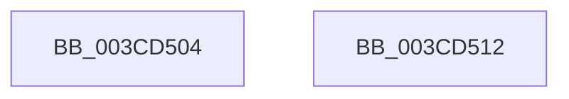

# CmpAllocatePool

- RVA: `0x003CD504`–`0x003CD513` (길이 `15` bytes)
- VA: `0x00000001403CD504`
- 실행 섹션: `.text`
- PDB 이름 있음: `예`; PDB Function 태그: `아니요`
- unwind 정보 RVA: `0x0005C788`
- 디코드: `5`개 명령, `15/15` bytes 표시
- 미해석 바이트: `0` (있으면 어셈블리에 `.byte`로 보존)

> 이 문서는 커널 이미지의 기계어와 PDB 기호를 분석해 생성했습니다. 4번과 5번은 함수 원형과 자료형을 바이너리 사용 방식에서 추정한 C 해석이며 원본 소스 복구 결과는 아닙니다.

## 1. Dependencies

- 직접 호출 지점: **1**; 고유 호출 대상: **1**
- 직접 호출자로 확인된 함수: **68**
- RIP 상대 이미지 참조: **0**

### Outgoing calls
- `0x003CD508` → [ExAllocatePool2](../../poolcode/B8/ExAllocatePool2_function_00B820F0.md) (function, `0x00B820F0`)

### Direct callers
- [ExAllocateFromLookasideListEx](ExAllocateFromLookasideListEx_function_003CD390.md) at `0x003CD406`
- [CmpInitializeLoadOptions](../66/CmpInitializeLoadOptions_function_0066A228.md) at `0x0066A285`
- [CmpReserveRollbackPacketSpace](../../page/70/CmpReserveRollbackPacketSpace_function_00703A5C.md) at `0x00703A9D`
- [CmpFinishSystemHivesLoad](../../page/7D/CmpFinishSystemHivesLoad_function_007DA210.md) at `0x007DA2F9`
- [CmpFinishSystemHivesLoad](../../page/7D/CmpFinishSystemHivesLoad_function_007DA210.md) at `0x007DA331`
- [CmpSaveBootControlSet](../../page/7D/CmpSaveBootControlSet_function_007DC744.md) at `0x007DC876`
- [CmpLoadHiveVolatile](../../page/7D/CmpLoadHiveVolatile_function_007DE5F0.md) at `0x007DE8AC`
- [CmpRefreshHive](../../page/7D/CmpRefreshHive_function_007DEAD0.md) at `0x007DEC44`
- [CmpReadBuildVersion](../../page/7E/CmpReadBuildVersion_function_007E52F4.md) at `0x007E53EB`
- [CmpReadBuildVersion](../../page/7E/CmpReadBuildVersion_function_007E52F4.md) at `0x007E543D`
- [CmpRecordShutdownStopTime](../../page/7E/CmpRecordShutdownStopTime_function_007E551C.md) at `0x007E556F`
- [CmpCreateRegistryProcessToken](../../page/7E/CmpCreateRegistryProcessToken_function_007E7F6C.md) at `0x007E7FF5`
- [CmReplaceKey](../../page/7E/CmReplaceKey_function_007EA1C8.md) at `0x007EA238`
- [CmpLockKeyBodyIntoMemory](../../page/7E/CmpLockKeyBodyIntoMemory_function_007EAF10.md) at `0x007EAF3B`
- [CmpCreateGlobalKeyLockEntry](../../page/7E/CmpCreateGlobalKeyLockEntry_function_007EDC88.md) at `0x007EDCAA`
- [CmpCreateSiloKeyLockEntry](../../page/7E/CmpCreateSiloKeyLockEntry_function_007EDCE4.md) at `0x007EDD06`
- [CmpDoReadTxRBigLogRecord](../../page/7F/CmpDoReadTxRBigLogRecord_function_007F0338.md) at `0x007F03A0`
- [CmpCopySyncTree](../../page/7F/CmpCopySyncTree_function_007F21A0.md) at `0x007F21D4`
- [CmpMergeKeyValues](../../page/7F/CmpMergeKeyValues_function_007F2304.md) at `0x007F23AE`
- [CmpGetValueForAudit](../../page/7F/CmpGetValueForAudit_function_007F37C0.md) at `0x007F3890`
- [CmpPromoteKey](../../page/84/CmpPromoteKey_function_00844388.md) at `0x0084442A`
- [CmSetValueKey](../../page/84/CmSetValueKey_function_008457C0.md) at `0x00846444`
- [CmSetValueKey](../../page/84/CmSetValueKey_function_008457C0.md) at `0x008465ED`
- [CmDeleteValueKey](../../page/84/CmDeleteValueKey_function_008476E8.md) at `0x00848245`
- [CmpStartKcbStackForTopLayerKcb](../../page/84/CmpStartKcbStackForTopLayerKcb_function_00848390.md) at `0x00848432`
- [CmpGetNameControlBlock](../../page/84/CmpGetNameControlBlock_function_0084A750.md) at `0x0084A894`
- [sub_0084BEDE](../../page/84/Unknown_function_0084BEDE.md) at `0x0084BF2A`
- [CmpMarkIndexDirty](../../page/84/CmpMarkIndexDirty_function_0084C30C.md) at `0x0084C392`
- [sub_0084D46C](../../page/84/Unknown_function_0084D46C.md) at `0x0084D47D`
- [sub_0084D499](../../page/84/Unknown_function_0084D499.md) at `0x0084D4AA`
- [CmpConstructNameFromKcbNameBlocks](../../page/84/CmpConstructNameFromKcbNameBlocks_function_0084D510.md) at `0x0084D558`
- [sub_00855882](../../page/85/Unknown_function_00855882.md) at `0x00855893`
- [sub_00855A3C](../../page/85/Unknown_function_00855A3C.md) at `0x00855A47`
- [sub_00855C81](../../page/85/Unknown_function_00855C81.md) at `0x00855C92`
- [CmpConstructNameWithStatus](../../page/85/CmpConstructNameWithStatus_function_008562A0.md) at `0x0085643A`
- [CmpConstructName](../../page/85/CmpConstructName_function_00856BE0.md) at `0x00856D6A`
- [sub_0085F25C](../../page/85/Unknown_function_0085F25C.md) at `0x0085F2BA`
- [CmpDoParseKey](../../page/85/CmpDoParseKey_function_0085F750.md) at `0x0086104B`
- [CmpDoParseKey](../../page/85/CmpDoParseKey_function_0085F750.md) at `0x00861074`
- [sub_0086FDC3](../../page/86/Unknown_function_0086FDC3.md) at `0x0086FE10`
- [CmpCheckOpenAccessOnKeyBody](../../page/87/CmpCheckOpenAccessOnKeyBody_function_00870000.md) at `0x008708AF`
- [CmpSecurityMethod](../../page/87/CmpSecurityMethod_function_00870CC0.md) at `0x008712D0`
- [CmpAllocateParseContext](../../page/87/CmpAllocateParseContext_function_008767B4.md) at `0x008767CA`
- [CmLoadAppKey](../../page/87/CmLoadAppKey_function_00876FFC.md) at `0x0087712A`
- [CmLoadKey](../../page/87/CmLoadKey_function_008787CC.md) at `0x008788A8`
- [CmLoadKey](../../page/87/CmLoadKey_function_008787CC.md) at `0x0087891A`
- [CmAllocateExtraParameter](../../page/93/CmAllocateExtraParameter_function_009370D8.md) at `0x009370EC`
- [CmpSubtreeEnumeratorStart](../../page/94/CmpSubtreeEnumeratorStart_function_009450E0.md) at `0x00945114`
- [CmpStartKcbStack](../../page/94/CmpStartKcbStack_function_009451F0.md) at `0x0094523A`
- [CmpKeyEnumStackStart](../../page/94/CmpKeyEnumStackStart_function_009452A0.md) at `0x00945313`
- [CmpStartKeyNodeStack](../../page/94/CmpStartKeyNodeStack_function_00945338.md) at `0x009453A3`
- [CmpEnumerateLayeredKey](../../page/94/CmpEnumerateLayeredKey_function_00945E58.md) at `0x00946098`
- [CmpKeyEnumStackCreateResumeContext](../../page/94/CmpKeyEnumStackCreateResumeContext_function_00948050.md) at `0x009480A6`
- [CmpKeyEnumStackCreateResumeContext](../../page/94/CmpKeyEnumStackCreateResumeContext_function_00948050.md) at `0x0094816A`
- [CmpSetSecurityDescriptorInfo](../../page/94/CmpSetSecurityDescriptorInfo_function_00949688.md) at `0x0094978C`
- [CmpBuildAdminInformation](../../page/9A/CmpBuildAdminInformation_function_009A8884.md) at `0x009A899E`
- [CmpLogTransactionAbortedWithChildName](../../page/9A/CmpLogTransactionAbortedWithChildName_function_009AED70.md) at `0x009AEE1C`
- [HvpPerformLogFileRecovery](../../page/9B/HvpPerformLogFileRecovery_function_009B7994.md) at `0x009B7B7B`
- [sub_009DC5D4](../../page/9D/Unknown_function_009DC5D4.md) at `0x009DC5E5`
- [CmpLightWeightPrepareSetValueKeyUoW](../../page/A0/CmpLightWeightPrepareSetValueKeyUoW_function_00A0EF28.md) at `0x00A0EFB2`
- [CmpLightWeightPrepareDeleteValueKeyUoW](../../page/A0/CmpLightWeightPrepareDeleteValueKeyUoW_function_00A0F3D8.md) at `0x00A0F442`
- [CmpLightWeightCreateSetValueData](../../page/A0/CmpLightWeightCreateSetValueData_function_00A0F7EC.md) at `0x00A0F82C`
- [CmpSortedValueEnumStackStartFromKeyNodeStack](../../page/A3/CmpSortedValueEnumStackStartFromKeyNodeStack_function_00A30CF0.md) at `0x00A30DB5`
- [CmpSortedValueEnumStackEntryStart](../../page/A3/CmpSortedValueEnumStackEntryStart_function_00A31110.md) at `0x00A3117B`
- [CmpSortedValueEnumStackEntryStart](../../page/A3/CmpSortedValueEnumStackEntryStart_function_00A31110.md) at `0x00A31197`
- [CmpLightWeightCreateModificationData](../../page/A5/CmpLightWeightCreateModificationData_function_00A54AE8.md) at `0x00A54B1F`
- [CmpDoFileWrite](../../page/A6/CmpDoFileWrite_function_00A65880.md) at `0x00A658D3`
- [HvpRecoverDataReadRoutine](../../page/A6/HvpRecoverDataReadRoutine_function_00A6DA60.md) at `0x00A6DAEC`
- [CmpAddToHiveFileList](../../page/A8/CmpAddToHiveFileList_function_00A81914.md) at `0x00A8196D`
- [sub_00B1845C](../../page/B1/Unknown_function_00B1845C.md) at `0x00B18529`
- [sub_00B3D5B8](../../page/B3/Unknown_function_00B3D5B8.md) at `0x00B3D5D5`
- [CmpDoAccessCheckOnSubtree](../../pagecmrc/BC/CmpDoAccessCheckOnSubtree_function_00BC9CD0.md) at `0x00BC9D3E`
- [CmpInitializeDriverStores](../../init/C5/CmpInitializeDriverStores_function_00C57CF0.md) at `0x00C57E58`
- [CmpInitializeSystemHive](../../init/C5/CmpInitializeSystemHive_function_00C58798.md) at `0x00C587D4`
- [CmGetSystemDriverList](../../init/C7/CmGetSystemDriverList_function_00C7380C.md) at `0x00C739A2`
- [CmGetSystemDriverList](../../init/C7/CmGetSystemDriverList_function_00C7380C.md) at `0x00C73A25`
- [CmGetSystemDriverList](../../init/C7/CmGetSystemDriverList_function_00C7380C.md) at `0x00C73B16`

### Static image references
- 디코드된 RIP-relative 메모리 참조가 없습니다.

## 2. Other-region calls and transfers

- 다른 실행 섹션으로 향하는 call: **1**
  - `0x003CD508` → [ExAllocatePool2](../../poolcode/B8/ExAllocatePool2_function_00B820F0.md) (`.text` → `POOLCODE`)
- 별도 외부 분기/꼬리 이동을 확인하지 못했습니다.

## 3. Assembly (complete function range)

```asm
003CD504  48 83 EC 28                     sub rsp, 0x28
003CD508  E8 E3 4B 7B 00                  call 0x140b820f0
003CD50D  48 83 C4 28                     add rsp, 0x28
003CD511  C3                              ret
003CD512  CC                              int3
```

## 4. C-style interpretation (structured pseudocode)

```c
__int64 __fastcall CmpAllocatePool(void)
{
    __int64 result;
    __int64 v_rsp;

    v_rsp = (v_rsp) - (40);
    result = ExAllocatePool2(a1, a2, a3, a4);
    v_rsp = (v_rsp) + (40);
    return result;
}
```

## 5. (Beta) C Style

```c
void CmpAllocatePool(void)
{
    int64_t result;
    int64_t local_rsp;

    local_rsp = (local_rsp) - (40);
    result = ExAllocatePool2(a1, a2, a3, a4);
    local_rsp = (local_rsp) + (40);
    return result;
}
```

## 6. Execution-region graph

[열기: 2D/3D 그래프와 함수 탐색 컨트롤 패널](../../../control-panel.html?section=text&rva=0x003CD504&view=graph)

- 2D 그래프는 위에서 아래로 흐르고, 3D 그래프는 빈 공간을 드래그해 회전합니다. Shift+드래그는 이동, 휠은 확대·축소, 함수 노드 선택은 대상 보고서 이동입니다.

### Static fallback


