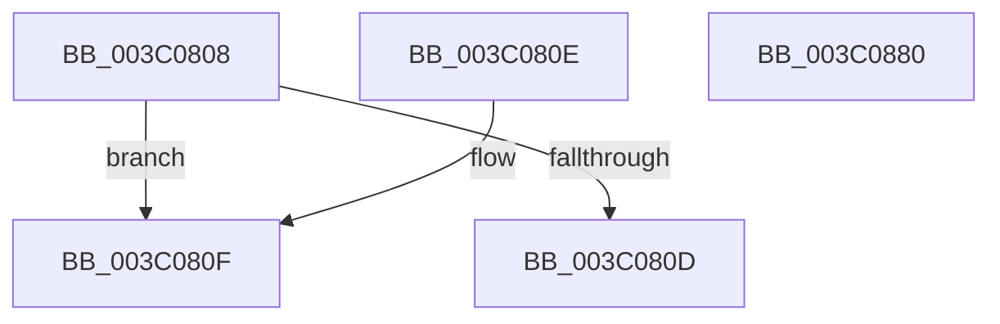

# EtwTraceIdealProcessor

- RVA: `0x003C0808`–`0x003C0881` (길이 `121` bytes)
- VA: `0x00000001403C0808`
- 실행 섹션: `.text`
- PDB 이름 있음: `예`; PDB Function 태그: `아니요`
- unwind 정보 RVA: `0x0008E000`
- 디코드: `28`개 명령, `121/121` bytes 표시
- 미해석 바이트: `0` (있으면 어셈블리에 `.byte`로 보존)

> 이 문서는 커널 이미지의 기계어와 PDB 기호를 분석해 생성했습니다. 4번과 5번은 함수 원형과 자료형을 바이너리 사용 방식에서 추정한 C 해석이며 원본 소스 복구 결과는 아닙니다.

## 1. Dependencies

- 직접 호출 지점: **2**; 고유 호출 대상: **2**
- 직접 호출자로 확인된 함수: **10**
- RIP 상대 이미지 참조: **1**

### Outgoing calls
- `0x003C0869` → [EtwTraceKernelEvent](../23/EtwTraceKernelEvent_function_00235350.md) (function, `0x00235350`)
- `0x003C0876` → [_security_check_cookie](../6A/_security_check_cookie_function_006AC640.md) (function, `0x006AC640`)

### Direct callers
- [KiQueueReadyThread](../21/KiQueueReadyThread_function_0021C7B0.md) at `0x0021D345`
- [sub_0021D7F8](../21/Unknown_function_0021D7F8.md) at `0x0021E0A0`
- [sub_002546EC](../25/Unknown_function_002546EC.md) at `0x00255350`
- [KiSetAffinityThread](../2C/KiSetAffinityThread_function_002CE010.md) at `0x002CE3A2`
- [KiSetAffinityThread](../2C/KiSetAffinityThread_function_002CE010.md) at `0x002CE3CE`
- [KeSetIdealProcessorThreadEx](../2D/KeSetIdealProcessorThreadEx_function_002DD36C.md) at `0x002DD455`
- [KeSetIdealProcessorThreadEx](../2D/KeSetIdealProcessorThreadEx_function_002DD36C.md) at `0x002DD474`
- [KiUpdateThreadCpuSets](../30/KiUpdateThreadCpuSets_function_0030313C.md) at `0x00303251`
- [KiUpdateGlobalCpuSetConfiguration](../30/KiUpdateGlobalCpuSetConfiguration_function_00305AB8.md) at `0x00305EBE`
- [KiSetSystemAffinityThread](../39/KiSetSystemAffinityThread_function_003993E0.md) at `0x00399A07`
- [KeStartThread](KeStartThread_function_003C21B8.md) at `0x003C25D9`
- [KeStartThread](KeStartThread_function_003C21B8.md) at `0x003C263A`
- [sub_006FAFDA](../6F/Unknown_function_006FAFDA.md) at `0x006FB0A6`

### Static image references
- `0x003C0813` → RVA `0x00E0A740` (`.data`; read)

## 2. Other-region calls and transfers

- 다른 실행 섹션으로 향하는 call: **0**
- 별도 외부 분기/꼬리 이동을 확인하지 못했습니다.

## 3. Assembly (complete function range)

```asm
003C0808  45 3B C1                        cmp r8d, r9d
003C080B  75 02                           jne 0x1403c080f
003C080D  C3                              ret
003C080E  CC                              int3
003C080F  48 83 EC 68                     sub rsp, 0x68
003C0813  48 8B 05 26 9F A4 00            mov rax, qword ptr [rip + 0xa49f26]
003C081A  48 33 C4                        xor rax, rsp
003C081D  48 89 44 24 50                  mov qword ptr [rsp + 0x50], rax
003C0822  8B 81 10 05 00 00               mov eax, dword ptr [rcx + 0x510]
003C0828  48 8D 4C 24 40                  lea rcx, [rsp + 0x40]
003C082D  83 64 24 4C 00                  and dword ptr [rsp + 0x4c], 0
003C0832  89 44 24 30                     mov dword ptr [rsp + 0x30], eax
003C0836  48 8D 44 24 30                  lea rax, [rsp + 0x30]
003C083B  44 89 4C 24 38                  mov dword ptr [rsp + 0x38], r9d
003C0840  44 0F B7 CA                     movzx r9d, dx
003C0844  44 89 44 24 34                  mov dword ptr [rsp + 0x34], r8d
003C0849  BA 01 00 00 00                  mov edx, 1
003C084E  41 B8 00 00 00 88               mov r8d, 0x88000000
003C0854  48 89 44 24 40                  mov qword ptr [rsp + 0x40], rax
003C0859  C7 44 24 48 0C 00 00 00         mov dword ptr [rsp + 0x48], 0xc
003C0861  C7 44 24 20 03 19 60 01         mov dword ptr [rsp + 0x20], 0x1601903
003C0869  E8 E2 4A E7 FF                  call 0x140235350
003C086E  48 8B 4C 24 50                  mov rcx, qword ptr [rsp + 0x50]
003C0873  48 33 CC                        xor rcx, rsp
003C0876  E8 C5 BD 2E 00                  call 0x1406ac640
003C087B  48 83 C4 68                     add rsp, 0x68
003C087F  C3                              ret
003C0880  CC                              int3
```

## 4. C-style interpretation (structured pseudocode)

```c
__int64 __fastcall EtwTraceIdealProcessor(__int64 a1, unsigned __int16 a2, int a3, int a4)
{
    __int64 result;
    __int64 v_rsp;
    unsigned __int64 v_stack_m18;
    unsigned int v_stack_m1C;
    unsigned int v_stack_m20;
    unsigned __int64 v_stack_m28;
    unsigned int v_stack_m30;
    unsigned int v_stack_m34;
    unsigned int v_stack_m38;
    unsigned int v_stack_m48;

    if (a3 != a4) goto loc_003C080F;
    return result;
loc_003C080F:
    v_rsp = (v_rsp) - (104);
    result = (*(unsigned __int64 *)(v_rip + 10788646)) ^ (v_rsp);
    v_stack_m18 = result;
    v_stack_m38 = (unsigned int)((unsigned int)(*(unsigned int *)(a1 + 1296)));
    v_stack_m30 = a4;
    v_stack_m34 = a3;
    v_stack_m28 = v_stack_m38;
    v_stack_m20 = 12;
    v_stack_m48 = 0x1601903ULL;
    result = EtwTraceKernelEvent(v_stack_m28, 1, (unsigned int)(0x88000000ULL), a2);
    a1 = (v_stack_m18) ^ (v_rsp);
    result = _security_check_cookie(a1, 1, (unsigned int)(0x88000000ULL), a2);
    v_rsp = (v_rsp) + (104);
    return result;
}
```

## 5. (Beta) C Style

```c
int64_t EtwTraceIdealProcessor(void *Arg1, uint16_t Arg2, int32_t Arg3, int32_t Arg4)
{
    uint8_t *arg1 = (uint8_t *)Arg1;

    int64_t result;
    int64_t local_rsp;
    uint64_t v_stack_m18;
    uint32_t v_stack_m1C;
    uint32_t v_stack_m20;
    uint64_t v_stack_m28;
    uint32_t v_stack_m30;
    uint32_t v_stack_m34;
    uint32_t v_stack_m38;
    uint32_t v_stack_m48;

    if (Arg3 != Arg4) goto loc_003C080F;
    return result;
loc_003C080F:
    local_rsp = (local_rsp) - (104);
    result = (*(uint64_t *)(v_rip + 0xA49F26)) ^ (local_rsp);
    v_stack_m18 = result;
    v_stack_m38 = (uint32_t)((uint32_t)(*(uint32_t *)(arg1 + 0x510)));
    v_stack_m30 = Arg4;
    v_stack_m34 = Arg3;
    v_stack_m28 = v_stack_m38;
    v_stack_m20 = 12;
    v_stack_m48 = 0x1601903ULL;
    result = EtwTraceKernelEvent(v_stack_m28, 1, (uint32_t)(0x88000000ULL), Arg2);
    Arg1 = (v_stack_m18) ^ (local_rsp);
    result = _security_check_cookie(Arg1, 1, (uint32_t)(0x88000000ULL), Arg2);
    local_rsp = (local_rsp) + (104);
    return result;
}
```

### 관측된 메모리 오프셋

구조체 형식이 확인되지 않은 접근은 인자 기준의 오프셋으로만 기록했습니다.

| 기준 인자 | 오프셋 표현 | 폭 (bit) | 접근 |
|---|---:|---:|---|
| `Arg1` | `+ 0x510` | `32` | `R` |

## 6. Execution-region graph

[열기: 2D/3D 그래프와 함수 탐색 컨트롤 패널](../../../control-panel.html?section=text&rva=0x003C0808&view=graph)

- 2D 그래프는 위에서 아래로 흐르고, 3D 그래프는 빈 공간을 드래그해 회전합니다. Shift+드래그는 이동, 휠은 확대·축소, 함수 노드 선택은 대상 보고서 이동입니다.

### Static fallback


