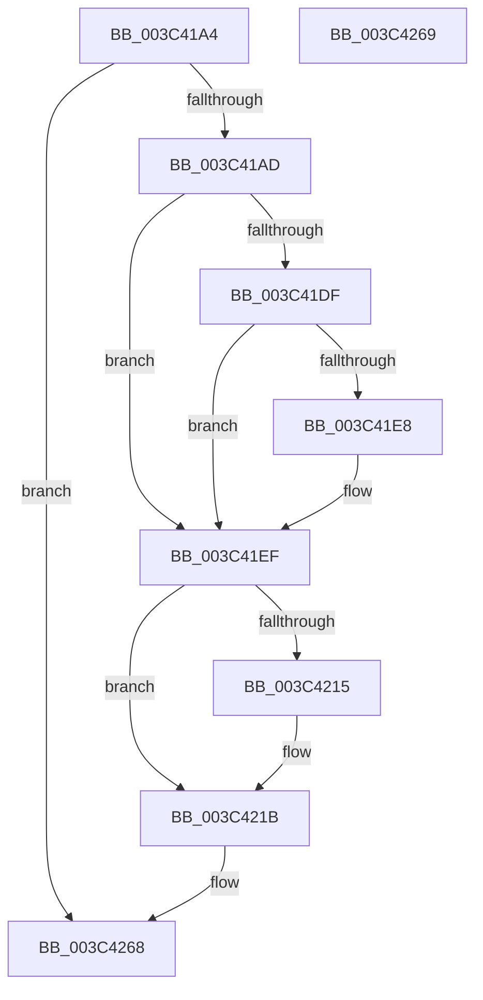

# EtwTracePriority

- RVA: `0x003C41A4`–`0x003C426A` (길이 `198` bytes)
- VA: `0x00000001403C41A4`
- 실행 섹션: `.text`
- PDB 이름 있음: `예`; PDB Function 태그: `아니요`
- unwind 정보 RVA: `0x0008E398`
- 디코드: `51`개 명령, `198/198` bytes 표시
- 미해석 바이트: `0` (있으면 어셈블리에 `.byte`로 보존)

> 이 문서는 커널 이미지의 기계어와 PDB 기호를 분석해 생성했습니다. 4번과 5번은 함수 원형과 자료형을 바이너리 사용 방식에서 추정한 C 해석이며 원본 소스 복구 결과는 아닙니다.

## 1. Dependencies

- 직접 호출 지점: **3**; 고유 호출 대상: **3**
- 직접 호출자로 확인된 함수: **9**
- RIP 상대 이미지 참조: **2**

### Outgoing calls
- `0x003C41EA` → [EtwpPsProvTracePriority](EtwpPsProvTracePriority_function_003C4270.md) (function, `0x003C4270`)
- `0x003C424E` → [EtwTraceKernelEvent](../23/EtwTraceKernelEvent_function_00235350.md) (function, `0x00235350`)
- `0x003C425B` → [_security_check_cookie](../6A/_security_check_cookie_function_006AC640.md) (function, `0x006AC640`)

### Direct callers
- [KeSetPriorityThread](../2C/KeSetPriorityThread_function_002C76E0.md) at `0x002C7933`
- [KeSetPriorityAndQuantumProcess](KeSetPriorityAndQuantumProcess_function_003C2EC0.md) at `0x003C3340`
- [KeSetPriorityAndQuantumProcess](KeSetPriorityAndQuantumProcess_function_003C2EC0.md) at `0x003C336E`
- [KeSetPriorityAndQuantumProcess](KeSetPriorityAndQuantumProcess_function_003C2EC0.md) at `0x003C3414`
- [IoApplyPriorityInfoThread](IoApplyPriorityInfoThread_function_003C3EC0.md) at `0x003C3F4E`
- [PsSetIoPriorityThread](PsSetIoPriorityThread_function_003C3FBC.md) at `0x003C4023`
- [PsSetPagePriorityThread](PsSetPagePriorityThread_function_003C4138.md) at `0x003C418F`
- [KeSetActualBasePriorityThread](KeSetActualBasePriorityThread_function_003C4370.md) at `0x003C4550`
- [KeSetBasePriorityThread](KeSetBasePriorityThread_function_003C6EB0.md) at `0x003C7192`
- [KeBoostPriorityThread](../4D/KeBoostPriorityThread_function_004D37F8.md) at `0x004D39EE`
- [sub_006E7EC2](../6E/Unknown_function_006E7EC2.md) at `0x006E7FF8`

### Static image references
- `0x003C41B5` → RVA `0x00E0A740` (`.data`; read)
- `0x003C41C4` → RVA `0x00FC6AA8` (`ALMOSTRO`; read)

## 2. Other-region calls and transfers

- 다른 실행 섹션으로 향하는 call: **0**
- 별도 외부 분기/꼬리 이동을 확인하지 못했습니다.

## 3. Assembly (complete function range)

```asm
003C41A4  45 3B C1                        cmp r8d, r9d
003C41A7  0F 84 BB 00 00 00               je 0x1403c4268
003C41AD  53                              push rbx
003C41AE  55                              push rbp
003C41AF  56                              push rsi
003C41B0  57                              push rdi
003C41B1  48 83 EC 58                     sub rsp, 0x58
003C41B5  48 8B 05 84 65 A4 00            mov rax, qword ptr [rip + 0xa46584]
003C41BC  48 33 C4                        xor rax, rsp
003C41BF  48 89 44 24 48                  mov qword ptr [rsp + 0x48], rax
003C41C4  48 8B 05 DD 28 C0 00            mov rax, qword ptr [rip + 0xc028dd]
003C41CB  41 8B F9                        mov edi, r9d
003C41CE  0F B7 EA                        movzx ebp, dx
003C41D1  41 8B D8                        mov ebx, r8d
003C41D4  48 8B F1                        mov rsi, rcx
003C41D7  48 05 CC 12 00 00               add rax, 0x12cc
003C41DD  74 10                           je 0x1403c41ef
003C41DF  F7 40 04 00 20 00 00            test dword ptr [rax + 4], 0x2000
003C41E6  74 07                           je 0x1403c41ef
003C41E8  8B D5                           mov edx, ebp
003C41EA  E8 81 00 00 00                  call 0x1403c4270
003C41EF  8B 86 10 05 00 00               mov eax, dword ptr [rsi + 0x510]
003C41F5  66 83 64 24 36 00               and word ptr [rsp + 0x36], 0
003C41FB  89 44 24 30                     mov dword ptr [rsp + 0x30], eax
003C41FF  48 8B 84 24 A0 00 00 00         mov rax, qword ptr [rsp + 0xa0]
003C4207  88 5C 24 34                     mov byte ptr [rsp + 0x34], bl
003C420B  40 88 7C 24 35                  mov byte ptr [rsp + 0x35], dil
003C4210  48 85 C0                        test rax, rax
003C4213  74 06                           je 0x1403c421b
003C4215  8A 00                           mov al, byte ptr [rax]
003C4217  88 44 24 36                     mov byte ptr [rsp + 0x36], al
003C421B  83 64 24 44 00                  and dword ptr [rsp + 0x44], 0
003C4220  48 8D 44 24 30                  lea rax, [rsp + 0x30]
003C4225  44 0F B7 CD                     movzx r9d, bp
003C4229  48 89 44 24 38                  mov qword ptr [rsp + 0x38], rax
003C422E  BA 01 00 00 00                  mov edx, 1
003C4233  C7 44 24 40 08 00 00 00         mov dword ptr [rsp + 0x40], 8
003C423B  41 B8 00 20 00 20               mov r8d, 0x20002000
003C4241  C7 44 24 20 03 19 60 01         mov dword ptr [rsp + 0x20], 0x1601903
003C4249  48 8D 4C 24 38                  lea rcx, [rsp + 0x38]
003C424E  E8 FD 10 E7 FF                  call 0x140235350
003C4253  48 8B 4C 24 48                  mov rcx, qword ptr [rsp + 0x48]
003C4258  48 33 CC                        xor rcx, rsp
003C425B  E8 E0 83 2E 00                  call 0x1406ac640
003C4260  48 83 C4 58                     add rsp, 0x58
003C4264  5F                              pop rdi
003C4265  5E                              pop rsi
003C4266  5D                              pop rbp
003C4267  5B                              pop rbx
003C4268  C3                              ret
003C4269  CC                              int3
```

## 4. C-style interpretation (structured pseudocode)

```c
__int64 __fastcall EtwTracePriority(__int64 a1, unsigned __int16 a2, int a3, int a4, __int64 a5)
{
    __int64 result;
    __int64 v_rsp;
    unsigned __int64 v_stack_m30;
    unsigned int v_stack_m34;
    unsigned int v_stack_m38;
    unsigned __int64 v_stack_m40;
    unsigned __int16 v_stack_m42;
    unsigned __int8 v_stack_m43;
    unsigned __int8 v_stack_m44;
    unsigned int v_stack_m48;
    unsigned int v_stack_m58;

    if (a3 == a4) goto loc_003C4268;
    v_rsp = (v_rsp) - (88);
    result = (*(unsigned __int64 *)(v_rip + 10773892)) ^ (v_rsp);
    v_stack_m30 = result;
    result = (*(unsigned __int64 *)(v_rip + 12593373)) + (0x12CCULL);
    if (condition_is_equal) goto loc_003C41EF;
    if (((*(unsigned int *)(result + 4)) & (0x2000ULL)) != 0) {
        a2 = a2;
        result = EtwpPsProvTracePriority(a1, a2, a3, a4);
    }
    v_stack_m48 = (unsigned int)((unsigned int)(*(unsigned int *)(a1 + 1296)));
    v_stack_m44 = (unsigned __int8)((unsigned int)(a3));
    v_stack_m43 = (unsigned __int8)((unsigned int)(a4));
    result = a5;
    if (a5 != 0) {
        result = *(unsigned __int8 *)(a5);
        v_stack_m42 = (unsigned __int8)(result);
    }
    v_stack_m40 = v_stack_m48;
    v_stack_m38 = 8;
    v_stack_m58 = 0x1601903ULL;
    result = EtwTraceKernelEvent(v_stack_m40, 1, (unsigned int)(0x20002000ULL), a2);
    a1 = (v_stack_m30) ^ (v_rsp);
    result = _security_check_cookie(a1, 1, (unsigned int)(0x20002000ULL), a2);
    v_rsp = (v_rsp) + (88);
loc_003C4268:
    return result;
}
```

## 5. (Beta) C Style

```c
int64_t EtwTracePriority(void *Arg1, uint16_t Arg2, int32_t Arg3, int32_t Arg4, int64_t Arg5)
{
    uint8_t *arg1 = (uint8_t *)Arg1;

    int64_t result;
    int64_t local_rsp;
    uint64_t v_stack_m30;
    uint32_t v_stack_m34;
    uint32_t v_stack_m38;
    uint64_t v_stack_m40;
    uint16_t v_stack_m42;
    uint8_t v_stack_m43;
    uint8_t v_stack_m44;
    uint32_t v_stack_m48;
    uint32_t v_stack_m58;

    if (Arg3 == Arg4) goto loc_003C4268;
    local_rsp = (local_rsp) - (88);
    result = (*(uint64_t *)(v_rip + 0xA46584)) ^ (local_rsp);
    v_stack_m30 = result;
    result = (*(uint64_t *)(v_rip + 0xC028DD)) + (0x12CCULL);
    if (condition_is_equal) goto loc_003C41EF;
    if (((*(uint32_t *)(result + 0x4)) & (0x2000ULL)) != 0) {
        Arg2 = Arg2;
        result = EtwpPsProvTracePriority(Arg1, Arg2, Arg3, Arg4);
    }
    v_stack_m48 = (uint32_t)((uint32_t)(*(uint32_t *)(arg1 + 0x510)));
    v_stack_m44 = (uint8_t)((uint32_t)(Arg3));
    v_stack_m43 = (uint8_t)((uint32_t)(Arg4));
    result = Arg5;
    if (Arg5 != 0) {
        result = *(uint8_t *)(Arg5);
        v_stack_m42 = (uint8_t)(result);
    }
    v_stack_m40 = v_stack_m48;
    v_stack_m38 = 8;
    v_stack_m58 = 0x1601903ULL;
    result = EtwTraceKernelEvent(v_stack_m40, 1, (uint32_t)(0x20002000ULL), Arg2);
    Arg1 = (v_stack_m30) ^ (local_rsp);
    result = _security_check_cookie(Arg1, 1, (uint32_t)(0x20002000ULL), Arg2);
    local_rsp = (local_rsp) + (88);
loc_003C4268:
    return result;
}
```

### 관측된 메모리 오프셋

구조체 형식이 확인되지 않은 접근은 인자 기준의 오프셋으로만 기록했습니다.

| 기준 인자 | 오프셋 표현 | 폭 (bit) | 접근 |
|---|---:|---:|---|
| `Arg1` | `+ 0x510` | `32` | `R` |

## 6. Execution-region graph

[열기: 2D/3D 그래프와 함수 탐색 컨트롤 패널](../../../control-panel.html?section=text&rva=0x003C41A4&view=graph)

- 2D 그래프는 위에서 아래로 흐르고, 3D 그래프는 빈 공간을 드래그해 회전합니다. Shift+드래그는 이동, 휠은 확대·축소, 함수 노드 선택은 대상 보고서 이동입니다.

### Static fallback


