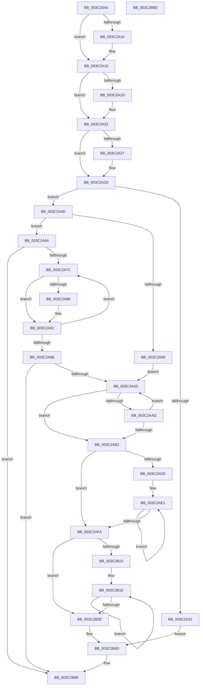

# EtwTraceThreadAffinity

- RVA: `0x003C29A0`–`0x003C2BB3` (길이 `531` bytes)
- VA: `0x00000001403C29A0`
- 실행 섹션: `.text`
- PDB 이름 있음: `예`; PDB Function 태그: `아니요`
- unwind 정보 RVA: `0x0007FBF4`
- 디코드: `147`개 명령, `531/531` bytes 표시
- 미해석 바이트: `0` (있으면 어셈블리에 `.byte`로 보존)

> 이 문서는 커널 이미지의 기계어와 PDB 기호를 분석해 생성했습니다. 4번과 5번은 함수 원형과 자료형을 바이너리 사용 방식에서 추정한 C 해석이며 원본 소스 복구 결과는 아닙니다.

## 1. Dependencies

- 직접 호출 지점: **8**; 고유 호출 대상: **7**
- 직접 호출자로 확인된 함수: **9**
- RIP 상대 이미지 참조: **2**

### Outgoing calls
- `0x003C2A00` → [KeIsEqualAffinityEx](../30/KeIsEqualAffinityEx_function_00305230.md) (function, `0x00305230`)
- `0x003C2A4D` → [Feature_AffinityLogSkipEmptyAffinity__private_IsEnabledDeviceUsageNoInline](../65/Feature_AffinityLogSkipEmptyAffinity__private_IsEnabledDeviceUsageNoInline_function_006512B8.md) (function, `0x006512B8`)
- `0x003C2A5D` → [KeComputeGroupMask](../4A/KeComputeGroupMask_function_004A2ECC.md) (function, `0x004A2ECC`)
- `0x003C2AB9` → [KeFindFirstSetRightGroupMask](../25/KeFindFirstSetRightGroupMask_function_00256BE4.md) (function, `0x00256BE4`)
- `0x003C2AD2` → [KeCountSetBitsGroupMask](../41/KeCountSetBitsGroupMask_function_00418AD4.md) (function, `0x00418AD4`)
- `0x003C2AE5` → [KeFindFirstSetRightGroupMask](../25/KeFindFirstSetRightGroupMask_function_00256BE4.md) (function, `0x00256BE4`)
- `0x003C2B80` → [EtwTraceKernelEvent](../23/EtwTraceKernelEvent_function_00235350.md) (function, `0x00235350`)
- `0x003C2B8C` → [_security_check_cookie](../6A/_security_check_cookie_function_006AC640.md) (function, `0x006AC640`)

### Direct callers
- [KiQueueReadyThread](../21/KiQueueReadyThread_function_0021C7B0.md) at `0x0021D323`
- [sub_0021D7F8](../21/Unknown_function_0021D7F8.md) at `0x0021E079`
- [sub_002546EC](../25/Unknown_function_002546EC.md) at `0x0025511F`
- [KiSetAffinityThread](../2C/KiSetAffinityThread_function_002CE010.md) at `0x002CE350`
- [KiSetAffinityThread](../2C/KiSetAffinityThread_function_002CE010.md) at `0x002CE381`
- [KiUpdateThreadCpuSets](../30/KiUpdateThreadCpuSets_function_0030313C.md) at `0x0030322D`
- [KiUpdateGlobalCpuSetConfiguration](../30/KiUpdateGlobalCpuSetConfiguration_function_00305AB8.md) at `0x00305E04`
- [KiSetSystemAffinityThread](../39/KiSetSystemAffinityThread_function_003993E0.md) at `0x00399A52`
- [KeStartThread](KeStartThread_function_003C21B8.md) at `0x003C258C`
- [KeTraceThreadAffinityRundown](../5C/KeTraceThreadAffinityRundown_function_005C379C.md) at `0x005C37DE`

### Static image references
- `0x003C29C3` → RVA `0x00E0A740` (`.data`; read)
- `0x003C29EF` → RVA `0x00FC7120` (`ALMOSTRO`; read)

## 2. Other-region calls and transfers

- 다른 실행 섹션으로 향하는 call: **0**
- 별도 외부 분기/꼬리 이동을 확인하지 못했습니다.

## 3. Assembly (complete function range)

```asm
003C29A0  48 8B C4                        mov rax, rsp
003C29A3  48 89 58 08                     mov qword ptr [rax + 8], rbx
003C29A7  48 89 70 10                     mov qword ptr [rax + 0x10], rsi
003C29AB  48 89 78 18                     mov qword ptr [rax + 0x18], rdi
003C29AF  4C 89 60 20                     mov qword ptr [rax + 0x20], r12
003C29B3  55                              push rbp
003C29B4  41 56                           push r14
003C29B6  41 57                           push r15
003C29B8  48 8D 68 B1                     lea rbp, [rax - 0x4f]
003C29BC  48 81 EC A0 00 00 00            sub rsp, 0xa0
003C29C3  48 8B 05 76 7D A4 00            mov rax, qword ptr [rip + 0xa47d76]
003C29CA  48 33 C4                        xor rax, rsp
003C29CD  48 89 45 27                     mov qword ptr [rbp + 0x27], rax
003C29D1  8B 81 10 05 00 00               mov eax, dword ptr [rcx + 0x510]
003C29D7  0F 57 C0                        xorps xmm0, xmm0
003C29DA  4C 8B 75 77                     mov r14, qword ptr [rbp + 0x77]
003C29DE  45 33 FF                        xor r15d, r15d
003C29E1  4C 89 7D C7                     mov qword ptr [rbp - 0x39], r15
003C29E5  49 8B CE                        mov rcx, r14
003C29E8  66 89 55 CB                     mov word ptr [rbp - 0x35], dx
003C29EC  41 8A F1                        mov sil, r9b
003C29EF  48 8D 15 2A 47 C0 00            lea rdx, [rip + 0xc0472a]
003C29F6  89 45 C7                        mov dword ptr [rbp - 0x39], eax
003C29F9  41 8A F8                        mov dil, r8b
003C29FC  0F 11 45 D7                     movups xmmword ptr [rbp - 0x29], xmm0
003C2A00  E8 2B 28 F4 FF                  call 0x140305230
003C2A05  8A 4D CD                        mov cl, byte ptr [rbp - 0x33]
003C2A08  45 8D 67 01                     lea r12d, [r15 + 1]
003C2A0C  85 C0                           test eax, eax
003C2A0E  74 06                           je 0x1403c2a16
003C2A10  41 0A CC                        or cl, r12b
003C2A13  88 4D CD                        mov byte ptr [rbp - 0x33], cl
003C2A16  B3 02                           mov bl, 2
003C2A18  40 84 FF                        test dil, dil
003C2A1B  74 05                           je 0x1403c2a22
003C2A1D  0A CB                           or cl, bl
003C2A1F  88 4D CD                        mov byte ptr [rbp - 0x33], cl
003C2A22  40 84 F6                        test sil, sil
003C2A25  74 06                           je 0x1403c2a2d
003C2A27  80 C9 04                        or cl, 4
003C2A2A  88 4D CD                        mov byte ptr [rbp - 0x33], cl
003C2A2D  85 C0                           test eax, eax
003C2A2F  74 1C                           je 0x1403c2a4d
003C2A31  48 8D 45 C7                     lea rax, [rbp - 0x39]
003C2A35  48 C7 45 EF 08 00 00 00         mov qword ptr [rbp - 0x11], 8
003C2A3D  48 89 45 E7                     mov qword ptr [rbp - 0x19], rax
003C2A41  48 8D 4D E7                     lea rcx, [rbp - 0x19]
003C2A45  41 8B D4                        mov edx, r12d
003C2A48  E9 20 01 00 00                  jmp 0x1403c2b6d
003C2A4D  E8 66 E8 28 00                  call 0x1406512b8
003C2A52  85 C0                           test eax, eax
003C2A54  75 0E                           jne 0x1403c2a64
003C2A56  48 8D 55 D7                     lea rdx, [rbp - 0x29]
003C2A5A  49 8B CE                        mov rcx, r14
003C2A5D  E8 6A 04 0E 00                  call 0x1404a2ecc
003C2A62  EB 3F                           jmp 0x1403c2aa3
003C2A64  0F 57 C0                        xorps xmm0, xmm0
003C2A67  41 8A D4                        mov dl, r12b
003C2A6A  41 0F B7 C7                     movzx eax, r15w
003C2A6E  0F 11 45 D7                     movups xmmword ptr [rbp - 0x29], xmm0
003C2A72  66 45 3B 3E                     cmp r15w, word ptr [r14]
003C2A76  0F 83 09 01 00 00               jae 0x1403c2b85
003C2A7C  0F B7 C8                        movzx ecx, ax
003C2A7F  4D 39 7C CE 08                  cmp qword ptr [r14 + rcx*8 + 8], r15
003C2A84  74 0B                           je 0x1403c2a91
003C2A86  4C 8D 45 D7                     lea r8, [rbp - 0x29]
003C2A8A  41 8A D7                        mov dl, r15b
003C2A8D  49 0F AB 08                     bts qword ptr [r8], rcx
003C2A91  66 41 03 C4                     add ax, r12w
003C2A95  66 41 3B 06                     cmp ax, word ptr [r14]
003C2A99  72 E1                           jb 0x1403c2a7c
003C2A9B  84 D2                           test dl, dl
003C2A9D  0F 85 E2 00 00 00               jne 0x1403c2b85
003C2AA3  0F B6 C3                        movzx eax, bl
003C2AA6  4C 39 7C C5 CF                  cmp qword ptr [rbp + rax*8 - 0x31], r15
003C2AAB  75 05                           jne 0x1403c2ab2
003C2AAD  80 C3 FF                        add bl, 0xff
003C2AB0  75 F1                           jne 0x1403c2aa3
003C2AB2  48 8D 4D D7                     lea rcx, [rbp - 0x29]
003C2AB6  88 5D CE                        mov byte ptr [rbp - 0x32], bl
003C2AB9  E8 26 41 E9 FF                  call 0x140256be4
003C2ABE  0F 28 45 D7                     movaps xmm0, xmmword ptr [rbp - 0x29]
003C2AC2  48 8D 4D E7                     lea rcx, [rbp - 0x19]
003C2AC6  66 0F 7F 45 E7                  movdqa xmmword ptr [rbp - 0x19], xmm0
003C2ACB  41 0F B7 FF                     movzx edi, r15w
003C2ACF  0F B7 F0                        movzx esi, ax
003C2AD2  E8 FD 5F 05 00                  call 0x140418ad4
003C2AD7  66 44 3B F8                     cmp r15w, ax
003C2ADB  73 1D                           jae 0x1403c2afa
003C2ADD  44 0F B7 D8                     movzx r11d, ax
003C2AE1  48 8D 4D E7                     lea rcx, [rbp - 0x19]
003C2AE5  E8 FA 40 E9 FF                  call 0x140256be4
003C2AEA  0F B7 F8                        movzx edi, ax
003C2AED  48 8D 45 E7                     lea rax, [rbp - 0x19]
003C2AF1  48 0F B3 38                     btr qword ptr [rax], rdi
003C2AF5  4D 2B DC                        sub r11, r12
003C2AF8  75 E7                           jne 0x1403c2ae1
003C2AFA  0F B7 CF                        movzx ecx, di
003C2AFD  4D 8D 46 08                     lea r8, [r14 + 8]
003C2B01  66 2B CE                        sub cx, si
003C2B04  4D 8D 04 F0                     lea r8, [r8 + rsi*8]
003C2B08  66 41 03 CC                     add cx, r12w
003C2B0C  66 41 03 F4                     add si, r12w
003C2B10  66 3B F7                        cmp si, di
003C2B13  73 19                           jae 0x1403c2b2e
003C2B15  66 2B FE                        sub di, si
003C2B18  0F B7 C6                        movzx eax, si
003C2B1B  0F B7 D7                        movzx edx, di
003C2B1E  4C 8D 4D D7                     lea r9, [rbp - 0x29]
003C2B22  49 0F AB 01                     bts qword ptr [r9], rax
003C2B26  49 03 C4                        add rax, r12
003C2B29  49 2B D4                        sub rdx, r12
003C2B2C  75 F0                           jne 0x1403c2b1e
003C2B2E  48 8D 45 C7                     lea rax, [rbp - 0x39]
003C2B32  48 C7 45 FF 08 00 00 00         mov qword ptr [rbp - 1], 8
003C2B3A  48 89 45 F7                     mov qword ptr [rbp - 9], rax
003C2B3E  BA 03 00 00 00                  mov edx, 3
003C2B43  48 8D 45 D7                     lea rax, [rbp - 0x29]
003C2B47  44 89 7D 13                     mov dword ptr [rbp + 0x13], r15d
003C2B4B  48 89 45 07                     mov qword ptr [rbp + 7], rax
003C2B4F  0F B6 C3                        movzx eax, bl
003C2B52  C1 E0 03                        shl eax, 3
003C2B55  89 45 0F                        mov dword ptr [rbp + 0xf], eax
003C2B58  0F B7 C1                        movzx eax, cx
003C2B5B  48 8D 4D F7                     lea rcx, [rbp - 9]
003C2B5F  C1 E0 03                        shl eax, 3
003C2B62  89 45 1F                        mov dword ptr [rbp + 0x1f], eax
003C2B65  4C 89 45 17                     mov qword ptr [rbp + 0x17], r8
003C2B69  44 89 7D 23                     mov dword ptr [rbp + 0x23], r15d
003C2B6D  44 0F B7 4D 7F                  movzx r9d, word ptr [rbp + 0x7f]
003C2B72  41 B8 00 10 00 20               mov r8d, 0x20001000
003C2B78  C7 44 24 20 02 1B 60 00         mov dword ptr [rsp + 0x20], 0x601b02
003C2B80  E8 CB 27 E7 FF                  call 0x140235350
003C2B85  48 8B 4D 27                     mov rcx, qword ptr [rbp + 0x27]
003C2B89  48 33 CC                        xor rcx, rsp
003C2B8C  E8 AF 9A 2E 00                  call 0x1406ac640
003C2B91  4C 8D 9C 24 A0 00 00 00         lea r11, [rsp + 0xa0]
003C2B99  49 8B 5B 20                     mov rbx, qword ptr [r11 + 0x20]
003C2B9D  49 8B 73 28                     mov rsi, qword ptr [r11 + 0x28]
003C2BA1  49 8B 7B 30                     mov rdi, qword ptr [r11 + 0x30]
003C2BA5  4D 8B 63 38                     mov r12, qword ptr [r11 + 0x38]
003C2BA9  49 8B E3                        mov rsp, r11
003C2BAC  41 5F                           pop r15
003C2BAE  41 5E                           pop r14
003C2BB0  5D                              pop rbp
003C2BB1  C3                              ret
003C2BB2  CC                              int3
```

## 4. C-style interpretation (structured pseudocode)

```c
__int64 __fastcall EtwTraceThreadAffinity(__int64 a1, unsigned __int16 a2, unsigned __int8 a3, unsigned __int8 a4)
{
    __int64 result;
    __int64 v_r11;
    __int64 v_r15;
    __int64 v_rbx;
    __int64 v_rdi;
    __int64 v_rsi;
    __int64 v_rsp;
    unsigned __int64 v_stack_m18;
    unsigned int v_stack_m98;

    *(unsigned __int64 *)(v_rsp + 8) = v_rbx;
    *(unsigned __int64 *)(v_rsp + 16) = v_rsi;
    *(unsigned __int64 *)(v_rsp + 24) = v_rdi;
    *(unsigned __int64 *)(v_rsp + 32) = v_r12;
    v_rsp = (v_rsp) - (160);
    result = (*(unsigned __int64 *)(v_rip + 10780022)) ^ (v_rsp);
    *(unsigned __int64 *)(v_rsp - 79 + 39) = result;
    v_r15 = 0;
    *(unsigned __int64 *)(v_rsp - 79 - 57) = 0;
    *(unsigned __int16 *)(v_rsp - 79 - 53) = a2;
    *(unsigned int *)(v_rsp - 79 - 57) = (unsigned int)((unsigned int)(*(unsigned int *)(a1 + 1296)));
    *(unsigned __int64 *)(v_rsp - 79 - 41) = v_xmm0;
    result = KeIsEqualAffinityEx(*(unsigned __int64 *)(v_rsp - 79 + 119), v_rip + 12601130, a3, a4);
    if ((unsigned int)(result) != 0) {
        a1 = (unsigned __int8)((*(unsigned __int8 *)(v_rsp - 79 - 51)) | ((unsigned __int8)(v_r15 + 1)));
        *(unsigned __int8 *)(v_rsp - 79 - 51) = (unsigned __int8)(a1);
    }
    if (a3 != 0) {
        a1 = (unsigned __int8)((a1) | (2));
        *(unsigned __int8 *)(v_rsp - 79 - 51) = (unsigned __int8)(a1);
    }
    if (a4 != 0) {
        a1 = (unsigned __int8)((a1) | (4));
        *(unsigned __int8 *)(v_rsp - 79 - 51) = (unsigned __int8)(a1);
    }
    if ((unsigned int)(result) == 0) goto loc_003C2A4D;
    *(unsigned __int64 *)(v_rsp - 79 - 17) = 8;
    *(unsigned __int64 *)(v_rsp - 79 - 25) = v_rsp - 79 - 57;
    goto loc_003C2B6D;
loc_003C2A4D:
    result = Feature_AffinityLogSkipEmptyAffinity__private_IsEnabledDeviceUsageNoInline(v_rsp - 79 - 25, (unsigned int)((unsigned int)(v_r15 + 1)), a3, a4);
    if ((unsigned int)(result) != 0) goto loc_003C2A64;
    result = KeComputeGroupMask(*(unsigned __int64 *)(v_rsp - 79 + 119), v_rsp - 79 - 41, a3, a4);
    goto loc_003C2AA3;
loc_003C2A64:
    *(unsigned __int64 *)(v_rsp - 79 - 41) = v_xmm0;
    if (0 >= (*(unsigned __int16 *)(*(unsigned __int64 *)(v_rsp - 79 + 119)))) goto loc_003C2B85;
loc_003C2A7C:
    if ((*(unsigned __int64 *)(*(unsigned __int64 *)(v_rsp - 79 + 119) + 0 * 8 + 8)) != 0) {
        a3 = v_rsp - 79 - 41;
        a2 = 0;
    }
    result = (unsigned __int16)((0) + ((unsigned __int16)(v_r15 + 1)));
    if (((unsigned __int16)(result)) < (*(unsigned __int16 *)(*(unsigned __int64 *)(v_rsp - 79 + 119)))) goto loc_003C2A7C;
    if ((unsigned __int8)(a2) != 0) goto loc_003C2B85;
loc_003C2AA3:
    if ((*(unsigned __int64 *)(v_rsp - 79 + 2 * 8 - 49)) != 0) goto loc_003C2AB2;
    v_rbx = (unsigned __int8)((2) + (255));
    if (condition_is_not_equal) goto loc_003C2AA3;
loc_003C2AB2:
    *(unsigned __int8 *)(v_rsp - 79 - 50) = (unsigned __int8)(v_rbx);
    result = KeFindFirstSetRightGroupMask(v_rsp - 79 - 41, a2, a3, a4);
    *(unsigned __int64 *)(v_rsp - 79 - 25) = v_xmm0;
    result = KeCountSetBitsGroupMask(v_rsp - 79 - 25, a2, a3, a4);
    if (0 >= ((unsigned __int16)(result))) goto loc_003C2AFA;
loc_003C2AE1:
    result = KeFindFirstSetRightGroupMask(v_rsp - 79 - 25, a2, a3, a4);
    v_r11 = ((unsigned __int16)(result)) - (v_r15 + 1);
    if (condition_is_not_equal) goto loc_003C2AE1;
loc_003C2AFA:
    a1 = (unsigned __int16)(((unsigned __int16)((unsigned __int16)(result))) - ((unsigned __int16)((unsigned __int16)(result))));
    a1 = (unsigned __int16)((a1) + ((unsigned __int16)(v_r15 + 1)));
    v_rsi = (unsigned __int16)(((unsigned __int16)(result)) + ((unsigned __int16)(v_r15 + 1)));
    if (((unsigned __int16)(v_rsi)) >= ((unsigned __int16)((unsigned __int16)(result)))) goto loc_003C2B2E;
    v_rdi = (unsigned __int16)(((unsigned __int16)(result)) - ((unsigned __int16)(v_rsi)));
loc_003C2B1E:
    result = ((unsigned __int16)(v_rsi)) + (v_r15 + 1);
    a2 = ((unsigned __int16)(v_rdi)) - (v_r15 + 1);
    if (condition_is_not_equal) goto loc_003C2B1E;
loc_003C2B2E:
    *(unsigned __int64 *)(v_rsp - 79 - 1) = 8;
    *(unsigned __int64 *)(v_rsp - 79 - 9) = v_rsp - 79 - 57;
    *(unsigned int *)(v_rsp - 79 + 19) = 0;
    *(unsigned __int64 *)(v_rsp - 79 + 7) = v_rsp - 79 - 41;
    result = (unsigned int)(((unsigned __int8)(v_rbx)) << (3));
    *(unsigned int *)(v_rsp - 79 + 15) = (unsigned int)(result);
    result = (unsigned int)(((unsigned __int16)(a1)) << (3));
    *(unsigned int *)(v_rsp - 79 + 31) = (unsigned int)(result);
    *(unsigned __int64 *)(v_rsp - 79 + 23) = *(unsigned __int64 *)(v_rsp - 79 + 119) + 8 + (unsigned __int16)(result) * 8;
    *(unsigned int *)(v_rsp - 79 + 35) = 0;
loc_003C2B6D:
    v_stack_m98 = 0x601B02ULL;
    result = EtwTraceKernelEvent(v_rsp - 79 - 9, 3, (unsigned int)(0x20001000ULL), *(unsigned __int16 *)(v_rsp - 79 + 127));
loc_003C2B85:
    a1 = (*(unsigned __int64 *)(v_rsp - 79 + 39)) ^ (v_rsp);
    result = _security_check_cookie(a1, 3, (unsigned int)(0x20001000ULL), *(unsigned __int16 *)(v_rsp - 79 + 127));
    return result;
}
```

## 5. (Beta) C Style

```c
int64_t EtwTraceThreadAffinity(void *Arg1, uint16_t Arg2, uint8_t Arg3, uint8_t Arg4)
{
    uint8_t *arg1 = (uint8_t *)Arg1;

    int64_t result;
    int64_t local_r11;
    int64_t local_r15;
    int64_t local_rbx;
    int64_t local_rdi;
    int64_t local_rsi;
    int64_t local_rsp;
    uint64_t v_stack_m18;
    uint32_t v_stack_m98;

    *(uint64_t *)(local_rsp + 0x8) = local_rbx;
    *(uint64_t *)(local_rsp + 0x10) = local_rsi;
    *(uint64_t *)(local_rsp + 0x18) = local_rdi;
    *(uint64_t *)(local_rsp + 0x20) = local_r12;
    local_rsp = (local_rsp) - (160);
    result = (*(uint64_t *)(v_rip + 0xA47D76)) ^ (local_rsp);
    *(uint64_t *)(local_rsp - 0x4F + 0x27) = result;
    local_r15 = 0;
    *(uint64_t *)(local_rsp - 0x4F - 0x39) = 0;
    *(uint16_t *)(local_rsp - 0x4F - 0x35) = Arg2;
    *(uint32_t *)(local_rsp - 0x4F - 0x39) = (uint32_t)((uint32_t)(*(uint32_t *)(arg1 + 0x510)));
    *(uint64_t *)(local_rsp - 0x4F - 0x29) = v_xmm0;
    result = KeIsEqualAffinityEx(*(uint64_t *)(local_rsp - 0x4F + 0x77), v_rip + 12601130, Arg3, Arg4);
    if ((uint32_t)(result) != 0) {
        Arg1 = (uint8_t)((*(uint8_t *)(local_rsp - 0x4F - 0x33)) | ((uint8_t)(local_r15 + 1)));
        *(uint8_t *)(local_rsp - 0x4F - 0x33) = (uint8_t)(Arg1);
    }
    if (Arg3 != 0) {
        Arg1 = (uint8_t)((Arg1) | (2));
        *(uint8_t *)(local_rsp - 0x4F - 0x33) = (uint8_t)(Arg1);
    }
    if (Arg4 != 0) {
        Arg1 = (uint8_t)((Arg1) | (4));
        *(uint8_t *)(local_rsp - 0x4F - 0x33) = (uint8_t)(Arg1);
    }
    if ((uint32_t)(result) == 0) goto loc_003C2A4D;
    *(uint64_t *)(local_rsp - 0x4F - 0x11) = 8;
    *(uint64_t *)(local_rsp - 0x4F - 0x19) = local_rsp - 79 - 57;
    goto loc_003C2B6D;
loc_003C2A4D:
    result = Feature_AffinityLogSkipEmptyAffinity__private_IsEnabledDeviceUsageNoInline(local_rsp - 79 - 25, (uint32_t)((uint32_t)(local_r15 + 1)), Arg3, Arg4);
    if ((uint32_t)(result) != 0) goto loc_003C2A64;
    result = KeComputeGroupMask(*(uint64_t *)(local_rsp - 0x4F + 0x77), local_rsp - 79 - 41, Arg3, Arg4);
    goto loc_003C2AA3;
loc_003C2A64:
    *(uint64_t *)(local_rsp - 0x4F - 0x29) = v_xmm0;
    if (0 >= (*(uint16_t *)(*(uint64_t *)(local_rsp - 0x4F + 0x77)))) goto loc_003C2B85;
loc_003C2A7C:
    if ((*(uint64_t *)(*(uint64_t *)(local_rsp - 0x4F + 0x77) + 0x0 * 8 + 0x8)) != 0) {
        Arg3 = local_rsp - 79 - 41;
        Arg2 = 0;
    }
    result = (uint16_t)((0) + ((uint16_t)(local_r15 + 1)));
    if (((uint16_t)(result)) < (*(uint16_t *)(*(uint64_t *)(local_rsp - 0x4F + 0x77)))) goto loc_003C2A7C;
    if ((uint8_t)(Arg2) != 0) goto loc_003C2B85;
loc_003C2AA3:
    if ((*(uint64_t *)(local_rsp - 0x4F + 0x2 * 8 - 0x31)) != 0) goto loc_003C2AB2;
    local_rbx = (uint8_t)((2) + (255));
    if (condition_is_not_equal) goto loc_003C2AA3;
loc_003C2AB2:
    *(uint8_t *)(local_rsp - 0x4F - 0x32) = (uint8_t)(local_rbx);
    result = KeFindFirstSetRightGroupMask(local_rsp - 79 - 41, Arg2, Arg3, Arg4);
    *(uint64_t *)(local_rsp - 0x4F - 0x19) = v_xmm0;
    result = KeCountSetBitsGroupMask(local_rsp - 79 - 25, Arg2, Arg3, Arg4);
    if (0 >= ((uint16_t)(result))) goto loc_003C2AFA;
loc_003C2AE1:
    result = KeFindFirstSetRightGroupMask(local_rsp - 79 - 25, Arg2, Arg3, Arg4);
    local_r11 = ((uint16_t)(result)) - (local_r15 + 1);
    if (condition_is_not_equal) goto loc_003C2AE1;
loc_003C2AFA:
    Arg1 = (uint16_t)(((uint16_t)((uint16_t)(result))) - ((uint16_t)((uint16_t)(result))));
    Arg1 = (uint16_t)((Arg1) + ((uint16_t)(local_r15 + 1)));
    local_rsi = (uint16_t)(((uint16_t)(result)) + ((uint16_t)(local_r15 + 1)));
    if (((uint16_t)(local_rsi)) >= ((uint16_t)((uint16_t)(result)))) goto loc_003C2B2E;
    local_rdi = (uint16_t)(((uint16_t)(result)) - ((uint16_t)(local_rsi)));
loc_003C2B1E:
    result = ((uint16_t)(local_rsi)) + (local_r15 + 1);
    Arg2 = ((uint16_t)(local_rdi)) - (local_r15 + 1);
    if (condition_is_not_equal) goto loc_003C2B1E;
loc_003C2B2E:
    *(uint64_t *)(local_rsp - 0x4F - 0x1) = 8;
    *(uint64_t *)(local_rsp - 0x4F - 0x9) = local_rsp - 79 - 57;
    *(uint32_t *)(local_rsp - 0x4F + 0x13) = 0;
    *(uint64_t *)(local_rsp - 0x4F + 0x7) = local_rsp - 79 - 41;
    result = (uint32_t)(((uint8_t)(local_rbx)) << (3));
    *(uint32_t *)(local_rsp - 0x4F + 0xF) = (uint32_t)(result);
    result = (uint32_t)(((uint16_t)(Arg1)) << (3));
    *(uint32_t *)(local_rsp - 0x4F + 0x1F) = (uint32_t)(result);
    *(uint64_t *)(local_rsp - 0x4F + 0x17) = *(uint64_t *)(local_rsp - 0x4F + 0x77) + 8 + (uint16_t)(result) * 8;
    *(uint32_t *)(local_rsp - 0x4F + 0x23) = 0;
loc_003C2B6D:
    v_stack_m98 = 0x601B02ULL;
    result = EtwTraceKernelEvent(local_rsp - 79 - 9, 3, (uint32_t)(0x20001000ULL), *(uint16_t *)(local_rsp - 0x4F + 0x7F));
loc_003C2B85:
    Arg1 = (*(uint64_t *)(local_rsp - 0x4F + 0x27)) ^ (local_rsp);
    result = _security_check_cookie(Arg1, 3, (uint32_t)(0x20001000ULL), *(uint16_t *)(local_rsp - 0x4F + 0x7F));
    return result;
}
```

### 관측된 메모리 오프셋

구조체 형식이 확인되지 않은 접근은 인자 기준의 오프셋으로만 기록했습니다.

| 기준 인자 | 오프셋 표현 | 폭 (bit) | 접근 |
|---|---:|---:|---|
| `Arg1` | `+ 0x510` | `32` | `R` |

## 6. Execution-region graph

[열기: 2D/3D 그래프와 함수 탐색 컨트롤 패널](../../../control-panel.html?section=text&rva=0x003C29A0&view=graph)

- 2D 그래프는 위에서 아래로 흐르고, 3D 그래프는 빈 공간을 드래그해 회전합니다. Shift+드래그는 이동, 휠은 확대·축소, 함수 노드 선택은 대상 보고서 이동입니다.

### Static fallback


