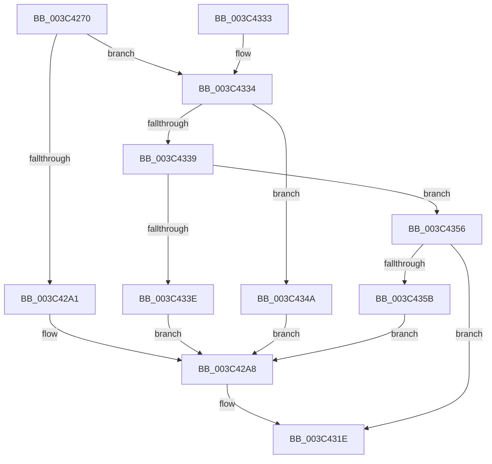

# EtwpPsProvTracePriority

- RVA: `0x003C4270`–`0x003C4367` (길이 `247` bytes)
- VA: `0x00000001403C4270`
- 실행 섹션: `.text`
- PDB 이름 있음: `예`; PDB Function 태그: `아니요`
- unwind 정보 RVA: `0x0008E3B4`
- 디코드: `57`개 명령, `247/247` bytes 표시
- 미해석 바이트: `0` (있으면 어셈블리에 `.byte`로 보존)

> 이 문서는 커널 이미지의 기계어와 PDB 기호를 분석해 생성했습니다. 4번과 5번은 함수 원형과 자료형을 바이너리 사용 방식에서 추정한 C 해석이며 원본 소스 복구 결과는 아닙니다.

## 1. Dependencies

- 직접 호출 지점: **2**; 고유 호출 대상: **2**
- 직접 호출자로 확인된 함수: **1**
- RIP 상대 이미지 참조: **6**

### Outgoing calls
- `0x003C4319` → [EtwWriteEx](../25/EtwWriteEx_function_0025F0D0.md) (function, `0x0025F0D0`)
- `0x003C4325` → [_security_check_cookie](../6A/_security_check_cookie_function_006AC640.md) (function, `0x006AC640`)

### Direct callers
- [EtwTracePriority](EtwTracePriority_function_003C41A4.md) at `0x003C41EA`

### Static image references
- `0x003C4287` → RVA `0x00E0A740` (`.data`; read)
- `0x003C42A1` → RVA `0x00011DA8` (`.rdata`; read)
- `0x003C42D0` → RVA `0x00EFF9E8` (`.data`; read)
- `0x003C433E` → RVA `0x00011DB8` (`.rdata`; read)
- `0x003C434A` → RVA `0x00011DC8` (`.rdata`; read)
- `0x003C435B` → RVA `0x00023378` (`.rdata`; read)

## 2. Other-region calls and transfers

- 다른 실행 섹션으로 향하는 call: **0**
- 별도 외부 분기/꼬리 이동을 확인하지 못했습니다.

## 3. Assembly (complete function range)

```asm
003C4270  44 89 4C 24 20                  mov dword ptr [rsp + 0x20], r9d
003C4275  44 89 44 24 18                  mov dword ptr [rsp + 0x18], r8d
003C427A  55                              push rbp
003C427B  48 8D 6C 24 A9                  lea rbp, [rsp - 0x57]
003C4280  48 81 EC A0 00 00 00            sub rsp, 0xa0
003C4287  48 8B 05 B2 64 A4 00            mov rax, qword ptr [rip + 0xa464b2]
003C428E  48 33 C4                        xor rax, rsp
003C4291  48 89 45 47                     mov qword ptr [rbp + 0x47], rax
003C4295  81 EA 30 05 00 00               sub edx, 0x530
003C429B  0F 85 93 00 00 00               jne 0x1403c4334
003C42A1  48 8D 15 00 DB C4 FF            lea rdx, [rip - 0x3b2500]
003C42A8  8B 81 08 05 00 00               mov eax, dword ptr [rcx + 0x508]
003C42AE  41 B8 04 00 00 00               mov r8d, 4
003C42B4  89 45 F7                        mov dword ptr [rbp - 9], eax
003C42B7  45 33 D2                        xor r10d, r10d
003C42BA  48 8D 45 F7                     lea rax, [rbp - 9]
003C42BE  4C 89 45 0F                     mov qword ptr [rbp + 0xf], r8
003C42C2  48 89 45 07                     mov qword ptr [rbp + 7], rax
003C42C6  8B 81 10 05 00 00               mov eax, dword ptr [rcx + 0x510]
003C42CC  45 8D 48 FD                     lea r9d, [r8 - 3]
003C42D0  48 8B 0D 11 B7 B3 00            mov rcx, qword ptr [rip + 0xb3b711]
003C42D7  89 45 FB                        mov dword ptr [rbp - 5], eax
003C42DA  48 8D 45 FB                     lea rax, [rbp - 5]
003C42DE  48 89 45 17                     mov qword ptr [rbp + 0x17], rax
003C42E2  48 8D 45 77                     lea rax, [rbp + 0x77]
003C42E6  48 89 45 27                     mov qword ptr [rbp + 0x27], rax
003C42EA  48 8D 45 7F                     lea rax, [rbp + 0x7f]
003C42EE  48 89 45 37                     mov qword ptr [rbp + 0x37], rax
003C42F2  48 8D 45 07                     lea rax, [rbp + 7]
003C42F6  48 89 44 24 38                  mov qword ptr [rsp + 0x38], rax
003C42FB  44 89 44 24 30                  mov dword ptr [rsp + 0x30], r8d
003C4300  4C 89 45 1F                     mov qword ptr [rbp + 0x1f], r8
003C4304  45 33 C0                        xor r8d, r8d
003C4307  4C 89 54 24 28                  mov qword ptr [rsp + 0x28], r10
003C430C  4C 89 54 24 20                  mov qword ptr [rsp + 0x20], r10
003C4311  4C 89 4D 2F                     mov qword ptr [rbp + 0x2f], r9
003C4315  4C 89 4D 3F                     mov qword ptr [rbp + 0x3f], r9
003C4319  E8 B2 AD E9 FF                  call 0x14025f0d0
003C431E  48 8B 4D 47                     mov rcx, qword ptr [rbp + 0x47]
003C4322  48 33 CC                        xor rcx, rsp
003C4325  E8 16 83 2E 00                  call 0x1406ac640
003C432A  48 81 C4 A0 00 00 00            add rsp, 0xa0
003C4331  5D                              pop rbp
003C4332  C3                              ret
003C4333  CC                              int3
003C4334  83 EA 01                        sub edx, 1
003C4337  74 11                           je 0x1403c434a
003C4339  83 EA 02                        sub edx, 2
003C433C  75 18                           jne 0x1403c4356
003C433E  48 8D 15 73 DA C4 FF            lea rdx, [rip - 0x3b258d]
003C4345  E9 5E FF FF FF                  jmp 0x1403c42a8
003C434A  48 8D 15 77 DA C4 FF            lea rdx, [rip - 0x3b2589]
003C4351  E9 52 FF FF FF                  jmp 0x1403c42a8
003C4356  83 FA 01                        cmp edx, 1
003C4359  75 C3                           jne 0x1403c431e
003C435B  48 8D 15 16 F0 C5 FF            lea rdx, [rip - 0x3a0fea]
003C4362  E9 41 FF FF FF                  jmp 0x1403c42a8
```

## 4. C-style interpretation (structured pseudocode)

```c
__int64 __fastcall EtwpPsProvTracePriority(__int64 a1, int a2, int a3, int a4)
{
    __int64 result;
    __int64 v_r10;
    __int64 v_rsp;
    unsigned __int64 v_stack_m18;
    unsigned __int64 v_stack_m20;
    unsigned __int64 v_stack_m28;
    unsigned __int64 v_stack_m30;
    unsigned __int64 v_stack_m38;
    unsigned __int64 v_stack_m40;
    unsigned __int64 v_stack_m48;
    unsigned __int64 v_stack_m50;
    unsigned __int64 v_stack_m58;
    unsigned __int64 v_stack_m5F;
    unsigned int v_stack_m64;
    unsigned int v_stack_m68;
    unsigned __int64 v_stack_m70;
    unsigned int v_stack_m78;
    unsigned __int64 v_stack_m80;
    unsigned __int64 v_stack_m88;
    unsigned int v_stack_p18;
    unsigned int v_stack_p20;

    v_stack_p20 = a4;
    v_stack_p18 = a3;
    v_rsp = (v_rsp) - (160);
    result = (*(unsigned __int64 *)(v_rip + 10773682)) ^ (v_rsp);
    v_stack_m18 = result;
    a2 = (unsigned int)((a2) - (0x530ULL));
    if (condition_is_not_equal) goto loc_003C4334;
loc_003C42A8:
    v_stack_m68 = (unsigned int)((unsigned int)(*(unsigned int *)(a1 + 1288)));
    v_r10 = 0;
    v_stack_m50 = 4;
    v_stack_m58 = v_stack_m68;
    v_stack_m64 = (unsigned int)((unsigned int)(*(unsigned int *)(a1 + 1296)));
    v_stack_m48 = v_stack_m64;
    v_stack_m38 = v_stack_p18;
    v_stack_m28 = v_stack_p20;
    v_stack_m70 = v_stack_m58;
    v_stack_m78 = 4;
    v_stack_m40 = 4;
    a3 = 0;
    v_stack_m80 = 0;
    v_stack_m88 = 0;
    v_stack_m30 = 4 - 3;
    v_stack_m20 = 4 - 3;
    result = EtwWriteEx(*(unsigned __int64 *)(v_rip + 11777809), v_rip - 3876096, a3, 4 - 3);
loc_003C431E:
    a1 = (v_stack_m18) ^ (v_rsp);
    result = _security_check_cookie(a1, v_rip - 3876096, a3, 4 - 3);
    v_rsp = (v_rsp) + (160);
    return result;
loc_003C4334:
    a2 = (unsigned int)((v_rip - 3876096) - (1));
    if (condition_is_equal) goto loc_003C434A;
    a2 = (unsigned int)((a2) - (2));
    if (condition_is_not_equal) goto loc_003C4356;
    goto loc_003C42A8;
loc_003C434A:
    goto loc_003C42A8;
loc_003C4356:
    if (((unsigned int)(v_rip - 3876233)) != 1) goto loc_003C431E;
    goto loc_003C42A8;
}
```

## 5. (Beta) C Style

```c
int64_t EtwpPsProvTracePriority(void *Arg1, int32_t Arg2, int32_t Arg3, int32_t Arg4)
{
    uint8_t *arg1 = (uint8_t *)Arg1;

    int64_t result;
    int64_t local_r10;
    int64_t local_rsp;
    uint64_t v_stack_m18;
    uint64_t v_stack_m20;
    uint64_t v_stack_m28;
    uint64_t v_stack_m30;
    uint64_t v_stack_m38;
    uint64_t v_stack_m40;
    uint64_t v_stack_m48;
    uint64_t v_stack_m50;
    uint64_t v_stack_m58;
    uint64_t v_stack_m5F;
    uint32_t v_stack_m64;
    uint32_t v_stack_m68;
    uint64_t v_stack_m70;
    uint32_t v_stack_m78;
    uint64_t v_stack_m80;
    uint64_t v_stack_m88;
    uint32_t v_stack_p18;
    uint32_t v_stack_p20;

    v_stack_p20 = Arg4;
    v_stack_p18 = Arg3;
    local_rsp = (local_rsp) - (160);
    result = (*(uint64_t *)(v_rip + 0xA464B2)) ^ (local_rsp);
    v_stack_m18 = result;
    Arg2 = (uint32_t)((Arg2) - (0x530ULL));
    if (condition_is_not_equal) goto loc_003C4334;
loc_003C42A8:
    v_stack_m68 = (uint32_t)((uint32_t)(*(uint32_t *)(arg1 + 0x508)));
    local_r10 = 0;
    v_stack_m50 = 4;
    v_stack_m58 = v_stack_m68;
    v_stack_m64 = (uint32_t)((uint32_t)(*(uint32_t *)(arg1 + 0x510)));
    v_stack_m48 = v_stack_m64;
    v_stack_m38 = v_stack_p18;
    v_stack_m28 = v_stack_p20;
    v_stack_m70 = v_stack_m58;
    v_stack_m78 = 4;
    v_stack_m40 = 4;
    Arg3 = 0;
    v_stack_m80 = 0;
    v_stack_m88 = 0;
    v_stack_m30 = 4 - 3;
    v_stack_m20 = 4 - 3;
    result = EtwWriteEx(*(uint64_t *)(v_rip + 0xB3B711), v_rip - 3876096, Arg3, 4 - 3);
loc_003C431E:
    Arg1 = (v_stack_m18) ^ (local_rsp);
    result = _security_check_cookie(Arg1, v_rip - 3876096, Arg3, 4 - 3);
    local_rsp = (local_rsp) + (160);
    return result;
loc_003C4334:
    Arg2 = (uint32_t)((v_rip - 3876096) - (1));
    if (condition_is_equal) goto loc_003C434A;
    Arg2 = (uint32_t)((Arg2) - (2));
    if (condition_is_not_equal) goto loc_003C4356;
    goto loc_003C42A8;
loc_003C434A:
    goto loc_003C42A8;
loc_003C4356:
    if (((uint32_t)(v_rip - 3876233)) != 1) goto loc_003C431E;
    goto loc_003C42A8;
}
```

### 관측된 메모리 오프셋

구조체 형식이 확인되지 않은 접근은 인자 기준의 오프셋으로만 기록했습니다.

| 기준 인자 | 오프셋 표현 | 폭 (bit) | 접근 |
|---|---:|---:|---|
| `Arg1` | `+ 0x508` | `32` | `R` |
| `Arg1` | `+ 0x510` | `32` | `R` |

## 6. Execution-region graph

[열기: 2D/3D 그래프와 함수 탐색 컨트롤 패널](../../../control-panel.html?section=text&rva=0x003C4270&view=graph)

- 2D 그래프는 위에서 아래로 흐르고, 3D 그래프는 빈 공간을 드래그해 회전합니다. Shift+드래그는 이동, 휠은 확대·축소, 함수 노드 선택은 대상 보고서 이동입니다.

### Static fallback


