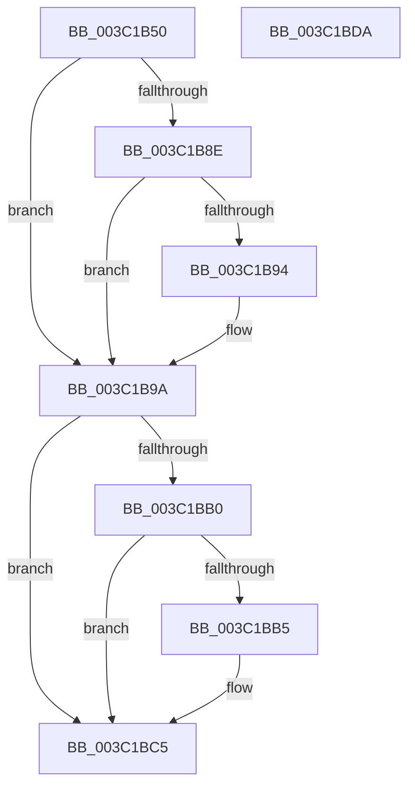

# EtwpThreadRundownApc

- RVA: `0x003C1B50`–`0x003C1BDB` (길이 `139` bytes)
- VA: `0x00000001403C1B50`
- 실행 섹션: `.text`
- PDB 이름 있음: `예`; PDB Function 태그: `아니요`
- unwind 정보 RVA: `0x0005C954`
- 디코드: `39`개 명령, `139/139` bytes 표시
- 미해석 바이트: `0` (있으면 어셈블리에 `.byte`로 보존)

> 이 문서는 커널 이미지의 기계어와 PDB 기호를 분석해 생성했습니다. 4번과 5번은 함수 원형과 자료형을 바이너리 사용 방식에서 추정한 C 해석이며 원본 소스 복구 결과는 아닙니다.

## 1. Dependencies

- 직접 호출 지점: **5**; 고유 호출 대상: **4**
- 직접 호출자로 확인된 함수: **0**
- RIP 상대 이미지 참조: **0**

### Outgoing calls
- `0x003C1B80` → [EtwpTraceThreadRundown](EtwpTraceThreadRundown_function_003C370C.md) (function, `0x003C370C`)
- `0x003C1B85` → [Feature_EtwThreadStackRundownPriority__private_IsEnabledDeviceUsageNoInline](../4F/Feature_EtwThreadStackRundownPriority__private_IsEnabledDeviceUsageNoInline_function_004F3B5C.md) (function, `0x004F3B5C`)
- `0x003C1BA2` → [KeSetEvent](../33/KeSetEvent_function_0033F310.md) (function, `0x0033F310`)
- `0x003C1BA7` → [Feature_EtwThreadStackRundownPriority__private_IsEnabledDeviceUsageNoInline](../4F/Feature_EtwThreadStackRundownPriority__private_IsEnabledDeviceUsageNoInline_function_004F3B5C.md) (function, `0x004F3B5C`)
- `0x003C1BC0` → [KeSetPriorityThread](../2C/KeSetPriorityThread_function_002C76E0.md) (function, `0x002C76E0`)

### Direct callers
- 이 함수 시작 RVA로 연결되는 직접 call은 확인되지 않았습니다. 간접 호출은 완전히 역산할 수 없습니다.

### Static image references
- 디코드된 RIP-relative 메모리 참조가 없습니다.

## 2. Other-region calls and transfers

- 다른 실행 섹션으로 향하는 call: **0**
- 별도 외부 분기/꼬리 이동을 확인하지 못했습니다.

## 3. Assembly (complete function range)

```asm
003C1B50  48 89 5C 24 08                  mov qword ptr [rsp + 8], rbx
003C1B55  48 89 6C 24 10                  mov qword ptr [rsp + 0x10], rbp
003C1B5A  48 89 74 24 18                  mov qword ptr [rsp + 0x18], rsi
003C1B5F  57                              push rdi
003C1B60  48 83 EC 20                     sub rsp, 0x20
003C1B64  48 8B 44 24 50                  mov rax, qword ptr [rsp + 0x50]
003C1B69  33 F6                           xor esi, esi
003C1B6B  65 48 8B 0C 25 88 01 00 00      mov rcx, qword ptr gs:[0x188]
003C1B74  40 32 FF                        xor dil, dil
003C1B77  49 8B 29                        mov rbp, qword ptr [r9]
003C1B7A  48 8B 18                        mov rbx, qword ptr [rax]
003C1B7D  48 8B D3                        mov rdx, rbx
003C1B80  E8 87 1B 00 00                  call 0x1403c370c
003C1B85  E8 D2 1F 13 00                  call 0x1404f3b5c
003C1B8A  85 C0                           test eax, eax
003C1B8C  74 0C                           je 0x1403c1b9a
003C1B8E  40 38 73 4C                     cmp byte ptr [rbx + 0x4c], sil
003C1B92  74 06                           je 0x1403c1b9a
003C1B94  8B 73 48                        mov esi, dword ptr [rbx + 0x48]
003C1B97  40 B7 01                        mov dil, 1
003C1B9A  45 33 C0                        xor r8d, r8d
003C1B9D  33 D2                           xor edx, edx
003C1B9F  48 8B CD                        mov rcx, rbp
003C1BA2  E8 69 D7 F7 FF                  call 0x14033f310
003C1BA7  E8 B0 1F 13 00                  call 0x1404f3b5c
003C1BAC  85 C0                           test eax, eax
003C1BAE  74 15                           je 0x1403c1bc5
003C1BB0  40 84 FF                        test dil, dil
003C1BB3  74 10                           je 0x1403c1bc5
003C1BB5  65 48 8B 0C 25 88 01 00 00      mov rcx, qword ptr gs:[0x188]
003C1BBE  8B D6                           mov edx, esi
003C1BC0  E8 1B 5B F0 FF                  call 0x1402c76e0
003C1BC5  48 8B 5C 24 30                  mov rbx, qword ptr [rsp + 0x30]
003C1BCA  48 8B 6C 24 38                  mov rbp, qword ptr [rsp + 0x38]
003C1BCF  48 8B 74 24 40                  mov rsi, qword ptr [rsp + 0x40]
003C1BD4  48 83 C4 20                     add rsp, 0x20
003C1BD8  5F                              pop rdi
003C1BD9  C3                              ret
003C1BDA  CC                              int3
```

## 4. C-style interpretation (structured pseudocode)

```c
__int64 __fastcall EtwpThreadRundownApc(__int64 a1, __int64 a2, int a3, __int64 a4, __int64 a5)
{
    __int64 result;
    __int64 v_rdi;
    __int64 v_rsi;
    __int64 v_rsp;
    unsigned __int64 v_stack_p10;
    unsigned __int64 v_stack_p18;
    unsigned __int64 v_stack_p8;

    v_stack_p8 = v_rbx;
    v_stack_p10 = v_rbp;
    v_stack_p18 = v_rsi;
    v_rsp = (v_rsp) - (32);
    v_rsi = 0;
    v_rdi = 0;
    result = EtwpTraceThreadRundown(*(unsigned __int64 *)(gs_base + (0 + 392)), *(unsigned __int64 *)(a5), a3, a4);
    result = Feature_EtwThreadStackRundownPriority__private_IsEnabledDeviceUsageNoInline(*(unsigned __int64 *)(gs_base + (0 + 392)), *(unsigned __int64 *)(a5), a3, a4);
    if ((unsigned int)(result) == 0) goto loc_003C1B9A;
    if ((*(unsigned __int8 *)(*(unsigned __int64 *)(a5) + 76)) != 0) {
        v_rsi = *(unsigned int *)(*(unsigned __int64 *)(a5) + 72);
        v_rdi = 1;
    }
    a3 = 0;
    a2 = 0;
    result = KeSetEvent(*(unsigned __int64 *)(a4), a2, a3, a4);
    result = Feature_EtwThreadStackRundownPriority__private_IsEnabledDeviceUsageNoInline(*(unsigned __int64 *)(a4), a2, a3, a4);
    if ((unsigned int)(result) == 0) goto loc_003C1BC5;
    if ((unsigned __int8)(v_rdi) != 0) {
        a1 = *(unsigned __int64 *)(gs_base + (0 + 392));
        a2 = (unsigned int)(v_rsi);
        result = KeSetPriorityThread(a1, a2, a3, a4);
    }
    v_rsp = (v_rsp) + (32);
    return result;
}
```

## 5. (Beta) C Style

```c
int64_t EtwpThreadRundownApc(int64_t Arg1, int64_t Arg2, int32_t Arg3, void *Arg4, void *Arg5)
{
    uint8_t *arg4 = (uint8_t *)Arg4;
    uint8_t *arg5 = (uint8_t *)Arg5;

    int64_t result;
    int64_t local_rdi;
    int64_t local_rsi;
    int64_t local_rsp;
    uint64_t v_stack_p10;
    uint64_t v_stack_p18;
    uint64_t v_stack_p8;

    v_stack_p8 = local_rbx;
    v_stack_p10 = local_rbp;
    v_stack_p18 = local_rsi;
    local_rsp = (local_rsp) - (32);
    local_rsi = 0;
    local_rdi = 0;
    result = EtwpTraceThreadRundown(*(uint64_t *)(gs_base + (0 + 0x188)), *(uint64_t *)(arg5), Arg3, Arg4);
    result = Feature_EtwThreadStackRundownPriority__private_IsEnabledDeviceUsageNoInline(*(uint64_t *)(gs_base + (0 + 0x188)), *(uint64_t *)(arg5), Arg3, Arg4);
    if ((uint32_t)(result) == 0) goto loc_003C1B9A;
    if ((*(uint8_t *)(*(uint64_t *)(arg5) + 0x4C)) != 0) {
        local_rsi = *(uint32_t *)(*(uint64_t *)(arg5) + 0x48);
        local_rdi = 1;
    }
    Arg3 = 0;
    Arg2 = 0;
    result = KeSetEvent(*(uint64_t *)(arg4), Arg2, Arg3, Arg4);
    result = Feature_EtwThreadStackRundownPriority__private_IsEnabledDeviceUsageNoInline(*(uint64_t *)(arg4), Arg2, Arg3, Arg4);
    if ((uint32_t)(result) == 0) goto loc_003C1BC5;
    if ((uint8_t)(local_rdi) != 0) {
        Arg1 = *(uint64_t *)(gs_base + (0 + 0x188));
        Arg2 = (uint32_t)(local_rsi);
        result = KeSetPriorityThread(Arg1, Arg2, Arg3, Arg4);
    }
    local_rsp = (local_rsp) + (32);
    return result;
}
```

### 관측된 메모리 오프셋

구조체 형식이 확인되지 않은 접근은 인자 기준의 오프셋으로만 기록했습니다.

| 기준 인자 | 오프셋 표현 | 폭 (bit) | 접근 |
|---|---:|---:|---|
| `Arg4` | `+ 0x0` | `64` | `R` |
| `Arg5` | `+ 0x0` | `64` | `R` |

## 6. Execution-region graph

[열기: 2D/3D 그래프와 함수 탐색 컨트롤 패널](../../../control-panel.html?section=text&rva=0x003C1B50&view=graph)

- 2D 그래프는 위에서 아래로 흐르고, 3D 그래프는 빈 공간을 드래그해 회전합니다. Shift+드래그는 이동, 휠은 확대·축소, 함수 노드 선택은 대상 보고서 이동입니다.

### Static fallback


