# EtwpTraceThreadRundown

- RVA: `0x003C370C`–`0x003C3A76` (길이 `874` bytes)
- VA: `0x00000001403C370C`
- 실행 섹션: `.text`
- PDB 이름 있음: `예`; PDB Function 태그: `아니요`
- unwind 정보 RVA: `0x0008E2F4`
- 디코드: `182`개 명령, `874/874` bytes 표시
- 미해석 바이트: `0` (있으면 어셈블리에 `.byte`로 보존)

> 이 문서는 커널 이미지의 기계어와 PDB 기호를 분석해 생성했습니다. 4번과 5번은 함수 원형과 자료형을 바이너리 사용 방식에서 추정한 C 해석이며 원본 소스 복구 결과는 아닙니다.

## 1. Dependencies

- 직접 호출 지점: **8**; 고유 호출 대상: **7**
- 직접 호출자로 확인된 함수: **3**
- RIP 상대 이미지 참조: **2**

### Outgoing calls
- `0x003C3819` → [PsGetPagePriorityThread](PsGetPagePriorityThread_function_003C3E80.md) (function, `0x003C3E80`)
- `0x003C3828` → [PsGetIoPriorityThread](../34/PsGetIoPriorityThread_function_00343930.md) (function, `0x00343930`)
- `0x003C391A` → [Feature_1224463674__private_IsEnabledDeviceUsageNoInline](../4F/Feature_1224463674__private_IsEnabledDeviceUsageNoInline_function_004F146C.md) (function, `0x004F146C`)
- `0x003C3929` → [PspLockThreadSecurityShared](PspLockThreadSecurityShared_function_003C4720.md) (function, `0x003C4720`)
- `0x003C3982` → [EtwpLogSystemEventUnsafe](../2F/EtwpLogSystemEventUnsafe_function_002FBF10.md) (function, `0x002FBF10`)
- `0x003C3987` → [Feature_1224463674__private_IsEnabledDeviceUsageNoInline](../4F/Feature_1224463674__private_IsEnabledDeviceUsageNoInline_function_004F146C.md) (function, `0x004F146C`)
- `0x003C399B` → [_security_check_cookie](../6A/_security_check_cookie_function_006AC640.md) (function, `0x006AC640`)
- `0x003C39C4` → [PspUnlockThreadSecurityShared](PspUnlockThreadSecurityShared_function_003C2E40.md) (function, `0x003C2E40`)

### Direct callers
- [EtwpThreadRundownApc](EtwpThreadRundownApc_function_003C1B50.md) at `0x003C1B80`
- [EtwpTraceThreadRundownWithStack](../4A/EtwpTraceThreadRundownWithStack_function_004AB5A0.md) at `0x004AB759`
- [EtwpThreadEnumCallback](../../page/8C/EtwpThreadEnumCallback_function_008C9BD0.md) at `0x008C9C04`

### Static image references
- `0x003C3727` → RVA `0x00E0A740` (`.data`; read)
- `0x003C393E` → RVA `0x000105E0` (`.rdata`; read)

## 2. Other-region calls and transfers

- 다른 실행 섹션으로 향하는 call: **0**
- 별도 외부 분기/꼬리 이동을 확인하지 못했습니다.

## 3. Assembly (complete function range)

```asm
003C370C  4C 8B DC                        mov r11, rsp
003C370F  49 89 5B 18                     mov qword ptr [r11 + 0x18], rbx
003C3713  49 89 73 20                     mov qword ptr [r11 + 0x20], rsi
003C3717  57                              push rdi
003C3718  41 54                           push r12
003C371A  41 55                           push r13
003C371C  41 56                           push r14
003C371E  41 57                           push r15
003C3720  48 81 EC F0 00 00 00            sub rsp, 0xf0
003C3727  48 8B 05 12 70 A4 00            mov rax, qword ptr [rip + 0xa47012]
003C372E  48 33 C4                        xor rax, rsp
003C3731  48 89 84 24 E0 00 00 00         mov qword ptr [rsp + 0xe0], rax
003C3739  48 8B F9                        mov rdi, rcx
003C373C  48 89 4C 24 58                  mov qword ptr [rsp + 0x58], rcx
003C3741  41 BC 02 00 00 00               mov r12d, 2
003C3747  44 89 64 24 48                  mov dword ptr [rsp + 0x48], r12d
003C374C  33 DB                           xor ebx, ebx
003C374E  49 89 5B 90                     mov qword ptr [r11 - 0x70], rbx
003C3752  4C 8B 6A 20                     mov r13, qword ptr [rdx + 0x20]
003C3756  4C 89 6C 24 50                  mov qword ptr [rsp + 0x50], r13
003C375B  44 8A 52 41                     mov r10b, byte ptr [rdx + 0x41]
003C375F  8B 72 28                        mov esi, dword ptr [rdx + 0x28]
003C3762  89 74 24 44                     mov dword ptr [rsp + 0x44], esi
003C3766  8A 42 40                        mov al, byte ptr [rdx + 0x40]
003C3769  F6 D8                           neg al
003C376B  66 45 1B FF                     sbb r15w, r15w
003C376F  66 41 81 C7 04 05               add r15w, 0x504
003C3775  66 44 89 7C 24 40               mov word ptr [rsp + 0x40], r15w
003C377B  65 48 8B 04 25 88 01 00 00      mov rax, qword ptr gs:[0x188]
003C3784  48 3B C8                        cmp rcx, rax
003C3787  0F 85 D3 02 00 00               jne 0x1403c3a60
003C378D  8B 81 08 05 00 00               mov eax, dword ptr [rcx + 0x508]
003C3793  89 44 24 60                     mov dword ptr [rsp + 0x60], eax
003C3797  8B 81 10 05 00 00               mov eax, dword ptr [rcx + 0x510]
003C379D  89 44 24 64                     mov dword ptr [rsp + 0x64], eax
003C37A1  48 8B 41 38                     mov rax, qword ptr [rcx + 0x38]
003C37A5  48 89 44 24 68                  mov qword ptr [rsp + 0x68], rax
003C37AA  48 8B 41 30                     mov rax, qword ptr [rcx + 0x30]
003C37AE  48 89 44 24 70                  mov qword ptr [rsp + 0x70], rax
003C37B3  0F B7 81 48 02 00 00            movzx eax, word ptr [rcx + 0x248]
003C37BA  48 8B 89 40 02 00 00            mov rcx, qword ptr [rcx + 0x240]
003C37C1  66 3B 01                        cmp ax, word ptr [rcx]
003C37C4  0F 83 8E 02 00 00               jae 0x1403c3a58
003C37CA  48 8B 54 C1 08                  mov rdx, qword ptr [rcx + rax*8 + 8]
003C37CF  48 89 94 24 88 00 00 00         mov qword ptr [rsp + 0x88], rdx
003C37D7  48 8B 87 60 05 00 00            mov rax, qword ptr [rdi + 0x560]
003C37DE  48 89 84 24 90 00 00 00         mov qword ptr [rsp + 0x90], rax
003C37E6  4C 8B 8F F0 00 00 00            mov r9, qword ptr [rdi + 0xf0]
003C37ED  48 89 5C 24 78                  mov qword ptr [rsp + 0x78], rbx
003C37F2  48 89 9C 24 80 00 00 00         mov qword ptr [rsp + 0x80], rbx
003C37FA  4C 89 8C 24 98 00 00 00         mov qword ptr [rsp + 0x98], r9
003C3802  89 9C 24 A0 00 00 00            mov dword ptr [rsp + 0xa0], ebx
003C3809  8A 87 33 02 00 00               mov al, byte ptr [rdi + 0x233]
003C380F  88 84 24 A4 00 00 00            mov byte ptr [rsp + 0xa4], al
003C3816  48 8B CF                        mov rcx, rdi
003C3819  E8 62 06 00 00                  call 0x1403c3e80
003C381E  88 84 24 A5 00 00 00            mov byte ptr [rsp + 0xa5], al
003C3825  48 8B CF                        mov rcx, rdi
003C3828  E8 03 01 F8 FF                  call 0x140343930
003C382D  88 84 24 A6 00 00 00            mov byte ptr [rsp + 0xa6], al
003C3834  88 9C 24 A7 00 00 00            mov byte ptr [rsp + 0xa7], bl
003C383B  8A 87 A8 05 00 00               mov al, byte ptr [rdi + 0x5a8]
003C3841  BA 01 00 00 00                  mov edx, 1
003C3846  A8 08                           test al, 8
003C3848  0F 85 E9 01 00 00               jne 0x1403c3a37
003C384E  4D 85 C9                        test r9, r9
003C3851  0F 84 A1 00 00 00               je 0x1403c38f8
003C3857  45 84 D2                        test r10b, r10b
003C385A  0F 84 98 00 00 00               je 0x1403c38f8
003C3860  48 8B 87 20 02 00 00            mov rax, qword ptr [rdi + 0x220]
003C3867  48 39 98 10 03 00 00            cmp qword ptr [rax + 0x310], rbx
003C386E  74 15                           je 0x1403c3885
003C3870  0F B7 88 EC 06 00 00            movzx ecx, word ptr [rax + 0x6ec]
003C3877  B8 4C 01 00 00                  mov eax, 0x14c
003C387C  66 3B C8                        cmp cx, ax
003C387F  75 44                           jne 0x1403c38c5
003C3881  84 D2                           test dl, dl
003C3883  75 1D                           jne 0x1403c38a2
003C3885  41 8B 81 20 17 00 00            mov eax, dword ptr [r9 + 0x1720]
003C388C  89 84 24 A0 00 00 00            mov dword ptr [rsp + 0xa0], eax
003C3893  49 8B 41 08                     mov rax, qword ptr [r9 + 8]
003C3897  48 89 44 24 78                  mov qword ptr [rsp + 0x78], rax
003C389C  49 8B 41 10                     mov rax, qword ptr [r9 + 0x10]
003C38A0  EB 31                           jmp 0x1403c38d3
003C38A2  41 8B 81 60 2F 00 00            mov eax, dword ptr [r9 + 0x2f60]
003C38A9  89 84 24 A0 00 00 00            mov dword ptr [rsp + 0xa0], eax
003C38B0  41 8B 81 04 20 00 00            mov eax, dword ptr [r9 + 0x2004]
003C38B7  48 89 44 24 78                  mov qword ptr [rsp + 0x78], rax
003C38BC  41 8B 81 08 20 00 00            mov eax, dword ptr [r9 + 0x2008]
003C38C3  EB 0E                           jmp 0x1403c38d3
003C38C5  B8 C4 01 00 00                  mov eax, 0x1c4
003C38CA  66 3B C8                        cmp cx, ax
003C38CD  74 B2                           je 0x1403c3881
003C38CF  8A D3                           mov dl, bl
003C38D1  EB AE                           jmp 0x1403c3881
003C38D3  48 89 84 24 80 00 00 00         mov qword ptr [rsp + 0x80], rax
003C38DB  EB 1B                           jmp 0x1403c38f8
003C38DD  33 DB                           xor ebx, ebx
003C38DF  44 8B 64 24 48                  mov r12d, dword ptr [rsp + 0x48]
003C38E4  8B 74 24 44                     mov esi, dword ptr [rsp + 0x44]
003C38E8  4C 8B 6C 24 50                  mov r13, qword ptr [rsp + 0x50]
003C38ED  48 8B 7C 24 58                  mov rdi, qword ptr [rsp + 0x58]
003C38F2  44 0F B7 7C 24 40               movzx r15d, word ptr [rsp + 0x40]
003C38F8  48 8D 44 24 60                  lea rax, [rsp + 0x60]
003C38FD  48 89 84 24 B0 00 00 00         mov qword ptr [rsp + 0xb0], rax
003C3905  48 C7 84 24 B8 00 00 00 48 00 00 00  mov qword ptr [rsp + 0xb8], 0x48
003C3911  65 4C 8B 34 25 88 01 00 00      mov r14, qword ptr gs:[0x188]
003C391A  E8 4D DB 12 00                  call 0x1404f146c
003C391F  85 C0                           test eax, eax
003C3921  74 0B                           je 0x1403c392e
003C3923  49 8B D6                        mov rdx, r14
003C3926  48 8B CF                        mov rcx, rdi
003C3929  E8 F2 0D 00 00                  call 0x1403c4720
003C392E  48 8B 87 A0 06 00 00            mov rax, qword ptr [rdi + 0x6a0]
003C3935  48 85 C0                        test rax, rax
003C3938  0F 85 8D 00 00 00               jne 0x1403c39cb
003C393E  48 8D 05 9B CC C4 FF            lea rax, [rip - 0x3b3365]
003C3945  48 89 84 24 C0 00 00 00         mov qword ptr [rsp + 0xc0], rax
003C394D  48 C7 84 24 C8 00 00 00 02 00 00 00  mov qword ptr [rsp + 0xc8], 2
003C3959  88 5C 24 38                     mov byte ptr [rsp + 0x38], bl
003C395D  89 74 24 30                     mov dword ptr [rsp + 0x30], esi
003C3961  66 44 89 7C 24 28               mov word ptr [rsp + 0x28], r15w
003C3967  44 89 64 24 20                  mov dword ptr [rsp + 0x20], r12d
003C396C  45 8B 4D 00                     mov r9d, dword ptr [r13]
003C3970  4C 8B C7                        mov r8, rdi
003C3973  48 8D 94 24 B0 00 00 00         lea rdx, [rsp + 0xb0]
003C397B  49 8B 8D 50 05 00 00            mov rcx, qword ptr [r13 + 0x550]
003C3982  E8 89 85 F3 FF                  call 0x1402fbf10
003C3987  E8 E0 DA 12 00                  call 0x1404f146c
003C398C  85 C0                           test eax, eax
003C398E  75 2E                           jne 0x1403c39be
003C3990  48 8B 8C 24 E0 00 00 00         mov rcx, qword ptr [rsp + 0xe0]
003C3998  48 33 CC                        xor rcx, rsp
003C399B  E8 A0 8C 2E 00                  call 0x1406ac640
003C39A0  4C 8D 9C 24 F0 00 00 00         lea r11, [rsp + 0xf0]
003C39A8  49 8B 5B 40                     mov rbx, qword ptr [r11 + 0x40]
003C39AC  49 8B 73 48                     mov rsi, qword ptr [r11 + 0x48]
003C39B0  49 8B E3                        mov rsp, r11
003C39B3  41 5F                           pop r15
003C39B5  41 5E                           pop r14
003C39B7  41 5D                           pop r13
003C39B9  41 5C                           pop r12
003C39BB  5F                              pop rdi
003C39BC  C3                              ret
003C39BD  CC                              int3
003C39BE  49 8B D6                        mov rdx, r14
003C39C1  48 8B CF                        mov rcx, rdi
003C39C4  E8 77 F4 FF FF                  call 0x1403c2e40
003C39C9  EB C5                           jmp 0x1403c3990
003C39CB  48 8B 48 08                     mov rcx, qword ptr [rax + 8]
003C39CF  48 85 C9                        test rcx, rcx
003C39D2  0F 84 66 FF FF FF               je 0x1403c393e
003C39D8  0F B7 10                        movzx edx, word ptr [rax]
003C39DB  B8 00 08 00 00                  mov eax, 0x800
003C39E0  66 3B D0                        cmp dx, ax
003C39E3  0F 82 86 00 00 00               jb 0x1403c3a6f
003C39E9  48 89 8C 24 C0 00 00 00         mov qword ptr [rsp + 0xc0], rcx
003C39F1  89 84 24 C8 00 00 00            mov dword ptr [rsp + 0xc8], eax
003C39F8  89 9C 24 CC 00 00 00            mov dword ptr [rsp + 0xcc], ebx
003C39FF  85 C0                           test eax, eax
003C3A01  74 0E                           je 0x1403c3a11
003C3A03  48 D1 E8                        shr rax, 1
003C3A06  66 39 5C 41 FE                  cmp word ptr [rcx + rax*2 - 2], bx
003C3A0B  0F 84 48 FF FF FF               je 0x1403c3959
003C3A11  48 8D 05 C8 CB C4 FF            lea rax, [rip - 0x3b3438]
003C3A18  48 89 84 24 D0 00 00 00         mov qword ptr [rsp + 0xd0], rax
003C3A20  48 C7 84 24 D8 00 00 00 02 00 00 00  mov qword ptr [rsp + 0xd8], 2
003C3A2C  41 BC 03 00 00 00               mov r12d, 3
003C3A32  E9 22 FF FF FF                  jmp 0x1403c3959
003C3A37  48 8D 87 D8 04 00 00            lea rax, [rdi + 0x4d8]
003C3A3E  0F B6 8C 24 A7 00 00 00         movzx ecx, byte ptr [rsp + 0xa7]
003C3A46  48 39 00                        cmp qword ptr [rax], rax
003C3A49  0F 45 CA                        cmovne ecx, edx
003C3A4C  88 8C 24 A7 00 00 00            mov byte ptr [rsp + 0xa7], cl
003C3A53  E9 F6 FD FF FF                  jmp 0x1403c384e
003C3A58  48 8B D3                        mov rdx, rbx
003C3A5B  E9 6F FD FF FF                  jmp 0x1403c37cf
003C3A60  81 E6 FF E7 FF FF               and esi, 0xffffe7ff
003C3A66  89 74 24 44                     mov dword ptr [rsp + 0x44], esi
003C3A6A  E9 1E FD FF FF                  jmp 0x1403c378d
003C3A6F  8B C2                           mov eax, edx
003C3A71  E9 73 FF FF FF                  jmp 0x1403c39e9
```

## 4. C-style interpretation (structured pseudocode)

```c
__int64 __fastcall EtwpTraceThreadRundown(__int64 a1, __int64 a2)
{
    __int64 result;
    __int64 v_r15;
    __int64 v_rbx;
    __int64 v_rsi;
    __int64 v_rsp;
    unsigned __int64 v_stack_m18;
    unsigned __int64 v_stack_m20;
    unsigned int v_stack_m24;
    unsigned __int64 v_stack_m28;
    unsigned __int64 v_stack_m30;
    unsigned __int64 v_stack_m38;
    unsigned __int8 v_stack_m49;
    unsigned __int64 v_stack_m50;
    unsigned __int64 v_stack_m58;
    unsigned __int64 v_stack_m60;
    unsigned __int64 v_stack_m68;
    unsigned __int8 v_stack_m71;
    unsigned __int8 v_stack_m72;
    unsigned __int8 v_stack_m73;
    unsigned __int8 v_stack_m74;
    unsigned int v_stack_m78;
    unsigned __int64 v_stack_m80;
    unsigned __int64 v_stack_m88;
    unsigned __int64 v_stack_m90;
    unsigned __int64 v_stack_m98;
    unsigned __int64 v_stack_mA0;
    unsigned __int64 v_stack_mA8;
    unsigned int v_stack_mAC;
    unsigned __int64 v_stack_mB0;
    unsigned int v_stack_mB4;
    unsigned int v_stack_mB8;
    unsigned __int64 v_stack_mC0;
    unsigned __int64 v_stack_mC8;
    unsigned int v_stack_mD0;
    unsigned int v_stack_mD4;
    unsigned __int16 v_stack_mD8;
    unsigned __int8 v_stack_mE0;
    unsigned int v_stack_mE8;
    unsigned __int16 v_stack_mF0;
    unsigned int v_stack_mF8;

    *(unsigned __int64 *)(v_rsp + 24) = v_rbx;
    *(unsigned __int64 *)(v_rsp + 32) = v_rsi;
    v_rsp = (v_rsp) - (240);
    result = (*(unsigned __int64 *)(v_rip + 10776594)) ^ (v_rsp);
    v_stack_m38 = result;
    v_stack_mC0 = a1;
    v_stack_mD0 = 2;
    v_rbx = 0;
    *(unsigned __int64 *)(v_rsp - 112) = 0;
    v_stack_mC8 = *(unsigned __int64 *)(a2 + 32);
    v_stack_mD4 = (unsigned int)((unsigned int)(*(unsigned int *)(a2 + 40)));
    result = (unsigned __int8)(-(*(unsigned __int8 *)(a2 + 64)));
    v_r15 = (unsigned __int16)((v_r15) + (0x504ULL));
    v_stack_mD8 = (unsigned __int16)(v_r15);
    if (a1 != (*(unsigned __int64 *)(gs_base + (0 + 392)))) goto loc_003C3A60;
loc_003C378D:
    v_stack_mB8 = (unsigned int)((unsigned int)(*(unsigned int *)(a1 + 1288)));
    v_stack_mB4 = (unsigned int)((unsigned int)(*(unsigned int *)(a1 + 1296)));
    v_stack_mB0 = *(unsigned __int64 *)(a1 + 56);
    v_stack_mA8 = *(unsigned __int64 *)(a1 + 48);
    if (((unsigned __int16)(*(unsigned __int16 *)(a1 + 584))) >= (*(unsigned __int16 *)(*(unsigned __int64 *)(a1 + 576)))) goto loc_003C3A58;
loc_003C37CF:
    v_stack_m90 = *(unsigned __int64 *)(*(unsigned __int64 *)(a1 + 576) + *(unsigned __int16 *)(a1 + 584) * 8 + 8);
    v_stack_m88 = *(unsigned __int64 *)(a1 + 1376);
    v_stack_mA0 = 0;
    v_stack_m98 = 0;
    v_stack_m80 = *(unsigned __int64 *)(a1 + 240);
    v_stack_m78 = 0;
    v_stack_m74 = (unsigned __int8)(*(unsigned __int8 *)(a1 + 563));
    result = PsGetPagePriorityThread(a1, *(unsigned __int64 *)(*(unsigned __int64 *)(a1 + 576) + *(unsigned __int16 *)(a1 + 584) * 8 + 8), a3, *(unsigned __int64 *)(a1 + 240));
    v_stack_m73 = (unsigned __int8)(result);
    result = PsGetIoPriorityThread(a1, *(unsigned __int64 *)(*(unsigned __int64 *)(a1 + 576) + *(unsigned __int16 *)(a1 + 584) * 8 + 8), a3, *(unsigned __int64 *)(a1 + 240));
    v_stack_m72 = (unsigned __int8)(result);
    v_stack_m71 = 0;
    if ((((unsigned __int8)(*(unsigned __int8 *)(a1 + 1448))) & (8)) != 0) goto loc_003C3A37;
loc_003C384E:
    if (*(unsigned __int64 *)(a1 + 240) == 0) goto loc_003C38F8;
    if ((unsigned __int8)(*(unsigned __int8 *)(a2 + 65)) == 0) goto loc_003C38F8;
    if ((*(unsigned __int64 *)(*(unsigned __int64 *)(a1 + 544) + 784)) == 0) goto loc_003C3885;
    if (((unsigned __int16)(*(unsigned __int16 *)(*(unsigned __int64 *)(a1 + 544) + 1772))) != 332) goto loc_003C38C5;
loc_003C3881:
    if (1 != 0) goto loc_003C38A2;
loc_003C3885:
    v_stack_m78 = (unsigned int)((unsigned int)(*(unsigned int *)(*(unsigned __int64 *)(a1 + 240) + 5920)));
    v_stack_mA0 = *(unsigned __int64 *)(*(unsigned __int64 *)(a1 + 240) + 8);
    goto loc_003C38D3;
loc_003C38A2:
    v_stack_m78 = (unsigned int)((unsigned int)(*(unsigned int *)(*(unsigned __int64 *)(a1 + 240) + 12128)));
    v_stack_mA0 = (unsigned int)(*(unsigned int *)(*(unsigned __int64 *)(a1 + 240) + 8196));
    goto loc_003C38D3;
loc_003C38C5:
    if (((unsigned __int16)(*(unsigned __int16 *)(*(unsigned __int64 *)(a1 + 544) + 1772))) == 452) goto loc_003C3881;
    goto loc_003C3881;
loc_003C38D3:
    v_stack_m98 = 452;
    goto loc_003C38F8;
loc_003C38F8:
    v_stack_m68 = v_stack_mB8;
    v_stack_m60 = 72;
    result = Feature_1224463674__private_IsEnabledDeviceUsageNoInline(*(unsigned __int16 *)(*(unsigned __int64 *)(a1 + 544) + 1772), 0, a3, *(unsigned __int64 *)(a1 + 240));
    if ((unsigned int)(result) != 0) {
        a2 = *(unsigned __int64 *)(gs_base + (0 + 392));
        a1 = a1;
        result = PspLockThreadSecurityShared(a1, a2, a3, *(unsigned __int64 *)(a1 + 240));
    }
    if (*(unsigned __int64 *)(a1 + 1696) != 0) goto loc_003C39CB;
loc_003C393E:
    v_stack_m58 = v_rip - 3879781;
    v_stack_m50 = 2;
loc_003C3959:
    v_stack_mE0 = 0;
    v_stack_mE8 = (unsigned int)((unsigned int)(*(unsigned int *)(a2 + 40)));
    v_stack_mF0 = (unsigned __int16)(v_r15);
    v_stack_mF8 = 2;
    result = EtwpLogSystemEventUnsafe(*(unsigned __int64 *)(*(unsigned __int64 *)(a2 + 32) + 1360), v_stack_m68, a1, (unsigned int)(*(unsigned int *)(*(unsigned __int64 *)(a2 + 32))));
    result = Feature_1224463674__private_IsEnabledDeviceUsageNoInline(*(unsigned __int64 *)(*(unsigned __int64 *)(a2 + 32) + 1360), v_stack_m68, a1, (unsigned int)(*(unsigned int *)(*(unsigned __int64 *)(a2 + 32))));
    if ((unsigned int)(result) != 0) goto loc_003C39BE;
loc_003C3990:
    a1 = (v_stack_m38) ^ (v_rsp);
    result = _security_check_cookie(a1, v_stack_m68, a1, (unsigned int)(*(unsigned int *)(*(unsigned __int64 *)(a2 + 32))));
    return result;
loc_003C39BE:
    result = PspUnlockThreadSecurityShared(a1, *(unsigned __int64 *)(gs_base + (0 + 392)), a1, (unsigned int)(*(unsigned int *)(*(unsigned __int64 *)(a2 + 32))));
    goto loc_003C3990;
loc_003C39CB:
    if (*(unsigned __int64 *)(result + 8) == 0) goto loc_003C393E;
    if (((unsigned __int16)(*(unsigned __int16 *)(result))) < ((unsigned __int16)((unsigned int)(0x800ULL)))) goto loc_003C3A6F;
loc_003C39E9:
    v_stack_m30 = *(unsigned __int64 *)(result + 8);
    v_stack_m28 = (unsigned int)((unsigned int)(0x800ULL));
    v_stack_m24 = (unsigned int)(*(unsigned __int64 *)(v_stack_m28 + 64));
    if ((unsigned int)((unsigned int)(0x800ULL)) == 0) goto loc_003C3A11;
    result = ((unsigned int)(0x800ULL)) >> (1);
    if ((*(unsigned __int16 *)(*(unsigned __int64 *)(result + 8) + result * 2 - 2)) == ((unsigned __int16)(*(unsigned __int64 *)(v_stack_m28 + 64)))) goto loc_003C3959;
loc_003C3A11:
    v_stack_m20 = v_rip - 3879992;
    v_stack_m18 = 2;
    goto loc_003C3959;
loc_003C3A37:
    a1 = v_stack_m49;
    if ((*(unsigned __int64 *)(a1 + 1240)) != (a1 + 1240)) { a1 = (unsigned int)(*(unsigned __int16 *)(result)); }
    v_stack_m49 = (unsigned __int8)(a1);
    goto loc_003C384E;
loc_003C3A58:
    goto loc_003C37CF;
loc_003C3A60:
    v_rsi = (unsigned int)((*(unsigned __int64 *)(v_stack_m28 + 72)) & (0xFFFFE7FFULL));
    v_stack_mAC = (unsigned int)(v_rsi);
    goto loc_003C378D;
loc_003C3A6F:
    goto loc_003C39E9;
}
```

## 5. (Beta) C Style

```c
int64_t EtwpTraceThreadRundown(void *Arg1, void *Arg2)
{
    uint8_t *arg1 = (uint8_t *)Arg1;
    uint8_t *arg2 = (uint8_t *)Arg2;

    int64_t result;
    int64_t local_r15;
    int64_t local_rbx;
    int64_t local_rsi;
    int64_t local_rsp;
    uint64_t v_stack_m18;
    uint64_t v_stack_m20;
    uint32_t v_stack_m24;
    uint64_t v_stack_m28;
    uint64_t v_stack_m30;
    uint64_t v_stack_m38;
    uint8_t v_stack_m49;
    uint64_t v_stack_m50;
    uint64_t v_stack_m58;
    uint64_t v_stack_m60;
    uint64_t v_stack_m68;
    uint8_t v_stack_m71;
    uint8_t v_stack_m72;
    uint8_t v_stack_m73;
    uint8_t v_stack_m74;
    uint32_t v_stack_m78;
    uint64_t v_stack_m80;
    uint64_t v_stack_m88;
    uint64_t v_stack_m90;
    uint64_t v_stack_m98;
    uint64_t v_stack_mA0;
    uint64_t v_stack_mA8;
    uint32_t v_stack_mAC;
    uint64_t v_stack_mB0;
    uint32_t v_stack_mB4;
    uint32_t v_stack_mB8;
    uint64_t v_stack_mC0;
    uint64_t v_stack_mC8;
    uint32_t v_stack_mD0;
    uint32_t v_stack_mD4;
    uint16_t v_stack_mD8;
    uint8_t v_stack_mE0;
    uint32_t v_stack_mE8;
    uint16_t v_stack_mF0;
    uint32_t v_stack_mF8;

    *(uint64_t *)(local_rsp + 0x18) = local_rbx;
    *(uint64_t *)(local_rsp + 0x20) = local_rsi;
    local_rsp = (local_rsp) - (240);
    result = (*(uint64_t *)(v_rip + 0xA47012)) ^ (local_rsp);
    v_stack_m38 = result;
    v_stack_mC0 = Arg1;
    v_stack_mD0 = 2;
    local_rbx = 0;
    *(uint64_t *)(local_rsp - 0x70) = 0;
    v_stack_mC8 = *(uint64_t *)(arg2 + 0x20);
    v_stack_mD4 = (uint32_t)((uint32_t)(*(uint32_t *)(arg2 + 0x28)));
    result = (uint8_t)(-(*(uint8_t *)(arg2 + 0x40)));
    local_r15 = (uint16_t)((local_r15) + (0x504ULL));
    v_stack_mD8 = (uint16_t)(local_r15);
    if (Arg1 != (*(uint64_t *)(gs_base + (0 + 0x188)))) goto loc_003C3A60;
loc_003C378D:
    v_stack_mB8 = (uint32_t)((uint32_t)(*(uint32_t *)(arg1 + 0x508)));
    v_stack_mB4 = (uint32_t)((uint32_t)(*(uint32_t *)(arg1 + 0x510)));
    v_stack_mB0 = *(uint64_t *)(arg1 + 0x38);
    v_stack_mA8 = *(uint64_t *)(arg1 + 0x30);
    if (((uint16_t)(*(uint16_t *)(arg1 + 0x248))) >= (*(uint16_t *)(*(uint64_t *)(arg1 + 0x240)))) goto loc_003C3A58;
loc_003C37CF:
    v_stack_m90 = *(uint64_t *)(*(uint64_t *)(arg1 + 0x240) + *(uint16_t *)(arg1 + 0x248) * 8 + 0x8);
    v_stack_m88 = *(uint64_t *)(arg1 + 0x560);
    v_stack_mA0 = 0;
    v_stack_m98 = 0;
    v_stack_m80 = *(uint64_t *)(arg1 + 0xF0);
    v_stack_m78 = 0;
    v_stack_m74 = (uint8_t)(*(uint8_t *)(arg1 + 0x233));
    result = PsGetPagePriorityThread(Arg1, *(uint64_t *)(*(uint64_t *)(arg1 + 0x240) + *(uint16_t *)(arg1 + 0x248) * 8 + 0x8), a3, *(uint64_t *)(arg1 + 0xF0));
    v_stack_m73 = (uint8_t)(result);
    result = PsGetIoPriorityThread(Arg1, *(uint64_t *)(*(uint64_t *)(arg1 + 0x240) + *(uint16_t *)(arg1 + 0x248) * 8 + 0x8), a3, *(uint64_t *)(arg1 + 0xF0));
    v_stack_m72 = (uint8_t)(result);
    v_stack_m71 = 0;
    if ((((uint8_t)(*(uint8_t *)(arg1 + 0x5A8))) & (8)) != 0) goto loc_003C3A37;
loc_003C384E:
    if (*(uint64_t *)(arg1 + 0xF0) == 0) goto loc_003C38F8;
    if ((uint8_t)(*(uint8_t *)(arg2 + 0x41)) == 0) goto loc_003C38F8;
    if ((*(uint64_t *)(*(uint64_t *)(arg1 + 0x220) + 0x310)) == 0) goto loc_003C3885;
    if (((uint16_t)(*(uint16_t *)(*(uint64_t *)(arg1 + 0x220) + 0x6EC))) != 332) goto loc_003C38C5;
loc_003C3881:
    if (1 != 0) goto loc_003C38A2;
loc_003C3885:
    v_stack_m78 = (uint32_t)((uint32_t)(*(uint32_t *)(*(uint64_t *)(arg1 + 0xF0) + 0x1720)));
    v_stack_mA0 = *(uint64_t *)(*(uint64_t *)(arg1 + 0xF0) + 0x8);
    goto loc_003C38D3;
loc_003C38A2:
    v_stack_m78 = (uint32_t)((uint32_t)(*(uint32_t *)(*(uint64_t *)(arg1 + 0xF0) + 0x2F60)));
    v_stack_mA0 = (uint32_t)(*(uint32_t *)(*(uint64_t *)(arg1 + 0xF0) + 0x2004));
    goto loc_003C38D3;
loc_003C38C5:
    if (((uint16_t)(*(uint16_t *)(*(uint64_t *)(arg1 + 0x220) + 0x6EC))) == 452) goto loc_003C3881;
    goto loc_003C3881;
loc_003C38D3:
    v_stack_m98 = 452;
    goto loc_003C38F8;
loc_003C38F8:
    v_stack_m68 = v_stack_mB8;
    v_stack_m60 = 72;
    result = Feature_1224463674__private_IsEnabledDeviceUsageNoInline(*(uint16_t *)(*(uint64_t *)(arg1 + 0x220) + 0x6EC), 0, a3, *(uint64_t *)(arg1 + 0xF0));
    if ((uint32_t)(result) != 0) {
        Arg2 = *(uint64_t *)(gs_base + (0 + 0x188));
        Arg1 = Arg1;
        result = PspLockThreadSecurityShared(Arg1, Arg2, a3, *(uint64_t *)(arg1 + 0xF0));
    }
    if (*(uint64_t *)(arg1 + 0x6A0) != 0) goto loc_003C39CB;
loc_003C393E:
    v_stack_m58 = v_rip - 3879781;
    v_stack_m50 = 2;
loc_003C3959:
    v_stack_mE0 = 0;
    v_stack_mE8 = (uint32_t)((uint32_t)(*(uint32_t *)(arg2 + 0x28)));
    v_stack_mF0 = (uint16_t)(local_r15);
    v_stack_mF8 = 2;
    result = EtwpLogSystemEventUnsafe(*(uint64_t *)(*(uint64_t *)(arg2 + 0x20) + 0x550), v_stack_m68, Arg1, (uint32_t)(*(uint32_t *)(*(uint64_t *)(arg2 + 0x20))));
    result = Feature_1224463674__private_IsEnabledDeviceUsageNoInline(*(uint64_t *)(*(uint64_t *)(arg2 + 0x20) + 0x550), v_stack_m68, Arg1, (uint32_t)(*(uint32_t *)(*(uint64_t *)(arg2 + 0x20))));
    if ((uint32_t)(result) != 0) goto loc_003C39BE;
loc_003C3990:
    Arg1 = (v_stack_m38) ^ (local_rsp);
    result = _security_check_cookie(Arg1, v_stack_m68, Arg1, (uint32_t)(*(uint32_t *)(*(uint64_t *)(arg2 + 0x20))));
    return result;
loc_003C39BE:
    result = PspUnlockThreadSecurityShared(Arg1, *(uint64_t *)(gs_base + (0 + 0x188)), Arg1, (uint32_t)(*(uint32_t *)(*(uint64_t *)(arg2 + 0x20))));
    goto loc_003C3990;
loc_003C39CB:
    if (*(uint64_t *)(result + 0x8) == 0) goto loc_003C393E;
    if (((uint16_t)(*(uint16_t *)(result))) < ((uint16_t)((uint32_t)(0x800ULL)))) goto loc_003C3A6F;
loc_003C39E9:
    v_stack_m30 = *(uint64_t *)(result + 0x8);
    v_stack_m28 = (uint32_t)((uint32_t)(0x800ULL));
    v_stack_m24 = (uint32_t)(*(uint64_t *)(v_stack_m28 + 0x40));
    if ((uint32_t)((uint32_t)(0x800ULL)) == 0) goto loc_003C3A11;
    result = ((uint32_t)(0x800ULL)) >> (1);
    if ((*(uint16_t *)(*(uint64_t *)(result + 0x8) + result * 2 - 0x2)) == ((uint16_t)(*(uint64_t *)(v_stack_m28 + 0x40)))) goto loc_003C3959;
loc_003C3A11:
    v_stack_m20 = v_rip - 3879992;
    v_stack_m18 = 2;
    goto loc_003C3959;
loc_003C3A37:
    Arg1 = v_stack_m49;
    if ((*(uint64_t *)(arg1 + 0x4D8)) != (Arg1 + 1240)) { Arg1 = (uint32_t)(*(uint16_t *)(result)); }
    v_stack_m49 = (uint8_t)(Arg1);
    goto loc_003C384E;
loc_003C3A58:
    goto loc_003C37CF;
loc_003C3A60:
    local_rsi = (uint32_t)((*(uint64_t *)(v_stack_m28 + 0x48)) & (0xFFFFE7FFULL));
    v_stack_mAC = (uint32_t)(local_rsi);
    goto loc_003C378D;
loc_003C3A6F:
    goto loc_003C39E9;
}
```

### 관측된 메모리 오프셋

구조체 형식이 확인되지 않은 접근은 인자 기준의 오프셋으로만 기록했습니다.

| 기준 인자 | 오프셋 표현 | 폭 (bit) | 접근 |
|---|---:|---:|---|
| `Arg1` | `+ 0x0` | `64` | `R` |
| `Arg1` | `+ 0xF0` | `64` | `R` |
| `Arg1` | `+ 0x220` | `64` | `R` |
| `Arg1` | `+ 0x233` | `8` | `R` |
| `Arg1` | `+ 0x4D8` | `64` | `R` |
| `Arg1` | `+ 0x560` | `64` | `R` |
| `Arg1` | `+ 0x5A8` | `8` | `R` |
| `Arg1` | `+ 0x6A0` | `64` | `R` |
| `Arg2` | `+ 0x20` | `64` | `R` |
| `Arg2` | `+ 0x28` | `32` | `R` |
| `Arg2` | `+ 0x40` | `8` | `R` |
| `Arg2` | `+ 0x41` | `8` | `R` |

## 6. Execution-region graph

[열기: 2D/3D 그래프와 함수 탐색 컨트롤 패널](../../../control-panel.html?section=text&rva=0x003C370C&view=graph)

- 2D 그래프는 위에서 아래로 흐르고, 3D 그래프는 빈 공간을 드래그해 회전합니다. Shift+드래그는 이동, 휠은 확대·축소, 함수 노드 선택은 대상 보고서 이동입니다.

### Static fallback

```mermaid
flowchart TD
  bb_003C370C[BB_003C370C]
  bb_003C378D[BB_003C378D]
  bb_003C37CA[BB_003C37CA]
  bb_003C37CF[BB_003C37CF]
  bb_003C384E[BB_003C384E]
  bb_003C3857[BB_003C3857]
  bb_003C3860[BB_003C3860]
  bb_003C3870[BB_003C3870]
  bb_003C3881[BB_003C3881]
  bb_003C3885[BB_003C3885]
  bb_003C38A2[BB_003C38A2]
  bb_003C38C5[BB_003C38C5]
  bb_003C38CF[BB_003C38CF]
  bb_003C38D3[BB_003C38D3]
  bb_003C38DD[BB_003C38DD]
  bb_003C38F8[BB_003C38F8]
  bb_003C3923[BB_003C3923]
  bb_003C392E[BB_003C392E]
  bb_003C393E[BB_003C393E]
  bb_003C3959[BB_003C3959]
  bb_003C3990[BB_003C3990]
  bb_003C39BD[BB_003C39BD]
  bb_003C39BE[BB_003C39BE]
  bb_003C39CB[BB_003C39CB]
  bb_003C39D8[BB_003C39D8]
  bb_003C39E9[BB_003C39E9]
  bb_003C3A03[BB_003C3A03]
  bb_003C3A11[BB_003C3A11]
  bb_003C3A37[BB_003C3A37]
  bb_003C3A58[BB_003C3A58]
  bb_003C3A60[BB_003C3A60]
  bb_003C3A6F[BB_003C3A6F]
  bb_003C370C -->|branch| bb_003C3A60
  bb_003C370C -->|fallthrough| bb_003C378D
  bb_003C378D -->|branch| bb_003C3A58
  bb_003C378D -->|fallthrough| bb_003C37CA
  bb_003C37CA -->|flow| bb_003C37CF
  bb_003C37CF -->|branch| bb_003C3A37
  bb_003C37CF -->|fallthrough| bb_003C384E
  bb_003C384E -->|branch| bb_003C38F8
  bb_003C384E -->|fallthrough| bb_003C3857
  bb_003C3857 -->|branch| bb_003C38F8
  bb_003C3857 -->|fallthrough| bb_003C3860
  bb_003C3860 -->|branch| bb_003C3885
  bb_003C3860 -->|fallthrough| bb_003C3870
  bb_003C3870 -->|branch| bb_003C38C5
  bb_003C3870 -->|fallthrough| bb_003C3881
  bb_003C3881 -->|branch| bb_003C38A2
  bb_003C3881 -->|fallthrough| bb_003C3885
  bb_003C3885 -->|branch| bb_003C38D3
  bb_003C38A2 -->|branch| bb_003C38D3
  bb_003C38C5 -->|branch| bb_003C3881
  bb_003C38C5 -->|fallthrough| bb_003C38CF
  bb_003C38CF -->|branch| bb_003C3881
  bb_003C38D3 -->|branch| bb_003C38F8
  bb_003C38DD -->|flow| bb_003C38F8
  bb_003C38F8 -->|branch| bb_003C392E
  bb_003C38F8 -->|fallthrough| bb_003C3923
  bb_003C3923 -->|flow| bb_003C392E
  bb_003C392E -->|branch| bb_003C39CB
  bb_003C392E -->|fallthrough| bb_003C393E
  bb_003C393E -->|flow| bb_003C3959
  bb_003C3959 -->|branch| bb_003C39BE
  bb_003C3959 -->|fallthrough| bb_003C3990
  bb_003C39BD -->|flow| bb_003C39BE
  bb_003C39BE -->|branch| bb_003C3990
  bb_003C39CB -->|branch| bb_003C393E
  bb_003C39CB -->|fallthrough| bb_003C39D8
  bb_003C39D8 -->|branch| bb_003C3A6F
  bb_003C39D8 -->|fallthrough| bb_003C39E9
  bb_003C39E9 -->|branch| bb_003C3A11
  bb_003C39E9 -->|fallthrough| bb_003C3A03
  bb_003C3A03 -->|branch| bb_003C3959
  bb_003C3A03 -->|fallthrough| bb_003C3A11
  bb_003C3A11 -->|branch| bb_003C3959
  bb_003C3A37 -->|branch| bb_003C384E
  bb_003C3A58 -->|branch| bb_003C37CF
  bb_003C3A60 -->|branch| bb_003C378D
  bb_003C3A6F -->|branch| bb_003C39E9
```


