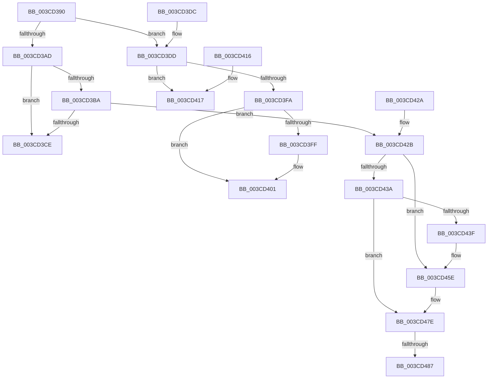

# ExAllocateFromLookasideListEx

- RVA: `0x003CD390`–`0x003CD4A3` (길이 `275` bytes)
- VA: `0x00000001403CD390`
- 실행 섹션: `.text`
- PDB 이름 있음: `예`; PDB Function 태그: `아니요`
- unwind 정보 RVA: `0x0008F9B0`
- 디코드: `77`개 명령, `275/275` bytes 표시
- 미해석 바이트: `0` (있으면 어셈블리에 `.byte`로 보존)

> 이 문서는 커널 이미지의 기계어와 PDB 기호를 분석해 생성했습니다. 4번과 5번은 함수 원형과 자료형을 바이너리 사용 방식에서 추정한 C 해석이며 원본 소스 복구 결과는 아닙니다.

## 1. Dependencies

- 직접 호출 지점: **6**; 고유 호출 대상: **4**
- 직접 호출자로 확인된 함수: **7**
- RIP 상대 이미지 참조: **3**

### Outgoing calls
- `0x003CD3A0` → [ExpInterlockedPopEntrySList](../6B/ExpInterlockedPopEntrySList_function_006BA570.md) (function, `0x006BA570`)
- `0x003CD406` → [CmpAllocatePool](CmpAllocatePool_function_003CD504.md) (function, `0x003CD504`)
- `0x003CD41A` → [guard_dispatch_icall](../6B/guard_dispatch_icall_function_006BAAD0.md) (function, `0x006BAAD0`)
- `0x003CD458` → [KeBugCheckEx](../4F/KeBugCheckEx_function_004FD660.md) (function, `0x004FD660`)
- `0x003CD478` → [KeBugCheckEx](../4F/KeBugCheckEx_function_004FD660.md) (function, `0x004FD660`)
- `0x003CD49D` → [KeBugCheckEx](../4F/KeBugCheckEx_function_004FD660.md) (function, `0x004FD660`)

### Direct callers
- [CcInitializeCacheMapInternal](CcInitializeCacheMapInternal_function_003CC720.md) at `0x003CC826`
- [CcInitializeCacheMapInternal](CcInitializeCacheMapInternal_function_003CC720.md) at `0x003CCF04`
- [CmpCreateKeyControlBlock](../../page/85/CmpCreateKeyControlBlock_function_00851DB0.md) at `0x00851F85`
- [NtQueryKey](../../page/86/NtQueryKey_function_008676E0.md) at `0x00867D41`
- [sub_008B288E](../../page/8B/Unknown_function_008B288E.md) at `0x008B28A2`
- [NtEnumerateValueKey](../../page/8B/NtEnumerateValueKey_function_008B3B50.md) at `0x008B4291`
- [CmpAllocateKeyControlBlock](../../page/9E/CmpAllocateKeyControlBlock_function_009EB5A0.md) at `0x009EB5B5`
- [VmAccessFault](../../page/A1/VmAccessFault_function_00A18BF0.md) at `0x00A18F4E`

### Static image references
- `0x003CD3AD` → RVA `0x00475D80` (`CmSiFreeMemory`; read)
- `0x003CD3C5` → RVA `0x00FCEC68` (`ALMOSTRO`; read)
- `0x003CD3E0` → RVA `0x0047FD60` (`CmpAllocatePoolLookaside`; read)

## 2. Other-region calls and transfers

- 다른 실행 섹션으로 향하는 call: **0**
- call이 아닌 외부 분기/꼬리 이동: **1**
  - `0x003CD485` → [sub_003CD4A3](Unknown_function_003CD4A3.md) (`tail-transfer`)

## 3. Assembly (complete function range)

```asm
003CD390  48 89 5C 24 18                  mov qword ptr [rsp + 0x18], rbx
003CD395  57                              push rdi
003CD396  48 83 EC 30                     sub rsp, 0x30
003CD39A  FF 41 14                        inc dword ptr [rcx + 0x14]
003CD39D  48 8B D9                        mov rbx, rcx
003CD3A0  E8 CB D1 2E 00                  call 0x1406ba570
003CD3A5  48 8B F8                        mov rdi, rax
003CD3A8  48 85 C0                        test rax, rax
003CD3AB  74 30                           je 0x1403cd3dd
003CD3AD  48 8D 05 CC 89 0A 00            lea rax, [rip + 0xa89cc]
003CD3B4  48 39 43 38                     cmp qword ptr [rbx + 0x38], rax
003CD3B8  75 14                           jne 0x1403cd3ce
003CD3BA  8B 5B 2C                        mov ebx, dword ptr [rbx + 0x2c]
003CD3BD  48 8D 4F 08                     lea rcx, [rdi + 8]
003CD3C1  48 83 EB 08                     sub rbx, 8
003CD3C5  80 3D 9C 18 C0 00 00            cmp byte ptr [rip + 0xc0189c], 0
003CD3CC  75 5D                           jne 0x1403cd42b
003CD3CE  48 8B C7                        mov rax, rdi
003CD3D1  48 8B 5C 24 50                  mov rbx, qword ptr [rsp + 0x50]
003CD3D6  48 83 C4 30                     add rsp, 0x30
003CD3DA  5F                              pop rdi
003CD3DB  C3                              ret
003CD3DC  CC                              int3
003CD3DD  FF 43 18                        inc dword ptr [rbx + 0x18]
003CD3E0  4C 8D 0D 79 29 0B 00            lea r9, [rip + 0xb2979]
003CD3E7  48 8B 43 30                     mov rax, qword ptr [rbx + 0x30]
003CD3EB  44 8B 43 28                     mov r8d, dword ptr [rbx + 0x28]
003CD3EF  8B 53 2C                        mov edx, dword ptr [rbx + 0x2c]
003CD3F2  8B 4B 24                        mov ecx, dword ptr [rbx + 0x24]
003CD3F5  49 3B C1                        cmp rax, r9
003CD3F8  75 1D                           jne 0x1403cd417
003CD3FA  83 F9 01                        cmp ecx, 1
003CD3FD  74 02                           je 0x1403cd401
003CD3FF  CD 2C                           int 0x2c
003CD401  B9 00 01 00 00                  mov ecx, 0x100
003CD406  E8 F9 00 00 00                  call 0x1403cd504
003CD40B  48 8B 5C 24 50                  mov rbx, qword ptr [rsp + 0x50]
003CD410  48 83 C4 30                     add rsp, 0x30
003CD414  5F                              pop rdi
003CD415  C3                              ret
003CD416  CC                              int3
003CD417  4C 8B CB                        mov r9, rbx
003CD41A  E8 B1 D6 2E 00                  call 0x1406baad0
003CD41F  48 8B 5C 24 50                  mov rbx, qword ptr [rsp + 0x50]
003CD424  48 83 C4 30                     add rsp, 0x30
003CD428  5F                              pop rdi
003CD429  C3                              ret
003CD42A  CC                              int3
003CD42B  48 B8 00 00 00 00 00 80 FF FF   movabs rax, 0xffff800000000000
003CD435  48 3B C8                        cmp rcx, rax
003CD438  72 24                           jb 0x1403cd45e
003CD43A  F6 C1 07                        test cl, 7
003CD43D  74 3F                           je 0x1403cd47e
003CD43F  BA 02 00 00 00                  mov edx, 2
003CD444  48 C7 44 24 20 08 00 00 00      mov qword ptr [rsp + 0x20], 8
003CD44D  4C 8B C9                        mov r9, rcx
003CD450  44 8B C2                        mov r8d, edx
003CD453  B9 F1 01 00 00                  mov ecx, 0x1f1
003CD458  E8 03 02 13 00                  call 0x1404fd660
003CD45D  CC                              int3
003CD45E  BA 02 00 00 00                  mov edx, 2
003CD463  48 C7 44 24 20 00 00 00 00      mov qword ptr [rsp + 0x20], 0
003CD46C  4C 8B C9                        mov r9, rcx
003CD46F  B9 F1 01 00 00                  mov ecx, 0x1f1
003CD474  44 8D 42 FF                     lea r8d, [rdx - 1]
003CD478  E8 E3 01 13 00                  call 0x1404fd660
003CD47D  CC                              int3
003CD47E  48 8D 04 19                     lea rax, [rcx + rbx]
003CD482  48 3B C1                        cmp rax, rcx
003CD485  73 1C                           jae 0x1403cd4a3
003CD487  BA 02 00 00 00                  mov edx, 2
003CD48C  48 89 5C 24 20                  mov qword ptr [rsp + 0x20], rbx
003CD491  4C 8B C9                        mov r9, rcx
003CD494  B9 F1 01 00 00                  mov ecx, 0x1f1
003CD499  44 8D 42 01                     lea r8d, [rdx + 1]
003CD49D  E8 BE 01 13 00                  call 0x1404fd660
003CD4A2  CC                              int3
```

## 4. C-style interpretation (structured pseudocode)

```c
__int64 __fastcall ExAllocateFromLookasideListEx(__int64 a1)
{
    __int64 result;
    __int64 v_rbx;
    __int64 v_rsp;
    unsigned __int64 v_stack_p18;
    unsigned __int64 v_stack_p50;
    unsigned __int64 v_stack_p88;
    unsigned __int64 v_stack_p90;

    v_stack_p18 = v_rbx;
    v_rsp = (v_rsp) - (48);
    result = ExpInterlockedPopEntrySList(a1, a2, a3, a4);
    if (result == 0) goto loc_003CD3DD;
    if ((*(unsigned __int64 *)(a1 + 56)) != (v_rip + 690636)) goto loc_003CD3CE;
    v_rbx = ((unsigned int)(*(unsigned int *)(a1 + 44))) - (8);
    if ((*(unsigned __int8 *)(v_rip + 12589212)) != 0) goto loc_003CD42B;
loc_003CD3CE:
    v_rsp = (v_rsp) + (48);
    return result;
loc_003CD3DD:
    if ((*(unsigned __int64 *)(v_stack_p18 + 48)) != (v_rip + 731513)) goto loc_003CD417;
    if (((unsigned int)((unsigned int)(*(unsigned int *)(v_stack_p18 + 36)))) != 1) {
    }
    result = CmpAllocatePool(256, (unsigned int)(*(unsigned int *)(v_stack_p18 + 44)), (unsigned int)(*(unsigned int *)(v_stack_p18 + 40)), v_rip + 731513);
    v_rsp = (v_rsp) + (48);
    return result;
loc_003CD417:
    result = guard_dispatch_icall(256, (unsigned int)(*(unsigned int *)(v_stack_p18 + 44)), (unsigned int)(*(unsigned int *)(v_stack_p18 + 40)), v_stack_p50);
    v_rsp = (v_rsp) + (48);
    return result;
loc_003CD42B:
    if (256 < result) goto loc_003CD45E;
    if (((256) & (7)) == 0) goto loc_003CD47E;
    v_stack_p90 = 8;
    result = KeBugCheckEx(497, 2, 2, 256);
loc_003CD45E:
    v_stack_p90 = 0;
    result = KeBugCheckEx(497, 2, 2 - 1, 497);
loc_003CD47E:
    v_stack_p90 = v_stack_p88;
    result = KeBugCheckEx(497, 2, 2 + 1, 497);
    return result;
}
```

## 5. (Beta) C Style

```c
int64_t ExAllocateFromLookasideListEx(void *Arg1)
{
    uint8_t *arg1 = (uint8_t *)Arg1;

    int64_t result;
    int64_t local_rbx;
    int64_t local_rsp;
    uint64_t v_stack_p18;
    uint64_t v_stack_p50;
    uint64_t v_stack_p88;
    uint64_t v_stack_p90;

    v_stack_p18 = local_rbx;
    local_rsp = (local_rsp) - (48);
    result = ExpInterlockedPopEntrySList(Arg1, a2, a3, a4);
    if (result == 0) goto loc_003CD3DD;
    if ((*(uint64_t *)(arg1 + 0x38)) != (v_rip + 690636)) goto loc_003CD3CE;
    local_rbx = ((uint32_t)(*(uint32_t *)(arg1 + 0x2C))) - (8);
    if ((*(uint8_t *)(v_rip + 0xC0189C)) != 0) goto loc_003CD42B;
loc_003CD3CE:
    local_rsp = (local_rsp) + (48);
    return result;
loc_003CD3DD:
    if ((*(uint64_t *)(v_stack_p18 + 0x30)) != (v_rip + 731513)) goto loc_003CD417;
    if (((uint32_t)((uint32_t)(*(uint32_t *)(v_stack_p18 + 0x24)))) != 1) {
    }
    result = CmpAllocatePool(256, (uint32_t)(*(uint32_t *)(v_stack_p18 + 0x2C)), (uint32_t)(*(uint32_t *)(v_stack_p18 + 0x28)), v_rip + 731513);
    local_rsp = (local_rsp) + (48);
    return result;
loc_003CD417:
    result = guard_dispatch_icall(256, (uint32_t)(*(uint32_t *)(v_stack_p18 + 0x2C)), (uint32_t)(*(uint32_t *)(v_stack_p18 + 0x28)), v_stack_p50);
    local_rsp = (local_rsp) + (48);
    return result;
loc_003CD42B:
    if (256 < result) goto loc_003CD45E;
    if (((256) & (7)) == 0) goto loc_003CD47E;
    v_stack_p90 = 8;
    result = KeBugCheckEx(497, 2, 2, 256);
loc_003CD45E:
    v_stack_p90 = 0;
    result = KeBugCheckEx(497, 2, 2 - 1, 497);
loc_003CD47E:
    v_stack_p90 = v_stack_p88;
    result = KeBugCheckEx(497, 2, 2 + 1, 497);
    return result;
}
```

### 관측된 메모리 오프셋

구조체 형식이 확인되지 않은 접근은 인자 기준의 오프셋으로만 기록했습니다.

| 기준 인자 | 오프셋 표현 | 폭 (bit) | 접근 |
|---|---:|---:|---|
| `Arg1` | `+ 0x14` | `32` | `R/W` |
| `Arg1` | `+ 0x18` | `32` | `R/W` |
| `Arg1` | `+ 0x24` | `32` | `R` |
| `Arg1` | `+ 0x28` | `32` | `R` |
| `Arg1` | `+ 0x2C` | `32` | `R` |
| `Arg1` | `+ 0x30` | `64` | `R` |
| `Arg1` | `+ 0x38` | `64` | `R` |

## 6. Execution-region graph

[열기: 2D/3D 그래프와 함수 탐색 컨트롤 패널](../../../control-panel.html?section=text&rva=0x003CD390&view=graph)

- 2D 그래프는 위에서 아래로 흐르고, 3D 그래프는 빈 공간을 드래그해 회전합니다. Shift+드래그는 이동, 휠은 확대·축소, 함수 노드 선택은 대상 보고서 이동입니다.

### Static fallback


