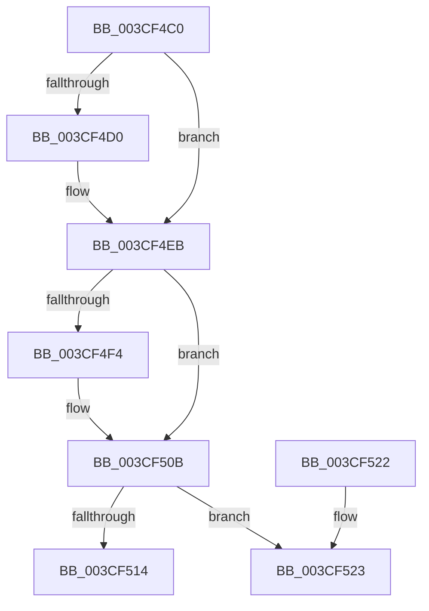

# ExDeleteFastResource

- RVA: `0x003CF4C0`–`0x003CF53E` (길이 `126` bytes)
- VA: `0x00000001403CF4C0`
- 실행 섹션: `.text`
- PDB 이름 있음: `예`; PDB Function 태그: `아니요`
- unwind 정보 RVA: `0x00082188`
- 디코드: `35`개 명령, `126/126` bytes 표시
- 미해석 바이트: `0` (있으면 어셈블리에 `.byte`로 보존)

> 이 문서는 커널 이미지의 기계어와 PDB 기호를 분석해 생성했습니다. 4번과 5번은 함수 원형과 자료형을 바이너리 사용 방식에서 추정한 C 해석이며 원본 소스 복구 결과는 아닙니다.

## 1. Dependencies

- 직접 호출 지점: **4**; 고유 호출 대상: **2**
- 직접 호출자로 확인된 함수: **0**
- RIP 상대 이미지 참조: **0**

### Outgoing calls
- `0x003CF4E5` → [KeBugCheckEx](../4F/KeBugCheckEx_function_004FD660.md) (function, `0x004FD660`)
- `0x003CF505` → [KeBugCheckEx](../4F/KeBugCheckEx_function_004FD660.md) (function, `0x004FD660`)
- `0x003CF50B` → [ExpIsFastResourceOwned](ExpIsFastResourceOwned_function_003CF550.md) (function, `0x003CF550`)
- `0x003CF538` → [KeBugCheckEx](../4F/KeBugCheckEx_function_004FD660.md) (function, `0x004FD660`)

### Direct callers
- 이 함수 시작 RVA로 연결되는 직접 call은 확인되지 않았습니다. 간접 호출은 완전히 역산할 수 없습니다.

### Static image references
- 디코드된 RIP-relative 메모리 참조가 없습니다.

## 2. Other-region calls and transfers

- 다른 실행 섹션으로 향하는 call: **0**
- 별도 외부 분기/꼬리 이동을 확인하지 못했습니다.

## 3. Assembly (complete function range)

```asm
003CF4C0  48 83 EC 38                     sub rsp, 0x38
003CF4C4  41 B9 01 00 00 00               mov r9d, 1
003CF4CA  44 84 49 1A                     test byte ptr [rcx + 0x1a], r9b
003CF4CE  75 1B                           jne 0x1403cf4eb
003CF4D0  48 83 64 24 20 00               and qword ptr [rsp + 0x20], 0
003CF4D6  45 33 C9                        xor r9d, r9d
003CF4D9  4C 8B C1                        mov r8, rcx
003CF4DC  B9 C6 01 00 00                  mov ecx, 0x1c6
003CF4E1  41 8D 51 03                     lea edx, [r9 + 3]
003CF4E5  E8 76 E1 12 00                  call 0x1404fd660
003CF4EA  CC                              int3
003CF4EB  44 0F 20 C0                     mov rax, cr8
003CF4EF  41 3A C1                        cmp al, r9b
003CF4F2  76 17                           jbe 0x1403cf50b
003CF4F4  48 83 64 24 20 00               and qword ptr [rsp + 0x20], 0
003CF4FA  33 D2                           xor edx, edx
003CF4FC  44 0F B6 C0                     movzx r8d, al
003CF500  B9 C6 01 00 00                  mov ecx, 0x1c6
003CF505  E8 56 E1 12 00                  call 0x1404fd660
003CF50A  CC                              int3
003CF50B  E8 40 00 00 00                  call 0x1403cf550
003CF510  84 C0                           test al, al
003CF512  75 0F                           jne 0x1403cf523
003CF514  B8 BE FF 00 00                  mov eax, 0xffbe
003CF519  66 21 41 1A                     and word ptr [rcx + 0x1a], ax
003CF51D  48 83 C4 38                     add rsp, 0x38
003CF521  C3                              ret
003CF522  CC                              int3
003CF523  48 83 64 24 20 00               and qword ptr [rsp + 0x20], 0
003CF529  45 33 C9                        xor r9d, r9d
003CF52C  4C 8B C1                        mov r8, rcx
003CF52F  B9 C6 01 00 00                  mov ecx, 0x1c6
003CF534  41 8D 51 04                     lea edx, [r9 + 4]
003CF538  E8 23 E1 12 00                  call 0x1404fd660
003CF53D  CC                              int3
```

## 4. C-style interpretation (structured pseudocode)

```c
__int64 __fastcall ExDeleteFastResource(__int64 a1)
{
    __int64 result;
    __int64 v_rsp;
    unsigned __int64 v_stack_m18;
    unsigned __int64 v_stack_p20;

    v_rsp = (v_rsp) - (56);
    if (((*(unsigned __int8 *)(a1 + 26)) & (1)) == 0) {
        a4 = 0;
        a3 = a1;
        a1 = 454;
        a2 = a4 + 3;
        result = KeBugCheckEx(a1, a2, a3, a4);
    }
    result = v_cr8;
    if (((unsigned __int8)(v_cr8)) >= = 0) {
        a2 = 0;
        a3 = (unsigned __int8)(v_cr8);
        a1 = 454;
        result = KeBugCheckEx(a1, a2, a3, a4);
    }
    result = ExpIsFastResourceOwned(a1, a2, a3, a4);
    if ((unsigned __int8)(result) != 0) goto loc_003CF523;
    v_rsp = (v_rsp) + (56);
    return (unsigned int)(0xFFBEULL);
loc_003CF523:
    a4 = 0;
    result = KeBugCheckEx(454, a4 + 4, a1, a4);
    return result;
}
```

## 5. (Beta) C Style

```c
int64_t ExDeleteFastResource(void *Arg1)
{
    uint8_t *arg1 = (uint8_t *)Arg1;

    int64_t result;
    int64_t local_rsp;
    uint64_t v_stack_m18;
    uint64_t v_stack_p20;

    local_rsp = (local_rsp) - (56);
    if (((*(uint8_t *)(arg1 + 0x1A)) & (1)) == 0) {
        a4 = 0;
        a3 = Arg1;
        Arg1 = 454;
        a2 = a4 + 3;
        result = KeBugCheckEx(Arg1, a2, a3, a4);
    }
    result = v_cr8;
    if (((uint8_t)(v_cr8)) >= = 0) {
        a2 = 0;
        a3 = (uint8_t)(v_cr8);
        Arg1 = 454;
        result = KeBugCheckEx(Arg1, a2, a3, a4);
    }
    result = ExpIsFastResourceOwned(Arg1, a2, a3, a4);
    if ((uint8_t)(result) != 0) goto loc_003CF523;
    local_rsp = (local_rsp) + (56);
    return (uint32_t)(0xFFBEULL);
loc_003CF523:
    a4 = 0;
    result = KeBugCheckEx(454, a4 + 4, Arg1, a4);
    return result;
}
```

### 관측된 메모리 오프셋

구조체 형식이 확인되지 않은 접근은 인자 기준의 오프셋으로만 기록했습니다.

| 기준 인자 | 오프셋 표현 | 폭 (bit) | 접근 |
|---|---:|---:|---|
| `Arg1` | `+ 0x1A` | `8` | `R` |

## 6. Execution-region graph

[열기: 2D/3D 그래프와 함수 탐색 컨트롤 패널](../../../control-panel.html?section=text&rva=0x003CF4C0&view=graph)

- 2D 그래프는 위에서 아래로 흐르고, 3D 그래프는 빈 공간을 드래그해 회전합니다. Shift+드래그는 이동, 휠은 확대·축소, 함수 노드 선택은 대상 보고서 이동입니다.

### Static fallback


