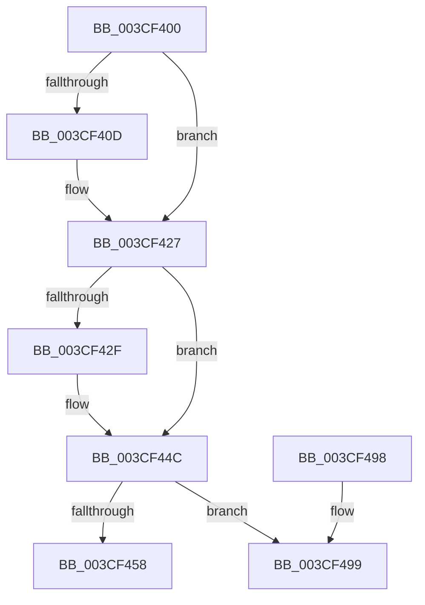

# ExReinitializeFastResource

- RVA: `0x003CF400`–`0x003CF4B1` (길이 `177` bytes)
- VA: `0x00000001403CF400`
- 실행 섹션: `.text`
- PDB 이름 있음: `예`; PDB Function 태그: `아니요`
- unwind 정보 RVA: `0x00076F28`
- 디코드: `52`개 명령, `177/177` bytes 표시
- 미해석 바이트: `0` (있으면 어셈블리에 `.byte`로 보존)

> 이 문서는 커널 이미지의 기계어와 PDB 기호를 분석해 생성했습니다. 4번과 5번은 함수 원형과 자료형을 바이너리 사용 방식에서 추정한 C 해석이며 원본 소스 복구 결과는 아닙니다.

## 1. Dependencies

- 직접 호출 지점: **4**; 고유 호출 대상: **2**
- 직접 호출자로 확인된 함수: **1**
- RIP 상대 이미지 참조: **0**

### Outgoing calls
- `0x003CF421` → [KeBugCheckEx](../4F/KeBugCheckEx_function_004FD660.md) (function, `0x004FD660`)
- `0x003CF446` → [KeBugCheckEx](../4F/KeBugCheckEx_function_004FD660.md) (function, `0x004FD660`)
- `0x003CF44C` → [ExpIsFastResourceOwned](ExpIsFastResourceOwned_function_003CF550.md) (function, `0x003CF550`)
- `0x003CF4AB` → [KeBugCheckEx](../4F/KeBugCheckEx_function_004FD660.md) (function, `0x004FD660`)

### Direct callers
- [DifExReinitializeFastResourceWrapper](../62/DifExReinitializeFastResourceWrapper_function_00621E90.md) at `0x00621F56`

### Static image references
- 디코드된 RIP-relative 메모리 참조가 없습니다.

## 2. Other-region calls and transfers

- 다른 실행 섹션으로 향하는 call: **0**
- 별도 외부 분기/꼬리 이동을 확인하지 못했습니다.

## 3. Assembly (complete function range)

```asm
003CF400  48 83 EC 38                     sub rsp, 0x38
003CF404  F6 41 1A 01                     test byte ptr [rcx + 0x1a], 1
003CF408  48 8B D1                        mov rdx, rcx
003CF40B  75 1A                           jne 0x1403cf427
003CF40D  45 33 C9                        xor r9d, r9d
003CF410  4C 8B C1                        mov r8, rcx
003CF413  B9 C6 01 00 00                  mov ecx, 0x1c6
003CF418  4C 89 4C 24 20                  mov qword ptr [rsp + 0x20], r9
003CF41D  41 8D 51 03                     lea edx, [r9 + 3]
003CF421  E8 3A E2 12 00                  call 0x1404fd660
003CF426  CC                              int3
003CF427  44 0F 20 C0                     mov rax, cr8
003CF42B  3C 01                           cmp al, 1
003CF42D  76 1D                           jbe 0x1403cf44c
003CF42F  45 33 C9                        xor r9d, r9d
003CF432  44 0F B6 C0                     movzx r8d, al
003CF436  33 D2                           xor edx, edx
003CF438  4C 89 4C 24 20                  mov qword ptr [rsp + 0x20], r9
003CF43D  B9 C6 01 00 00                  mov ecx, 0x1c6
003CF442  44 8D 4A 01                     lea r9d, [rdx + 1]
003CF446  E8 15 E2 12 00                  call 0x1404fd660
003CF44B  CC                              int3
003CF44C  E8 FF 00 00 00                  call 0x1403cf550
003CF451  45 33 C9                        xor r9d, r9d
003CF454  84 C0                           test al, al
003CF456  75 41                           jne 0x1403cf499
003CF458  0F B7 49 1A                     movzx ecx, word ptr [rcx + 0x1a]
003CF45C  4C 89 0A                        mov qword ptr [rdx], r9
003CF45F  66 83 E1 49                     and cx, 0x49
003CF463  4C 89 4A 40                     mov qword ptr [rdx + 0x40], r9
003CF467  4C 89 4A 48                     mov qword ptr [rdx + 0x48], r9
003CF46B  8A 42 65                        mov al, byte ptr [rdx + 0x65]
003CF46E  4C 89 4A 50                     mov qword ptr [rdx + 0x50], r9
003CF472  24 FA                           and al, 0xfa
003CF474  44 89 4A 60                     mov dword ptr [rdx + 0x60], r9d
003CF478  0C 02                           or al, 2
003CF47A  88 42 65                        mov byte ptr [rdx + 0x65], al
003CF47D  33 C0                           xor eax, eax
003CF47F  44 88 4A 64                     mov byte ptr [rdx + 0x64], r9b
003CF483  48 89 42 08                     mov qword ptr [rdx + 8], rax
003CF487  48 89 42 10                     mov qword ptr [rdx + 0x10], rax
003CF48B  4C 89 4A 38                     mov qword ptr [rdx + 0x38], r9
003CF48F  66 89 4A 1A                     mov word ptr [rdx + 0x1a], cx
003CF493  48 83 C4 38                     add rsp, 0x38
003CF497  C3                              ret
003CF498  CC                              int3
003CF499  4C 8B C2                        mov r8, rdx
003CF49C  4C 89 4C 24 20                  mov qword ptr [rsp + 0x20], r9
003CF4A1  BA 04 00 00 00                  mov edx, 4
003CF4A6  B9 C6 01 00 00                  mov ecx, 0x1c6
003CF4AB  E8 B0 E1 12 00                  call 0x1404fd660
003CF4B0  CC                              int3
```

## 4. C-style interpretation (structured pseudocode)

```c
__int64 __fastcall ExReinitializeFastResource(__int64 a1, __int64 a2, __int64 a3, int a4)
{
    __int64 result;
    __int64 v_rsp;
    unsigned __int64 v_stack_m18;
    unsigned __int64 v_stack_p20;

    v_rsp = (v_rsp) - (56);
    if (((*(unsigned __int8 *)(a1 + 26)) & (1)) == 0) {
        a4 = 0;
        a3 = a1;
        a1 = 454;
        v_stack_m18 = 0;
        a2 = a4 + 3;
        result = KeBugCheckEx(a1, a2, a3, a4);
    }
    result = v_cr8;
    if (((unsigned __int8)(v_cr8)) >= = 1) {
        a4 = 0;
        a3 = (unsigned __int8)(v_cr8);
        a2 = 0;
        v_stack_m18 = 0;
        a1 = 454;
        a4 = a2 + 1;
        result = KeBugCheckEx(a1, a2, a3, a4);
    }
    result = ExpIsFastResourceOwned(a1, a2, a3, a4);
    a4 = 0;
    if ((unsigned __int8)(result) != 0) goto loc_003CF499;
    *(unsigned __int64 *)(a2) = 0;
    a1 = (unsigned __int16)((*(unsigned __int16 *)(a1 + 26)) & (73));
    *(unsigned __int64 *)(a2 + 64) = 0;
    *(unsigned __int64 *)(a2 + 72) = 0;
    *(unsigned __int64 *)(a2 + 80) = 0;
    result = (unsigned __int8)((*(unsigned __int8 *)(a2 + 101)) & (250));
    *(unsigned int *)(a2 + 96) = 0;
    result = (unsigned __int8)((result) | (2));
    *(unsigned __int8 *)(a2 + 101) = (unsigned __int8)(result);
    result = 0;
    *(unsigned __int8 *)(a2 + 100) = 0;
    *(unsigned __int64 *)(a2 + 8) = 0;
    *(unsigned __int64 *)(a2 + 16) = 0;
    *(unsigned __int64 *)(a2 + 56) = 0;
    *(unsigned __int16 *)(a2 + 26) = (unsigned __int16)(a1);
    v_rsp = (v_rsp) + (56);
    return result;
loc_003CF499:
    v_stack_p20 = 0;
    result = KeBugCheckEx(454, 4, 0, a4);
    return result;
}
```

## 5. (Beta) C Style

```c
int64_t ExReinitializeFastResource(void *Arg1, int64_t Arg2, int64_t Arg3, int32_t Arg4)
{
    uint8_t *arg1 = (uint8_t *)Arg1;

    int64_t result;
    int64_t local_rsp;
    uint64_t v_stack_m18;
    uint64_t v_stack_p20;

    local_rsp = (local_rsp) - (56);
    if (((*(uint8_t *)(arg1 + 0x1A)) & (1)) == 0) {
        Arg4 = 0;
        Arg3 = Arg1;
        Arg1 = 454;
        v_stack_m18 = 0;
        Arg2 = Arg4 + 3;
        result = KeBugCheckEx(Arg1, Arg2, Arg3, Arg4);
    }
    result = v_cr8;
    if (((uint8_t)(v_cr8)) >= = 1) {
        Arg4 = 0;
        Arg3 = (uint8_t)(v_cr8);
        Arg2 = 0;
        v_stack_m18 = 0;
        Arg1 = 454;
        Arg4 = Arg2 + 1;
        result = KeBugCheckEx(Arg1, Arg2, Arg3, Arg4);
    }
    result = ExpIsFastResourceOwned(Arg1, Arg2, Arg3, Arg4);
    Arg4 = 0;
    if ((uint8_t)(result) != 0) goto loc_003CF499;
    *(uint64_t *)(Arg2) = 0;
    Arg1 = (uint16_t)((*(uint16_t *)(arg1 + 0x1A)) & (73));
    *(uint64_t *)(Arg2 + 0x40) = 0;
    *(uint64_t *)(Arg2 + 0x48) = 0;
    *(uint64_t *)(Arg2 + 0x50) = 0;
    result = (uint8_t)((*(uint8_t *)(Arg2 + 0x65)) & (250));
    *(uint32_t *)(Arg2 + 0x60) = 0;
    result = (uint8_t)((result) | (2));
    *(uint8_t *)(Arg2 + 0x65) = (uint8_t)(result);
    result = 0;
    *(uint8_t *)(Arg2 + 0x64) = 0;
    *(uint64_t *)(Arg2 + 0x8) = 0;
    *(uint64_t *)(Arg2 + 0x10) = 0;
    *(uint64_t *)(Arg2 + 0x38) = 0;
    *(uint16_t *)(Arg2 + 0x1A) = (uint16_t)(Arg1);
    local_rsp = (local_rsp) + (56);
    return result;
loc_003CF499:
    v_stack_p20 = 0;
    result = KeBugCheckEx(454, 4, 0, Arg4);
    return result;
}
```

### 관측된 메모리 오프셋

구조체 형식이 확인되지 않은 접근은 인자 기준의 오프셋으로만 기록했습니다.

| 기준 인자 | 오프셋 표현 | 폭 (bit) | 접근 |
|---|---:|---:|---|
| `Arg1` | `+ 0x1A` | `8` | `R` |

## 6. Execution-region graph

[열기: 2D/3D 그래프와 함수 탐색 컨트롤 패널](../../../control-panel.html?section=text&rva=0x003CF400&view=graph)

- 2D 그래프는 위에서 아래로 흐르고, 3D 그래프는 빈 공간을 드래그해 회전합니다. Shift+드래그는 이동, 휠은 확대·축소, 함수 노드 선택은 대상 보고서 이동입니다.

### Static fallback


