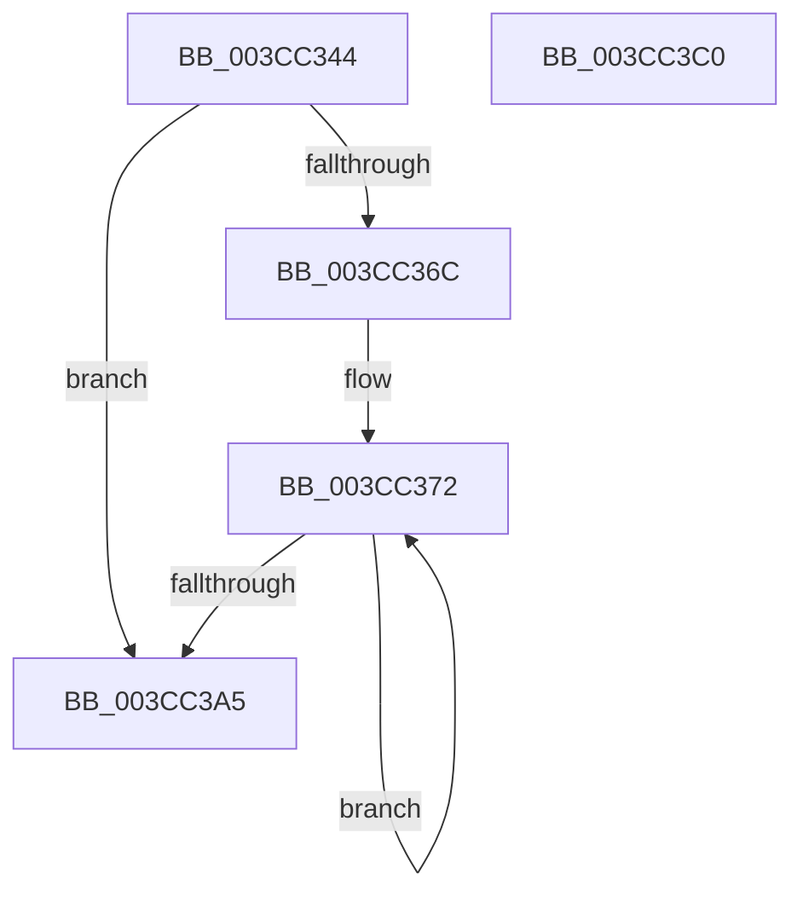

# HviCopyMemoryNonTemporal

- RVA: `0x003CC344`–`0x003CC3C1` (길이 `125` bytes)
- VA: `0x00000001403CC344`
- 실행 섹션: `.text`
- PDB 이름 있음: `예`; PDB Function 태그: `아니요`
- unwind 정보 RVA: `0x00060300`
- 디코드: `38`개 명령, `125/125` bytes 표시
- 미해석 바이트: `0` (있으면 어셈블리에 `.byte`로 보존)

> 이 문서는 커널 이미지의 기계어와 PDB 기호를 분석해 생성했습니다. 4번과 5번은 함수 원형과 자료형을 바이너리 사용 방식에서 추정한 C 해석이며 원본 소스 복구 결과는 아닙니다.

## 1. Dependencies

- 직접 호출 지점: **3**; 고유 호출 대상: **3**
- 직접 호출자로 확인된 함수: **1**
- RIP 상대 이미지 참조: **1**

### Outgoing calls
- `0x003CC37D` → [HviEnterKernelAperture](../60/HviEnterKernelAperture_function_0060256C.md) (function, `0x0060256C`)
- `0x003CC38D` → `indirect target` (indirect, 간접 대상)
- `0x003CC399` → [HviLeaveKernelAperture](../60/HviLeaveKernelAperture_function_00602640.md) (function, `0x00602640`)

### Direct callers
- [CcCopyToCacheHelper](CcCopyToCacheHelper_function_003CC290.md) at `0x003CC2FB`

### Static image references
- `0x003CC38D` → RVA `0x00042FF8` (`.rdata`; read)

## 2. Other-region calls and transfers

- 다른 실행 섹션으로 향하는 call: **0**
- 별도 외부 분기/꼬리 이동을 확인하지 못했습니다.

## 3. Assembly (complete function range)

```asm
003CC344  48 89 5C 24 08                  mov qword ptr [rsp + 8], rbx
003CC349  48 89 6C 24 10                  mov qword ptr [rsp + 0x10], rbp
003CC34E  48 89 74 24 18                  mov qword ptr [rsp + 0x18], rsi
003CC353  57                              push rdi
003CC354  41 56                           push r14
003CC356  41 57                           push r15
003CC358  48 83 EC 20                     sub rsp, 0x20
003CC35C  33 FF                           xor edi, edi
003CC35E  41 8B F0                        mov esi, r8d
003CC361  48 8B EA                        mov rbp, rdx
003CC364  4C 8B F1                        mov r14, rcx
003CC367  45 85 C0                        test r8d, r8d
003CC36A  74 39                           je 0x1403cc3a5
003CC36C  41 BF 00 00 10 00               mov r15d, 0x100000
003CC372  8B DE                           mov ebx, esi
003CC374  2B DF                           sub ebx, edi
003CC376  41 3B DF                        cmp ebx, r15d
003CC379  41 0F 47 DF                     cmova ebx, r15d
003CC37D  E8 EA 61 23 00                  call 0x14060256c
003CC382  44 8B C3                        mov r8d, ebx
003CC385  48 8D 14 2F                     lea rdx, [rdi + rbp]
003CC389  4A 8D 0C 37                     lea rcx, [rdi + r14]
003CC38D  48 FF 15 64 6C C7 FF            call qword ptr [rip - 0x38939c]
003CC394  0F 1F 44 00 00                  nop dword ptr [rax + rax]
003CC399  E8 A2 62 23 00                  call 0x140602640
003CC39E  41 03 FF                        add edi, r15d
003CC3A1  3B FE                           cmp edi, esi
003CC3A3  72 CD                           jb 0x1403cc372
003CC3A5  48 8B 5C 24 40                  mov rbx, qword ptr [rsp + 0x40]
003CC3AA  33 C0                           xor eax, eax
003CC3AC  48 8B 6C 24 48                  mov rbp, qword ptr [rsp + 0x48]
003CC3B1  48 8B 74 24 50                  mov rsi, qword ptr [rsp + 0x50]
003CC3B6  48 83 C4 20                     add rsp, 0x20
003CC3BA  41 5F                           pop r15
003CC3BC  41 5E                           pop r14
003CC3BE  5F                              pop rdi
003CC3BF  C3                              ret
003CC3C0  CC                              int3
```

## 4. C-style interpretation (structured pseudocode)

```c
__int64 __fastcall HviCopyMemoryNonTemporal(__int64 a1, __int64 a2, int a3)
{
    __int64 result;
    __int64 v_rbx;
    __int64 v_rdi;
    __int64 v_rsp;
    unsigned __int64 v_stack_p10;
    unsigned __int64 v_stack_p18;
    unsigned __int64 v_stack_p8;

    v_stack_p8 = v_rbx;
    v_stack_p10 = v_rbp;
    v_stack_p18 = v_rsi;
    v_rsp = (v_rsp) - (32);
    v_rdi = 0;
    if (a3 == 0) goto loc_003CC3A5;
loc_003CC372:
    v_rbx = (unsigned int)(((unsigned int)((unsigned int)((unsigned int)(a3)))) - (0));
    if (((unsigned int)(v_rbx)) > ((unsigned int)((unsigned int)(0x100000ULL)))) { v_rbx = (unsigned int)((unsigned int)(0x100000ULL)); }
    result = HviEnterKernelAperture(a1, a2, a3, a4);
    result = kernel_indirect_call(v_rdi + a1 * 1, v_rdi + a2 * 1, (unsigned int)((unsigned int)(v_rbx)), a4);
    result = HviLeaveKernelAperture(v_rdi + a1 * 1, v_rdi + a2 * 1, (unsigned int)((unsigned int)(v_rbx)), a4);
    v_rdi = (unsigned int)((v_rdi) + ((unsigned int)((unsigned int)(0x100000ULL))));
    if (((unsigned int)(v_rdi)) < ((unsigned int)((unsigned int)(a3)))) goto loc_003CC372;
loc_003CC3A5:
    result = 0;
    v_rsp = (v_rsp) + (32);
    return result;
}
```

## 5. (Beta) C Style

```c
int64_t HviCopyMemoryNonTemporal(int64_t Arg1, int64_t Arg2, int32_t Arg3)
{
    int64_t result;
    int64_t local_rbx;
    int64_t local_rdi;
    int64_t local_rsp;
    uint64_t v_stack_p10;
    uint64_t v_stack_p18;
    uint64_t v_stack_p8;

    v_stack_p8 = local_rbx;
    v_stack_p10 = local_rbp;
    v_stack_p18 = local_rsi;
    local_rsp = (local_rsp) - (32);
    local_rdi = 0;
    if (Arg3 == 0) goto loc_003CC3A5;
loc_003CC372:
    local_rbx = (uint32_t)(((uint32_t)((uint32_t)((uint32_t)(Arg3)))) - (0));
    if (((uint32_t)(local_rbx)) > ((uint32_t)((uint32_t)(0x100000ULL)))) { local_rbx = (uint32_t)((uint32_t)(0x100000ULL)); }
    result = HviEnterKernelAperture(Arg1, Arg2, Arg3, a4);
    result = kernel_indirect_call(local_rdi + Arg1 * 1, local_rdi + Arg2 * 1, (uint32_t)((uint32_t)(local_rbx)), a4);
    result = HviLeaveKernelAperture(local_rdi + Arg1 * 1, local_rdi + Arg2 * 1, (uint32_t)((uint32_t)(local_rbx)), a4);
    local_rdi = (uint32_t)((local_rdi) + ((uint32_t)((uint32_t)(0x100000ULL))));
    if (((uint32_t)(local_rdi)) < ((uint32_t)((uint32_t)(Arg3)))) goto loc_003CC372;
loc_003CC3A5:
    result = 0;
    local_rsp = (local_rsp) + (32);
    return result;
}
```

## 6. Execution-region graph

[열기: 2D/3D 그래프와 함수 탐색 컨트롤 패널](../../../control-panel.html?section=text&rva=0x003CC344&view=graph)

- 2D 그래프는 위에서 아래로 흐르고, 3D 그래프는 빈 공간을 드래그해 회전합니다. Shift+드래그는 이동, 휠은 확대·축소, 함수 노드 선택은 대상 보고서 이동입니다.

### Static fallback


