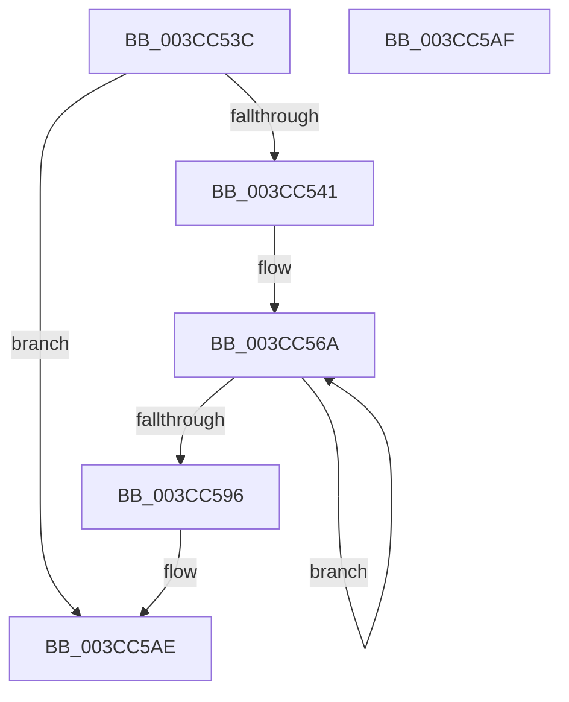

# HviCopyMemory

- RVA: `0x003CC53C`–`0x003CC5B0` (길이 `116` bytes)
- VA: `0x00000001403CC53C`
- 실행 섹션: `.text`
- PDB 이름 있음: `예`; PDB Function 태그: `아니요`
- unwind 정보 RVA: `0x0008F90C`
- 디코드: `36`개 명령, `116/116` bytes 표시
- 미해석 바이트: `0` (있으면 어셈블리에 `.byte`로 보존)

> 이 문서는 커널 이미지의 기계어와 PDB 기호를 분석해 생성했습니다. 4번과 5번은 함수 원형과 자료형을 바이너리 사용 방식에서 추정한 C 해석이며 원본 소스 복구 결과는 아닙니다.

## 1. Dependencies

- 직접 호출 지점: **3**; 고유 호출 대상: **3**
- 직접 호출자로 확인된 함수: **2**
- RIP 상대 이미지 참조: **0**

### Outgoing calls
- `0x003CC575` → [HviEnterKernelAperture](../60/HviEnterKernelAperture_function_0060256C.md) (function, `0x0060256C`)
- `0x003CC585` → [memcpy](../6C/memcpy_function_006C6840.md) (function, `0x006C6840`)
- `0x003CC58A` → [HviLeaveKernelAperture](../60/HviLeaveKernelAperture_function_00602640.md) (function, `0x00602640`)

### Direct callers
- [CcCopyToCacheHelper](CcCopyToCacheHelper_function_003CC290.md) at `0x003CC31D`
- [CcCopyBytesToUserBuffer](CcCopyBytesToUserBuffer_function_003CC3D0.md) at `0x003CC495`

### Static image references
- 디코드된 RIP-relative 메모리 참조가 없습니다.

## 2. Other-region calls and transfers

- 다른 실행 섹션으로 향하는 call: **0**
- 별도 외부 분기/꼬리 이동을 확인하지 못했습니다.

## 3. Assembly (complete function range)

```asm
003CC53C  45 85 C0                        test r8d, r8d
003CC53F  74 6D                           je 0x1403cc5ae
003CC541  48 89 5C 24 08                  mov qword ptr [rsp + 8], rbx
003CC546  48 89 6C 24 10                  mov qword ptr [rsp + 0x10], rbp
003CC54B  48 89 74 24 18                  mov qword ptr [rsp + 0x18], rsi
003CC550  57                              push rdi
003CC551  41 56                           push r14
003CC553  41 57                           push r15
003CC555  48 83 EC 20                     sub rsp, 0x20
003CC559  41 8B F0                        mov esi, r8d
003CC55C  48 8B EA                        mov rbp, rdx
003CC55F  4C 8B F1                        mov r14, rcx
003CC562  33 FF                           xor edi, edi
003CC564  41 BF 00 00 10 00               mov r15d, 0x100000
003CC56A  8B DE                           mov ebx, esi
003CC56C  2B DF                           sub ebx, edi
003CC56E  41 3B DF                        cmp ebx, r15d
003CC571  41 0F 47 DF                     cmova ebx, r15d
003CC575  E8 F2 5F 23 00                  call 0x14060256c
003CC57A  44 8B C3                        mov r8d, ebx
003CC57D  48 8D 14 2F                     lea rdx, [rdi + rbp]
003CC581  4A 8D 0C 37                     lea rcx, [rdi + r14]
003CC585  E8 B6 A2 2F 00                  call 0x1406c6840
003CC58A  E8 B1 60 23 00                  call 0x140602640
003CC58F  41 03 FF                        add edi, r15d
003CC592  3B FE                           cmp edi, esi
003CC594  72 D4                           jb 0x1403cc56a
003CC596  48 8B 5C 24 40                  mov rbx, qword ptr [rsp + 0x40]
003CC59B  48 8B 6C 24 48                  mov rbp, qword ptr [rsp + 0x48]
003CC5A0  48 8B 74 24 50                  mov rsi, qword ptr [rsp + 0x50]
003CC5A5  48 83 C4 20                     add rsp, 0x20
003CC5A9  41 5F                           pop r15
003CC5AB  41 5E                           pop r14
003CC5AD  5F                              pop rdi
003CC5AE  C3                              ret
003CC5AF  CC                              int3
```

## 4. C-style interpretation (structured pseudocode)

```c
__int64 __fastcall HviCopyMemory(__int64 a1, __int64 a2, int a3)
{
    __int64 result;
    __int64 v_rbx;
    __int64 v_rdi;
    __int64 v_rsp;
    unsigned __int64 v_stack_p10;
    unsigned __int64 v_stack_p18;
    unsigned __int64 v_stack_p8;

    if (a3 == 0) goto loc_003CC5AE;
    v_stack_p8 = v_rbx;
    v_stack_p10 = v_rbp;
    v_stack_p18 = v_rsi;
    v_rsp = (v_rsp) - (32);
    v_rdi = 0;
loc_003CC56A:
    v_rbx = (unsigned int)(((unsigned int)((unsigned int)((unsigned int)(a3)))) - (0));
    if (((unsigned int)(v_rbx)) > ((unsigned int)((unsigned int)(0x100000ULL)))) { v_rbx = (unsigned int)((unsigned int)(0x100000ULL)); }
    result = HviEnterKernelAperture(a1, a2, a3, a4);
    result = memcpy(v_rdi + a1 * 1, v_rdi + a2 * 1, (unsigned int)((unsigned int)(v_rbx)), a4);
    result = HviLeaveKernelAperture(v_rdi + a1 * 1, v_rdi + a2 * 1, (unsigned int)((unsigned int)(v_rbx)), a4);
    v_rdi = (unsigned int)((v_rdi) + ((unsigned int)((unsigned int)(0x100000ULL))));
    if (((unsigned int)(v_rdi)) < ((unsigned int)((unsigned int)(a3)))) goto loc_003CC56A;
    v_rsp = (v_rsp) + (32);
loc_003CC5AE:
    return result;
}
```

## 5. (Beta) C Style

```c
int64_t HviCopyMemory(int64_t Arg1, int64_t Arg2, int32_t Arg3)
{
    int64_t result;
    int64_t local_rbx;
    int64_t local_rdi;
    int64_t local_rsp;
    uint64_t v_stack_p10;
    uint64_t v_stack_p18;
    uint64_t v_stack_p8;

    if (Arg3 == 0) goto loc_003CC5AE;
    v_stack_p8 = local_rbx;
    v_stack_p10 = local_rbp;
    v_stack_p18 = local_rsi;
    local_rsp = (local_rsp) - (32);
    local_rdi = 0;
loc_003CC56A:
    local_rbx = (uint32_t)(((uint32_t)((uint32_t)((uint32_t)(Arg3)))) - (0));
    if (((uint32_t)(local_rbx)) > ((uint32_t)((uint32_t)(0x100000ULL)))) { local_rbx = (uint32_t)((uint32_t)(0x100000ULL)); }
    result = HviEnterKernelAperture(Arg1, Arg2, Arg3, a4);
    result = memcpy(local_rdi + Arg1 * 1, local_rdi + Arg2 * 1, (uint32_t)((uint32_t)(local_rbx)), a4);
    result = HviLeaveKernelAperture(local_rdi + Arg1 * 1, local_rdi + Arg2 * 1, (uint32_t)((uint32_t)(local_rbx)), a4);
    local_rdi = (uint32_t)((local_rdi) + ((uint32_t)((uint32_t)(0x100000ULL))));
    if (((uint32_t)(local_rdi)) < ((uint32_t)((uint32_t)(Arg3)))) goto loc_003CC56A;
    local_rsp = (local_rsp) + (32);
loc_003CC5AE:
    return result;
}
```

## 6. Execution-region graph

[열기: 2D/3D 그래프와 함수 탐색 컨트롤 패널](../../../control-panel.html?section=text&rva=0x003CC53C&view=graph)

- 2D 그래프는 위에서 아래로 흐르고, 3D 그래프는 빈 공간을 드래그해 회전합니다. Shift+드래그는 이동, 휠은 확대·축소, 함수 노드 선택은 대상 보고서 이동입니다.

### Static fallback


