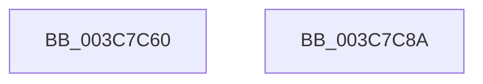

# HvlSwitchVirtualAddressSpace

- RVA: `0x003C7C60`–`0x003C7C8B` (길이 `43` bytes)
- VA: `0x00000001403C7C60`
- 실행 섹션: `.text`
- PDB 이름 있음: `예`; PDB Function 태그: `아니요`
- unwind 정보 RVA: `0x0005C788`
- 디코드: `10`개 명령, `43/43` bytes 표시
- 미해석 바이트: `0` (있으면 어셈블리에 `.byte`로 보존)

> 이 문서는 커널 이미지의 기계어와 PDB 기호를 분석해 생성했습니다. 4번과 5번은 함수 원형과 자료형을 바이너리 사용 방식에서 추정한 C 해석이며 원본 소스 복구 결과는 아닙니다.

## 1. Dependencies

- 직접 호출 지점: **1**; 고유 호출 대상: **1**
- 직접 호출자로 확인된 함수: **11**
- RIP 상대 이미지 참조: **0**

### Outgoing calls
- `0x003C7C80` → [HvcallInitiateHypercall](../31/HvcallInitiateHypercall_function_00313630.md) (function, `0x00313630`)

### Direct callers
- [sub_00216B4F](../21/Unknown_function_00216B4F.md) at `0x00216DCD`
- [sub_00216E70](../21/Unknown_function_00216E70.md) at `0x00216E8F`
- [sub_00217780](../21/Unknown_function_00217780.md) at `0x00217783`
- [KiLoadDirectoryTableBase](../21/KiLoadDirectoryTableBase_function_00217800.md) at `0x00217888`
- [sub_0021824F](../21/Unknown_function_0021824F.md) at `0x00218252`
- [KiAttachProcess](../21/KiAttachProcess_function_002182D0.md) at `0x00218580`
- [sub_00218A8C](../21/Unknown_function_00218A8C.md) at `0x00218A8F`
- [sub_0028F368](../28/Unknown_function_0028F368.md) at `0x0028F36B`
- [sub_003C7676](Unknown_function_003C7676.md) at `0x003C7689`
- [sub_003C7B56](Unknown_function_003C7B56.md) at `0x003C7BD8`
- [SwapContext](../6B/SwapContext_function_006B9820.md) at `0x006B9BF9`

### Static image references
- 디코드된 RIP-relative 메모리 참조가 없습니다.

## 2. Other-region calls and transfers

- 다른 실행 섹션으로 향하는 call: **0**
- 별도 외부 분기/꼬리 이동을 확인하지 못했습니다.

## 3. Assembly (complete function range)

```asm
003C7C60  48 83 EC 28                     sub rsp, 0x28
003C7C64  48 C7 44 24 38 01 00 00 00      mov qword ptr [rsp + 0x38], 1
003C7C6D  48 8B D1                        mov rdx, rcx
003C7C70  C7 44 24 38 01 00 01 00         mov dword ptr [rsp + 0x38], 0x10001
003C7C78  45 33 C0                        xor r8d, r8d
003C7C7B  48 8B 4C 24 38                  mov rcx, qword ptr [rsp + 0x38]
003C7C80  E8 AB B9 F4 FF                  call 0x140313630
003C7C85  48 83 C4 28                     add rsp, 0x28
003C7C89  C3                              ret
003C7C8A  CC                              int3
```

## 4. C-style interpretation (structured pseudocode)

```c
__int64 __fastcall HvlSwitchVirtualAddressSpace(__int64 a1, __int64 a2, int a3)
{
    __int64 result;
    __int64 v_rsp;
    unsigned __int64 v_stack_p10;

    v_rsp = (v_rsp) - (40);
    v_stack_p10 = 1;
    v_stack_p10 = 0x10001ULL;
    a3 = 0;
    result = HvcallInitiateHypercall(v_stack_p10, a1, a3, a4);
    v_rsp = (v_rsp) + (40);
    return result;
}
```

## 5. (Beta) C Style

```c
int64_t HvlSwitchVirtualAddressSpace(int64_t Arg1, int64_t Arg2, int32_t Arg3)
{
    int64_t result;
    int64_t local_rsp;
    uint64_t v_stack_p10;

    local_rsp = (local_rsp) - (40);
    v_stack_p10 = 1;
    v_stack_p10 = 0x10001ULL;
    Arg3 = 0;
    result = HvcallInitiateHypercall(v_stack_p10, Arg1, Arg3, a4);
    local_rsp = (local_rsp) + (40);
    return result;
}
```

## 6. Execution-region graph

[열기: 2D/3D 그래프와 함수 탐색 컨트롤 패널](../../../control-panel.html?section=text&rva=0x003C7C60&view=graph)

- 2D 그래프는 위에서 아래로 흐르고, 3D 그래프는 빈 공간을 드래그해 회전합니다. Shift+드래그는 이동, 휠은 확대·축소, 함수 노드 선택은 대상 보고서 이동입니다.

### Static fallback


