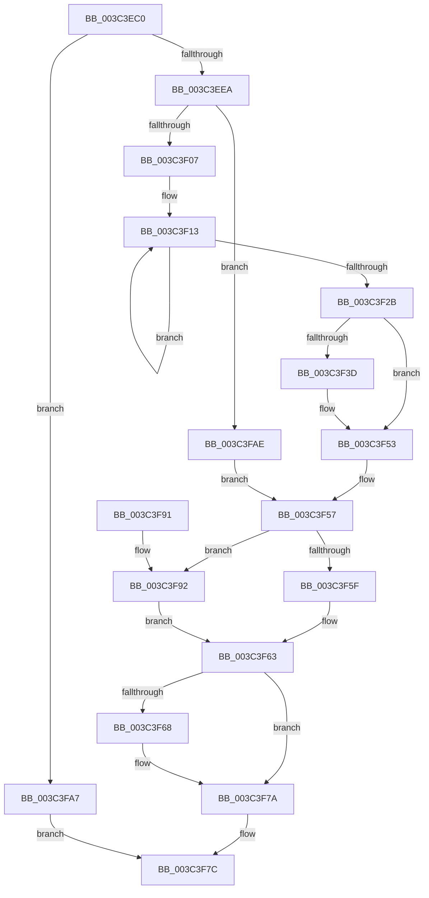

# IoApplyPriorityInfoThread

- RVA: `0x003C3EC0`–`0x003C3FB5` (길이 `245` bytes)
- VA: `0x00000001403C3EC0`
- 실행 섹션: `.text`
- PDB 이름 있음: `예`; PDB Function 태그: `아니요`
- unwind 정보 RVA: `0x0008E368`
- 디코드: `63`개 명령, `245/245` bytes 표시
- 미해석 바이트: `0` (있으면 어셈블리에 `.byte`로 보존)

> 이 문서는 커널 이미지의 기계어와 PDB 기호를 분석해 생성했습니다. 4번과 5번은 함수 원형과 자료형을 바이너리 사용 방식에서 추정한 C 해석이며 원본 소스 복구 결과는 아닙니다.

## 1. Dependencies

- 직접 호출 지점: **3**; 고유 호출 대상: **3**
- 직접 호출자로 확인된 함수: **0**
- RIP 상대 이미지 참조: **1**

### Outgoing calls
- `0x003C3EF0` → [PsSetIoPriorityThread](PsSetIoPriorityThread_function_003C3FBC.md) (function, `0x003C3FBC`)
- `0x003C3F4E` → [EtwTracePriority](EtwTracePriority_function_003C41A4.md) (function, `0x003C41A4`)
- `0x003C3FA0` → [KeSetActualBasePriorityThread](KeSetActualBasePriorityThread_function_003C4370.md) (function, `0x003C4370`)

### Direct callers
- 이 함수 시작 RVA로 연결되는 직접 call은 확인되지 않았습니다. 간접 호출은 완전히 역산할 수 없습니다.

### Static image references
- `0x003C3F31` → RVA `0x00FC6B04` (`ALMOSTRO`; read)

## 2. Other-region calls and transfers

- 다른 실행 섹션으로 향하는 call: **0**
- 별도 외부 분기/꼬리 이동을 확인하지 못했습니다.

## 3. Assembly (complete function range)

```asm
003C3EC0  48 89 5C 24 08                  mov qword ptr [rsp + 8], rbx
003C3EC5  48 89 6C 24 10                  mov qword ptr [rsp + 0x10], rbp
003C3ECA  48 89 74 24 18                  mov qword ptr [rsp + 0x18], rsi
003C3ECF  57                              push rdi
003C3ED0  48 83 EC 40                     sub rsp, 0x40
003C3ED4  81 79 04 FF FF 00 00            cmp dword ptr [rcx + 4], 0xffff
003C3EDB  49 8B D8                        mov rbx, r8
003C3EDE  48 8B EA                        mov rbp, rdx
003C3EE1  48 8B F1                        mov rsi, rcx
003C3EE4  0F 84 BD 00 00 00               je 0x1403c3fa7
003C3EEA  8B 51 0C                        mov edx, dword ptr [rcx + 0xc]
003C3EED  48 8B CB                        mov rcx, rbx
003C3EF0  E8 C7 00 00 00                  call 0x1403c3fbc
003C3EF5  44 8B 4E 08                     mov r9d, dword ptr [rsi + 8]
003C3EF9  89 44 24 3C                     mov dword ptr [rsp + 0x3c], eax
003C3EFD  41 83 F9 FF                     cmp r9d, -1
003C3F01  0F 84 A7 00 00 00               je 0x1403c3fae
003C3F07  8B 83 A0 05 00 00               mov eax, dword ptr [rbx + 0x5a0]
003C3F0D  41 8B D1                        mov edx, r9d
003C3F10  C1 E2 0C                        shl edx, 0xc
003C3F13  8B C8                           mov ecx, eax
003C3F15  8B F8                           mov edi, eax
003C3F17  81 E1 FF 8F FF FF               and ecx, 0xffff8fff
003C3F1D  0B CA                           or ecx, edx
003C3F1F  F0 0F B1 8B A0 05 00 00         lock cmpxchg dword ptr [rbx + 0x5a0], ecx
003C3F27  3B C7                           cmp eax, edi
003C3F29  75 E8                           jne 0x1403c3f13
003C3F2B  C1 EF 0C                        shr edi, 0xc
003C3F2E  83 E7 07                        and edi, 7
003C3F31  F7 05 C9 2B C0 00 00 20 00 00   test dword ptr [rip + 0xc02bc9], 0x2000
003C3F3B  74 16                           je 0x1403c3f53
003C3F3D  48 83 64 24 20 00               and qword ptr [rsp + 0x20], 0
003C3F43  BA 33 05 00 00                  mov edx, 0x533
003C3F48  44 8B C7                        mov r8d, edi
003C3F4B  48 8B CB                        mov rcx, rbx
003C3F4E  E8 51 02 00 00                  call 0x1403c41a4
003C3F53  89 7C 24 38                     mov dword ptr [rsp + 0x38], edi
003C3F57  8B 56 04                        mov edx, dword ptr [rsi + 4]
003C3F5A  83 FA FF                        cmp edx, -1
003C3F5D  75 33                           jne 0x1403c3f92
003C3F5F  09 54 24 34                     or dword ptr [rsp + 0x34], edx
003C3F63  48 85 ED                        test rbp, rbp
003C3F66  74 12                           je 0x1403c3f7a
003C3F68  C7 44 24 30 10 00 00 00         mov dword ptr [rsp + 0x30], 0x10
003C3F70  0F 10 44 24 30                  movups xmm0, xmmword ptr [rsp + 0x30]
003C3F75  F3 0F 7F 45 00                  movdqu xmmword ptr [rbp], xmm0
003C3F7A  33 C0                           xor eax, eax
003C3F7C  48 8B 5C 24 50                  mov rbx, qword ptr [rsp + 0x50]
003C3F81  48 8B 6C 24 58                  mov rbp, qword ptr [rsp + 0x58]
003C3F86  48 8B 74 24 60                  mov rsi, qword ptr [rsp + 0x60]
003C3F8B  48 83 C4 40                     add rsp, 0x40
003C3F8F  5F                              pop rdi
003C3F90  C3                              ret
003C3F91  CC                              int3
003C3F92  0F BE 83 33 02 00 00            movsx eax, byte ptr [rbx + 0x233]
003C3F99  48 8B CB                        mov rcx, rbx
003C3F9C  89 44 24 34                     mov dword ptr [rsp + 0x34], eax
003C3FA0  E8 CB 03 00 00                  call 0x1403c4370
003C3FA5  EB BC                           jmp 0x1403c3f63
003C3FA7  B8 EF 00 00 C0                  mov eax, 0xc00000ef
003C3FAC  EB CE                           jmp 0x1403c3f7c
003C3FAE  83 4C 24 38 FF                  or dword ptr [rsp + 0x38], 0xffffffff
003C3FB3  EB A2                           jmp 0x1403c3f57
```

## 4. C-style interpretation (structured pseudocode)

```c
__int64 __fastcall IoApplyPriorityInfoThread(__int64 a1, __int64 a2, __int64 a3)
{
    __int64 result;
    __int64 v_rdi;
    __int64 v_rsp;
    unsigned int v_stack_m10;
    unsigned int v_stack_m14;
    unsigned int v_stack_m18;
    unsigned __int64 v_stack_m28;
    unsigned int v_stack_mC;
    unsigned __int64 v_stack_p10;
    unsigned __int64 v_stack_p18;
    unsigned int v_stack_p34;
    unsigned int v_stack_p38;
    unsigned __int64 v_stack_p8;

    v_stack_p8 = v_rbx;
    v_stack_p10 = v_rbp;
    v_stack_p18 = v_rsi;
    v_rsp = (v_rsp) - (64);
    if ((*(unsigned int *)(a1 + 4)) == 0xFFFFULL) goto loc_003C3FA7;
    result = PsSetIoPriorityThread(a3, (unsigned int)(*(unsigned int *)(a1 + 12)), a3, a4);
    v_stack_mC = (unsigned int)(result);
    if (((unsigned int)((unsigned int)(*(unsigned int *)(a1 + 8)))) == -1) goto loc_003C3FAE;
    a2 = (unsigned int)(((unsigned int)((unsigned int)((unsigned int)(*(unsigned int *)(a1 + 8))))) << (12));
loc_003C3F13:
    a1 = (unsigned int)(((unsigned int)((unsigned int)((unsigned int)(*(unsigned int *)(a3 + 1440))))) & (0xFFFF8FFFULL));
    a1 = (unsigned int)((a1) | ((unsigned int)(a2)));
    if (((unsigned int)((unsigned int)(*(unsigned int *)(a3 + 1440)))) != ((unsigned int)((unsigned int)((unsigned int)((unsigned int)(*(unsigned int *)(a3 + 1440))))))) goto loc_003C3F13;
    v_rdi = (unsigned int)(((unsigned int)((unsigned int)((unsigned int)(*(unsigned int *)(a3 + 1440))))) >> (12));
    v_rdi = (unsigned int)((v_rdi) & (7));
    result = (unsigned int)(*(unsigned int *)(a3 + 1440));
    if (((*(unsigned int *)(v_rip + 12594121)) & (0x2000ULL)) != 0) {
        a2 = 0x533ULL;
        a3 = (unsigned int)(v_rdi);
        a1 = a3;
        result = EtwTracePriority(a1, a2, a3, (unsigned int)(*(unsigned int *)(a1 + 8)));
    }
    v_stack_m10 = (unsigned int)(v_rdi);
loc_003C3F57:
    if (((unsigned int)((unsigned int)(*(unsigned int *)(a1 + 4)))) != -1) goto loc_003C3F92;
loc_003C3F63:
    if (a2 != 0) {
        v_stack_m18 = 16;
        *(unsigned __int64 *)(a2) = v_xmm0;
    }
    result = 0;
loc_003C3F7C:
    v_rsp = (v_rsp) + (64);
    return result;
loc_003C3F92:
    v_stack_p34 = (unsigned int)((__int8)(*(unsigned __int8 *)(v_stack_p8 + 563)));
    result = KeSetActualBasePriorityThread(v_stack_p8, (unsigned int)(*(unsigned int *)(a1 + 4)), a3, (unsigned int)(*(unsigned int *)(a1 + 8)));
    goto loc_003C3F63;
loc_003C3FA7:
    goto loc_003C3F7C;
loc_003C3FAE:
    goto loc_003C3F57;
}
```

## 5. (Beta) C Style

```c
int64_t IoApplyPriorityInfoThread(void *Arg1, int64_t Arg2, void *Arg3)
{
    uint8_t *arg1 = (uint8_t *)Arg1;
    uint8_t *arg3 = (uint8_t *)Arg3;

    int64_t result;
    int64_t local_rdi;
    int64_t local_rsp;
    uint32_t v_stack_m10;
    uint32_t v_stack_m14;
    uint32_t v_stack_m18;
    uint64_t v_stack_m28;
    uint32_t v_stack_mC;
    uint64_t v_stack_p10;
    uint64_t v_stack_p18;
    uint32_t v_stack_p34;
    uint32_t v_stack_p38;
    uint64_t v_stack_p8;

    v_stack_p8 = local_rbx;
    v_stack_p10 = local_rbp;
    v_stack_p18 = local_rsi;
    local_rsp = (local_rsp) - (64);
    if ((*(uint32_t *)(arg1 + 0x4)) == 0xFFFFULL) goto loc_003C3FA7;
    result = PsSetIoPriorityThread(Arg3, (uint32_t)(*(uint32_t *)(arg1 + 0xC)), Arg3, a4);
    v_stack_mC = (uint32_t)(result);
    if (((uint32_t)((uint32_t)(*(uint32_t *)(arg1 + 0x8)))) == -1) goto loc_003C3FAE;
    Arg2 = (uint32_t)(((uint32_t)((uint32_t)((uint32_t)(*(uint32_t *)(arg1 + 0x8))))) << (12));
loc_003C3F13:
    Arg1 = (uint32_t)(((uint32_t)((uint32_t)((uint32_t)(*(uint32_t *)(arg3 + 0x5A0))))) & (0xFFFF8FFFULL));
    Arg1 = (uint32_t)((Arg1) | ((uint32_t)(Arg2)));
    if (((uint32_t)((uint32_t)(*(uint32_t *)(arg3 + 0x5A0)))) != ((uint32_t)((uint32_t)((uint32_t)((uint32_t)(*(uint32_t *)(arg3 + 0x5A0))))))) goto loc_003C3F13;
    local_rdi = (uint32_t)(((uint32_t)((uint32_t)((uint32_t)(*(uint32_t *)(arg3 + 0x5A0))))) >> (12));
    local_rdi = (uint32_t)((local_rdi) & (7));
    result = (uint32_t)(*(uint32_t *)(arg3 + 0x5A0));
    if (((*(uint32_t *)(v_rip + 0xC02BC9)) & (0x2000ULL)) != 0) {
        Arg2 = 0x533ULL;
        Arg3 = (uint32_t)(local_rdi);
        Arg1 = Arg3;
        result = EtwTracePriority(Arg1, Arg2, Arg3, (uint32_t)(*(uint32_t *)(arg1 + 0x8)));
    }
    v_stack_m10 = (uint32_t)(local_rdi);
loc_003C3F57:
    if (((uint32_t)((uint32_t)(*(uint32_t *)(arg1 + 0x4)))) != -1) goto loc_003C3F92;
loc_003C3F63:
    if (Arg2 != 0) {
        v_stack_m18 = 16;
        *(uint64_t *)(Arg2) = v_xmm0;
    }
    result = 0;
loc_003C3F7C:
    local_rsp = (local_rsp) + (64);
    return result;
loc_003C3F92:
    v_stack_p34 = (uint32_t)((int8_t)(*(uint8_t *)(v_stack_p8 + 0x233)));
    result = KeSetActualBasePriorityThread(v_stack_p8, (uint32_t)(*(uint32_t *)(arg1 + 0x4)), Arg3, (uint32_t)(*(uint32_t *)(arg1 + 0x8)));
    goto loc_003C3F63;
loc_003C3FA7:
    goto loc_003C3F7C;
loc_003C3FAE:
    goto loc_003C3F57;
}
```

### 관측된 메모리 오프셋

구조체 형식이 확인되지 않은 접근은 인자 기준의 오프셋으로만 기록했습니다.

| 기준 인자 | 오프셋 표현 | 폭 (bit) | 접근 |
|---|---:|---:|---|
| `Arg1` | `+ 0x4` | `32` | `R` |
| `Arg1` | `+ 0x8` | `32` | `R` |
| `Arg1` | `+ 0xC` | `32` | `R` |
| `Arg3` | `+ 0x233` | `8` | `R` |
| `Arg3` | `+ 0x5A0` | `32` | `R` |

## 6. Execution-region graph

[열기: 2D/3D 그래프와 함수 탐색 컨트롤 패널](../../../control-panel.html?section=text&rva=0x003C3EC0&view=graph)

- 2D 그래프는 위에서 아래로 흐르고, 3D 그래프는 빈 공간을 드래그해 회전합니다. Shift+드래그는 이동, 휠은 확대·축소, 함수 노드 선택은 대상 보고서 이동입니다.

### Static fallback


