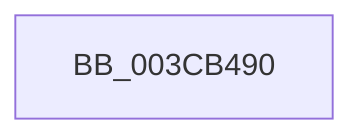

# IoReferenceIoAttributionFromThread

- RVA: `0x003CB490`–`0x003CB4A9` (길이 `25` bytes)
- VA: `0x00000001403CB490`
- 실행 섹션: `.text`
- PDB 이름 있음: `예`; PDB Function 태그: `아니요`
- unwind 정보 RVA: `0x0008F764`
- 디코드: `6`개 명령, `25/25` bytes 표시
- 미해석 바이트: `0` (있으면 어셈블리에 `.byte`로 보존)

> 이 문서는 커널 이미지의 기계어와 PDB 기호를 분석해 생성했습니다. 4번과 5번은 함수 원형과 자료형을 바이너리 사용 방식에서 추정한 C 해석이며 원본 소스 복구 결과는 아닙니다.

## 1. Dependencies

- 직접 호출 지점: **0**; 고유 호출 대상: **0**
- 직접 호출자로 확인된 함수: **5**
- RIP 상대 이미지 참조: **0**

### Outgoing calls
- 직접 디코드된 call 명령이 없습니다.

### Direct callers
- [CcAsyncCopyRead](../35/CcAsyncCopyRead_function_00358880.md) at `0x00358A93`
- [CcScheduleReadAheadNuma](../38/CcScheduleReadAheadNuma_function_0038883C.md) at `0x00388B68`
- [CcMapAndCopyInToCache](CcMapAndCopyInToCache_function_003CA7F0.md) at `0x003CA9A1`
- [MiCheckAndUpdateIoAttribution](MiCheckAndUpdateIoAttribution_function_003CB3C4.md) at `0x003CB416`
- [CcCopyReadEx](../45/CcCopyReadEx_function_0045E160.md) at `0x0045E364`

### Static image references
- 디코드된 RIP-relative 메모리 참조가 없습니다.

## 2. Other-region calls and transfers

- 다른 실행 섹션으로 향하는 call: **0**
- 별도 외부 분기/꼬리 이동을 확인하지 못했습니다.

## 3. Assembly (complete function range)

```asm
003CB490  48 89 5C 24 18                  mov qword ptr [rsp + 0x18], rbx
003CB495  48 89 74 24 20                  mov qword ptr [rsp + 0x20], rsi
003CB49A  57                              push rdi
003CB49B  48 83 EC 30                     sub rsp, 0x30
003CB49F  48 8B 99 50 06 00 00            mov rbx, qword ptr [rcx + 0x650]
003CB4A6  48 8B F2                        mov rsi, rdx
```

## 4. C-style interpretation (structured pseudocode)

```c
void __fastcall IoReferenceIoAttributionFromThread(__int64 a1, __int64 a2)
{
    __int64 v_rsp;
    unsigned __int64 v_stack_p18;
    unsigned __int64 v_stack_p20;

    v_stack_p18 = v_rbx;
    v_stack_p20 = v_rsi;
    v_rsp = (v_rsp) - (48);
    return;
}
```

## 5. (Beta) C Style

```c
void IoReferenceIoAttributionFromThread(void *Arg1, int64_t Arg2)
{
    uint8_t *arg1 = (uint8_t *)Arg1;

    int64_t local_rsp;
    uint64_t v_stack_p18;
    uint64_t v_stack_p20;

    v_stack_p18 = local_rbx;
    v_stack_p20 = local_rsi;
    local_rsp = (local_rsp) - (48);
    return;
}
```

### 관측된 메모리 오프셋

구조체 형식이 확인되지 않은 접근은 인자 기준의 오프셋으로만 기록했습니다.

| 기준 인자 | 오프셋 표현 | 폭 (bit) | 접근 |
|---|---:|---:|---|
| `Arg1` | `+ 0x650` | `64` | `R` |

## 6. Execution-region graph

[열기: 2D/3D 그래프와 함수 탐색 컨트롤 패널](../../../control-panel.html?section=text&rva=0x003CB490&view=graph)

- 2D 그래프는 위에서 아래로 흐르고, 3D 그래프는 빈 공간을 드래그해 회전합니다. Shift+드래그는 이동, 휠은 확대·축소, 함수 노드 선택은 대상 보고서 이동입니다.

### Static fallback


