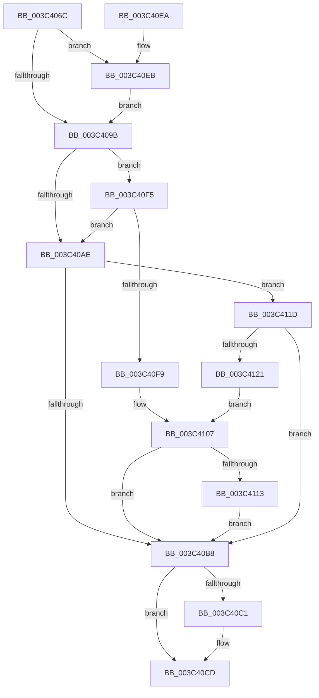

# KeAbProcessBaseIoPriorityChangeInternal

- RVA: `0x003C406C`–`0x003C4131` (길이 `197` bytes)
- VA: `0x00000001403C406C`
- 실행 섹션: `.text`
- PDB 이름 있음: `예`; PDB Function 태그: `아니요`
- unwind 정보 RVA: `0x0008E380`
- 디코드: `52`개 명령, `197/197` bytes 표시
- 미해석 바이트: `0` (있으면 어셈블리에 `.byte`로 보존)

> 이 문서는 커널 이미지의 기계어와 PDB 기호를 분석해 생성했습니다. 4번과 5번은 함수 원형과 자료형을 바이너리 사용 방식에서 추정한 C 해석이며 원본 소스 복구 결과는 아닙니다.

## 1. Dependencies

- 직접 호출 지점: **4**; 고유 호출 대상: **4**
- 직접 호출자로 확인된 함수: **3**
- RIP 상대 이미지 참조: **1**

### Outgoing calls
- `0x003C40C8` → [KiLowerIrqlProcessIrqlFlags](../4F/KiLowerIrqlProcessIrqlFlags_function_004F5698.md) (function, `0x004F5698`)
- `0x003C40EE` → [KiRaiseIrqlProcessIrqlFlags](../4F/KiRaiseIrqlProcessIrqlFlags_function_004F56FC.md) (function, `0x004F56FC`)
- `0x003C410A` → [KiAbThreadInsertList](../21/KiAbThreadInsertList_function_0021F0E0.md) (function, `0x0021F0E0`)
- `0x003C4116` → [KiAbQueueAutoBoostDpc](../20/KiAbQueueAutoBoostDpc_function_002074D0.md) (function, `0x002074D0`)

### Direct callers
- [KeAbProcessBaseIoPriorityChange](KeAbProcessBaseIoPriorityChange_function_003C3E4C.md) at `0x003C3E6B`
- [PsSetIoPriorityThread](PsSetIoPriorityThread_function_003C3FBC.md) at `0x003C4047`
- [IoUpdateThreadIoRateThrottle](../49/IoUpdateThreadIoRateThrottle_function_0049CE20.md) at `0x0049CE39`

### Static image references
- `0x003C4092` → RVA `0x00FC6D20` (`ALMOSTRO`; read)

## 2. Other-region calls and transfers

- 다른 실행 섹션으로 향하는 call: **0**
- 별도 외부 분기/꼬리 이동을 확인하지 못했습니다.

## 3. Assembly (complete function range)

```asm
003C406C  48 89 5C 24 08                  mov qword ptr [rsp + 8], rbx
003C4071  48 89 6C 24 10                  mov qword ptr [rsp + 0x10], rbp
003C4076  48 89 74 24 18                  mov qword ptr [rsp + 0x18], rsi
003C407B  57                              push rdi
003C407C  48 83 EC 20                     sub rsp, 0x20
003C4080  8B EA                           mov ebp, edx
003C4082  48 8B D9                        mov rbx, rcx
003C4085  44 0F 20 C7                     mov rdi, cr8
003C4089  BA 02 00 00 00                  mov edx, 2
003C408E  44 0F 22 C2                     mov cr8, rdx
003C4092  83 3D 87 2C C0 00 00            cmp dword ptr [rip + 0xc02c87], 0
003C4099  75 50                           jne 0x1403c40eb
003C409B  65 48 8B 34 25 20 00 00 00      mov rsi, qword ptr gs:[0x20]
003C40A4  8A 83 19 03 00 00               mov al, byte ptr [rbx + 0x319]
003C40AA  84 C0                           test al, al
003C40AC  75 47                           jne 0x1403c40f5
003C40AE  8A 83 18 03 00 00               mov al, byte ptr [rbx + 0x318]
003C40B4  84 C0                           test al, al
003C40B6  75 65                           jne 0x1403c411d
003C40B8  83 3D 61 2C C0 00 00            cmp dword ptr [rip + 0xc02c61], 0
003C40BF  74 0C                           je 0x1403c40cd
003C40C1  44 0F 20 C1                     mov rcx, cr8
003C40C5  40 8A D7                        mov dl, dil
003C40C8  E8 CB 15 13 00                  call 0x1404f5698
003C40CD  40 0F B6 C7                     movzx eax, dil
003C40D1  44 0F 22 C0                     mov cr8, rax
003C40D5  48 8B 5C 24 30                  mov rbx, qword ptr [rsp + 0x30]
003C40DA  48 8B 6C 24 38                  mov rbp, qword ptr [rsp + 0x38]
003C40DF  48 8B 74 24 40                  mov rsi, qword ptr [rsp + 0x40]
003C40E4  48 83 C4 20                     add rsp, 0x20
003C40E8  5F                              pop rdi
003C40E9  C3                              ret
003C40EA  CC                              int3
003C40EB  40 8A CF                        mov cl, dil
003C40EE  E8 09 16 13 00                  call 0x1404f56fc
003C40F3  EB A6                           jmp 0x1403c409b
003C40F5  85 ED                           test ebp, ebp
003C40F7  75 B5                           jne 0x1403c40ae
003C40F9  4C 8D 83 30 03 00 00            lea r8, [rbx + 0x330]
003C4100  48 8D 96 70 91 00 00            lea rdx, [rsi + 0x9170]
003C4107  48 8B CB                        mov rcx, rbx
003C410A  E8 D1 AF E5 FF                  call 0x14021f0e0
003C410F  85 C0                           test eax, eax
003C4111  74 A5                           je 0x1403c40b8
003C4113  48 8B CE                        mov rcx, rsi
003C4116  E8 B5 33 E4 FF                  call 0x1402074d0
003C411B  EB 9B                           jmp 0x1403c40b8
003C411D  85 ED                           test ebp, ebp
003C411F  74 97                           je 0x1403c40b8
003C4121  4C 8D 83 28 03 00 00            lea r8, [rbx + 0x328]
003C4128  48 8D 96 78 91 00 00            lea rdx, [rsi + 0x9178]
003C412F  EB D6                           jmp 0x1403c4107
```

## 4. C-style interpretation (structured pseudocode)

```c
__int64 __fastcall KeAbProcessBaseIoPriorityChangeInternal(__int64 a1, int a2)
{
    __int64 result;
    __int64 v_rsp;
    unsigned __int64 v_stack_p10;
    unsigned __int64 v_stack_p18;
    unsigned __int64 v_stack_p8;

    v_stack_p8 = v_rbx;
    v_stack_p10 = v_rbp;
    v_stack_p18 = v_rsi;
    v_rsp = (v_rsp) - (32);
    if ((*(unsigned int *)(v_rip + 12594311)) != 0) goto loc_003C40EB;
loc_003C409B:
    if ((unsigned __int8)(*(unsigned __int8 *)(a1 + 793)) != 0) goto loc_003C40F5;
loc_003C40AE:
    if ((unsigned __int8)(*(unsigned __int8 *)(a1 + 792)) != 0) goto loc_003C411D;
loc_003C40B8:
    result = *(unsigned __int8 *)(a1 + 792);
    if ((*(unsigned int *)(v_rip + 12594273)) != 0) {
        a1 = 2;
        a2 = (unsigned __int8)(v_cr8);
        result = KiLowerIrqlProcessIrqlFlags(a1, a2, a3, a4);
    }
    v_rsp = (v_rsp) + (32);
    return (unsigned __int8)(v_cr8);
loc_003C40EB:
    result = KiRaiseIrqlProcessIrqlFlags((unsigned __int8)(v_cr8), a2, a3, a4);
    goto loc_003C409B;
loc_003C40F5:
    if ((unsigned int)(v_stack_p10) != 0) goto loc_003C40AE;
loc_003C4107:
    result = KiAbThreadInsertList(v_stack_p8, v_stack_p18 + 37232, v_stack_p8 + 816, a4);
    if ((unsigned int)(result) == 0) goto loc_003C40B8;
    result = KiAbQueueAutoBoostDpc(v_stack_p18, v_stack_p18 + 37232, v_stack_p8 + 816, a4);
    goto loc_003C40B8;
loc_003C411D:
    if ((unsigned int)(v_stack_p10) == 0) goto loc_003C40B8;
    goto loc_003C4107;
}
```

## 5. (Beta) C Style

```c
int64_t KeAbProcessBaseIoPriorityChangeInternal(void *Arg1, int32_t Arg2)
{
    uint8_t *arg1 = (uint8_t *)Arg1;

    int64_t result;
    int64_t local_rsp;
    uint64_t v_stack_p10;
    uint64_t v_stack_p18;
    uint64_t v_stack_p8;

    v_stack_p8 = local_rbx;
    v_stack_p10 = local_rbp;
    v_stack_p18 = local_rsi;
    local_rsp = (local_rsp) - (32);
    if ((*(uint32_t *)(v_rip + 0xC02C87)) != 0) goto loc_003C40EB;
loc_003C409B:
    if ((uint8_t)(*(uint8_t *)(arg1 + 0x319)) != 0) goto loc_003C40F5;
loc_003C40AE:
    if ((uint8_t)(*(uint8_t *)(arg1 + 0x318)) != 0) goto loc_003C411D;
loc_003C40B8:
    result = *(uint8_t *)(arg1 + 0x318);
    if ((*(uint32_t *)(v_rip + 0xC02C61)) != 0) {
        Arg1 = 2;
        Arg2 = (uint8_t)(v_cr8);
        result = KiLowerIrqlProcessIrqlFlags(Arg1, Arg2, a3, a4);
    }
    local_rsp = (local_rsp) + (32);
    return (uint8_t)(v_cr8);
loc_003C40EB:
    result = KiRaiseIrqlProcessIrqlFlags((uint8_t)(v_cr8), Arg2, a3, a4);
    goto loc_003C409B;
loc_003C40F5:
    if ((uint32_t)(v_stack_p10) != 0) goto loc_003C40AE;
loc_003C4107:
    result = KiAbThreadInsertList(v_stack_p8, v_stack_p18 + 37232, v_stack_p8 + 816, a4);
    if ((uint32_t)(result) == 0) goto loc_003C40B8;
    result = KiAbQueueAutoBoostDpc(v_stack_p18, v_stack_p18 + 37232, v_stack_p8 + 816, a4);
    goto loc_003C40B8;
loc_003C411D:
    if ((uint32_t)(v_stack_p10) == 0) goto loc_003C40B8;
    goto loc_003C4107;
}
```

### 관측된 메모리 오프셋

구조체 형식이 확인되지 않은 접근은 인자 기준의 오프셋으로만 기록했습니다.

| 기준 인자 | 오프셋 표현 | 폭 (bit) | 접근 |
|---|---:|---:|---|
| `Arg1` | `+ 0x318` | `8` | `R` |
| `Arg1` | `+ 0x319` | `8` | `R` |
| `Arg1` | `+ 0x328` | `64` | `R` |
| `Arg1` | `+ 0x330` | `64` | `R` |

## 6. Execution-region graph

[열기: 2D/3D 그래프와 함수 탐색 컨트롤 패널](../../../control-panel.html?section=text&rva=0x003C406C&view=graph)

- 2D 그래프는 위에서 아래로 흐르고, 3D 그래프는 빈 공간을 드래그해 회전합니다. Shift+드래그는 이동, 휠은 확대·축소, 함수 노드 선택은 대상 보고서 이동입니다.

### Static fallback


