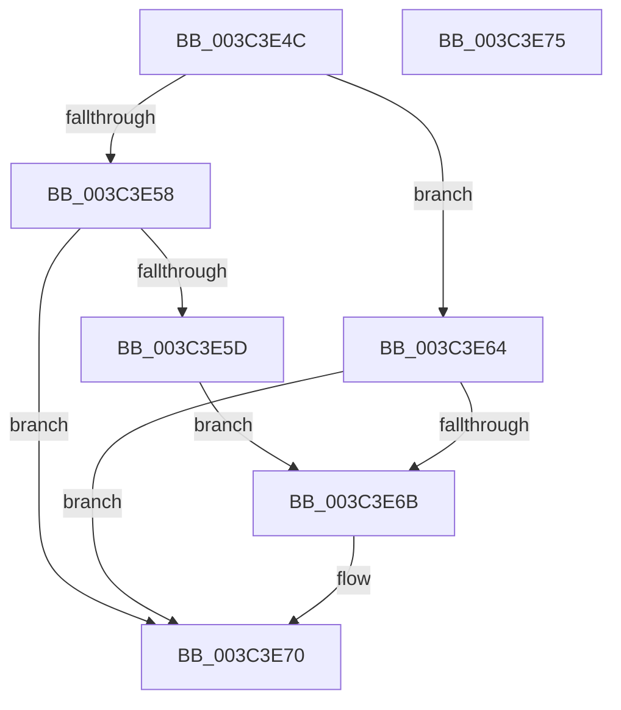

# KeAbProcessBaseIoPriorityChange

- RVA: `0x003C3E4C`–`0x003C3E76` (길이 `42` bytes)
- VA: `0x00000001403C3E4C`
- 실행 섹션: `.text`
- PDB 이름 있음: `예`; PDB Function 태그: `아니요`
- unwind 정보 RVA: `0x0005C788`
- 디코드: `15`개 명령, `42/42` bytes 표시
- 미해석 바이트: `0` (있으면 어셈블리에 `.byte`로 보존)

> 이 문서는 커널 이미지의 기계어와 PDB 기호를 분석해 생성했습니다. 4번과 5번은 함수 원형과 자료형을 바이너리 사용 방식에서 추정한 C 해석이며 원본 소스 복구 결과는 아닙니다.

## 1. Dependencies

- 직접 호출 지점: **1**; 고유 호출 대상: **1**
- 직접 호출자로 확인된 함수: **1**
- RIP 상대 이미지 참조: **0**

### Outgoing calls
- `0x003C3E6B` → [KeAbProcessBaseIoPriorityChangeInternal](KeAbProcessBaseIoPriorityChangeInternal_function_003C406C.md) (function, `0x003C406C`)

### Direct callers
- [PspNotifyProcessEffectiveIoLimitChanged](../3E/PspNotifyProcessEffectiveIoLimitChanged_function_003EC9C0.md) at `0x003ECAB8`

### Static image references
- 디코드된 RIP-relative 메모리 참조가 없습니다.

## 2. Other-region calls and transfers

- 다른 실행 섹션으로 향하는 call: **0**
- 별도 외부 분기/꼬리 이동을 확인하지 못했습니다.

## 3. Assembly (complete function range)

```asm
003C3E4C  48 83 EC 28                     sub rsp, 0x28
003C3E50  8B C2                           mov eax, edx
003C3E52  41 83 F8 02                     cmp r8d, 2
003C3E56  7C 0C                           jl 0x1403c3e64
003C3E58  83 F8 02                        cmp eax, 2
003C3E5B  7D 13                           jge 0x1403c3e70
003C3E5D  BA 01 00 00 00                  mov edx, 1
003C3E62  EB 07                           jmp 0x1403c3e6b
003C3E64  33 D2                           xor edx, edx
003C3E66  83 F8 02                        cmp eax, 2
003C3E69  7C 05                           jl 0x1403c3e70
003C3E6B  E8 FC 01 00 00                  call 0x1403c406c
003C3E70  48 83 C4 28                     add rsp, 0x28
003C3E74  C3                              ret
003C3E75  CC                              int3
```

## 4. C-style interpretation (structured pseudocode)

```c
__int64 __fastcall KeAbProcessBaseIoPriorityChange(__int64 a1, int a2, int a3)
{
    __int64 result;
    __int64 v_rsp;

    v_rsp = (v_rsp) - (40);
    if (a3 < 2) goto loc_003C3E64;
    if (((unsigned int)((unsigned int)(a2))) >= 2) goto loc_003C3E70;
    goto loc_003C3E6B;
loc_003C3E64:
    a2 = 0;
    result = (unsigned int)(a2);
    if (((unsigned int)((unsigned int)(a2))) >= 2) {
        result = KeAbProcessBaseIoPriorityChangeInternal(a1, a2, a3, a4);
    }
    v_rsp = (v_rsp) + (40);
    return result;
}
```

## 5. (Beta) C Style

```c
int64_t KeAbProcessBaseIoPriorityChange(int64_t Arg1, int32_t Arg2, int32_t Arg3)
{
    int64_t result;
    int64_t local_rsp;

    local_rsp = (local_rsp) - (40);
    if (Arg3 < 2) goto loc_003C3E64;
    if (((uint32_t)((uint32_t)(Arg2))) >= 2) goto loc_003C3E70;
    goto loc_003C3E6B;
loc_003C3E64:
    Arg2 = 0;
    result = (uint32_t)(Arg2);
    if (((uint32_t)((uint32_t)(Arg2))) >= 2) {
        result = KeAbProcessBaseIoPriorityChangeInternal(Arg1, Arg2, Arg3, a4);
    }
    local_rsp = (local_rsp) + (40);
    return result;
}
```

## 6. Execution-region graph

[열기: 2D/3D 그래프와 함수 탐색 컨트롤 패널](../../../control-panel.html?section=text&rva=0x003C3E4C&view=graph)

- 2D 그래프는 위에서 아래로 흐르고, 3D 그래프는 빈 공간을 드래그해 회전합니다. Shift+드래그는 이동, 휠은 확대·축소, 함수 노드 선택은 대상 보고서 이동입니다.

### Static fallback


