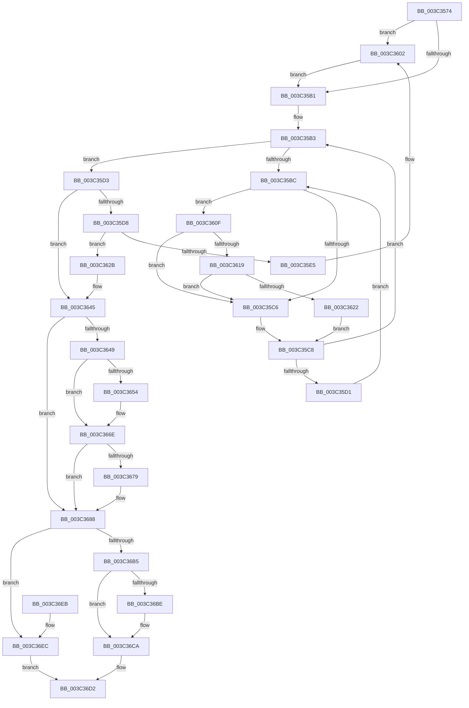

# KeAdjustPriorityFloor

- RVA: `0x003C3574`–`0x003C3704` (길이 `400` bytes)
- VA: `0x00000001403C3574`
- 실행 섹션: `.text`
- PDB 이름 있음: `예`; PDB Function 태그: `아니요`
- unwind 정보 RVA: `0x0008E2D8`
- 디코드: `108`개 명령, `400/400` bytes 표시
- 미해석 바이트: `0` (있으면 어셈블리에 `.byte`로 보존)

> 이 문서는 커널 이미지의 기계어와 PDB 기호를 분석해 생성했습니다. 4번과 5번은 함수 원형과 자료형을 바이너리 사용 방식에서 추정한 C 해석이며 원본 소스 복구 결과는 아닙니다.

## 1. Dependencies

- 직접 호출 지점: **9**; 고유 호출 대상: **8**
- 직접 호출자로 확인된 함수: **1**
- RIP 상대 이미지 참조: **3**

### Outgoing calls
- `0x003C35FC` → [KeBugCheckEx](../4F/KeBugCheckEx_function_004FD660.md) (function, `0x004FD660`)
- `0x003C3608` → [KiRaiseIrqlProcessIrqlFlags](../4F/KiRaiseIrqlProcessIrqlFlags_function_004F56FC.md) (function, `0x004F56FC`)
- `0x003C3619` → [KiCheckVpBackingLongSpinWaitHypercall](../30/KiCheckVpBackingLongSpinWaitHypercall_function_0030F490.md) (function, `0x0030F490`)
- `0x003C3624` → [HvlNotifyLongSpinWait](../30/HvlNotifyLongSpinWait_function_0030F460.md) (function, `0x0030F460`)
- `0x003C3668` → [KeBugCheckEx](../4F/KeBugCheckEx_function_004FD660.md) (function, `0x004FD660`)
- `0x003C3690` → [KiComputeThreadPriority](KiComputeThreadPriority_function_003C45F4.md) (function, `0x003C45F4`)
- `0x003C36A0` → [KiSetPriorityThread](../22/KiSetPriorityThread_function_00220E78.md) (function, `0x00220E78`)
- `0x003C36C5` → [KiLowerIrqlProcessIrqlFlags](../4F/KiLowerIrqlProcessIrqlFlags_function_004F5698.md) (function, `0x004F5698`)
- `0x003C36FD` → [KiProcessDeferredReadyList](../25/KiProcessDeferredReadyList_function_00250800.md) (function, `0x00250800`)

### Direct callers
- [PsAdjustWin32kPriorityFloor](PsAdjustWin32kPriorityFloor_function_003C2D00.md) at `0x003C2D48`

### Static image references
- `0x003C35A8` → RVA `0x00FC6D20` (`ALMOSTRO`; read)
- `0x003C35BE` → RVA `0x00FC52AC` (`ALMOSTRO`; reference)
- `0x003C360F` → RVA `0x00FC6AB8` (`ALMOSTRO`; read)

## 2. Other-region calls and transfers

- 다른 실행 섹션으로 향하는 call: **0**
- 별도 외부 분기/꼬리 이동을 확인하지 못했습니다.

## 3. Assembly (complete function range)

```asm
003C3574  48 8B C4                        mov rax, rsp
003C3577  48 89 58 10                     mov qword ptr [rax + 0x10], rbx
003C357B  48 89 68 18                     mov qword ptr [rax + 0x18], rbp
003C357F  48 89 70 20                     mov qword ptr [rax + 0x20], rsi
003C3583  57                              push rdi
003C3584  41 55                           push r13
003C3586  41 56                           push r14
003C3588  48 83 EC 30                     sub rsp, 0x30
003C358C  48 83 60 08 00                  and qword ptr [rax + 8], 0
003C3591  48 8B D9                        mov rbx, rcx
003C3594  4D 63 F0                        movsxd r14, r8d
003C3597  48 63 EA                        movsxd rbp, edx
003C359A  44 0F 20 C7                     mov rdi, cr8
003C359E  41 BD 02 00 00 00               mov r13d, 2
003C35A4  45 0F 22 C5                     mov cr8, r13
003C35A8  83 3D 71 37 C0 00 00            cmp dword ptr [rip + 0xc03771], 0
003C35AF  75 51                           jne 0x1403c3602
003C35B1  33 F6                           xor esi, esi
003C35B3  F0 48 0F BA 6B 40 00            lock bts qword ptr [rbx + 0x40], 0
003C35BA  73 17                           jae 0x1403c35d3
003C35BC  FF C6                           inc esi
003C35BE  85 35 E8 1C C0 00               test dword ptr [rip + 0xc01ce8], esi
003C35C4  74 49                           je 0x1403c360f
003C35C6  F3 90                           pause
003C35C8  48 8B 43 40                     mov rax, qword ptr [rbx + 0x40]
003C35CC  48 85 C0                        test rax, rax
003C35CF  74 E2                           je 0x1403c35b3
003C35D1  EB E9                           jmp 0x1403c35bc
003C35D3  45 85 F6                        test r14d, r14d
003C35D6  74 6D                           je 0x1403c3645
003C35D8  41 8A 8C 1E 38 03 00 00         mov cl, byte ptr [r14 + rbx + 0x338]
003C35E0  80 F9 FF                        cmp cl, 0xff
003C35E3  75 46                           jne 0x1403c362b
003C35E5  48 83 64 24 20 00               and qword ptr [rsp + 0x20], 0
003C35EB  41 B9 01 00 00 00               mov r9d, 1
003C35F1  4D 8B C6                        mov r8, r14
003C35F4  48 8B D3                        mov rdx, rbx
003C35F7  B9 57 01 00 00                  mov ecx, 0x157
003C35FC  E8 5F A0 13 00                  call 0x1404fd660
003C3601  CC                              int3
003C3602  41 8A D5                        mov dl, r13b
003C3605  40 8A CF                        mov cl, dil
003C3608  E8 EF 20 13 00                  call 0x1404f56fc
003C360D  EB A2                           jmp 0x1403c35b1
003C360F  8B 05 A3 34 C0 00               mov eax, dword ptr [rip + 0xc034a3]
003C3615  A8 40                           test al, 0x40
003C3617  74 AD                           je 0x1403c35c6
003C3619  E8 72 BE F4 FF                  call 0x14030f490
003C361E  84 C0                           test al, al
003C3620  74 A4                           je 0x1403c35c6
003C3622  8B CE                           mov ecx, esi
003C3624  E8 37 BE F4 FF                  call 0x14030f460
003C3629  EB 9D                           jmp 0x1403c35c8
003C362B  FE C1                           inc cl
003C362D  41 88 8C 1E 38 03 00 00         mov byte ptr [r14 + rbx + 0x338], cl
003C3635  8B 83 58 03 00 00               mov eax, dword ptr [rbx + 0x358]
003C363B  44 0F AB F0                     bts eax, r14d
003C363F  89 83 58 03 00 00               mov dword ptr [rbx + 0x358], eax
003C3645  85 ED                           test ebp, ebp
003C3647  74 3F                           je 0x1403c3688
003C3649  8A 84 1D 38 03 00 00            mov al, byte ptr [rbp + rbx + 0x338]
003C3650  84 C0                           test al, al
003C3652  75 1A                           jne 0x1403c366e
003C3654  48 83 64 24 20 00               and qword ptr [rsp + 0x20], 0
003C365A  4D 8B CD                        mov r9, r13
003C365D  4C 8B C5                        mov r8, rbp
003C3660  48 8B D3                        mov rdx, rbx
003C3663  B9 57 01 00 00                  mov ecx, 0x157
003C3668  E8 F3 9F 13 00                  call 0x1404fd660
003C366D  CC                              int3
003C366E  2C 01                           sub al, 1
003C3670  88 84 1D 38 03 00 00            mov byte ptr [rbp + rbx + 0x338], al
003C3677  75 0F                           jne 0x1403c3688
003C3679  8B 83 58 03 00 00               mov eax, dword ptr [rbx + 0x358]
003C367F  0F BB E8                        btc eax, ebp
003C3682  89 83 58 03 00 00               mov dword ptr [rbx + 0x358], eax
003C3688  45 33 C0                        xor r8d, r8d
003C368B  33 D2                           xor edx, edx
003C368D  48 8B CB                        mov rcx, rbx
003C3690  E8 5F 0F 00 00                  call 0x1403c45f4
003C3695  44 8B C0                        mov r8d, eax
003C3698  48 8D 54 24 50                  lea rdx, [rsp + 0x50]
003C369D  48 8B CB                        mov rcx, rbx
003C36A0  E8 D3 D7 E5 FF                  call 0x140220e78
003C36A5  48 83 7C 24 50 00               cmp qword ptr [rsp + 0x50], 0
003C36AB  48 C7 43 40 00 00 00 00         mov qword ptr [rbx + 0x40], 0
003C36B3  75 37                           jne 0x1403c36ec
003C36B5  83 3D 64 36 C0 00 00            cmp dword ptr [rip + 0xc03664], 0
003C36BC  74 0C                           je 0x1403c36ca
003C36BE  44 0F 20 C1                     mov rcx, cr8
003C36C2  40 8A D7                        mov dl, dil
003C36C5  E8 CE 1F 13 00                  call 0x1404f5698
003C36CA  40 0F B6 C7                     movzx eax, dil
003C36CE  44 0F 22 C0                     mov cr8, rax
003C36D2  48 8B 5C 24 58                  mov rbx, qword ptr [rsp + 0x58]
003C36D7  48 8B 6C 24 60                  mov rbp, qword ptr [rsp + 0x60]
003C36DC  48 8B 74 24 68                  mov rsi, qword ptr [rsp + 0x68]
003C36E1  48 83 C4 30                     add rsp, 0x30
003C36E5  41 5E                           pop r14
003C36E7  41 5D                           pop r13
003C36E9  5F                              pop rdi
003C36EA  C3                              ret
003C36EB  CC                              int3
003C36EC  65 48 8B 0C 25 20 00 00 00      mov rcx, qword ptr gs:[0x20]
003C36F5  48 8D 54 24 50                  lea rdx, [rsp + 0x50]
003C36FA  44 8A C7                        mov r8b, dil
003C36FD  E8 FE D0 E8 FF                  call 0x140250800
003C3702  EB CE                           jmp 0x1403c36d2
```

## 4. C-style interpretation (structured pseudocode)

```c
__int64 __fastcall KeAdjustPriorityFloor(__int64 a1, int a2, int a3)
{
    __int64 result;
    __int64 v_rsi;
    __int64 v_rsp;
    unsigned __int64 v_stack_m28;
    unsigned __int64 v_stack_p10;
    unsigned __int64 v_stack_p18;
    unsigned __int64 v_stack_p20;
    unsigned __int64 v_stack_p50;
    unsigned __int64 v_stack_p8;

    *(unsigned __int64 *)(v_rsp + 16) = v_rbx;
    *(unsigned __int64 *)(v_rsp + 24) = v_rbp;
    *(unsigned __int64 *)(v_rsp + 32) = v_rsi;
    v_rsp = (v_rsp) - (48);
    if ((*(unsigned int *)(v_rip + 12597105)) != 0) goto loc_003C3602;
loc_003C35B1:
    v_rsi = 0;
loc_003C35B3:
    if (condition_is_above_or_equal) goto loc_003C35D3;
loc_003C35BC:
    v_rsi = (unsigned int)((v_rsi) + 1);
    if (((*(unsigned int *)(v_rip + 12590312)) & ((unsigned int)(v_rsi))) == 0) goto loc_003C360F;
loc_003C35C6:
loc_003C35C8:
    if (*(unsigned __int64 *)(a1 + 64) == 0) goto loc_003C35B3;
    goto loc_003C35BC;
loc_003C35D3:
    if ((unsigned int)((int)(a3)) == 0) goto loc_003C3645;
    if (((unsigned __int8)(*(unsigned __int8 *)((int)(a3) + a1 * 1 + 824))) != 255) goto loc_003C362B;
    result = KeBugCheckEx(343, a1, (int)(a3), 1);
loc_003C3602:
    result = KiRaiseIrqlProcessIrqlFlags((unsigned __int8)(v_cr8), 2, (int)(a3), 1);
    goto loc_003C35B1;
loc_003C360F:
    if ((((unsigned __int8)((unsigned int)(*(unsigned int *)(v_rip + 12596387)))) & (64)) == 0) goto loc_003C35C6;
    result = KiCheckVpBackingLongSpinWaitHypercall((unsigned __int8)(v_cr8), 2, (int)(a3), 1);
    if ((unsigned __int8)(result) == 0) goto loc_003C35C6;
    result = HvlNotifyLongSpinWait((unsigned int)((unsigned int)(v_rsi)), 2, (int)(a3), 1);
    goto loc_003C35C8;
loc_003C362B:
    a1 = (unsigned __int8)(((unsigned int)((unsigned int)(v_rsi))) + 1);
    *(unsigned __int8 *)((int)(a3) + a1 * 1 + 824) = (unsigned __int8)(a1);
    *(unsigned int *)(a1 + 856) = (unsigned int)((unsigned int)(*(unsigned int *)(a1 + 856)));
loc_003C3645:
    if ((unsigned int)((int)(a2)) == 0) goto loc_003C3688;
    result = *(unsigned __int8 *)((int)(a2) + a1 * 1 + 824);
    if ((unsigned __int8)(*(unsigned __int8 *)((int)(a2) + a1 * 1 + 824)) == 0) {
        a4 = 2;
        a3 = (int)(a2);
        a2 = a1;
        a1 = 343;
        result = KeBugCheckEx(a1, a2, a3, a4);
    }
    result = (unsigned __int8)((result) - (1));
    *(unsigned __int8 *)((int)(a2) + a1 * 1 + 824) = (unsigned __int8)(result);
    if (!(condition_is_not_equal)) {
        result = *(unsigned int *)(a1 + 856);
        *(unsigned int *)(a1 + 856) = (unsigned int)(result);
    }
    a3 = 0;
    a2 = 0;
    result = KiComputeThreadPriority(a1, a2, a3, a4);
    result = KiSetPriorityThread(a1, v_stack_p8, (unsigned int)((unsigned int)(result)), a4);
    *(unsigned __int64 *)(a1 + 64) = 0;
    if (v_stack_p8 != 0) goto loc_003C36EC;
    if ((*(unsigned int *)(v_rip + 12596836)) != 0) {
        a1 = 2;
        a2 = (unsigned __int8)(v_cr8);
        result = KiLowerIrqlProcessIrqlFlags(a1, a2, (unsigned int)((unsigned int)(result)), a4);
    }
loc_003C36D2:
    v_rsp = (v_rsp) + (48);
    return (unsigned __int8)(v_cr8);
loc_003C36EC:
    result = KiProcessDeferredReadyList(*(unsigned __int64 *)(gs_base + (0 + 32)), v_stack_p50, (unsigned __int8)(v_cr8), a4);
    goto loc_003C36D2;
}
```

## 5. (Beta) C Style

```c
int64_t KeAdjustPriorityFloor(void *Arg1, int32_t Arg2, int32_t Arg3)
{
    uint8_t *arg1 = (uint8_t *)Arg1;

    int64_t result;
    int64_t local_rsi;
    int64_t local_rsp;
    uint64_t v_stack_m28;
    uint64_t v_stack_p10;
    uint64_t v_stack_p18;
    uint64_t v_stack_p20;
    uint64_t v_stack_p50;
    uint64_t v_stack_p8;

    *(uint64_t *)(local_rsp + 0x10) = local_rbx;
    *(uint64_t *)(local_rsp + 0x18) = local_rbp;
    *(uint64_t *)(local_rsp + 0x20) = local_rsi;
    local_rsp = (local_rsp) - (48);
    if ((*(uint32_t *)(v_rip + 0xC03771)) != 0) goto loc_003C3602;
loc_003C35B1:
    local_rsi = 0;
loc_003C35B3:
    if (condition_is_above_or_equal) goto loc_003C35D3;
loc_003C35BC:
    local_rsi = (uint32_t)((local_rsi) + 1);
    if (((*(uint32_t *)(v_rip + 0xC01CE8)) & ((uint32_t)(local_rsi))) == 0) goto loc_003C360F;
loc_003C35C6:
loc_003C35C8:
    if (*(uint64_t *)(arg1 + 0x40) == 0) goto loc_003C35B3;
    goto loc_003C35BC;
loc_003C35D3:
    if ((uint32_t)((int32_t)(Arg3)) == 0) goto loc_003C3645;
    if (((uint8_t)(*(uint8_t *)((int32_t)(Arg3) + arg1 * 1 + 0x338))) != 255) goto loc_003C362B;
    result = KeBugCheckEx(343, Arg1, (int32_t)(Arg3), 1);
loc_003C3602:
    result = KiRaiseIrqlProcessIrqlFlags((uint8_t)(v_cr8), 2, (int32_t)(Arg3), 1);
    goto loc_003C35B1;
loc_003C360F:
    if ((((uint8_t)((uint32_t)(*(uint32_t *)(v_rip + 0xC034A3)))) & (64)) == 0) goto loc_003C35C6;
    result = KiCheckVpBackingLongSpinWaitHypercall((uint8_t)(v_cr8), 2, (int32_t)(Arg3), 1);
    if ((uint8_t)(result) == 0) goto loc_003C35C6;
    result = HvlNotifyLongSpinWait((uint32_t)((uint32_t)(local_rsi)), 2, (int32_t)(Arg3), 1);
    goto loc_003C35C8;
loc_003C362B:
    Arg1 = (uint8_t)(((uint32_t)((uint32_t)(local_rsi))) + 1);
    *(uint8_t *)((int32_t)(Arg3) + arg1 * 1 + 0x338) = (uint8_t)(Arg1);
    *(uint32_t *)(arg1 + 0x358) = (uint32_t)((uint32_t)(*(uint32_t *)(arg1 + 0x358)));
loc_003C3645:
    if ((uint32_t)((int32_t)(Arg2)) == 0) goto loc_003C3688;
    result = *(uint8_t *)((int32_t)(Arg2) + arg1 * 1 + 0x338);
    if ((uint8_t)(*(uint8_t *)((int32_t)(Arg2) + arg1 * 1 + 0x338)) == 0) {
        a4 = 2;
        Arg3 = (int32_t)(Arg2);
        Arg2 = Arg1;
        Arg1 = 343;
        result = KeBugCheckEx(Arg1, Arg2, Arg3, a4);
    }
    result = (uint8_t)((result) - (1));
    *(uint8_t *)((int32_t)(Arg2) + arg1 * 1 + 0x338) = (uint8_t)(result);
    if (!(condition_is_not_equal)) {
        result = *(uint32_t *)(arg1 + 0x358);
        *(uint32_t *)(arg1 + 0x358) = (uint32_t)(result);
    }
    Arg3 = 0;
    Arg2 = 0;
    result = KiComputeThreadPriority(Arg1, Arg2, Arg3, a4);
    result = KiSetPriorityThread(Arg1, v_stack_p8, (uint32_t)((uint32_t)(result)), a4);
    *(uint64_t *)(arg1 + 0x40) = 0;
    if (v_stack_p8 != 0) goto loc_003C36EC;
    if ((*(uint32_t *)(v_rip + 0xC03664)) != 0) {
        Arg1 = 2;
        Arg2 = (uint8_t)(v_cr8);
        result = KiLowerIrqlProcessIrqlFlags(Arg1, Arg2, (uint32_t)((uint32_t)(result)), a4);
    }
loc_003C36D2:
    local_rsp = (local_rsp) + (48);
    return (uint8_t)(v_cr8);
loc_003C36EC:
    result = KiProcessDeferredReadyList(*(uint64_t *)(gs_base + (0 + 0x20)), v_stack_p50, (uint8_t)(v_cr8), a4);
    goto loc_003C36D2;
}
```

### 관측된 메모리 오프셋

구조체 형식이 확인되지 않은 접근은 인자 기준의 오프셋으로만 기록했습니다.

| 기준 인자 | 오프셋 표현 | 폭 (bit) | 접근 |
|---|---:|---:|---|
| `Arg1` | `+ 0x40` | `64` | `R` |
| `Arg1` | `+ 0x40` | `64` | `R/W` |
| `Arg1` | `+ 0x40` | `64` | `W` |
| `Arg1` | `+ 0x358` | `32` | `R` |
| `Arg1` | `+ 0x358` | `32` | `W` |

## 6. Execution-region graph

[열기: 2D/3D 그래프와 함수 탐색 컨트롤 패널](../../../control-panel.html?section=text&rva=0x003C3574&view=graph)

- 2D 그래프는 위에서 아래로 흐르고, 3D 그래프는 빈 공간을 드래그해 회전합니다. Shift+드래그는 이동, 휠은 확대·축소, 함수 노드 선택은 대상 보고서 이동입니다.

### Static fallback


