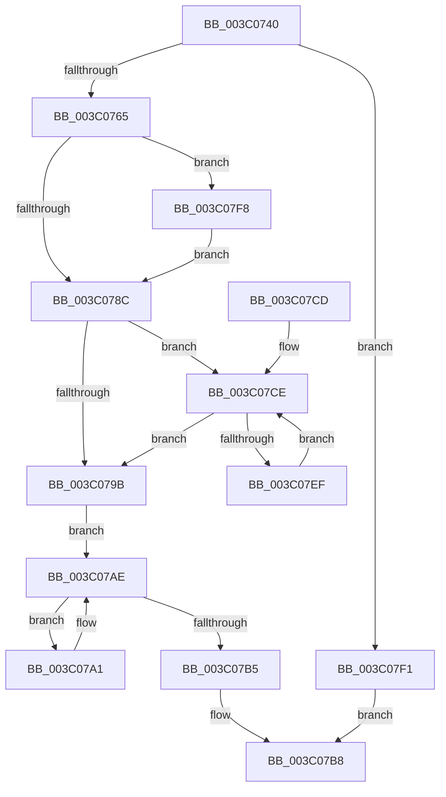

# KeAndAffinityEx2

- RVA: `0x003C0740`–`0x003C0802` (길이 `194` bytes)
- VA: `0x00000001403C0740`
- 실행 섹션: `.text`
- PDB 이름 있음: `예`; PDB Function 태그: `아니요`
- unwind 정보 RVA: `0x0008DFE8`
- 디코드: `53`개 명령, `194/194` bytes 표시
- 미해석 바이트: `0` (있으면 어셈블리에 `.byte`로 보존)

> 이 문서는 커널 이미지의 기계어와 PDB 기호를 분석해 생성했습니다. 4번과 5번은 함수 원형과 자료형을 바이너리 사용 방식에서 추정한 C 해석이며 원본 소스 복구 결과는 아닙니다.

## 1. Dependencies

- 직접 호출 지점: **1**; 고유 호출 대상: **1**
- 직접 호출자로 확인된 함수: **16**
- RIP 상대 이미지 참조: **0**

### Outgoing calls
- `0x003C07F1` → [KiAndAffinityExNoResult](../2C/KiAndAffinityExNoResult_function_002CF84C.md) (function, `0x002CF84C`)

### Direct callers
- [KiComputeCpuSetAffinity](../39/KiComputeCpuSetAffinity_function_0039A1C0.md) at `0x0039A67F`
- [KiForwardTick](../39/KiForwardTick_function_0039D40C.md) at `0x0039D50A`
- [KiUpdateProcessAvailableCpuState](KiUpdateProcessAvailableCpuState_function_003C00B4.md) at `0x003C0124`
- [KiGetDeepIdleProcessors](KiGetDeepIdleProcessors_function_003C0268.md) at `0x003C02D7`
- [KiForceIdleUpdateSchedulerParkState](../48/KiForceIdleUpdateSchedulerParkState_function_0048D874.md) at `0x0048DA90`
- [PpmHeteroDistributeUtilityEx](../4E/PpmHeteroDistributeUtilityEx_function_004EFC00.md) at `0x004EFDD7`
- [PpmHeteroDistributeUtilityEx](../4E/PpmHeteroDistributeUtilityEx_function_004EFC00.md) at `0x004EFE5A`
- [PpmHeteroDistributeUtilityEx](../4E/PpmHeteroDistributeUtilityEx_function_004EFC00.md) at `0x004EFEC2`
- [PpmHeteroDistributeUtilityEx](../4E/PpmHeteroDistributeUtilityEx_function_004EFC00.md) at `0x004EFF93`
- [PpmEventTraceSoftCoreParkingSelectionEx](../4F/PpmEventTraceSoftCoreParkingSelectionEx_function_004F2424.md) at `0x004F2542`
- [PpmEventTraceSoftCoreParkingSelectionEx](../4F/PpmEventTraceSoftCoreParkingSelectionEx_function_004F2424.md) at `0x004F2555`
- [PpmEventTraceSoftCoreParkingSelectionEx](../4F/PpmEventTraceSoftCoreParkingSelectionEx_function_004F2424.md) at `0x004F256B`
- [PpmParkBuildTopologyCandidatesEx](../4F/PpmParkBuildTopologyCandidatesEx_function_004F3038.md) at `0x004F3071`
- [HalSendNMI](../54/HalSendNMI_function_00545E80.md) at `0x00545F38`
- [KeUpdateProcessorRestrictionsEx](../5B/KeUpdateProcessorRestrictionsEx_function_005B64E8.md) at `0x005B6708`
- [PpmParkCalculateCoreParkingMaskEx](../5D/PpmParkCalculateCoreParkingMaskEx_function_005DFBE0.md) at `0x005DFF66`
- [PpmParkCalculateCoreParkingMaskEx](../5D/PpmParkCalculateCoreParkingMaskEx_function_005DFBE0.md) at `0x005E0397`
- [PpmParkComputeUnparkMaskEx](../5E/PpmParkComputeUnparkMaskEx_function_005E05E0.md) at `0x005E09D3`
- [PpmParkComputeUnparkMaskEx](../5E/PpmParkComputeUnparkMaskEx_function_005E05E0.md) at `0x005E0B62`
- [PpmParkComputeUnparkMaskEx](../5E/PpmParkComputeUnparkMaskEx_function_005E05E0.md) at `0x005E0B84`
- [PpmParkComputeUnparkMaskEx](../5E/PpmParkComputeUnparkMaskEx_function_005E05E0.md) at `0x005E0BF4`
- [PpmParkComputeUnparkMaskEx](../5E/PpmParkComputeUnparkMaskEx_function_005E05E0.md) at `0x005E0C0E`
- [PpmParkComputeUnparkMaskEx](../5E/PpmParkComputeUnparkMaskEx_function_005E05E0.md) at `0x005E0C28`
- [PpmParkComputeUnparkMaskEx](../5E/PpmParkComputeUnparkMaskEx_function_005E05E0.md) at `0x005E0CA2`
- [PpmParkComputeUnparkMaskEx](../5E/PpmParkComputeUnparkMaskEx_function_005E05E0.md) at `0x005E0CC3`
- [PpmParkComputeUnparkMaskEx](../5E/PpmParkComputeUnparkMaskEx_function_005E05E0.md) at `0x005E0D02`
- [PpmParkComputeUnparkMaskEx](../5E/PpmParkComputeUnparkMaskEx_function_005E05E0.md) at `0x005E0E13`
- [PpmParkComputeUnparkMaskEx](../5E/PpmParkComputeUnparkMaskEx_function_005E05E0.md) at `0x005E1319`
- [PpmParkComputeUnparkMaskEx](../5E/PpmParkComputeUnparkMaskEx_function_005E05E0.md) at `0x005E1333`
- [PpmParkComputeUnparkMaskEx](../5E/PpmParkComputeUnparkMaskEx_function_005E05E0.md) at `0x005E135A`
- [PpmParkComputeUnparkMaskEx](../5E/PpmParkComputeUnparkMaskEx_function_005E05E0.md) at `0x005E136E`
- [PpmParkComputeUnparkMaskEx](../5E/PpmParkComputeUnparkMaskEx_function_005E05E0.md) at `0x005E1388`
- [PpmParkComputeUnparkMaskEx](../5E/PpmParkComputeUnparkMaskEx_function_005E05E0.md) at `0x005E13C1`
- [PpmParkComputeUnparkMaskEx](../5E/PpmParkComputeUnparkMaskEx_function_005E05E0.md) at `0x005E13DC`
- [PpmParkRegisterParkingEx](../5E/PpmParkRegisterParkingEx_function_005E183C.md) at `0x005E1986`
- [PpmParkRegisterParkingEx](../5E/PpmParkRegisterParkingEx_function_005E183C.md) at `0x005E1A97`
- [PpmParkApplyForcedMask](../../page/76/PpmParkApplyForcedMask_function_0076A904.md) at `0x0076AABF`
- [PpmParkApplyForcedMask](../../page/76/PpmParkApplyForcedMask_function_0076A904.md) at `0x0076AAD2`
- [NtStartProfile](../../page/7D/NtStartProfile_function_007D22C0.md) at `0x007D24EF`
- [sub_00B18AF6](../../page/B1/Unknown_function_00B18AF6.md) at `0x00B18B3F`

### Static image references
- 디코드된 RIP-relative 메모리 참조가 없습니다.

## 2. Other-region calls and transfers

- 다른 실행 섹션으로 향하는 call: **0**
- 별도 외부 분기/꼬리 이동을 확인하지 못했습니다.

## 3. Assembly (complete function range)

```asm
003C0740  48 89 5C 24 08                  mov qword ptr [rsp + 8], rbx
003C0745  48 89 6C 24 10                  mov qword ptr [rsp + 0x10], rbp
003C074A  48 89 74 24 18                  mov qword ptr [rsp + 0x18], rsi
003C074F  57                              push rdi
003C0750  48 83 EC 20                     sub rsp, 0x20
003C0754  33 F6                           xor esi, esi
003C0756  48 8B DA                        mov rbx, rdx
003C0759  48 8B F9                        mov rdi, rcx
003C075C  4D 85 C0                        test r8, r8
003C075F  0F 84 8C 00 00 00               je 0x1403c07f1
003C0765  45 0F B7 48 02                  movzx r9d, word ptr [r8 + 2]
003C076A  44 8B DE                        mov r11d, esi
003C076D  66 45 89 48 02                  mov word ptr [r8 + 2], r9w
003C0772  44 0F B7 11                     movzx r10d, word ptr [rcx]
003C0776  0F B7 02                        movzx eax, word ptr [rdx]
003C0779  66 44 3B D0                     cmp r10w, ax
003C077D  66 44 0F 43 D0                  cmovae r10w, ax
003C0782  66 45 89 10                     mov word ptr [r8], r10w
003C0786  66 45 3B D1                     cmp r10w, r9w
003C078A  77 6C                           ja 0x1403c07f8
003C078C  44 0F B7 CE                     movzx r9d, si
003C0790  BD 01 00 00 00                  mov ebp, 1
003C0795  66 41 3B F2                     cmp si, r10w
003C0799  72 33                           jb 0x1403c07ce
003C079B  41 89 70 04                     mov dword ptr [r8 + 4], esi
003C079F  EB 0D                           jmp 0x1403c07ae
003C07A1  41 0F B7 C9                     movzx ecx, r9w
003C07A5  66 44 03 CD                     add r9w, bp
003C07A9  49 89 74 C8 08                  mov qword ptr [r8 + rcx*8 + 8], rsi
003C07AE  66 45 3B 48 02                  cmp r9w, word ptr [r8 + 2]
003C07B3  72 EC                           jb 0x1403c07a1
003C07B5  41 8B C3                        mov eax, r11d
003C07B8  48 8B 5C 24 30                  mov rbx, qword ptr [rsp + 0x30]
003C07BD  48 8B 6C 24 38                  mov rbp, qword ptr [rsp + 0x38]
003C07C2  48 8B 74 24 40                  mov rsi, qword ptr [rsp + 0x40]
003C07C7  48 83 C4 20                     add rsp, 0x20
003C07CB  5F                              pop rdi
003C07CC  C3                              ret
003C07CD  CC                              int3
003C07CE  41 0F B7 D1                     movzx edx, r9w
003C07D2  48 8B 4C D7 08                  mov rcx, qword ptr [rdi + rdx*8 + 8]
003C07D7  48 23 4C D3 08                  and rcx, qword ptr [rbx + rdx*8 + 8]
003C07DC  49 89 4C D0 08                  mov qword ptr [r8 + rdx*8 + 8], rcx
003C07E1  44 0F 45 DD                     cmovne r11d, ebp
003C07E5  66 44 03 CD                     add r9w, bp
003C07E9  66 45 3B 08                     cmp r9w, word ptr [r8]
003C07ED  73 AC                           jae 0x1403c079b
003C07EF  EB DD                           jmp 0x1403c07ce
003C07F1  E8 56 F0 F0 FF                  call 0x1402cf84c
003C07F6  EB C0                           jmp 0x1403c07b8
003C07F8  66 45 89 08                     mov word ptr [r8], r9w
003C07FC  45 0F B7 D1                     movzx r10d, r9w
003C0800  EB 8A                           jmp 0x1403c078c
```

## 4. C-style interpretation (structured pseudocode)

```c
__int64 __fastcall KeAndAffinityEx2(__int64 a1, __int64 a2, __int64 a3)
{
    __int64 result;
    __int64 v_r10;
    __int64 v_r11;
    __int64 v_rsi;
    __int64 v_rsp;
    unsigned __int64 v_stack_p10;
    unsigned __int64 v_stack_p18;
    unsigned __int64 v_stack_p8;

    v_stack_p8 = v_rbx;
    v_stack_p10 = v_rbp;
    v_stack_p18 = v_rsi;
    v_rsp = (v_rsp) - (32);
    v_rsi = 0;
    if (a3 == 0) goto loc_003C07F1;
    *(unsigned __int16 *)(a3 + 2) = (unsigned __int16)(*(unsigned __int16 *)(a3 + 2));
    v_r10 = *(unsigned __int16 *)(a1);
    if (((unsigned __int16)(*(unsigned __int16 *)(a1))) >= ((unsigned __int16)(*(unsigned __int16 *)(a2)))) { v_r10 = (unsigned __int16)(*(unsigned __int16 *)(a2)); }
    *(unsigned __int16 *)(a3) = (unsigned __int16)(v_r10);
    if (((unsigned __int16)(v_r10)) > ((unsigned __int16)(*(unsigned __int16 *)(a3 + 2)))) goto loc_003C07F8;
loc_003C078C:
    if (0 < ((unsigned __int16)(v_r10))) goto loc_003C07CE;
loc_003C079B:
    *(unsigned int *)(a3 + 4) = 0;
    goto loc_003C07AE;
loc_003C07A1:
    a4 = (unsigned __int16)((0) + (1));
    *(unsigned __int64 *)(a3 + 0 * 8 + 8) = 0;
loc_003C07AE:
    if (((unsigned __int16)(a4)) < (*(unsigned __int16 *)(a3 + 2))) goto loc_003C07A1;
loc_003C07B8:
    v_rsp = (v_rsp) + (32);
    return 0;
loc_003C07CE:
    a1 = (*(unsigned __int64 *)(a1 + (unsigned __int16)(a4) * 8 + 8)) & (*(unsigned __int64 *)(v_stack_p8 + (unsigned __int16)(a4) * 8 + 8));
    *(unsigned __int64 *)(a3 + (unsigned __int16)(a4) * 8 + 8) = a1;
    v_r11 = 0;
    if (condition_is_not_equal) { v_r11 = (unsigned int)(v_stack_p10); }
    a4 = (unsigned __int16)((a4) + ((unsigned __int16)(v_stack_p10)));
    if (((unsigned __int16)(a4)) >= (*(unsigned __int16 *)(a3))) goto loc_003C079B;
    goto loc_003C07CE;
loc_003C07F1:
    result = KiAndAffinityExNoResult(a1, (unsigned __int16)(a4), a3, a4);
    goto loc_003C07B8;
loc_003C07F8:
    *(unsigned __int16 *)(a3) = (unsigned __int16)(a4);
    goto loc_003C078C;
}
```

## 5. (Beta) C Style

```c
int64_t KeAndAffinityEx2(void *Arg1, void *Arg2, int64_t Arg3)
{
    uint8_t *arg1 = (uint8_t *)Arg1;
    uint8_t *arg2 = (uint8_t *)Arg2;

    int64_t result;
    int64_t local_r10;
    int64_t local_r11;
    int64_t local_rsi;
    int64_t local_rsp;
    uint64_t v_stack_p10;
    uint64_t v_stack_p18;
    uint64_t v_stack_p8;

    v_stack_p8 = local_rbx;
    v_stack_p10 = local_rbp;
    v_stack_p18 = local_rsi;
    local_rsp = (local_rsp) - (32);
    local_rsi = 0;
    if (Arg3 == 0) goto loc_003C07F1;
    *(uint16_t *)(Arg3 + 0x2) = (uint16_t)(*(uint16_t *)(Arg3 + 0x2));
    local_r10 = *(uint16_t *)(arg1);
    if (((uint16_t)(*(uint16_t *)(arg1))) >= ((uint16_t)(*(uint16_t *)(arg2)))) { local_r10 = (uint16_t)(*(uint16_t *)(arg2)); }
    *(uint16_t *)(Arg3) = (uint16_t)(local_r10);
    if (((uint16_t)(local_r10)) > ((uint16_t)(*(uint16_t *)(Arg3 + 0x2)))) goto loc_003C07F8;
loc_003C078C:
    if (0 < ((uint16_t)(local_r10))) goto loc_003C07CE;
loc_003C079B:
    *(uint32_t *)(Arg3 + 0x4) = 0;
    goto loc_003C07AE;
loc_003C07A1:
    a4 = (uint16_t)((0) + (1));
    *(uint64_t *)(Arg3 + 0x0 * 8 + 0x8) = 0;
loc_003C07AE:
    if (((uint16_t)(a4)) < (*(uint16_t *)(Arg3 + 0x2))) goto loc_003C07A1;
loc_003C07B8:
    local_rsp = (local_rsp) + (32);
    return 0;
loc_003C07CE:
    Arg1 = (*(uint64_t *)(arg1 + (uint16_t)(a4) * 8 + 0x8)) & (*(uint64_t *)(v_stack_p8 + (uint16_t)(a4) * 8 + 0x8));
    *(void **)(Arg3 + (uint16_t)(a4) * 8 + 0x8) = Arg1;
    local_r11 = 0;
    if (condition_is_not_equal) { local_r11 = (uint32_t)(v_stack_p10); }
    a4 = (uint16_t)((a4) + ((uint16_t)(v_stack_p10)));
    if (((uint16_t)(a4)) >= (*(uint16_t *)(Arg3))) goto loc_003C079B;
    goto loc_003C07CE;
loc_003C07F1:
    result = KiAndAffinityExNoResult(Arg1, (uint16_t)(a4), Arg3, a4);
    goto loc_003C07B8;
loc_003C07F8:
    *(uint16_t *)(Arg3) = (uint16_t)(a4);
    goto loc_003C078C;
}
```

### 관측된 메모리 오프셋

구조체 형식이 확인되지 않은 접근은 인자 기준의 오프셋으로만 기록했습니다.

| 기준 인자 | 오프셋 표현 | 폭 (bit) | 접근 |
|---|---:|---:|---|
| `Arg1` | `+ 0x0` | `16` | `R` |
| `Arg1` | `+ 0x8 + rdx*8` | `64` | `R` |
| `Arg2` | `+ 0x0` | `16` | `R` |
| `Arg2` | `+ 0x8 + rdx*8` | `64` | `R` |

## 6. Execution-region graph

[열기: 2D/3D 그래프와 함수 탐색 컨트롤 패널](../../../control-panel.html?section=text&rva=0x003C0740&view=graph)

- 2D 그래프는 위에서 아래로 흐르고, 3D 그래프는 빈 공간을 드래그해 회전합니다. Shift+드래그는 이동, 휠은 확대·축소, 함수 노드 선택은 대상 보고서 이동입니다.

### Static fallback


