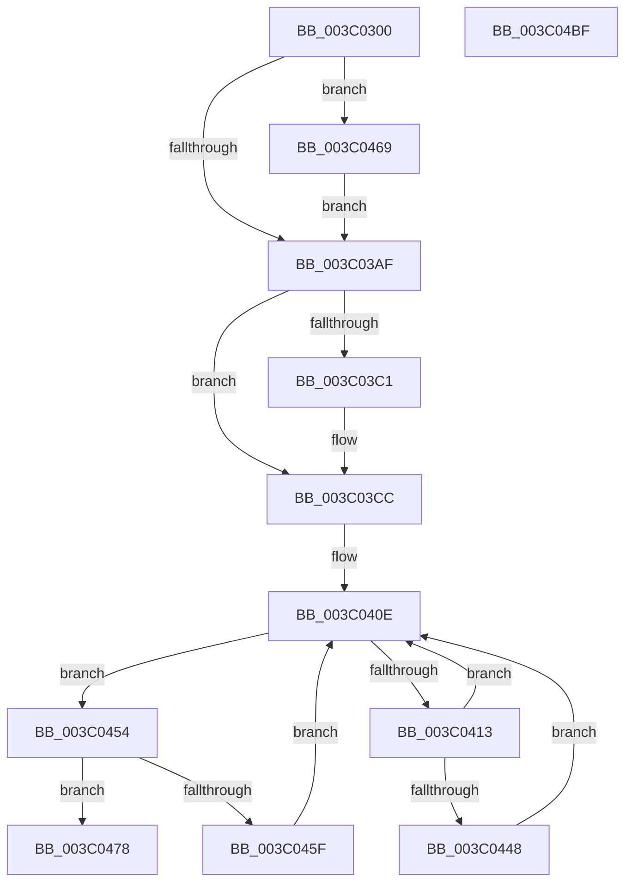

# KeFlushQueuedDpcs

- RVA: `0x003C0300`–`0x003C04C0` (길이 `448` bytes)
- VA: `0x00000001403C0300`
- 실행 섹션: `.text`
- PDB 이름 있음: `예`; PDB Function 태그: `아니요`
- unwind 정보 RVA: `0x0008DF78`
- 디코드: `110`개 명령, `448/448` bytes 표시
- 미해석 바이트: `0` (있으면 어셈블리에 `.byte`로 보존)

> 이 문서는 커널 이미지의 기계어와 PDB 기호를 분석해 생성했습니다. 4번과 5번은 함수 원형과 자료형을 바이너리 사용 방식에서 추정한 C 해석이며 원본 소스 복구 결과는 아닙니다.

## 1. Dependencies

- 직접 호출 지점: **12**; 고유 호출 대상: **9**
- 직접 호출자로 확인된 함수: **6**
- RIP 상대 이미지 참조: **6**

### Outgoing calls
- `0x003C0345` → [memset](../6C/memset_function_006C6C40.md) (function, `0x006C6C40`)
- `0x003C0354` → [memset](../6C/memset_function_006C6C40.md) (function, `0x006C6C40`)
- `0x003C0373` → [memset](../6C/memset_function_006C6C40.md) (function, `0x006C6C40`)
- `0x003C038B` → [memset](../6C/memset_function_006C6C40.md) (function, `0x006C6C40`)
- `0x003C03B3` → [PoCopyDeepIdleMask](PoCopyDeepIdleMask_function_003C04C8.md) (function, `0x003C04C8`)
- `0x003C03C7` → [KiLowerIrqlProcessIrqlFlags](../4F/KiLowerIrqlProcessIrqlFlags_function_004F5698.md) (function, `0x004F5698`)
- `0x003C03E1` → [KiComplementAffinityEx](KiComplementAffinityEx_function_003C05E0.md) (function, `0x003C05E0`)
- `0x003C03FD` → [KiAndAffinityEx](KiAndAffinityEx_function_003C0680.md) (function, `0x003C0680`)
- `0x003C044D` → [KeAddProcessorAffinityEx](../25/KeAddProcessorAffinityEx_function_0025B6F0.md) (function, `0x0025B6F0`)
- `0x003C046E` → [KiRaiseIrqlProcessIrqlFlags](../4F/KiRaiseIrqlProcessIrqlFlags_function_004F56FC.md) (function, `0x004F56FC`)
- `0x003C048A` → [KeGenericProcessorCallback](../39/KeGenericProcessorCallback_function_00398C2C.md) (function, `0x00398C2C`)
- `0x003C0499` → [_security_check_cookie](../6A/_security_check_cookie_function_006AC640.md) (function, `0x006AC640`)

### Direct callers
- [KeCleanupThreadState](../44/KeCleanupThreadState_function_0044B518.md) at `0x0044B5F1`
- [ExpTimeZoneCleanupSiloState](../../page/7C/ExpTimeZoneCleanupSiloState_function_007C638C.md) at `0x007C6411`
- [ExpPartitionDestroy](../../page/7C/ExpPartitionDestroy_function_007CF9B8.md) at `0x007CFA5E`
- [MiDeletePartitionResources](../../page/80/MiDeletePartitionResources_function_0080D074.md) at `0x0080D128`
- [MmPageEntireDriver](../../page/A4/MmPageEntireDriver_function_00A4BBB0.md) at `0x00A4BBF8`
- [IopDeleteDriver](../../page/AA/IopDeleteDriver_function_00AA2E50.md) at `0x00AA2EBD`

### Static image references
- `0x003C0326` → RVA `0x00E0A740` (`.data`; read)
- `0x003C03A2` → RVA `0x00FC6D20` (`ALMOSTRO`; read)
- `0x003C03F1` → RVA `0x00FC7120` (`ALMOSTRO`; read)
- `0x003C0429` → RVA `0x00F231B8` (`.data`; read)
- `0x003C0433` → RVA `0x00FC8C40` (`ALMOSTRO`; read)
- `0x003C047B` → RVA `0x00482100` (`KiFlushQueuedDpcsWorker`; read)

## 2. Other-region calls and transfers

- 다른 실행 섹션으로 향하는 call: **0**
- 별도 외부 분기/꼬리 이동을 확인하지 못했습니다.

## 3. Assembly (complete function range)

```asm
003C0300  48 8B C4                        mov rax, rsp
003C0303  48 89 58 08                     mov qword ptr [rax + 8], rbx
003C0307  48 89 70 10                     mov qword ptr [rax + 0x10], rsi
003C030B  48 89 78 18                     mov qword ptr [rax + 0x18], rdi
003C030F  4C 89 60 20                     mov qword ptr [rax + 0x20], r12
003C0313  55                              push rbp
003C0314  41 56                           push r14
003C0316  41 57                           push r15
003C0318  48 8D A8 88 FE FF FF            lea rbp, [rax - 0x178]
003C031F  48 81 EC 60 02 00 00            sub rsp, 0x260
003C0326  48 8B 05 13 A4 A4 00            mov rax, qword ptr [rip + 0xa4a413]
003C032D  48 33 C4                        xor rax, rsp
003C0330  48 89 85 50 01 00 00            mov qword ptr [rbp + 0x150], rax
003C0337  BF 00 01 00 00                  mov edi, 0x100
003C033C  48 8D 4D 48                     lea rcx, [rbp + 0x48]
003C0340  44 8B C7                        mov r8d, edi
003C0343  33 D2                           xor edx, edx
003C0345  E8 F6 68 30 00                  call 0x1406c6c40
003C034A  44 8B C7                        mov r8d, edi
003C034D  48 8D 4C 24 38                  lea rcx, [rsp + 0x38]
003C0352  33 D2                           xor edx, edx
003C0354  E8 E7 68 30 00                  call 0x1406c6c40
003C0359  44 8B C7                        mov r8d, edi
003C035C  48 C7 45 40 01 00 20 00         mov qword ptr [rbp + 0x40], 0x200001
003C0364  33 D2                           xor edx, edx
003C0366  48 8D 4D 48                     lea rcx, [rbp + 0x48]
003C036A  41 BC 01 00 00 00               mov r12d, 1
003C0370  45 33 F6                        xor r14d, r14d
003C0373  E8 C8 68 30 00                  call 0x1406c6c40
003C0378  44 8B C7                        mov r8d, edi
003C037B  48 C7 44 24 30 01 00 20 00      mov qword ptr [rsp + 0x30], 0x200001
003C0384  33 D2                           xor edx, edx
003C0386  48 8D 4C 24 38                  lea rcx, [rsp + 0x38]
003C038B  E8 B0 68 30 00                  call 0x1406c6c40
003C0390  F0 44 09 34 24                  lock or dword ptr [rsp], r14d
003C0395  44 0F 20 C3                     mov rbx, cr8
003C0399  45 8D 7C 24 01                  lea r15d, [r12 + 1]
003C039E  45 0F 22 C7                     mov cr8, r15
003C03A2  44 39 35 77 69 C0 00            cmp dword ptr [rip + 0xc06977], r14d
003C03A9  0F 85 BA 00 00 00               jne 0x1403c0469
003C03AF  48 8D 4D 40                     lea rcx, [rbp + 0x40]
003C03B3  E8 10 01 00 00                  call 0x1403c04c8
003C03B8  44 39 35 61 69 C0 00            cmp dword ptr [rip + 0xc06961], r14d
003C03BF  74 0B                           je 0x1403c03cc
003C03C1  44 0F 20 C1                     mov rcx, cr8
003C03C5  8A D3                           mov dl, bl
003C03C7  E8 CC 52 13 00                  call 0x1404f5698
003C03CC  0F B6 C3                        movzx eax, bl
003C03CF  44 0F 22 C0                     mov cr8, rax
003C03D3  0F B7 54 24 32                  movzx edx, word ptr [rsp + 0x32]
003C03D8  4C 8D 45 40                     lea r8, [rbp + 0x40]
003C03DC  48 8D 4C 24 30                  lea rcx, [rsp + 0x30]
003C03E1  E8 FA 01 00 00                  call 0x1403c05e0
003C03E6  44 0F B7 4C 24 32               movzx r9d, word ptr [rsp + 0x32]
003C03EC  4C 8D 44 24 30                  lea r8, [rsp + 0x30]
003C03F1  48 8D 15 28 6D C0 00            lea rdx, [rip + 0xc06d28]
003C03F8  48 8D 4C 24 30                  lea rcx, [rsp + 0x30]
003C03FD  E8 7E 02 00 00                  call 0x1403c0680
003C0402  48 8B 7D 48                     mov rdi, qword ptr [rbp + 0x48]
003C0406  41 0F B7 DE                     movzx ebx, r14w
003C040A  0F B7 75 40                     movzx esi, word ptr [rbp + 0x40]
003C040E  48 85 FF                        test rdi, rdi
003C0411  74 41                           je 0x1403c0454
003C0413  48 0F BC D7                     bsf rdx, rdi
003C0417  0F B7 CB                        movzx ecx, bx
003C041A  0F B6 C2                        movzx eax, dl
003C041D  48 0F B3 C7                     btr rdi, rax
003C0421  C1 E1 06                        shl ecx, 6
003C0424  0F B6 C2                        movzx eax, dl
003C0427  03 C8                           add ecx, eax
003C0429  48 8B 05 88 2D B6 00            mov rax, qword ptr [rip + 0xb62d88]
003C0430  8B 14 88                        mov edx, dword ptr [rax + rcx*4]
003C0433  48 8D 0D 06 88 C0 00            lea rcx, [rip + 0xc08806]
003C043A  48 8B 04 D1                     mov rax, qword ptr [rcx + rdx*8]
003C043E  8B 80 BC 38 00 00               mov eax, dword ptr [rax + 0x38bc]
003C0444  85 C0                           test eax, eax
003C0446  74 C6                           je 0x1403c040e
003C0448  48 8D 4C 24 30                  lea rcx, [rsp + 0x30]
003C044D  E8 9E B2 E9 FF                  call 0x14025b6f0
003C0452  EB BA                           jmp 0x1403c040e
003C0454  66 41 03 DC                     add bx, r12w
003C0458  0F B7 C3                        movzx eax, bx
003C045B  3B C6                           cmp eax, esi
003C045D  73 19                           jae 0x1403c0478
003C045F  0F B7 C3                        movzx eax, bx
003C0462  48 8B 7C C5 48                  mov rdi, qword ptr [rbp + rax*8 + 0x48]
003C0467  EB A5                           jmp 0x1403c040e
003C0469  41 8A D7                        mov dl, r15b
003C046C  8A CB                           mov cl, bl
003C046E  E8 89 52 13 00                  call 0x1404f56fc
003C0473  E9 37 FF FF FF                  jmp 0x1403c03af
003C0478  45 8B CF                        mov r9d, r15d
003C047B  48 8D 15 7E 1C 0C 00            lea rdx, [rip + 0xc1c7e]
003C0482  45 33 C0                        xor r8d, r8d
003C0485  48 8D 4C 24 30                  lea rcx, [rsp + 0x30]
003C048A  E8 9D 87 FD FF                  call 0x140398c2c
003C048F  48 8B 8D 50 01 00 00            mov rcx, qword ptr [rbp + 0x150]
003C0496  48 33 CC                        xor rcx, rsp
003C0499  E8 A2 C1 2E 00                  call 0x1406ac640
003C049E  4C 8D 9C 24 60 02 00 00         lea r11, [rsp + 0x260]
003C04A6  49 8B 5B 20                     mov rbx, qword ptr [r11 + 0x20]
003C04AA  49 8B 73 28                     mov rsi, qword ptr [r11 + 0x28]
003C04AE  49 8B 7B 30                     mov rdi, qword ptr [r11 + 0x30]
003C04B2  4D 8B 63 38                     mov r12, qword ptr [r11 + 0x38]
003C04B6  49 8B E3                        mov rsp, r11
003C04B9  41 5F                           pop r15
003C04BB  41 5E                           pop r14
003C04BD  5D                              pop rbp
003C04BE  C3                              ret
003C04BF  CC                              int3
```

## 4. C-style interpretation (structured pseudocode)

```c
__int64 __fastcall KeFlushQueuedDpcs(__int64 a1, int a2)
{
    __int64 result;
    __int64 v_r14;
    __int64 v_rbx;
    __int64 v_rsp;
    unsigned __int64 v_stack_m18;
    unsigned __int64 v_stack_m240;
    unsigned __int16 v_stack_m246;
    unsigned __int64 v_stack_m248;
    unsigned int v_stack_m278;

    *(unsigned __int64 *)(v_rsp + 8) = v_rbx;
    *(unsigned __int64 *)(v_rsp + 16) = v_rsi;
    *(unsigned __int64 *)(v_rsp + 24) = v_rdi;
    *(unsigned __int64 *)(v_rsp + 32) = v_r12;
    v_rsp = (v_rsp) - (608);
    result = (*(unsigned __int64 *)(v_rip + 10789907)) ^ (v_rsp);
    *(unsigned __int64 *)(v_rsp - 376 + 336) = result;
    a2 = 0;
    result = memset(v_rsp - 376 + 72, a2, 256, a4);
    a2 = 0;
    result = memset(v_stack_m240, a2, 256, a4);
    *(unsigned __int64 *)(v_rsp - 376 + 64) = 0x200001ULL;
    a2 = 0;
    v_r14 = 0;
    result = memset(v_rsp - 376 + 72, a2, 256, a4);
    v_stack_m248 = 0x200001ULL;
    a2 = 0;
    result = memset(v_stack_m240, a2, 256, a4);
    if ((*(unsigned int *)(v_rip + 12609911)) != 0) goto loc_003C0469;
loc_003C03AF:
    result = PoCopyDeepIdleMask(v_rsp - 376 + 64, a2, 256, a4);
    if ((*(unsigned int *)(v_rip + 12609889)) != 0) {
        a1 = 1 + 1;
        a2 = (unsigned __int8)(v_cr8);
        result = KiLowerIrqlProcessIrqlFlags(a1, a2, 256, a4);
    }
    result = KiComplementAffinityEx(v_stack_m248, v_stack_m246, v_rsp - 376 + 64, a4);
    result = KiAndAffinityEx(v_stack_m248, v_rip + 12610856, v_stack_m248, v_stack_m246);
loc_003C040E:
    if (*(unsigned __int64 *)(v_rsp - 376 + 72) == 0) goto loc_003C0454;
    a1 = (unsigned int)((0) << (6));
    a1 = (unsigned int)((a1) + ((unsigned int)((unsigned __int8)(v_rip + 12610856))));
    if ((unsigned int)((unsigned int)(*(unsigned int *)(*(unsigned __int64 *)(v_rip + 12617734 + (unsigned int)(*(unsigned int *)(*(unsigned __int64 *)(v_rip + 11939208) + a1 * 4)) * 8) + 14524))) == 0) goto loc_003C040E;
    result = KeAddProcessorAffinityEx(v_stack_m248, (unsigned int)(*(unsigned int *)(*(unsigned __int64 *)(v_rip + 11939208) + a1 * 4)), v_stack_m248, v_stack_m246);
    goto loc_003C040E;
loc_003C0454:
    v_rbx = (unsigned __int16)((0) + (1));
    if (((unsigned int)((unsigned __int16)(v_rbx))) >= ((unsigned int)(*(unsigned __int16 *)(v_rsp - 376 + 64)))) goto loc_003C0478;
    goto loc_003C040E;
loc_003C0469:
    result = KiRaiseIrqlProcessIrqlFlags((unsigned __int8)(v_rbx), (unsigned __int8)(1 + 1), v_stack_m248, v_stack_m246);
    goto loc_003C03AF;
loc_003C0478:
    a3 = 0;
    result = KeGenericProcessorCallback(v_stack_m248, v_rip + 793726, a3, (unsigned int)((unsigned int)(1 + 1)));
    a1 = (*(unsigned __int64 *)(v_rsp - 376 + 336)) ^ (v_rsp);
    result = _security_check_cookie(a1, v_rip + 793726, a3, (unsigned int)((unsigned int)(1 + 1)));
    return result;
}
```

## 5. (Beta) C Style

```c
int64_t KeFlushQueuedDpcs(int64_t Arg1, int32_t Arg2)
{
    int64_t result;
    int64_t local_r14;
    int64_t local_rbx;
    int64_t local_rsp;
    uint64_t v_stack_m18;
    uint64_t v_stack_m240;
    uint16_t v_stack_m246;
    uint64_t v_stack_m248;
    uint32_t v_stack_m278;

    *(uint64_t *)(local_rsp + 0x8) = local_rbx;
    *(uint64_t *)(local_rsp + 0x10) = local_rsi;
    *(uint64_t *)(local_rsp + 0x18) = local_rdi;
    *(uint64_t *)(local_rsp + 0x20) = local_r12;
    local_rsp = (local_rsp) - (608);
    result = (*(uint64_t *)(v_rip + 0xA4A413)) ^ (local_rsp);
    *(uint64_t *)(local_rsp - 0x178 + 0x150) = result;
    Arg2 = 0;
    result = memset(local_rsp - 376 + 72, Arg2, 256, a4);
    Arg2 = 0;
    result = memset(v_stack_m240, Arg2, 256, a4);
    *(uint64_t *)(local_rsp - 0x178 + 0x40) = 0x200001ULL;
    Arg2 = 0;
    local_r14 = 0;
    result = memset(local_rsp - 376 + 72, Arg2, 256, a4);
    v_stack_m248 = 0x200001ULL;
    Arg2 = 0;
    result = memset(v_stack_m240, Arg2, 256, a4);
    if ((*(uint32_t *)(v_rip + 0xC06977)) != 0) goto loc_003C0469;
loc_003C03AF:
    result = PoCopyDeepIdleMask(local_rsp - 376 + 64, Arg2, 256, a4);
    if ((*(uint32_t *)(v_rip + 0xC06961)) != 0) {
        Arg1 = 1 + 1;
        Arg2 = (uint8_t)(v_cr8);
        result = KiLowerIrqlProcessIrqlFlags(Arg1, Arg2, 256, a4);
    }
    result = KiComplementAffinityEx(v_stack_m248, v_stack_m246, local_rsp - 376 + 64, a4);
    result = KiAndAffinityEx(v_stack_m248, v_rip + 12610856, v_stack_m248, v_stack_m246);
loc_003C040E:
    if (*(uint64_t *)(local_rsp - 0x178 + 0x48) == 0) goto loc_003C0454;
    Arg1 = (uint32_t)((0) << (6));
    Arg1 = (uint32_t)((Arg1) + ((uint32_t)((uint8_t)(v_rip + 12610856))));
    if ((uint32_t)((uint32_t)(*(uint32_t *)(*(uint64_t *)(v_rip + 0xC08806 + (uint32_t)(*(uint32_t *)(*(uint64_t *)(v_rip + 0xB62D88) + Arg1 * 4)) * 8) + 0x38BC))) == 0) goto loc_003C040E;
    result = KeAddProcessorAffinityEx(v_stack_m248, (uint32_t)(*(uint32_t *)(*(uint64_t *)(v_rip + 0xB62D88) + Arg1 * 4)), v_stack_m248, v_stack_m246);
    goto loc_003C040E;
loc_003C0454:
    local_rbx = (uint16_t)((0) + (1));
    if (((uint32_t)((uint16_t)(local_rbx))) >= ((uint32_t)(*(uint16_t *)(local_rsp - 0x178 + 0x40)))) goto loc_003C0478;
    goto loc_003C040E;
loc_003C0469:
    result = KiRaiseIrqlProcessIrqlFlags((uint8_t)(local_rbx), (uint8_t)(1 + 1), v_stack_m248, v_stack_m246);
    goto loc_003C03AF;
loc_003C0478:
    a3 = 0;
    result = KeGenericProcessorCallback(v_stack_m248, v_rip + 793726, a3, (uint32_t)((uint32_t)(1 + 1)));
    Arg1 = (*(uint64_t *)(local_rsp - 0x178 + 0x150)) ^ (local_rsp);
    result = _security_check_cookie(Arg1, v_rip + 793726, a3, (uint32_t)((uint32_t)(1 + 1)));
    return result;
}
```

## 6. Execution-region graph

[열기: 2D/3D 그래프와 함수 탐색 컨트롤 패널](../../../control-panel.html?section=text&rva=0x003C0300&view=graph)

- 2D 그래프는 위에서 아래로 흐르고, 3D 그래프는 빈 공간을 드래그해 회전합니다. Shift+드래그는 이동, 휠은 확대·축소, 함수 노드 선택은 대상 보고서 이동입니다.

### Static fallback


