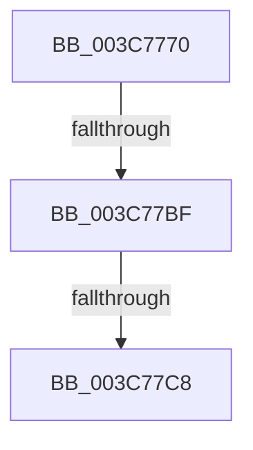

# KeForceDetachProcess

- RVA: `0x003C7770`–`0x003C77D1` (길이 `97` bytes)
- VA: `0x00000001403C7770`
- 실행 섹션: `.text`
- PDB 이름 있음: `예`; PDB Function 태그: `아니요`
- unwind 정보 RVA: `0x0008E74C`
- 디코드: `21`개 명령, `97/97` bytes 표시
- 미해석 바이트: `0` (있으면 어셈블리에 `.byte`로 보존)

> 이 문서는 커널 이미지의 기계어와 PDB 기호를 분석해 생성했습니다. 4번과 5번은 함수 원형과 자료형을 바이너리 사용 방식에서 추정한 C 해석이며 원본 소스 복구 결과는 아닙니다.

## 1. Dependencies

- 직접 호출 지점: **0**; 고유 호출 대상: **0**
- 직접 호출자로 확인된 함수: **8**
- RIP 상대 이미지 참조: **1**

### Outgoing calls
- 직접 디코드된 call 명령이 없습니다.

### Direct callers
- [MiTrimSharedPageFromViews](../2E/MiTrimSharedPageFromViews_function_002E16F8.md) at `0x002E2222`
- [MiSharePages](../31/MiSharePages_function_00315110.md) at `0x003159F4`
- [MiReleaseOutSwappedProcessCommit](MiReleaseOutSwappedProcessCommit_function_003C8320.md) at `0x003C85B4`
- [MiReAcquireOutSwappedProcessCommit](../66/MiReAcquireOutSwappedProcessCommit_function_0066F598.md) at `0x0066F734`
- [MiReleaseCommitForResetPages](../66/MiReleaseCommitForResetPages_function_0066FAF8.md) at `0x0066FC25`
- [MmReleaseCommitForMemResetPages](../66/MmReleaseCommitForMemResetPages_function_0066FDCC.md) at `0x0066FEEA`
- [MmReleaseCommitForMemResetPages](../66/MmReleaseCommitForMemResetPages_function_0066FDCC.md) at `0x0066FF2E`
- [sub_006F5914](../6F/Unknown_function_006F5914.md) at `0x006F598D`
- [PopHandleNextState](../../pagelk/B7/PopHandleNextState_function_00B77350.md) at `0x00B77604`

### Static image references
- `0x003C777B` → RVA `0x00E0A740` (`.data`; read)

## 2. Other-region calls and transfers

- 다른 실행 섹션으로 향하는 call: **0**
- call이 아닌 외부 분기/꼬리 이동: **2**
  - `0x003C77B9` → [sub_003C7AA9](Unknown_function_003C7AA9.md) (`tail-transfer`)
  - `0x003C77C2` → [sub_003C7BE2](Unknown_function_003C7BE2.md) (`tail-transfer`)

## 3. Assembly (complete function range)

```asm
003C7770  4C 8B DC                        mov r11, rsp
003C7773  56                              push rsi
003C7774  48 81 EC A0 00 00 00            sub rsp, 0xa0
003C777B  48 8B 05 BE 2F A4 00            mov rax, qword ptr [rip + 0xa42fbe]
003C7782  48 33 C4                        xor rax, rsp
003C7785  48 89 44 24 70                  mov qword ptr [rsp + 0x70], rax
003C778A  48 85 C9                        test rcx, rcx
003C778D  49 8D 43 98                     lea rax, [r11 - 0x68]
003C7791  0F 57 C0                        xorps xmm0, xmm0
003C7794  48 0F 45 C1                     cmovne rax, rcx
003C7798  83 E2 01                        and edx, 1
003C779B  0F 11 44 24 40                  movups xmmword ptr [rsp + 0x40], xmm0
003C77A0  0F 11 44 24 50                  movups xmmword ptr [rsp + 0x50], xmm0
003C77A5  8D 34 55 01 00 00 00            lea esi, [rdx*2 + 1]
003C77AC  0F 11 44 24 60                  movups xmmword ptr [rsp + 0x60], xmm0
003C77B1  48 8B 48 20                     mov rcx, qword ptr [rax + 0x20]
003C77B5  48 83 F9 01                     cmp rcx, 1
003C77B9  0F 84 EA 02 00 00               je 0x1403c7aa9
003C77BF  48 85 C9                        test rcx, rcx
003C77C2  0F 85 1A 04 00 00               jne 0x1403c7be2
003C77C8  65 48 8B 04 25 88 01 00 00      mov rax, qword ptr gs:[0x188]
```

## 4. C-style interpretation (structured pseudocode)

```c
__int64 __fastcall KeForceDetachProcess(__int64 a1, int a2)
{
    __int64 result;
    __int64 v_rsp;
    unsigned __int64 v_stack_m38;
    unsigned __int64 v_stack_m48;
    unsigned __int64 v_stack_m58;
    unsigned __int64 v_stack_m68;

    v_rsp = (v_rsp) - (160);
    result = (*(unsigned __int64 *)(v_rip + 10760126)) ^ (v_rsp);
    v_stack_m38 = result;
    result = v_rsp - 104;
    if (a1 != 0) { result = a1; }
    a2 = (unsigned int)((a2) & (1));
    v_stack_m68 = v_xmm0;
    v_stack_m58 = v_xmm0;
    v_stack_m48 = v_xmm0;
    return *(unsigned __int64 *)(gs_base + (0 + 392));
}
```

## 5. (Beta) C Style

```c
int64_t KeForceDetachProcess(int64_t Arg1, int32_t Arg2)
{
    int64_t result;
    int64_t local_rsp;
    uint64_t v_stack_m38;
    uint64_t v_stack_m48;
    uint64_t v_stack_m58;
    uint64_t v_stack_m68;

    local_rsp = (local_rsp) - (160);
    result = (*(uint64_t *)(v_rip + 0xA42FBE)) ^ (local_rsp);
    v_stack_m38 = result;
    result = local_rsp - 104;
    if (Arg1 != 0) { result = Arg1; }
    Arg2 = (uint32_t)((Arg2) & (1));
    v_stack_m68 = v_xmm0;
    v_stack_m58 = v_xmm0;
    v_stack_m48 = v_xmm0;
    return *(uint64_t *)(gs_base + (0 + 0x188));
}
```

## 6. Execution-region graph

[열기: 2D/3D 그래프와 함수 탐색 컨트롤 패널](../../../control-panel.html?section=text&rva=0x003C7770&view=graph)

- 2D 그래프는 위에서 아래로 흐르고, 3D 그래프는 빈 공간을 드래그해 회전합니다. Shift+드래그는 이동, 휠은 확대·축소, 함수 노드 선택은 대상 보고서 이동입니다.

### Static fallback


