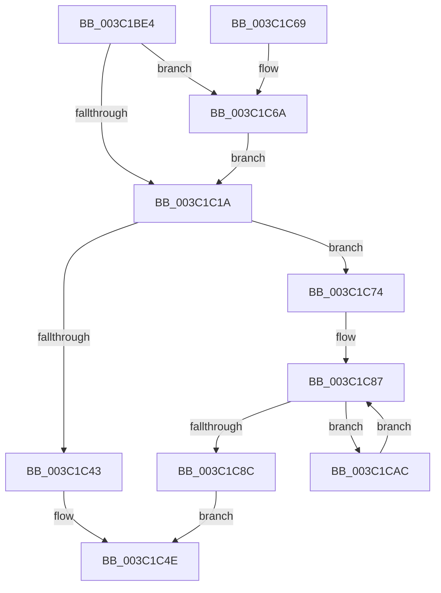

# KeForceResumeProcess

- RVA: `0x003C1BE4`–`0x003C1CC6` (길이 `226` bytes)
- VA: `0x00000001403C1BE4`
- 실행 섹션: `.text`
- PDB 이름 있음: `예`; PDB Function 태그: `아니요`
- unwind 정보 RVA: `0x0008E188`
- 디코드: `58`개 명령, `226/226` bytes 표시
- 미해석 바이트: `0` (있으면 어셈블리에 `.byte`로 보존)

> 이 문서는 커널 이미지의 기계어와 PDB 기호를 분석해 생성했습니다. 4번과 5번은 함수 원형과 자료형을 바이너리 사용 방식에서 추정한 C 해석이며 원본 소스 복구 결과는 아닙니다.

## 1. Dependencies

- 직접 호출 지점: **6**; 고유 호출 대상: **6**
- 직접 호출자로 확인된 함수: **4**
- RIP 상대 이미지 참조: **1**

### Outgoing calls
- `0x003C1C2A` → [ExAcquireSpinLockExclusiveAtDpcLevel](../24/ExAcquireSpinLockExclusiveAtDpcLevel_function_00248E80.md) (function, `0x00248E80`)
- `0x003C1C49` → [KiReleaseProcessLockExclusive](KiReleaseProcessLockExclusive_function_003C2660.md) (function, `0x003C2660`)
- `0x003C1C6D` → [KiRaiseIrqlProcessIrqlFlags](../4F/KiRaiseIrqlProcessIrqlFlags_function_004F56FC.md) (function, `0x004F56FC`)
- `0x003C1C8F` → [ExReleaseSpinLockExclusiveFromDpcLevel](../24/ExReleaseSpinLockExclusiveFromDpcLevel_function_002497E0.md) (function, `0x002497E0`)
- `0x003C1CA5` → [KiExitDispatcher](../25/KiExitDispatcher_function_00251CF0.md) (function, `0x00251CF0`)
- `0x003C1CBC` → [KiThawSingleThread](../20/KiThawSingleThread_function_00203560.md) (function, `0x00203560`)

### Direct callers
- [MiReAcquireCommitFailWorker](../66/MiReAcquireCommitFailWorker_function_0066F560.md) at `0x0066F576`
- [PspTerminateProcess](../../page/90/PspTerminateProcess_function_00903FFC.md) at `0x009040FD`
- [PspExitLastThread](../../page/90/PspExitLastThread_function_00904184.md) at `0x009042A6`
- [PsFreezeProcess](../../page/AA/PsFreezeProcess_function_00AA6D04.md) at `0x00AA6D3D`

### Static image references
- `0x003C1C11` → RVA `0x00FC6D20` (`ALMOSTRO`; read)

## 2. Other-region calls and transfers

- 다른 실행 섹션으로 향하는 call: **0**
- 별도 외부 분기/꼬리 이동을 확인하지 못했습니다.

## 3. Assembly (complete function range)

```asm
003C1BE4  48 8B C4                        mov rax, rsp
003C1BE7  48 89 58 08                     mov qword ptr [rax + 8], rbx
003C1BEB  48 89 68 10                     mov qword ptr [rax + 0x10], rbp
003C1BEF  48 89 70 18                     mov qword ptr [rax + 0x18], rsi
003C1BF3  48 89 78 20                     mov qword ptr [rax + 0x20], rdi
003C1BF7  41 56                           push r14
003C1BF9  48 83 EC 30                     sub rsp, 0x30
003C1BFD  48 8B D9                        mov rbx, rcx
003C1C00  48 8D 71 30                     lea rsi, [rcx + 0x30]
003C1C04  44 0F 20 C7                     mov rdi, cr8
003C1C08  BA 02 00 00 00                  mov edx, 2
003C1C0D  44 0F 22 C2                     mov cr8, rdx
003C1C11  83 3D 08 51 C0 00 00            cmp dword ptr [rip + 0xc05108], 0
003C1C18  75 50                           jne 0x1403c1c6a
003C1C1A  65 48 8B 2C 25 20 00 00 00      mov rbp, qword ptr gs:[0x20]
003C1C23  4C 8D 73 40                     lea r14, [rbx + 0x40]
003C1C27  49 8B CE                        mov rcx, r14
003C1C2A  E8 51 72 E8 FF                  call 0x140248e80
003C1C2F  8B 83 88 00 00 00               mov eax, dword ptr [rbx + 0x88]
003C1C35  C1 E8 03                        shr eax, 3
003C1C38  83 E0 01                        and eax, 1
003C1C3B  03 83 50 01 00 00               add eax, dword ptr [rbx + 0x150]
003C1C41  75 31                           jne 0x1403c1c74
003C1C43  40 8A D7                        mov dl, dil
003C1C46  48 8B CB                        mov rcx, rbx
003C1C49  E8 12 0A 00 00                  call 0x1403c2660
003C1C4E  48 8B 5C 24 40                  mov rbx, qword ptr [rsp + 0x40]
003C1C53  48 8B 6C 24 48                  mov rbp, qword ptr [rsp + 0x48]
003C1C58  48 8B 74 24 50                  mov rsi, qword ptr [rsp + 0x50]
003C1C5D  48 8B 7C 24 58                  mov rdi, qword ptr [rsp + 0x58]
003C1C62  48 83 C4 30                     add rsp, 0x30
003C1C66  41 5E                           pop r14
003C1C68  C3                              ret
003C1C69  CC                              int3
003C1C6A  40 8A CF                        mov cl, dil
003C1C6D  E8 8A 3A 13 00                  call 0x1404f56fc
003C1C72  EB A6                           jmp 0x1403c1c1a
003C1C74  F0 0F BA B3 88 00 00 00 03      lock btr dword ptr [rbx + 0x88], 3
003C1C7D  83 A3 50 01 00 00 00            and dword ptr [rbx + 0x150], 0
003C1C84  48 8B 1E                        mov rbx, qword ptr [rsi]
003C1C87  48 3B DE                        cmp rbx, rsi
003C1C8A  75 20                           jne 0x1403c1cac
003C1C8C  49 8B CE                        mov rcx, r14
003C1C8F  E8 4C 7B E8 FF                  call 0x1402497e0
003C1C94  45 33 C9                        xor r9d, r9d
003C1C97  40 88 7C 24 20                  mov byte ptr [rsp + 0x20], dil
003C1C9C  33 D2                           xor edx, edx
003C1C9E  48 8B CD                        mov rcx, rbp
003C1CA1  45 8D 41 01                     lea r8d, [r9 + 1]
003C1CA5  E8 46 00 E9 FF                  call 0x140251cf0
003C1CAA  EB A2                           jmp 0x1403c1c4e
003C1CAC  41 B1 01                        mov r9b, 1
003C1CAF  48 8D 93 08 FD FF FF            lea rdx, [rbx - 0x2f8]
003C1CB6  45 8A C1                        mov r8b, r9b
003C1CB9  48 8B CD                        mov rcx, rbp
003C1CBC  E8 9F 18 E4 FF                  call 0x140203560
003C1CC1  48 8B 1B                        mov rbx, qword ptr [rbx]
003C1CC4  EB C1                           jmp 0x1403c1c87
```

## 4. C-style interpretation (structured pseudocode)

```c
__int64 __fastcall KeForceResumeProcess(__int64 a1, __int64 a2, __int64 a3, int a4)
{
    __int64 result;
    __int64 v_rsp;
    unsigned __int64 v_stack_p10;
    unsigned __int64 v_stack_p18;
    unsigned __int64 v_stack_p20;
    unsigned __int64 v_stack_p8;

    *(unsigned __int64 *)(v_rsp + 8) = v_rbx;
    *(unsigned __int64 *)(v_rsp + 16) = v_rbp;
    *(unsigned __int64 *)(v_rsp + 24) = v_rsi;
    *(unsigned __int64 *)(v_rsp + 32) = v_rdi;
    v_rsp = (v_rsp) - (48);
    if ((*(unsigned int *)(v_rip + 12603656)) != 0) goto loc_003C1C6A;
loc_003C1C1A:
    result = ExAcquireSpinLockExclusiveAtDpcLevel(a1 + 64, 2, a3, a4);
    result = (unsigned int)(((unsigned int)(*(unsigned int *)(a1 + 136))) >> (3));
    result = (unsigned int)((result) & (1));
    result = (unsigned int)((result) + (*(unsigned int *)(a1 + 336)));
    if (condition_is_not_equal) goto loc_003C1C74;
    result = KiReleaseProcessLockExclusive(a1, (unsigned __int8)(v_cr8), a3, a4);
loc_003C1C4E:
    v_rsp = (v_rsp) + (48);
    return result;
loc_003C1C6A:
    result = KiRaiseIrqlProcessIrqlFlags((unsigned __int8)(v_stack_p20), (unsigned __int8)(v_cr8), a3, a4);
    goto loc_003C1C1A;
loc_003C1C74:
loc_003C1C87:
    if ((*(unsigned __int64 *)(v_stack_p18)) != v_stack_p18) goto loc_003C1CAC;
    result = ExReleaseSpinLockExclusiveFromDpcLevel(a1 + 64, (unsigned __int8)(v_cr8), a3, a4);
    a4 = 0;
    v_stack_p20 = (unsigned __int8)(v_stack_p20);
    a2 = 0;
    result = KiExitDispatcher(v_stack_p10, a2, a4 + 1, a4);
    goto loc_003C1C4E;
loc_003C1CAC:
    result = KiThawSingleThread(v_stack_p10, *(unsigned __int64 *)(v_stack_p18) - 760, 1, 1);
    goto loc_003C1C87;
}
```

## 5. (Beta) C Style

```c
int64_t KeForceResumeProcess(void *Arg1, int64_t Arg2, int64_t Arg3, int32_t Arg4)
{
    uint8_t *arg1 = (uint8_t *)Arg1;

    int64_t result;
    int64_t local_rsp;
    uint64_t v_stack_p10;
    uint64_t v_stack_p18;
    uint64_t v_stack_p20;
    uint64_t v_stack_p8;

    *(uint64_t *)(local_rsp + 0x8) = local_rbx;
    *(uint64_t *)(local_rsp + 0x10) = local_rbp;
    *(uint64_t *)(local_rsp + 0x18) = local_rsi;
    *(uint64_t *)(local_rsp + 0x20) = local_rdi;
    local_rsp = (local_rsp) - (48);
    if ((*(uint32_t *)(v_rip + 0xC05108)) != 0) goto loc_003C1C6A;
loc_003C1C1A:
    result = ExAcquireSpinLockExclusiveAtDpcLevel(Arg1 + 64, 2, Arg3, Arg4);
    result = (uint32_t)(((uint32_t)(*(uint32_t *)(arg1 + 0x88))) >> (3));
    result = (uint32_t)((result) & (1));
    result = (uint32_t)((result) + (*(uint32_t *)(arg1 + 0x150)));
    if (condition_is_not_equal) goto loc_003C1C74;
    result = KiReleaseProcessLockExclusive(Arg1, (uint8_t)(v_cr8), Arg3, Arg4);
loc_003C1C4E:
    local_rsp = (local_rsp) + (48);
    return result;
loc_003C1C6A:
    result = KiRaiseIrqlProcessIrqlFlags((uint8_t)(v_stack_p20), (uint8_t)(v_cr8), Arg3, Arg4);
    goto loc_003C1C1A;
loc_003C1C74:
loc_003C1C87:
    if ((*(uint64_t *)(v_stack_p18)) != v_stack_p18) goto loc_003C1CAC;
    result = ExReleaseSpinLockExclusiveFromDpcLevel(Arg1 + 64, (uint8_t)(v_cr8), Arg3, Arg4);
    Arg4 = 0;
    v_stack_p20 = (uint8_t)(v_stack_p20);
    Arg2 = 0;
    result = KiExitDispatcher(v_stack_p10, Arg2, Arg4 + 1, Arg4);
    goto loc_003C1C4E;
loc_003C1CAC:
    result = KiThawSingleThread(v_stack_p10, *(uint64_t *)(v_stack_p18) - 760, 1, 1);
    goto loc_003C1C87;
}
```

### 관측된 메모리 오프셋

구조체 형식이 확인되지 않은 접근은 인자 기준의 오프셋으로만 기록했습니다.

| 기준 인자 | 오프셋 표현 | 폭 (bit) | 접근 |
|---|---:|---:|---|
| `Arg1` | `+ 0x0` | `64` | `R` |
| `Arg1` | `+ 0x30` | `64` | `R` |
| `Arg1` | `+ 0x40` | `64` | `R` |
| `Arg1` | `+ 0x88` | `32` | `R` |
| `Arg1` | `+ 0x88` | `32` | `R/W` |
| `Arg1` | `+ 0x150` | `32` | `R` |
| `Arg1` | `+ 0x150` | `32` | `R/W` |

## 6. Execution-region graph

[열기: 2D/3D 그래프와 함수 탐색 컨트롤 패널](../../../control-panel.html?section=text&rva=0x003C1BE4&view=graph)

- 2D 그래프는 위에서 아래로 흐르고, 3D 그래프는 빈 공간을 드래그해 회전합니다. Shift+드래그는 이동, 휠은 확대·축소, 함수 노드 선택은 대상 보고서 이동입니다.

### Static fallback


