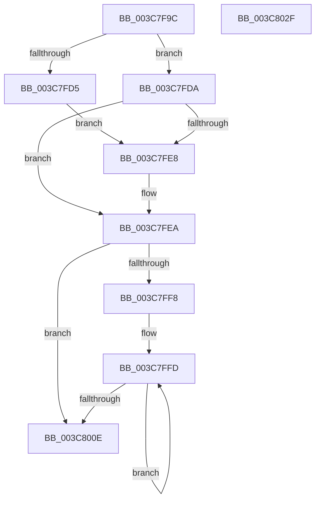

# KeQueryCpuSetsThread

- RVA: `0x003C7F9C`–`0x003C8030` (길이 `148` bytes)
- VA: `0x00000001403C7F9C`
- 실행 섹션: `.text`
- PDB 이름 있음: `예`; PDB Function 태그: `아니요`
- unwind 정보 RVA: `0x0008E904`
- 디코드: `45`개 명령, `148/148` bytes 표시
- 미해석 바이트: `0` (있으면 어셈블리에 `.byte`로 보존)

> 이 문서는 커널 이미지의 기계어와 PDB 기호를 분석해 생성했습니다. 4번과 5번은 함수 원형과 자료형을 바이너리 사용 방식에서 추정한 C 해석이며 원본 소스 복구 결과는 아닙니다.

## 1. Dependencies

- 직접 호출 지점: **2**; 고유 호출 대상: **2**
- 직접 호출자로 확인된 함수: **1**
- RIP 상대 이미지 참조: **1**

### Outgoing calls
- `0x003C7FEF` → [KiAcquireThreadLockRaiseToDpc](../39/KiAcquireThreadLockRaiseToDpc_function_00396280.md) (function, `0x00396280`)
- `0x003C8015` → [KiReleaseThreadLockLowerIrql](KiReleaseThreadLockLowerIrql_function_003C65D0.md) (function, `0x003C65D0`)

### Direct callers
- [NtQueryInformationThread](../../page/AE/NtQueryInformationThread_function_00AE3760.md) at `0x00AE4909`

### Static image references
- `0x003C7FDA` → RVA `0x00FC5014` (`ALMOSTRO`; read)

## 2. Other-region calls and transfers

- 다른 실행 섹션으로 향하는 call: **0**
- 별도 외부 분기/꼬리 이동을 확인하지 못했습니다.

## 3. Assembly (complete function range)

```asm
003C7F9C  48 8B C4                        mov rax, rsp
003C7F9F  48 89 58 08                     mov qword ptr [rax + 8], rbx
003C7FA3  48 89 68 10                     mov qword ptr [rax + 0x10], rbp
003C7FA7  44 89 40 18                     mov dword ptr [rax + 0x18], r8d
003C7FAB  56                              push rsi
003C7FAC  57                              push rdi
003C7FAD  41 56                           push r14
003C7FAF  48 83 EC 20                     sub rsp, 0x20
003C7FB3  F7 81 A0 05 00 00 00 00 02 00   test dword ptr [rcx + 0x5a0], 0x20000
003C7FBD  48 8D B1 90 06 00 00            lea rsi, [rcx + 0x690]
003C7FC4  48 8B DA                        mov rbx, rdx
003C7FC7  C6 40 18 00                     mov byte ptr [rax + 0x18], 0
003C7FCB  4C 8B F1                        mov r14, rcx
003C7FCE  BD 20 00 00 00                  mov ebp, 0x20
003C7FD3  75 05                           jne 0x1403c7fda
003C7FD5  8D 7D E1                        lea edi, [rbp - 0x1f]
003C7FD8  EB 0E                           jmp 0x1403c7fe8
003C7FDA  0F B7 3D 33 D0 BF 00            movzx edi, word ptr [rip + 0xbfd033]
003C7FE1  48 8B 36                        mov rsi, qword ptr [rsi]
003C7FE4  3B FD                           cmp edi, ebp
003C7FE6  77 02                           ja 0x1403c7fea
003C7FE8  8B EF                           mov ebp, edi
003C7FEA  48 8D 54 24 50                  lea rdx, [rsp + 0x50]
003C7FEF  E8 8C E2 FC FF                  call 0x140396280
003C7FF4  85 ED                           test ebp, ebp
003C7FF6  74 16                           je 0x1403c800e
003C7FF8  48 2B F3                        sub rsi, rbx
003C7FFB  8B C5                           mov eax, ebp
003C7FFD  48 8B 0C 1E                     mov rcx, qword ptr [rsi + rbx]
003C8001  48 89 0B                        mov qword ptr [rbx], rcx
003C8004  48 8D 5B 08                     lea rbx, [rbx + 8]
003C8008  48 83 E8 01                     sub rax, 1
003C800C  75 EF                           jne 0x1403c7ffd
003C800E  8A 54 24 50                     mov dl, byte ptr [rsp + 0x50]
003C8012  49 8B CE                        mov rcx, r14
003C8015  E8 B6 E5 FF FF                  call 0x1403c65d0
003C801A  48 8B 5C 24 40                  mov rbx, qword ptr [rsp + 0x40]
003C801F  8B C7                           mov eax, edi
003C8021  48 8B 6C 24 48                  mov rbp, qword ptr [rsp + 0x48]
003C8026  48 83 C4 20                     add rsp, 0x20
003C802A  41 5E                           pop r14
003C802C  5F                              pop rdi
003C802D  5E                              pop rsi
003C802E  C3                              ret
003C802F  CC                              int3
```

## 4. C-style interpretation (structured pseudocode)

```c
__int64 __fastcall KeQueryCpuSetsThread(__int64 a1, __int64 a2, int a3)
{
    __int64 result;
    __int64 v_rbp;
    __int64 v_rsi;
    __int64 v_rsp;
    unsigned __int64 v_stack_p10;
    unsigned __int64 v_stack_p18;
    unsigned __int64 v_stack_p8;

    *(unsigned __int64 *)(v_rsp + 8) = v_rbx;
    *(unsigned __int64 *)(v_rsp + 16) = v_rbp;
    *(unsigned int *)(v_rsp + 24) = a3;
    v_rsp = (v_rsp) - (32);
    *(unsigned __int8 *)(v_rsp + 24) = 0;
    if (((*(unsigned int *)(a1 + 1440)) & (0x20000ULL)) != 0) goto loc_003C7FDA;
    goto loc_003C7FE8;
loc_003C7FDA:
    v_rbp = 32;
    if (((unsigned int)(*(unsigned __int16 *)(v_rip + 12570675))) <= 32) {
        v_rbp = (unsigned int)(*(unsigned __int16 *)(v_rip + 12570675));
    }
    result = KiAcquireThreadLockRaiseToDpc(a1, v_stack_p18, a3, a4);
    if ((unsigned int)(v_rbp) == 0) goto loc_003C800E;
    v_rsi = (*(unsigned __int64 *)(a1 + 1680)) - (a2);
loc_003C7FFD:
    *(unsigned __int64 *)(a2) = *(unsigned __int64 *)(v_rsi + a2 * 1);
    result = ((unsigned int)((unsigned int)(v_rbp))) - (1);
    if (condition_is_not_equal) goto loc_003C7FFD;
loc_003C800E:
    result = KiReleaseThreadLockLowerIrql(a1, v_stack_p18, a3, a4);
    v_rsp = (v_rsp) + (32);
    return (unsigned int)((unsigned int)(*(unsigned __int16 *)(v_rip + 12570675)));
}
```

## 5. (Beta) C Style

```c
int64_t KeQueryCpuSetsThread(void *Arg1, void *Arg2, int32_t Arg3)
{
    uint8_t *arg1 = (uint8_t *)Arg1;
    uint8_t *arg2 = (uint8_t *)Arg2;

    int64_t result;
    int64_t local_rbp;
    int64_t local_rsi;
    int64_t local_rsp;
    uint64_t v_stack_p10;
    uint64_t v_stack_p18;
    uint64_t v_stack_p8;

    *(uint64_t *)(local_rsp + 0x8) = local_rbx;
    *(uint64_t *)(local_rsp + 0x10) = local_rbp;
    *(uint32_t *)(local_rsp + 0x18) = Arg3;
    local_rsp = (local_rsp) - (32);
    *(uint8_t *)(local_rsp + 0x18) = 0;
    if (((*(uint32_t *)(arg1 + 0x5A0)) & (0x20000ULL)) != 0) goto loc_003C7FDA;
    goto loc_003C7FE8;
loc_003C7FDA:
    local_rbp = 32;
    if (((uint32_t)(*(uint16_t *)(v_rip + 0xBFD033))) <= 32) {
        local_rbp = (uint32_t)(*(uint16_t *)(v_rip + 0xBFD033));
    }
    result = KiAcquireThreadLockRaiseToDpc(Arg1, v_stack_p18, Arg3, a4);
    if ((uint32_t)(local_rbp) == 0) goto loc_003C800E;
    local_rsi = (*(uint64_t *)(arg1 + 0x690)) - (Arg2);
loc_003C7FFD:
    *(uint64_t *)(arg2) = *(uint64_t *)(local_rsi + arg2 * 1);
    result = ((uint32_t)((uint32_t)(local_rbp))) - (1);
    if (condition_is_not_equal) goto loc_003C7FFD;
loc_003C800E:
    result = KiReleaseThreadLockLowerIrql(Arg1, v_stack_p18, Arg3, a4);
    local_rsp = (local_rsp) + (32);
    return (uint32_t)((uint32_t)(*(uint16_t *)(v_rip + 0xBFD033)));
}
```

### 관측된 메모리 오프셋

구조체 형식이 확인되지 않은 접근은 인자 기준의 오프셋으로만 기록했습니다.

| 기준 인자 | 오프셋 표현 | 폭 (bit) | 접근 |
|---|---:|---:|---|
| `Arg1` | `+ 0x0` | `64` | `R` |
| `Arg1` | `+ 0x5A0` | `32` | `R` |
| `Arg1` | `+ 0x690` | `64` | `R` |
| `Arg2` | `+ 0x0` | `64` | `W` |
| `Arg2` | `+ 0x8` | `64` | `R` |

## 6. Execution-region graph

[열기: 2D/3D 그래프와 함수 탐색 컨트롤 패널](../../../control-panel.html?section=text&rva=0x003C7F9C&view=graph)

- 2D 그래프는 위에서 아래로 흐르고, 3D 그래프는 빈 공간을 드래그해 회전합니다. Shift+드래그는 이동, 휠은 확대·축소, 함수 노드 선택은 대상 보고서 이동입니다.

### Static fallback


