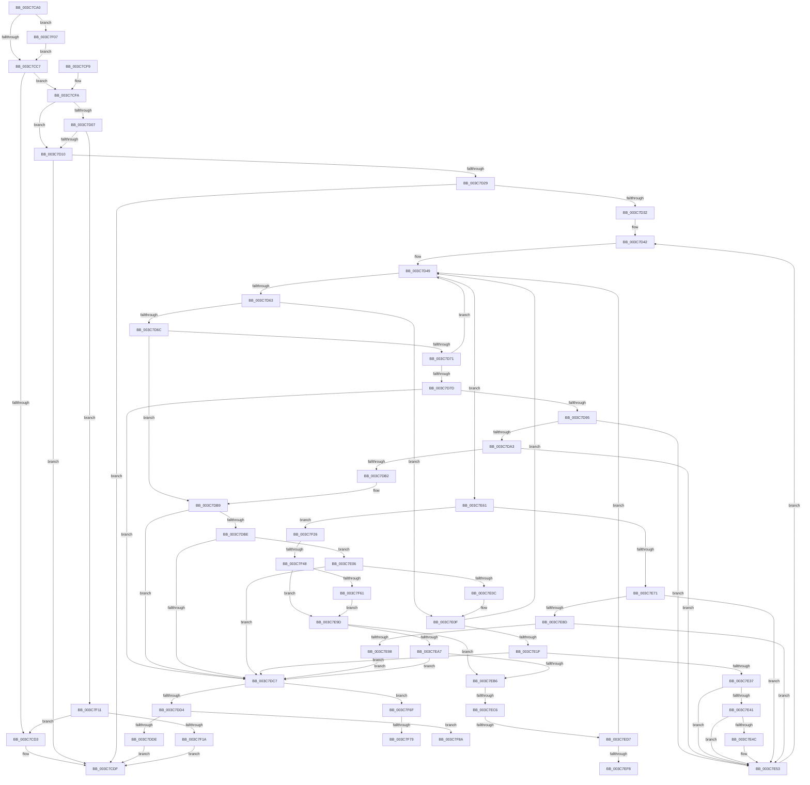

# KeQueryEffectivePriorityThread

- RVA: `0x003C7CA0`–`0x003C7F96` (길이 `758` bytes)
- VA: `0x00000001403C7CA0`
- 실행 섹션: `.text`
- PDB 이름 있음: `예`; PDB Function 태그: `예`
- unwind 정보 RVA: `0x0008E8D8`
- 디코드: `192`개 명령, `758/758` bytes 표시
- 미해석 바이트: `0` (있으면 어셈블리에 `.byte`로 보존)

> 이 문서는 커널 이미지의 기계어와 PDB 기호를 분석해 생성했습니다. 4번과 5번은 함수 원형과 자료형을 바이너리 사용 방식에서 추정한 C 해석이며 원본 소스 복구 결과는 아닙니다.

## 1. Dependencies

- 직접 호출 지점: **11**; 고유 호출 대상: **9**
- 직접 호출자로 확인된 함수: **0**
- RIP 상대 이미지 참조: **3**

### Outgoing calls
- `0x003C7CD8` → [KiQueryEffectivePriorityThread](../25/KiQueryEffectivePriorityThread_function_00257BA0.md) (function, `0x00257BA0`)
- `0x003C7D3D` → [KiAcquireThreadLockRaiseToDpc](../39/KiAcquireThreadLockRaiseToDpc_function_00396280.md) (function, `0x00396280`)
- `0x003C7D8A` → [KiAcquirePrcbLocksForIsolationUnit](../30/KiAcquirePrcbLocksForIsolationUnit_function_0030ED60.md) (function, `0x0030ED60`)
- `0x003C7DF1` → [KiReleaseThreadStateLock](../21/KiReleaseThreadStateLock_function_00217910.md) (function, `0x00217910`)
- `0x003C7DFC` → [KiReleaseThreadLockLowerIrql](KiReleaseThreadLockLowerIrql_function_003C65D0.md) (function, `0x003C65D0`)
- `0x003C7E2C` → [KiAcquirePrcbLocksForIsolationUnit](../30/KiAcquirePrcbLocksForIsolationUnit_function_0030ED60.md) (function, `0x0030ED60`)
- `0x003C7E57` → [KiReleasePrcbLocksForIsolationUnit](../39/KiReleasePrcbLocksForIsolationUnit_function_00399C50.md) (function, `0x00399C50`)
- `0x003C7E7E` → [KiAcquirePrcbLocksForIsolationUnit](../30/KiAcquirePrcbLocksForIsolationUnit_function_0030ED60.md) (function, `0x0030ED60`)
- `0x003C7EFC` → [KxWaitForLockChainValid](../21/KxWaitForLockChainValid_function_00217AA0.md) (function, `0x00217AA0`)
- `0x003C7F07` → [KiUpdateVpBackingThreadPriorityOnPriorityQuery](../4B/KiUpdateVpBackingThreadPriorityOnPriorityQuery_function_004BF550.md) (function, `0x004BF550`)
- `0x003C7F65` → [KxWaitForLockOwnerShip](../25/KxWaitForLockOwnerShip_function_00257EB0.md) (function, `0x00257EB0`)

### Direct callers
- 이 함수 시작 RVA로 연결되는 직접 call은 확인되지 않았습니다. 간접 호출은 완전히 역산할 수 없습니다.

### Static image references
- `0x003C7CC7` → RVA `0x00FC6B38` (`ALMOSTRO`; read)
- `0x003C7CFA` → RVA `0x00F22B68` (`.data`; read)
- `0x003C7D42` → RVA `0x00FC8C40` (`ALMOSTRO`; read)

## 2. Other-region calls and transfers

- 다른 실행 섹션으로 향하는 call: **0**
- call이 아닌 외부 분기/꼬리 이동: **7**
  - `0x003C7EC0` → [sub_006E825E + 0x51](../6E/Unknown_function_006E825E.md) (`tail-transfer`)
  - `0x003C7ED1` → [sub_006E825E + 0x23](../6E/Unknown_function_006E825E.md) (`tail-transfer`)
  - `0x003C7F02` → [sub_006E825E + 0x23](../6E/Unknown_function_006E825E.md) (`tail-transfer`)
  - `0x003C7F42` → [sub_006E825E](../6E/Unknown_function_006E825E.md) (`tail-transfer`)
  - `0x003C7F73` → [sub_006E825E + 0x60](../6E/Unknown_function_006E825E.md) (`tail-transfer`)
  - `0x003C7F85` → [sub_006E825E + 0x5A](../6E/Unknown_function_006E825E.md) (`tail-transfer`)
  - `0x003C7F91` → [sub_006E825E + 0x5A](../6E/Unknown_function_006E825E.md) (`tail-transfer`)

## 3. Assembly (complete function range)

```asm
003C7CA0  48 89 5C 24 20                  mov qword ptr [rsp + 0x20], rbx
003C7CA5  55                              push rbp
003C7CA6  56                              push rsi
003C7CA7  57                              push rdi
003C7CA8  41 54                           push r12
003C7CAA  41 55                           push r13
003C7CAC  41 56                           push r14
003C7CAE  41 57                           push r15
003C7CB0  48 8B EC                        mov rbp, rsp
003C7CB3  48 83 EC 40                     sub rsp, 0x40
003C7CB7  F7 41 78 00 00 40 00            test dword ptr [rcx + 0x78], 0x400000
003C7CBE  48 8B D9                        mov rbx, rcx
003C7CC1  0F 85 40 02 00 00               jne 0x1403c7f07
003C7CC7  F7 05 67 EE BF 00 00 00 00 02   test dword ptr [rip + 0xbfee67], 0x2000000
003C7CD1  75 27                           jne 0x1403c7cfa
003C7CD3  33 D2                           xor edx, edx
003C7CD5  48 8B CB                        mov rcx, rbx
003C7CD8  E8 C3 FE E8 FF                  call 0x140257ba0
003C7CDD  8B F8                           mov edi, eax
003C7CDF  48 8B 9C 24 98 00 00 00         mov rbx, qword ptr [rsp + 0x98]
003C7CE7  8B C7                           mov eax, edi
003C7CE9  48 83 C4 40                     add rsp, 0x40
003C7CED  41 5F                           pop r15
003C7CEF  41 5E                           pop r14
003C7CF1  41 5D                           pop r13
003C7CF3  41 5C                           pop r12
003C7CF5  5F                              pop rdi
003C7CF6  5E                              pop rsi
003C7CF7  5D                              pop rbp
003C7CF8  C3                              ret
003C7CF9  CC                              int3
003C7CFA  8B 05 68 AE B5 00               mov eax, dword ptr [rip + 0xb5ae68]
003C7D00  45 33 ED                        xor r13d, r13d
003C7D03  85 C0                           test eax, eax
003C7D05  74 09                           je 0x1403c7d10
003C7D07  83 E8 01                        sub eax, 1
003C7D0A  0F 85 01 02 00 00               jne 0x1403c7f11
003C7D10  0F B6 83 C3 00 00 00            movzx eax, byte ptr [rbx + 0xc3]
003C7D17  0F 57 C0                        xorps xmm0, xmm0
003C7D1A  44 88 6D 40                     mov byte ptr [rbp + 0x40], r13b
003C7D1E  8B F8                           mov edi, eax
003C7D20  0F 11 45 F0                     movups xmmword ptr [rbp - 0x10], xmm0
003C7D24  83 F8 10                        cmp eax, 0x10
003C7D27  73 B6                           jae 0x1403c7cdf
003C7D29  48 8B 43 68                     mov rax, qword ptr [rbx + 0x68]
003C7D2D  48 85 C0                        test rax, rax
003C7D30  74 AD                           je 0x1403c7cdf
003C7D32  48 8D 55 40                     lea rdx, [rbp + 0x40]
003C7D36  4C 89 6D 50                     mov qword ptr [rbp + 0x50], r13
003C7D3A  48 8B CB                        mov rcx, rbx
003C7D3D  E8 3E E5 FC FF                  call 0x140396280
003C7D42  48 8D 15 F7 0E C0 00            lea rdx, [rip + 0xc00ef7]
003C7D49  44 0F B6 A3 84 01 00 00         movzx r12d, byte ptr [rbx + 0x184]
003C7D51  4D 8B F5                        mov r14, r13
003C7D54  41 8B CC                        mov ecx, r12d
003C7D57  49 8B F5                        mov rsi, r13
003C7D5A  83 E9 01                        sub ecx, 1
003C7D5D  0F 84 FE 00 00 00               je 0x1403c7e61
003C7D63  83 E9 01                        sub ecx, 1
003C7D66  0F 84 A3 00 00 00               je 0x1403c7e0f
003C7D6C  83 E9 01                        sub ecx, 1
003C7D6F  75 48                           jne 0x1403c7db9
003C7D71  44 8B BB 18 02 00 00            mov r15d, dword ptr [rbx + 0x218]
003C7D78  45 85 FF                        test r15d, r15d
003C7D7B  78 CC                           js 0x1403c7d49
003C7D7D  4E 8B 34 FA                     mov r14, qword ptr [rdx + r15*8]
003C7D81  4C 8D 45 50                     lea r8, [rbp + 0x50]
003C7D85  49 8B CE                        mov rcx, r14
003C7D88  33 D2                           xor edx, edx
003C7D8A  E8 D1 6F F4 FF                  call 0x14030ed60
003C7D8F  49 3B 5E 10                     cmp rbx, qword ptr [r14 + 0x10]
003C7D93  74 32                           je 0x1403c7dc7
003C7D95  8A 83 84 01 00 00               mov al, byte ptr [rbx + 0x184]
003C7D9B  3C 03                           cmp al, 3
003C7D9D  0F 85 B0 00 00 00               jne 0x1403c7e53
003C7DA3  8B 83 18 02 00 00               mov eax, dword ptr [rbx + 0x218]
003C7DA9  41 3B C7                        cmp eax, r15d
003C7DAC  0F 85 A1 00 00 00               jne 0x1403c7e53
003C7DB2  B9 1E 00 00 00                  mov ecx, 0x1e
003C7DB7  CD 29                           int 0x29
003C7DB9  83 F9 02                        cmp ecx, 2
003C7DBC  75 09                           jne 0x1403c7dc7
003C7DBE  8A 43 70                        mov al, byte ptr [rbx + 0x70]
003C7DC1  24 07                           and al, 7
003C7DC3  3C 01                           cmp al, 1
003C7DC5  75 3F                           jne 0x1403c7e06
003C7DC7  44 39 2D 9A AD B5 00            cmp dword ptr [rip + 0xb5ad9a], r13d
003C7DCE  0F 84 9B 01 00 00               je 0x1403c7f6f
003C7DD4  41 80 FC 05                     cmp r12b, 5
003C7DD8  0F 84 AC 01 00 00               je 0x1403c7f8a
003C7DDE  48 8D 45 F0                     lea rax, [rbp - 0x10]
003C7DE2  4C 8B CE                        mov r9, rsi
003C7DE5  4C 8D 45 50                     lea r8, [rbp + 0x50]
003C7DE9  48 89 44 24 20                  mov qword ptr [rsp + 0x20], rax
003C7DEE  49 8B D6                        mov rdx, r14
003C7DF1  E8 1A FB E4 FF                  call 0x140217910
003C7DF6  8A 55 40                        mov dl, byte ptr [rbp + 0x40]
003C7DF9  48 8B CB                        mov rcx, rbx
003C7DFC  E8 CF E7 FF FF                  call 0x1403c65d0
003C7E01  E9 D9 FE FF FF                  jmp 0x1403c7cdf
003C7E06  2C 03                           sub al, 3
003C7E08  3C 03                           cmp al, 3
003C7E0A  76 BB                           jbe 0x1403c7dc7
003C7E0C  41 B4 02                        mov r12b, 2
003C7E0F  44 8B BB 18 02 00 00            mov r15d, dword ptr [rbx + 0x218]
003C7E16  45 85 FF                        test r15d, r15d
003C7E19  0F 88 2A FF FF FF               js 0x1403c7d49
003C7E1F  4E 8B 34 FA                     mov r14, qword ptr [rdx + r15*8]
003C7E23  4C 8D 45 50                     lea r8, [rbp + 0x50]
003C7E27  49 8B CE                        mov rcx, r14
003C7E2A  33 D2                           xor edx, edx
003C7E2C  E8 2F 6F F4 FF                  call 0x14030ed60
003C7E31  49 3B 5E 08                     cmp rbx, qword ptr [r14 + 8]
003C7E35  74 90                           je 0x1403c7dc7
003C7E37  8A 83 84 01 00 00               mov al, byte ptr [rbx + 0x184]
003C7E3D  3C 02                           cmp al, 2
003C7E3F  75 12                           jne 0x1403c7e53
003C7E41  8B 83 18 02 00 00               mov eax, dword ptr [rbx + 0x218]
003C7E47  41 3B C7                        cmp eax, r15d
003C7E4A  75 07                           jne 0x1403c7e53
003C7E4C  B9 4A 00 00 00                  mov ecx, 0x4a
003C7E51  CD 29                           int 0x29
003C7E53  48 8D 4D 50                     lea rcx, [rbp + 0x50]
003C7E57  E8 F4 1D FD FF                  call 0x140399c50
003C7E5C  E9 E1 FE FF FF                  jmp 0x1403c7d42
003C7E61  44 8B BB 18 02 00 00            mov r15d, dword ptr [rbx + 0x218]
003C7E68  45 85 FF                        test r15d, r15d
003C7E6B  0F 88 B5 00 00 00               js 0x1403c7f26
003C7E71  4E 8B 34 FA                     mov r14, qword ptr [rdx + r15*8]
003C7E75  4C 8D 45 50                     lea r8, [rbp + 0x50]
003C7E79  49 8B CE                        mov rcx, r14
003C7E7C  33 D2                           xor edx, edx
003C7E7E  E8 DD 6E F4 FF                  call 0x14030ed60
003C7E83  8A 83 84 01 00 00               mov al, byte ptr [rbx + 0x184]
003C7E89  3C 01                           cmp al, 1
003C7E8B  75 C6                           jne 0x1403c7e53
003C7E8D  8B 83 18 02 00 00               mov eax, dword ptr [rbx + 0x218]
003C7E93  41 3B C7                        cmp eax, r15d
003C7E96  75 BB                           jne 0x1403c7e53
003C7E98  E9 2A FF FF FF                  jmp 0x1403c7dc7
003C7E9D  8A 83 84 01 00 00               mov al, byte ptr [rbx + 0x184]
003C7EA3  3C 01                           cmp al, 1
003C7EA5  75 0F                           jne 0x1403c7eb6
003C7EA7  8B 83 18 02 00 00               mov eax, dword ptr [rbx + 0x218]
003C7EAD  41 3B C7                        cmp eax, r15d
003C7EB0  0F 84 11 FF FF FF               je 0x1403c7dc7
003C7EB6  F7 05 78 EC BF 00 00 00 20 00   test dword ptr [rip + 0xbfec78], 0x200000
003C7EC0  0F 84 E9 03 32 00               je 0x1406e82af
003C7EC6  0F 0D 4D F0                     prefetchw byte ptr [rbp - 0x10]
003C7ECA  48 8B 45 F0                     mov rax, qword ptr [rbp - 0x10]
003C7ECE  48 85 C0                        test rax, rax
003C7ED1  0F 85 AA 03 32 00               jne 0x1406e8281
003C7ED7  48 8B 4D F8                     mov rcx, qword ptr [rbp - 8]
003C7EDB  48 8D 45 F0                     lea rax, [rbp - 0x10]
003C7EDF  F0 4C 0F B1 29                  lock cmpxchg qword ptr [rcx], r13
003C7EE4  48 8D 4D F0                     lea rcx, [rbp - 0x10]
003C7EE8  48 8D 15 51 0D C0 00            lea rdx, [rip + 0xc00d51]
003C7EEF  48 3B C1                        cmp rax, rcx
003C7EF2  0F 84 51 FE FF FF               je 0x1403c7d49
003C7EF8  48 8D 4D F0                     lea rcx, [rbp - 0x10]
003C7EFC  E8 9F FB E4 FF                  call 0x140217aa0
003C7F01  90                              nop
003C7F02  E9 7A 03 32 00                  jmp 0x1406e8281
003C7F07  E8 44 76 0F 00                  call 0x1404bf550
003C7F0C  E9 B6 FD FF FF                  jmp 0x1403c7cc7
003C7F11  83 F8 01                        cmp eax, 1
003C7F14  0F 85 B9 FD FF FF               jne 0x1403c7cd3
003C7F1A  0F B6 BB C3 00 00 00            movzx edi, byte ptr [rbx + 0xc3]
003C7F21  E9 B9 FD FF FF                  jmp 0x1403c7cdf
003C7F26  41 8B C7                        mov eax, r15d
003C7F29  0F BA F0 1F                     btr eax, 0x1f
003C7F2D  F7 05 01 EC BF 00 00 00 20 00   test dword ptr [rip + 0xbfec01], 0x200000
003C7F37  48 8B 04 C2                     mov rax, qword ptr [rdx + rax*8]
003C7F3B  48 8B B0 48 8E 00 00            mov rsi, qword ptr [rax + 0x8e48]
003C7F42  0F 84 16 03 32 00               je 0x1406e825e
003C7F48  48 89 75 F8                     mov qword ptr [rbp - 8], rsi
003C7F4C  48 8D 55 F0                     lea rdx, [rbp - 0x10]
003C7F50  4C 89 6D F0                     mov qword ptr [rbp - 0x10], r13
003C7F54  90                              nop
003C7F55  48 87 16                        xchg qword ptr [rsi], rdx
003C7F58  48 85 D2                        test rdx, rdx
003C7F5B  0F 84 3C FF FF FF               je 0x1403c7e9d
003C7F61  48 8D 4D F0                     lea rcx, [rbp - 0x10]
003C7F65  E8 46 FF E8 FF                  call 0x140257eb0
003C7F6A  E9 2E FF FF FF                  jmp 0x1403c7e9d
003C7F6F  41 80 FC 02                     cmp r12b, 2
003C7F73  0F 85 45 03 32 00               jne 0x1406e82be
003C7F79  65 48 8B 04 25 88 01 00 00      mov rax, qword ptr gs:[0x188]
003C7F82  48 3B D8                        cmp rbx, rax
003C7F85  E9 2E 03 32 00                  jmp 0x1406e82b8
003C7F8A  80 BB 87 01 00 00 01            cmp byte ptr [rbx + 0x187], 1
003C7F91  E9 22 03 32 00                  jmp 0x1406e82b8
```

## 4. C-style interpretation (structured pseudocode)

```c
__int64 __fastcall KeQueryEffectivePriorityThread(__int64 a1, int a2)
{
    __int64 result;
    __int64 v_r13;
    __int64 v_rsp;
    unsigned __int64 v_stack_m40;
    unsigned __int64 v_stack_m48;
    unsigned __int64 v_stack_p18;
    unsigned __int64 v_stack_p20;
    unsigned __int8 v_stack_p8;

    v_stack_p20 = v_rbx;
    v_rsp = (v_rsp) - (64);
    if (((*(unsigned int *)(a1 + 120)) & (0x400000ULL)) != 0) goto loc_003C7F07;
loc_003C7CC7:
    if (((*(unsigned int *)(v_rip + 12578407)) & (0x2000000ULL)) != 0) goto loc_003C7CFA;
loc_003C7CD3:
    a2 = 0;
    result = KiQueryEffectivePriorityThread(a1, a2, a3, a4);
loc_003C7CDF:
    v_rsp = (v_rsp) + (64);
    return (unsigned int)((unsigned int)((unsigned int)((unsigned int)(result))));
loc_003C7CFA:
    v_r13 = 0;
    if ((unsigned int)((unsigned int)(*(unsigned int *)(v_rip + 11906664))) == 0) goto loc_003C7D10;
    result = (unsigned int)(((unsigned int)(*(unsigned int *)(v_rip + 11906664))) - (1));
    if (condition_is_not_equal) goto loc_003C7F11;
loc_003C7D10:
    v_stack_p8 = 0;
    v_stack_m48 = v_xmm0;
    if (((unsigned int)(*(unsigned __int8 *)(v_stack_p20 + 195))) >= 16) goto loc_003C7CDF;
    if (*(unsigned __int64 *)(v_stack_p20 + 104) == 0) goto loc_003C7CDF;
    v_stack_p18 = 0;
    result = KiAcquireThreadLockRaiseToDpc(v_stack_p20, v_stack_p8, a3, a4);
loc_003C7D42:
loc_003C7D49:
    a1 = (unsigned int)(((unsigned int)((unsigned int)(*(unsigned __int8 *)(v_stack_p20 + 388)))) - (1));
    if (condition_is_equal) goto loc_003C7E61;
    a1 = (unsigned int)((a1) - (1));
    if (condition_is_equal) goto loc_003C7E0F;
    a1 = (unsigned int)((a1) - (1));
    if (condition_is_not_equal) goto loc_003C7DB9;
    if (sign_flag) goto loc_003C7D49;
    a2 = 0;
    result = KiAcquirePrcbLocksForIsolationUnit(*(unsigned __int64 *)(v_rip + 12586743 + (unsigned int)(*(unsigned int *)(v_stack_p20 + 536)) * 8), a2, v_stack_p18, a4);
    if (v_stack_p20 == (*(unsigned __int64 *)(*(unsigned __int64 *)(v_rip + 12586743 + (unsigned int)(*(unsigned int *)(v_stack_p20 + 536)) * 8) + 16))) goto loc_003C7DC7;
    if (((unsigned __int8)(*(unsigned __int8 *)(v_stack_p20 + 388))) != 3) goto loc_003C7E53;
    if (((unsigned int)((unsigned int)(*(unsigned int *)(v_stack_p20 + 536)))) != ((unsigned int)((unsigned int)(*(unsigned int *)(v_stack_p20 + 536))))) goto loc_003C7E53;
loc_003C7DB9:
    if (30 != 2) goto loc_003C7DC7;
    result = (unsigned __int8)((*(unsigned __int8 *)(v_stack_p20 + 112)) & (7));
    if (((unsigned __int8)(result)) != 1) goto loc_003C7E06;
loc_003C7DC7:
    if ((*(unsigned int *)(v_rip + 11906458)) == 0) goto loc_003C7F6F;
    if (((unsigned __int8)(*(unsigned __int8 *)(v_stack_p20 + 388))) == 5) goto loc_003C7F8A;
    v_stack_p20 = v_stack_m48;
    result = KiReleaseThreadStateLock(30, *(unsigned __int64 *)(v_rip + 12586743 + (unsigned int)(*(unsigned int *)(v_stack_p20 + 536)) * 8), v_stack_p18, 0);
    result = KiReleaseThreadLockLowerIrql(v_stack_p20, v_stack_p8, v_stack_p18, 0);
    goto loc_003C7CDF;
loc_003C7E06:
    result = (unsigned __int8)((result) - (3));
    if (((unsigned __int8)(result)) <= 3) goto loc_003C7DC7;
loc_003C7E0F:
    if (sign_flag) goto loc_003C7D49;
    a2 = 0;
    result = KiAcquirePrcbLocksForIsolationUnit(*(unsigned __int64 *)(v_stack_p8 + (unsigned int)(*(unsigned int *)(v_stack_p20 + 536)) * 8), a2, v_stack_p18, 0);
    if (v_stack_p20 == (*(unsigned __int64 *)(*(unsigned __int64 *)(v_stack_p8 + (unsigned int)(*(unsigned int *)(v_stack_p20 + 536)) * 8) + 8))) goto loc_003C7DC7;
    if (((unsigned __int8)(*(unsigned __int8 *)(v_stack_p20 + 388))) != 2) goto loc_003C7E53;
    if (((unsigned int)((unsigned int)(*(unsigned int *)(v_stack_p20 + 536)))) == ((unsigned int)((unsigned int)(*(unsigned int *)(v_stack_p20 + 536))))) {
        a1 = 74;
    }
    result = KiReleasePrcbLocksForIsolationUnit(v_stack_p18, a2, v_stack_p18, 0);
    goto loc_003C7D42;
loc_003C7E61:
    if (sign_flag) goto loc_003C7F26;
    a2 = 0;
    result = KiAcquirePrcbLocksForIsolationUnit(*(unsigned __int64 *)(a2 + (unsigned int)(*(unsigned int *)(v_stack_p20 + 536)) * 8), a2, v_stack_p18, 0);
    if (((unsigned __int8)(*(unsigned __int8 *)(v_stack_p20 + 388))) != 1) goto loc_003C7E53;
    if (((unsigned int)((unsigned int)(*(unsigned int *)(v_stack_p20 + 536)))) != ((unsigned int)((unsigned int)(*(unsigned int *)(v_stack_p20 + 536))))) goto loc_003C7E53;
    goto loc_003C7DC7;
loc_003C7E9D:
    if (((unsigned __int8)(*(unsigned __int8 *)(v_stack_p20 + 388))) != 1) goto loc_003C7EB6;
    if (((unsigned int)((unsigned int)(*(unsigned int *)(v_stack_p20 + 536)))) == ((unsigned int)((unsigned int)(*(unsigned int *)(v_stack_p20 + 536))))) goto loc_003C7DC7;
loc_003C7EB6:
    if (v_stack_m48 == v_stack_m48) goto loc_003C7D49;
    result = KxWaitForLockChainValid(v_stack_m48, v_rip + 12586321, v_stack_p18, 0);
loc_003C7F07:
    result = KiUpdateVpBackingThreadPriorityOnPriorityQuery(v_stack_m48, v_rip + 12586321, v_stack_p18, 0);
    goto loc_003C7CC7;
loc_003C7F11:
    if (((unsigned int)(result)) != 1) goto loc_003C7CD3;
    goto loc_003C7CDF;
loc_003C7F26:
    v_stack_m40 = *(unsigned __int64 *)(*(unsigned __int64 *)(v_rip + 12586321 + (unsigned int)((unsigned int)((unsigned int)(*(unsigned int *)(v_stack_p20 + 536)))) * 8) + 36424);
    v_stack_m48 = 0;
    if (v_stack_m48 == 0) goto loc_003C7E9D;
    result = KxWaitForLockOwnerShip(v_stack_m48, v_stack_m48, v_stack_p18, 0);
    goto loc_003C7E9D;
loc_003C7F6F:
loc_003C7F8A:
}
```

## 5. (Beta) C Style

```c
int64_t KeQueryEffectivePriorityThread(void *Arg1, int32_t Arg2)
{
    uint8_t *arg1 = (uint8_t *)Arg1;

    int64_t result;
    int64_t local_r13;
    int64_t local_rsp;
    uint64_t v_stack_m40;
    uint64_t v_stack_m48;
    uint64_t v_stack_p18;
    uint64_t v_stack_p20;
    uint8_t v_stack_p8;

    v_stack_p20 = local_rbx;
    local_rsp = (local_rsp) - (64);
    if (((*(uint32_t *)(arg1 + 0x78)) & (0x400000ULL)) != 0) goto loc_003C7F07;
loc_003C7CC7:
    if (((*(uint32_t *)(v_rip + 0xBFEE67)) & (0x2000000ULL)) != 0) goto loc_003C7CFA;
loc_003C7CD3:
    Arg2 = 0;
    result = KiQueryEffectivePriorityThread(Arg1, Arg2, a3, a4);
loc_003C7CDF:
    local_rsp = (local_rsp) + (64);
    return (uint32_t)((uint32_t)((uint32_t)((uint32_t)(result))));
loc_003C7CFA:
    local_r13 = 0;
    if ((uint32_t)((uint32_t)(*(uint32_t *)(v_rip + 0xB5AE68))) == 0) goto loc_003C7D10;
    result = (uint32_t)(((uint32_t)(*(uint32_t *)(v_rip + 0xB5AE68))) - (1));
    if (condition_is_not_equal) goto loc_003C7F11;
loc_003C7D10:
    v_stack_p8 = 0;
    v_stack_m48 = v_xmm0;
    if (((uint32_t)(*(uint8_t *)(v_stack_p20 + 0xC3))) >= 16) goto loc_003C7CDF;
    if (*(uint64_t *)(v_stack_p20 + 0x68) == 0) goto loc_003C7CDF;
    v_stack_p18 = 0;
    result = KiAcquireThreadLockRaiseToDpc(v_stack_p20, v_stack_p8, a3, a4);
loc_003C7D42:
loc_003C7D49:
    Arg1 = (uint32_t)(((uint32_t)((uint32_t)(*(uint8_t *)(v_stack_p20 + 0x184)))) - (1));
    if (condition_is_equal) goto loc_003C7E61;
    Arg1 = (uint32_t)((Arg1) - (1));
    if (condition_is_equal) goto loc_003C7E0F;
    Arg1 = (uint32_t)((Arg1) - (1));
    if (condition_is_not_equal) goto loc_003C7DB9;
    if (sign_flag) goto loc_003C7D49;
    Arg2 = 0;
    result = KiAcquirePrcbLocksForIsolationUnit(*(uint64_t *)(v_rip + 0xC00EF7 + (uint32_t)(*(uint32_t *)(v_stack_p20 + 0x218)) * 8), Arg2, v_stack_p18, a4);
    if (v_stack_p20 == (*(uint64_t *)(*(uint64_t *)(v_rip + 0xC00EF7 + (uint32_t)(*(uint32_t *)(v_stack_p20 + 0x218)) * 8) + 0x10))) goto loc_003C7DC7;
    if (((uint8_t)(*(uint8_t *)(v_stack_p20 + 0x184))) != 3) goto loc_003C7E53;
    if (((uint32_t)((uint32_t)(*(uint32_t *)(v_stack_p20 + 0x218)))) != ((uint32_t)((uint32_t)(*(uint32_t *)(v_stack_p20 + 0x218))))) goto loc_003C7E53;
loc_003C7DB9:
    if (30 != 2) goto loc_003C7DC7;
    result = (uint8_t)((*(uint8_t *)(v_stack_p20 + 0x70)) & (7));
    if (((uint8_t)(result)) != 1) goto loc_003C7E06;
loc_003C7DC7:
    if ((*(uint32_t *)(v_rip + 0xB5AD9A)) == 0) goto loc_003C7F6F;
    if (((uint8_t)(*(uint8_t *)(v_stack_p20 + 0x184))) == 5) goto loc_003C7F8A;
    v_stack_p20 = v_stack_m48;
    result = KiReleaseThreadStateLock(30, *(uint64_t *)(v_rip + 0xC00EF7 + (uint32_t)(*(uint32_t *)(v_stack_p20 + 0x218)) * 8), v_stack_p18, 0);
    result = KiReleaseThreadLockLowerIrql(v_stack_p20, v_stack_p8, v_stack_p18, 0);
    goto loc_003C7CDF;
loc_003C7E06:
    result = (uint8_t)((result) - (3));
    if (((uint8_t)(result)) <= 3) goto loc_003C7DC7;
loc_003C7E0F:
    if (sign_flag) goto loc_003C7D49;
    Arg2 = 0;
    result = KiAcquirePrcbLocksForIsolationUnit(*(uint64_t *)(v_stack_p8 + (uint32_t)(*(uint32_t *)(v_stack_p20 + 0x218)) * 8), Arg2, v_stack_p18, 0);
    if (v_stack_p20 == (*(uint64_t *)(*(uint64_t *)(v_stack_p8 + (uint32_t)(*(uint32_t *)(v_stack_p20 + 0x218)) * 8) + 0x8))) goto loc_003C7DC7;
    if (((uint8_t)(*(uint8_t *)(v_stack_p20 + 0x184))) != 2) goto loc_003C7E53;
    if (((uint32_t)((uint32_t)(*(uint32_t *)(v_stack_p20 + 0x218)))) == ((uint32_t)((uint32_t)(*(uint32_t *)(v_stack_p20 + 0x218))))) {
        Arg1 = 74;
    }
    result = KiReleasePrcbLocksForIsolationUnit(v_stack_p18, Arg2, v_stack_p18, 0);
    goto loc_003C7D42;
loc_003C7E61:
    if (sign_flag) goto loc_003C7F26;
    Arg2 = 0;
    result = KiAcquirePrcbLocksForIsolationUnit(*(uint64_t *)(Arg2 + (uint32_t)(*(uint32_t *)(v_stack_p20 + 0x218)) * 8), Arg2, v_stack_p18, 0);
    if (((uint8_t)(*(uint8_t *)(v_stack_p20 + 0x184))) != 1) goto loc_003C7E53;
    if (((uint32_t)((uint32_t)(*(uint32_t *)(v_stack_p20 + 0x218)))) != ((uint32_t)((uint32_t)(*(uint32_t *)(v_stack_p20 + 0x218))))) goto loc_003C7E53;
    goto loc_003C7DC7;
loc_003C7E9D:
    if (((uint8_t)(*(uint8_t *)(v_stack_p20 + 0x184))) != 1) goto loc_003C7EB6;
    if (((uint32_t)((uint32_t)(*(uint32_t *)(v_stack_p20 + 0x218)))) == ((uint32_t)((uint32_t)(*(uint32_t *)(v_stack_p20 + 0x218))))) goto loc_003C7DC7;
loc_003C7EB6:
    if (v_stack_m48 == v_stack_m48) goto loc_003C7D49;
    result = KxWaitForLockChainValid(v_stack_m48, v_rip + 12586321, v_stack_p18, 0);
loc_003C7F07:
    result = KiUpdateVpBackingThreadPriorityOnPriorityQuery(v_stack_m48, v_rip + 12586321, v_stack_p18, 0);
    goto loc_003C7CC7;
loc_003C7F11:
    if (((uint32_t)(result)) != 1) goto loc_003C7CD3;
    goto loc_003C7CDF;
loc_003C7F26:
    v_stack_m40 = *(uint64_t *)(*(uint64_t *)(v_rip + 0xC00D51 + (uint32_t)((uint32_t)((uint32_t)(*(uint32_t *)(v_stack_p20 + 0x218)))) * 8) + 0x8E48);
    v_stack_m48 = 0;
    if (v_stack_m48 == 0) goto loc_003C7E9D;
    result = KxWaitForLockOwnerShip(v_stack_m48, v_stack_m48, v_stack_p18, 0);
    goto loc_003C7E9D;
loc_003C7F6F:
loc_003C7F8A:
}
```

### 관측된 메모리 오프셋

구조체 형식이 확인되지 않은 접근은 인자 기준의 오프셋으로만 기록했습니다.

| 기준 인자 | 오프셋 표현 | 폭 (bit) | 접근 |
|---|---:|---:|---|
| `Arg1` | `+ 0x68` | `64` | `R` |
| `Arg1` | `+ 0x78` | `32` | `R` |
| `Arg1` | `+ 0xC3` | `8` | `R` |

## 6. Execution-region graph

[열기: 2D/3D 그래프와 함수 탐색 컨트롤 패널](../../../control-panel.html?section=text&rva=0x003C7CA0&view=graph)

- 2D 그래프는 위에서 아래로 흐르고, 3D 그래프는 빈 공간을 드래그해 회전합니다. Shift+드래그는 이동, 휠은 확대·축소, 함수 노드 선택은 대상 보고서 이동입니다.

### Static fallback


