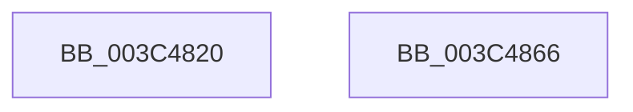

# KeRemoveQueueApc

- RVA: `0x003C4820`–`0x003C4867` (길이 `71` bytes)
- VA: `0x00000001403C4820`
- 실행 섹션: `.text`
- PDB 이름 있음: `예`; PDB Function 태그: `아니요`
- unwind 정보 RVA: `0x00068D5C`
- 디코드: `21`개 명령, `71/71` bytes 표시
- 미해석 바이트: `0` (있으면 어셈블리에 `.byte`로 보존)

> 이 문서는 커널 이미지의 기계어와 PDB 기호를 분석해 생성했습니다. 4번과 5번은 함수 원형과 자료형을 바이너리 사용 방식에서 추정한 C 해석이며 원본 소스 복구 결과는 아닙니다.

## 1. Dependencies

- 직접 호출 지점: **3**; 고유 호출 대상: **3**
- 직접 호출자로 확인된 함수: **8**
- RIP 상대 이미지 참조: **0**

### Outgoing calls
- `0x003C483E` → [KiAcquireThreadLockRaiseToDpc](../39/KiAcquireThreadLockRaiseToDpc_function_00396280.md) (function, `0x00396280`)
- `0x003C4846` → [KiRemoveQueueApc](KiRemoveQueueApc_function_003C4870.md) (function, `0x003C4870`)
- `0x003C4854` → [KiReleaseThreadLockLowerIrql](KiReleaseThreadLockLowerIrql_function_003C65D0.md) (function, `0x003C65D0`)

### Direct callers
- [EtwpQueueApc](../20/EtwpQueueApc_function_00203B7C.md) at `0x00203D65`
- [ExpSetTimerObject](../23/ExpSetTimerObject_function_00231730.md) at `0x002324B9`
- [ExpCancelTimer](../23/ExpCancelTimer_function_00232700.md) at `0x002327A4`
- [EtwpCancelPendingApcs](../49/EtwpCancelPendingApcs_function_00497D88.md) at `0x00497E2E`
- [EtwpTraceThreadRundownWithStack](../4A/EtwpTraceThreadRundownWithStack_function_004AB5A0.md) at `0x004AB72C`
- [EtwpCovSampCaptureCancelApcs](../65/EtwpCovSampCaptureCancelApcs_function_00653B44.md) at `0x00653BBD`
- [CmNotifyRunDown](../../page/90/CmNotifyRunDown_function_00906984.md) at `0x00906BDD`
- [ExSwapinWorkerThreads](../../page/A6/ExSwapinWorkerThreads_function_00A68C40.md) at `0x00A68D90`

### Static image references
- 디코드된 RIP-relative 메모리 참조가 없습니다.

## 2. Other-region calls and transfers

- 다른 실행 섹션으로 향하는 call: **0**
- 별도 외부 분기/꼬리 이동을 확인하지 못했습니다.

## 3. Assembly (complete function range)

```asm
003C4820  48 89 5C 24 10                  mov qword ptr [rsp + 0x10], rbx
003C4825  57                              push rdi
003C4826  48 83 EC 20                     sub rsp, 0x20
003C482A  48 8B 79 08                     mov rdi, qword ptr [rcx + 8]
003C482E  48 8D 54 24 30                  lea rdx, [rsp + 0x30]
003C4833  48 8B D9                        mov rbx, rcx
003C4836  C6 44 24 30 00                  mov byte ptr [rsp + 0x30], 0
003C483B  48 8B CF                        mov rcx, rdi
003C483E  E8 3D 1A FD FF                  call 0x140396280
003C4843  48 8B CB                        mov rcx, rbx
003C4846  E8 25 00 00 00                  call 0x1403c4870
003C484B  8A 54 24 30                     mov dl, byte ptr [rsp + 0x30]
003C484F  48 8B CF                        mov rcx, rdi
003C4852  8A D8                           mov bl, al
003C4854  E8 77 1D 00 00                  call 0x1403c65d0
003C4859  8A C3                           mov al, bl
003C485B  48 8B 5C 24 38                  mov rbx, qword ptr [rsp + 0x38]
003C4860  48 83 C4 20                     add rsp, 0x20
003C4864  5F                              pop rdi
003C4865  C3                              ret
003C4866  CC                              int3
```

## 4. C-style interpretation (structured pseudocode)

```c
__int64 __fastcall KeRemoveQueueApc(__int64 a1)
{
    __int64 result;
    __int64 v_rsp;
    unsigned __int64 v_stack_p10;
    unsigned __int64 v_stack_p8;

    v_stack_p10 = v_rbx;
    v_rsp = (v_rsp) - (32);
    v_stack_p8 = 0;
    result = KiAcquireThreadLockRaiseToDpc(*(unsigned __int64 *)(a1 + 8), v_stack_p8, a3, a4);
    result = KiRemoveQueueApc(a1, v_stack_p8, a3, a4);
    result = KiReleaseThreadLockLowerIrql(*(unsigned __int64 *)(a1 + 8), v_stack_p8, a3, a4);
    v_rsp = (v_rsp) + (32);
    return (unsigned __int8)((unsigned __int8)(result));
}
```

## 5. (Beta) C Style

```c
int64_t KeRemoveQueueApc(void *Apc)
{
    uint8_t *apc = (uint8_t *)Apc;

    int64_t result;
    int64_t local_rsp;
    uint64_t v_stack_p10;
    uint64_t v_stack_p8;

    v_stack_p10 = local_rbx;
    local_rsp = (local_rsp) - (32);
    v_stack_p8 = 0;
    result = KiAcquireThreadLockRaiseToDpc(*(uint64_t *)(apc + 0x8), v_stack_p8, a3, a4); // Thread @ 0x08
    result = KiRemoveQueueApc(Apc, v_stack_p8, a3, a4);
    result = KiReleaseThreadLockLowerIrql(*(uint64_t *)(apc + 0x8), v_stack_p8, a3, a4); // Thread @ 0x08
    local_rsp = (local_rsp) + (32);
    return (uint8_t)((uint8_t)(result));
}
```

### KAPC 구조체와 오프셋 대응

| 오프셋 | KAPC 필드 |
|---:|---|
| `0x00` | `Type` |
| `0x01` | `SpareByte0` |
| `0x02` | `Size` |
| `0x08` | `Thread` |
| `0x20` | `KernelRoutine` |
| `0x28` | `RundownRoutine` |
| `0x30` | `NormalRoutine` |
| `0x38` | `NormalContext` |
| `0x40` | `SystemArgument1` |
| `0x48` | `SystemArgument2` |
| `0x50` | `ApcStateIndex` |
| `0x51` | `ApcMode` |
| `0x52` | `Inserted` |

필드 이름은 KAPC 배치에 맞춘 것이며, 해당 함수가 실행 중 접근한 오프셋은 위 C 코드와 어셈블리에서 확인할 수 있습니다.

## 6. Execution-region graph

[열기: 2D/3D 그래프와 함수 탐색 컨트롤 패널](../../../control-panel.html?section=text&rva=0x003C4820&view=graph)

- 2D 그래프는 위에서 아래로 흐르고, 3D 그래프는 빈 공간을 드래그해 회전합니다. Shift+드래그는 이동, 휠은 확대·축소, 함수 노드 선택은 대상 보고서 이동입니다.

### Static fallback


