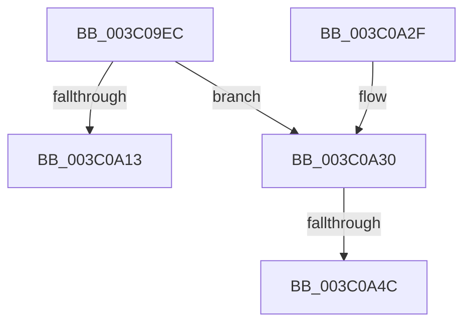

# KeSelectNodeForAffinity

- RVA: `0x003C09EC`–`0x003C0A58` (길이 `108` bytes)
- VA: `0x00000001403C09EC`
- 실행 섹션: `.text`
- PDB 이름 있음: `예`; PDB Function 태그: `예`
- unwind 정보 RVA: `0x0008E024`
- 디코드: `25`개 명령, `108/108` bytes 표시
- 미해석 바이트: `0` (있으면 어셈블리에 `.byte`로 보존)

> 이 문서는 커널 이미지의 기계어와 PDB 기호를 분석해 생성했습니다. 4번과 5번은 함수 원형과 자료형을 바이너리 사용 방식에서 추정한 C 해석이며 원본 소스 복구 결과는 아닙니다.

## 1. Dependencies

- 직접 호출 지점: **0**; 고유 호출 대상: **0**
- 직접 호출자로 확인된 함수: **3**
- RIP 상대 이미지 참조: **4**

### Outgoing calls
- 직접 디코드된 call 명령이 없습니다.

### Direct callers
- [KiSetIdealNodeProcessByGroup](KiSetIdealNodeProcessByGroup_function_003C0888.md) at `0x003C08C5`
- [PspAllocateProcess](../../page/A1/PspAllocateProcess_function_00A13B3C.md) at `0x00A14EE4`
- [sub_00B3E480](../../page/B3/Unknown_function_00B3E480.md) at `0x00B3E48B`

### Static image references
- `0x003C09FF` → RVA `0x00FC5000` (`ALMOSTRO`; read)
- `0x003C0A13` → RVA `0x00FCF6C0` (`CACHEALI`; read)
- `0x003C0A30` → RVA `0x00F231F0` (`.data`; read)
- `0x003C0A3C` → RVA `0x00F231F0` (`.data`; write)

## 2. Other-region calls and transfers

- 다른 실행 섹션으로 향하는 call: **0**
- call이 아닌 외부 분기/꼬리 이동: **2**
  - `0x003C0A46` → [sub_006E7DBA](../6E/Unknown_function_006E7DBA.md) (`tail-transfer`)
  - `0x003C0A53` → [sub_006E7DBA](../6E/Unknown_function_006E7DBA.md) (`tail-transfer`)

## 3. Assembly (complete function range)

```asm
003C09EC  48 8B C4                        mov rax, rsp
003C09EF  48 89 58 08                     mov qword ptr [rax + 8], rbx
003C09F3  48 89 70 10                     mov qword ptr [rax + 0x10], rsi
003C09F7  48 89 78 18                     mov qword ptr [rax + 0x18], rdi
003C09FB  4C 89 70 20                     mov qword ptr [rax + 0x20], r14
003C09FF  0F B7 15 FA 45 C0 00            movzx edx, word ptr [rip + 0xc045fa]
003C0A06  BF 01 00 00 00                  mov edi, 1
003C0A0B  4C 8B D1                        mov r10, rcx
003C0A0E  66 3B D7                        cmp dx, di
003C0A11  75 1D                           jne 0x1403c0a30
003C0A13  48 8B 05 A6 EC C0 00            mov rax, qword ptr [rip + 0xc0eca6]
003C0A1A  48 8B 5C 24 08                  mov rbx, qword ptr [rsp + 8]
003C0A1F  48 8B 74 24 10                  mov rsi, qword ptr [rsp + 0x10]
003C0A24  48 8B 7C 24 18                  mov rdi, qword ptr [rsp + 0x18]
003C0A29  4C 8B 74 24 20                  mov r14, qword ptr [rsp + 0x20]
003C0A2E  C3                              ret
003C0A2F  CC                              int3
003C0A30  0F B7 0D B9 27 B6 00            movzx ecx, word ptr [rip + 0xb627b9]
003C0A37  33 F6                           xor esi, esi
003C0A39  8D 04 0F                        lea eax, [rdi + rcx]
003C0A3C  66 89 05 AD 27 B6 00            mov word ptr [rip + 0xb627ad], ax
003C0A43  66 3B C2                        cmp ax, dx
003C0A46  0F 82 6E 73 32 00               jb 0x1406e7dba
003C0A4C  66 89 35 9D 27 B6 00            mov word ptr [rip + 0xb6279d], si
003C0A53  E9 62 73 32 00                  jmp 0x1406e7dba
```

## 4. C-style interpretation (structured pseudocode)

```c
__int64 __fastcall KeSelectNodeForAffinity(__int64 a1)
{
    __int64 v_rsi;
    unsigned __int64 v_stack_p10;
    unsigned __int64 v_stack_p18;
    unsigned __int64 v_stack_p20;
    unsigned __int64 v_stack_p8;

    *(unsigned __int64 *)(v_rsp + 8) = v_rbx;
    *(unsigned __int64 *)(v_rsp + 16) = v_rsi;
    *(unsigned __int64 *)(v_rsp + 24) = v_rdi;
    *(unsigned __int64 *)(v_rsp + 32) = v_r14;
    if (((unsigned __int16)(*(unsigned __int16 *)(v_rip + 12600826))) != 1) goto loc_003C0A30;
    return *(unsigned __int64 *)(v_rip + 12643494);
loc_003C0A30:
    v_rsi = 0;
    *(unsigned __int16 *)(v_rip + 11937709) = (unsigned __int16)(v_stack_p18 + *(unsigned __int16 *)(v_rip + 11937721) * 1);
    *(unsigned __int16 *)(v_rip + 11937693) = 0;
}
```

## 5. (Beta) C Style

```c
int64_t KeSelectNodeForAffinity(int64_t Arg1)
{
    int64_t local_rsi;
    uint64_t v_stack_p10;
    uint64_t v_stack_p18;
    uint64_t v_stack_p20;
    uint64_t v_stack_p8;

    *(uint64_t *)(local_rsp + 0x8) = local_rbx;
    *(uint64_t *)(local_rsp + 0x10) = local_rsi;
    *(uint64_t *)(local_rsp + 0x18) = local_rdi;
    *(uint64_t *)(local_rsp + 0x20) = local_r14;
    if (((uint16_t)(*(uint16_t *)(v_rip + 0xC045FA))) != 1) goto loc_003C0A30;
    return *(uint64_t *)(v_rip + 0xC0ECA6);
loc_003C0A30:
    local_rsi = 0;
    *(uint16_t *)(v_rip + 0xB627AD) = (uint16_t)(v_stack_p18 + *(uint16_t *)(v_rip + 0xB627B9) * 1);
    *(uint16_t *)(v_rip + 0xB6279D) = 0;
}
```

## 6. Execution-region graph

[열기: 2D/3D 그래프와 함수 탐색 컨트롤 패널](../../../control-panel.html?section=text&rva=0x003C09EC&view=graph)

- 2D 그래프는 위에서 아래로 흐르고, 3D 그래프는 빈 공간을 드래그해 회전합니다. Shift+드래그는 이동, 휠은 확대·축소, 함수 노드 선택은 대상 보고서 이동입니다.

### Static fallback


