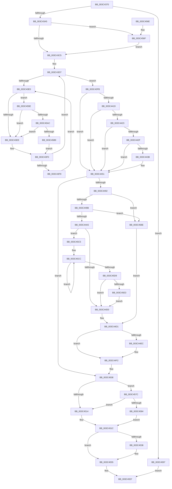

# KeSetActualBasePriorityThread

- RVA: `0x003C4370`–`0x003C45ED` (길이 `637` bytes)
- VA: `0x00000001403C4370`
- 실행 섹션: `.text`
- PDB 이름 있음: `예`; PDB Function 태그: `아니요`
- unwind 정보 RVA: `0x0008E3CC`
- 디코드: `159`개 명령, `637/637` bytes 표시
- 미해석 바이트: `0` (있으면 어셈블리에 `.byte`로 보존)

> 이 문서는 커널 이미지의 기계어와 PDB 기호를 분석해 생성했습니다. 4번과 5번은 함수 원형과 자료형을 바이너리 사용 방식에서 추정한 C 해석이며 원본 소스 복구 결과는 아닙니다.

## 1. Dependencies

- 직접 호출 지점: **13**; 고유 호출 대상: **13**
- 직접 호출자로 확인된 함수: **29**
- RIP 상대 이미지 참조: **6**

### Outgoing calls
- `0x003C444C` → [KiAbQueueAutoBoostDpc](../20/KiAbQueueAutoBoostDpc_function_002074D0.md) (function, `0x002074D0`)
- `0x003C4471` → [KiAdjustRealtimePriorityFloor](../21/KiAdjustRealtimePriorityFloor_function_0021FBE0.md) (function, `0x0021FBE0`)
- `0x003C447E` → [KiComputeThreadPriority](KiComputeThreadPriority_function_003C45F4.md) (function, `0x003C45F4`)
- `0x003C44AF` → [KiUpdateTotalCyclesCurrentThread](../37/KiUpdateTotalCyclesCurrentThread_function_0037DE40.md) (function, `0x0037DE40`)
- `0x003C44D4` → [KiQueryQuantumReset](../21/KiQueryQuantumReset_function_0021F6B4.md) (function, `0x0021F6B4`)
- `0x003C4503` → [KiSetPriorityThread](../22/KiSetPriorityThread_function_00220E78.md) (function, `0x00220E78`)
- `0x003C4527` → [KiProcessDeferredReadyList](../25/KiProcessDeferredReadyList_function_00250800.md) (function, `0x00250800`)
- `0x003C4550` → [EtwTracePriority](EtwTracePriority_function_003C41A4.md) (function, `0x003C41A4`)
- `0x003C4572` → [KiRaiseIrqlProcessIrqlFlags](../4F/KiRaiseIrqlProcessIrqlFlags_function_004F56FC.md) (function, `0x004F56FC`)
- `0x003C4587` → [KiPriQueueThreadPriorityChanged](KiPriQueueThreadPriorityChanged_function_003C4640.md) (function, `0x003C4640`)
- `0x003C45AC` → [KiCheckVpBackingLongSpinWaitHypercall](../30/KiCheckVpBackingLongSpinWaitHypercall_function_0030F490.md) (function, `0x0030F490`)
- `0x003C45BB` → [HvlNotifyLongSpinWait](../30/HvlNotifyLongSpinWait_function_0030F460.md) (function, `0x0030F460`)
- `0x003C45E3` → [KiRemoveSystemWorkPriorityKick](../26/KiRemoveSystemWorkPriorityKick_function_002631D0.md) (function, `0x002631D0`)

### Direct callers
- [SMKM_STORE&lt;SM_TRAITS&gt;::SmStReadThread](../20/SMKM_STORE_SM_TRAITS_SmStReadThread_function_00203230.md) at `0x00203275`
- [sub_002066BE](../20/Unknown_function_002066BE.md) at `0x0020671D`
- [sub_00206865](../20/Unknown_function_00206865.md) at `0x00206BF9`
- [sub_00206865](../20/Unknown_function_00206865.md) at `0x00206C4D`
- [SMKM_STORE_MGR&lt;SM_TRAITS&gt;::SmCompressCtxWorkerThread](../26/SMKM_STORE_MGR_SM_TRAITS_SmCompressCtxWorkerThread_function_00267D20.md) at `0x00267E00`
- [KeSetThreadSchedulerAssist](../30/KeSetThreadSchedulerAssist_function_003038F8.md) at `0x00303B8E`
- [SMKM_STORE&lt;SM_TRAITS&gt;::SmStWorkItemQueue](../31/SMKM_STORE_SM_TRAITS_SmStWorkItemQueue_function_00317A34.md) at `0x00317BCC`
- [MiSetZeroPageThreadPriority](../31/MiSetZeroPageThreadPriority_function_0031E620.md) at `0x0031E693`
- [MiStoreUpdateMemoryConditions](../34/MiStoreUpdateMemoryConditions_function_0034CF3C.md) at `0x0034D110`
- [SMKM_STORE_MGR&lt;SM_TRAITS&gt;::SmCompressCtxBalancerThread](../3B/SMKM_STORE_MGR_SM_TRAITS_SmCompressCtxBalancerThread_function_003B22C0.md) at `0x003B22F8`
- [MiFlushAllStoreSwapPages](../3B/MiFlushAllStoreSwapPages_function_003BC890.md) at `0x003BC8DA`
- [MiFlushAllStoreSwapPages](../3B/MiFlushAllStoreSwapPages_function_003BC890.md) at `0x003BC97F`
- [MiWakeModifiedPageWriter](../3B/MiWakeModifiedPageWriter_function_003BCB18.md) at `0x003BCB93`
- [SmKmStoreHelperWorker](SmKmStoreHelperWorker_function_003C2BC0.md) at `0x003C2BFF`
- [SMKM_STORE&lt;SM_TRAITS&gt;::SmStUpdateMemoryCondition](SMKM_STORE_SM_TRAITS_SmStUpdateMemoryCondition_function_003C34D0.md) at `0x003C3521`
- [SMKM_STORE&lt;SM_TRAITS&gt;::SmStUpdateMemoryCondition](SMKM_STORE_SM_TRAITS_SmStUpdateMemoryCondition_function_003C34D0.md) at `0x003C3550`
- [IoApplyPriorityInfoThread](IoApplyPriorityInfoThread_function_003C3EC0.md) at `0x003C3FA0`
- [MiMappedPageWriter](../40/MiMappedPageWriter_function_00404AC0.md) at `0x00404DE2`
- [MiModifiedPageWriter](../47/MiModifiedPageWriter_function_0047E5F0.md) at `0x0047E6E9`
- [MiModifiedPageWriter](../47/MiModifiedPageWriter_function_0047E5F0.md) at `0x0047E865`
- [MiModifiedPageWriter](../47/MiModifiedPageWriter_function_0047E5F0.md) at `0x0047E983`
- [MiModifiedPageWriter](../47/MiModifiedPageWriter_function_0047E5F0.md) at `0x0047EAD3`
- [PopCreatePowerThread](../4A/PopCreatePowerThread_function_004A17D8.md) at `0x004A1886`
- [CmpSetPriorityThread](../4B/CmpSetPriorityThread_function_004BC818.md) at `0x004BC81C`
- [SMKM_STORE_MGR&lt;SM_TRAITS&gt;::SmCompressCtxUpdatePriority](../4B/SMKM_STORE_MGR_SM_TRAITS_SmCompressCtxUpdatePriority_function_004BD314.md) at `0x004BD357`
- [PfpServiceMainThreadBoost](../5C/PfpServiceMainThreadBoost_function_005CDBB0.md) at `0x005CDC1C`
- [PfpServiceMainThreadUnboost](../5C/PfpServiceMainThreadUnboost_function_005CDCB0.md) at `0x005CDD03`
- [PopFxStaticWorkPoolThread](../5D/PopFxStaticWorkPoolThread_function_005D3690.md) at `0x005D36A7`
- [sub_006DCCA8](../6D/Unknown_function_006DCCA8.md) at `0x006DCD02`
- [IopCreatePassiveInterruptRealtimeThreads](../../page/72/IopCreatePassiveInterruptRealtimeThreads_function_0072BA98.md) at `0x0072BB7E`
- [MiNodeZeroConductor](../../page/81/MiNodeZeroConductor_function_00810AC0.md) at `0x00810AE6`
- [NtSetInformationThread](../../page/8C/NtSetInformationThread_function_008C9F60.md) at `0x008CA1F3`
- [EtwpLogger](../../page/9B/EtwpLogger_function_009BE310.md) at `0x009BE36D`
- [NtSetSystemInformation](../../page/AF/NtSetSystemInformation_function_00AF4A60.md) at `0x00AF5839`
- [ExpWorkQueueManagerThread](../../page/AF/ExpWorkQueueManagerThread_function_00AF6D60.md) at `0x00AF6E1A`

### Static image references
- `0x003C438B` → RVA `0x00FCFF00` (`CACHEALI`; read)
- `0x003C43B8` → RVA `0x00FC6D20` (`ALMOSTRO`; read)
- `0x003C43E2` → RVA `0x00FC52AC` (`ALMOSTRO`; reference)
- `0x003C44D9` → RVA `0x00FC5098` (`ALMOSTRO`; read)
- `0x003C452C` → RVA `0x00FC6B04` (`ALMOSTRO`; read)
- `0x003C459E` → RVA `0x00FC6AB8` (`ALMOSTRO`; read)

## 2. Other-region calls and transfers

- 다른 실행 섹션으로 향하는 call: **0**
- 별도 외부 분기/꼬리 이동을 확인하지 못했습니다.

## 3. Assembly (complete function range)

```asm
003C4370  48 89 5C 24 10                  mov qword ptr [rsp + 0x10], rbx
003C4375  48 89 6C 24 20                  mov qword ptr [rsp + 0x20], rbp
003C437A  56                              push rsi
003C437B  57                              push rdi
003C437C  41 54                           push r12
003C437E  41 56                           push r14
003C4380  41 57                           push r15
003C4382  48 83 EC 30                     sub rsp, 0x30
003C4386  83 64 24 60 00                  and dword ptr [rsp + 0x60], 0
003C438B  48 8D 05 6E BB C0 00            lea rax, [rip + 0xc0bb6e]
003C4392  44 8B FA                        mov r15d, edx
003C4395  48 8B D9                        mov rbx, rcx
003C4398  48 39 81 20 02 00 00            cmp qword ptr [rcx + 0x220], rax
003C439F  0F 84 F2 01 00 00               je 0x1403c4597
003C43A5  48 83 64 24 70 00               and qword ptr [rsp + 0x70], 0
003C43AB  45 0F 20 C4                     mov r12, cr8
003C43AF  BA 02 00 00 00                  mov edx, 2
003C43B4  44 0F 22 C2                     mov cr8, rdx
003C43B8  83 3D 61 29 C0 00 00            cmp dword ptr [rip + 0xc02961], 0
003C43BF  0F 85 AA 01 00 00               jne 0x1403c456f
003C43C5  65 48 8B 2C 25 20 00 00 00      mov rbp, qword ptr gs:[0x20]
003C43CE  33 F6                           xor esi, esi
003C43D0  4C 8B 75 08                     mov r14, qword ptr [rbp + 8]
003C43D4  8D 7E 01                        lea edi, [rsi + 1]
003C43D7  F0 48 0F BA 6B 40 00            lock bts qword ptr [rbx + 0x40], 0
003C43DE  73 1B                           jae 0x1403c43fb
003C43E0  03 F7                           add esi, edi
003C43E2  85 35 C4 0E C0 00               test dword ptr [rip + 0xc00ec4], esi
003C43E8  0F 84 B0 01 00 00               je 0x1403c459e
003C43EE  F3 90                           pause
003C43F0  48 8B 43 40                     mov rax, qword ptr [rbx + 0x40]
003C43F4  48 85 C0                        test rax, rax
003C43F7  74 DE                           je 0x1403c43d7
003C43F9  EB E5                           jmp 0x1403c43e0
003C43FB  0F BE 83 33 02 00 00            movsx eax, byte ptr [rbx + 0x233]
003C4402  C6 83 85 02 00 00 00            mov byte ptr [rbx + 0x285], 0
003C4409  8B F0                           mov esi, eax
003C440B  65 48 8B 0C 25 20 00 00 00      mov rcx, qword ptr gs:[0x20]
003C4414  44 3A F8                        cmp r15b, al
003C4417  7D 38                           jge 0x1403c4451
003C4419  8A 83 19 03 00 00               mov al, byte ptr [rbx + 0x319]
003C441F  84 C0                           test al, al
003C4421  74 2E                           je 0x1403c4451
003C4423  48 8D 93 30 03 00 00            lea rdx, [rbx + 0x330]
003C442A  48 39 3A                        cmp qword ptr [rdx], rdi
003C442D  75 22                           jne 0x1403c4451
003C442F  4C 8D 81 70 91 00 00            lea r8, [rcx + 0x9170]
003C4436  4D 85 C0                        test r8, r8
003C4439  74 16                           je 0x1403c4451
003C443B  49 8B 00                        mov rax, qword ptr [r8]
003C443E  48 89 02                        mov qword ptr [rdx], rax
003C4441  49 89 10                        mov qword ptr [r8], rdx
003C4444  66 F0 01 BB 64 03 00 00         lock add word ptr [rbx + 0x364], di
003C444C  E8 7F 30 E4 FF                  call 0x1402074d0
003C4451  B8 0F F0 00 00                  mov eax, 0xf00f
003C4456  44 88 BB 33 02 00 00            mov byte ptr [rbx + 0x233], r15b
003C445D  66 21 83 06 02 00 00            and word ptr [rbx + 0x206], ax
003C4464  41 8B D7                        mov edx, r15d
003C4467  48 8B CB                        mov rcx, rbx
003C446A  C6 83 66 03 00 00 00            mov byte ptr [rbx + 0x366], 0
003C4471  E8 6A B7 E5 FF                  call 0x14021fbe0
003C4476  45 33 C0                        xor r8d, r8d
003C4479  33 D2                           xor edx, edx
003C447B  48 8B CB                        mov rcx, rbx
003C447E  E8 71 01 00 00                  call 0x1403c45f4
003C4483  0F BE 8B C3 00 00 00            movsx ecx, byte ptr [rbx + 0xc3]
003C448A  89 44 24 60                     mov dword ptr [rsp + 0x60], eax
003C448E  3B C1                           cmp eax, ecx
003C4490  74 76                           je 0x1403c4508
003C4492  49 3B DE                        cmp rbx, r14
003C4495  0F 85 F3 00 00 00               jne 0x1403c458e
003C449B  80 7D 20 00                     cmp byte ptr [rbp + 0x20], 0
003C449F  0F 85 E9 00 00 00               jne 0x1403c458e
003C44A5  FA                              cli
003C44A6  45 33 C0                        xor r8d, r8d
003C44A9  48 8B D3                        mov rdx, rbx
003C44AC  48 8B CD                        mov rcx, rbp
003C44AF  E8 8C 99 FB FF                  call 0x14037de40
003C44B4  65 48 8B 0C 25 20 00 00 00      mov rcx, qword ptr gs:[0x20]
003C44BD  48 8B F8                        mov rdi, rax
003C44C0  4C 8B 81 B8 8E 00 00            mov r8, qword ptr [rcx + 0x8eb8]
003C44C7  4D 85 C0                        test r8, r8
003C44CA  0F 85 F5 00 00 00               jne 0x1403c45c5
003C44D0  FB                              sti
003C44D1  48 8B CB                        mov rcx, rbx
003C44D4  E8 DB B1 E5 FF                  call 0x14021f6b4
003C44D9  0F AF 05 B8 0B C0 00            imul eax, dword ptr [rip + 0xc00bb8]
003C44E0  8B C8                           mov ecx, eax
003C44E2  8B 43 78                        mov eax, dword ptr [rbx + 0x78]
003C44E5  48 03 CF                        add rcx, rdi
003C44E8  A8 20                           test al, 0x20
003C44EA  74 06                           je 0x1403c44f2
003C44EC  F0 0F BA 73 78 05               lock btr dword ptr [rbx + 0x78], 5
003C44F2  44 8B 44 24 60                  mov r8d, dword ptr [rsp + 0x60]
003C44F7  48 8D 54 24 70                  lea rdx, [rsp + 0x70]
003C44FC  48 89 4B 20                     mov qword ptr [rbx + 0x20], rcx
003C4500  48 8B CB                        mov rcx, rbx
003C4503  E8 70 C9 E5 FF                  call 0x140220e78
003C4508  48 8B 8B E8 00 00 00            mov rcx, qword ptr [rbx + 0xe8]
003C450F  48 85 C9                        test rcx, rcx
003C4512  75 68                           jne 0x1403c457c
003C4514  48 C7 43 40 00 00 00 00         mov qword ptr [rbx + 0x40], 0
003C451C  45 8A C4                        mov r8b, r12b
003C451F  48 8D 54 24 70                  lea rdx, [rsp + 0x70]
003C4524  48 8B CD                        mov rcx, rbp
003C4527  E8 D4 C2 E8 FF                  call 0x140250800
003C452C  F7 05 CE 25 C0 00 00 20 00 00   test dword ptr [rip + 0xc025ce], 0x2000
003C4536  74 1D                           je 0x1403c4555
003C4538  48 8D 44 24 60                  lea rax, [rsp + 0x60]
003C453D  BA 31 05 00 00                  mov edx, 0x531
003C4542  45 8B CF                        mov r9d, r15d
003C4545  48 89 44 24 20                  mov qword ptr [rsp + 0x20], rax
003C454A  44 8B C6                        mov r8d, esi
003C454D  48 8B CB                        mov rcx, rbx
003C4550  E8 4F FC FF FF                  call 0x1403c41a4
003C4555  8B C6                           mov eax, esi
003C4557  48 8B 5C 24 68                  mov rbx, qword ptr [rsp + 0x68]
003C455C  48 8B 6C 24 78                  mov rbp, qword ptr [rsp + 0x78]
003C4561  48 83 C4 30                     add rsp, 0x30
003C4565  41 5F                           pop r15
003C4567  41 5E                           pop r14
003C4569  41 5C                           pop r12
003C456B  5F                              pop rdi
003C456C  5E                              pop rsi
003C456D  C3                              ret
003C456E  CC                              int3
003C456F  41 8A CC                        mov cl, r12b
003C4572  E8 85 11 13 00                  call 0x1404f56fc
003C4577  E9 49 FE FF FF                  jmp 0x1403c43c5
003C457C  8A 01                           mov al, byte ptr [rcx]
003C457E  24 7F                           and al, 0x7f
003C4580  3C 15                           cmp al, 0x15
003C4582  75 90                           jne 0x1403c4514
003C4584  48 8B D3                        mov rdx, rbx
003C4587  E8 B4 00 00 00                  call 0x1403c4640
003C458C  EB 8E                           jmp 0x1403c451c
003C458E  48 8B 7B 48                     mov rdi, qword ptr [rbx + 0x48]
003C4592  E9 3A FF FF FF                  jmp 0x1403c44d1
003C4597  B8 01 00 00 00                  mov eax, 1
003C459C  EB B9                           jmp 0x1403c4557
003C459E  8B 05 14 25 C0 00               mov eax, dword ptr [rip + 0xc02514]
003C45A4  A8 40                           test al, 0x40
003C45A6  0F 84 42 FE FF FF               je 0x1403c43ee
003C45AC  E8 DF AE F4 FF                  call 0x14030f490
003C45B1  84 C0                           test al, al
003C45B3  0F 84 35 FE FF FF               je 0x1403c43ee
003C45B9  8B CE                           mov ecx, esi
003C45BB  E8 A0 AE F4 FF                  call 0x14030f460
003C45C0  E9 2B FE FF FF                  jmp 0x1403c43f0
003C45C5  41 0F 0D 08                     prefetchw byte ptr [r8]
003C45C9  41 8B 00                        mov eax, dword ptr [r8]
003C45CC  8B D0                           mov edx, eax
003C45CE  0F BA F2 15                     btr edx, 0x15
003C45D2  F0 41 0F B1 10                  lock cmpxchg dword ptr [r8], edx
003C45D7  75 F3                           jne 0x1403c45cc
003C45D9  0F BA E0 15                     bt eax, 0x15
003C45DD  0F 83 ED FE FF FF               jae 0x1403c44d0
003C45E3  E8 E8 EB E9 FF                  call 0x1402631d0
003C45E8  E9 E3 FE FF FF                  jmp 0x1403c44d0
```

## 4. C-style interpretation (structured pseudocode)

```c
__int64 __fastcall KeSetActualBasePriorityThread(__int64 a1, int a2)
{
    __int64 result;
    __int64 v_rsi;
    __int64 v_rsp;
    unsigned __int64 v_stack_m38;
    unsigned __int64 v_stack_p10;
    unsigned __int64 v_stack_p18;
    unsigned __int64 v_stack_p20;
    unsigned int v_stack_p8;

    v_stack_p10 = v_rbx;
    v_stack_p20 = v_rbp;
    v_rsp = (v_rsp) - (48);
    if ((*(unsigned __int64 *)(a1 + 544)) == (v_rip + 12630894)) goto loc_003C4597;
    if ((*(unsigned int *)(v_rip + 12593505)) != 0) goto loc_003C456F;
loc_003C43C5:
    v_rsi = 0;
loc_003C43D7:
    if (condition_is_above_or_equal) goto loc_003C43FB;
loc_003C43E0:
    v_rsi = (unsigned int)((v_rsi) + ((unsigned int)(v_rsi + 1)));
    if (((*(unsigned int *)(v_rip + 12586692)) & ((unsigned int)(v_rsi))) == 0) goto loc_003C459E;
loc_003C43EE:
loc_003C43F0:
    if (*(unsigned __int64 *)(a1 + 64) == 0) goto loc_003C43D7;
    goto loc_003C43E0;
loc_003C43FB:
    *(unsigned __int8 *)(a1 + 645) = 0;
    if (((unsigned __int8)((unsigned int)(a2))) >= ((unsigned __int8)((__int8)(*(unsigned __int8 *)(a1 + 563))))) goto loc_003C4451;
    if ((unsigned __int8)(*(unsigned __int8 *)(a1 + 793)) == 0) goto loc_003C4451;
    if ((*(unsigned __int64 *)(a1 + 816)) != (v_rsi + 1)) goto loc_003C4451;
    result = *(unsigned __int8 *)(a1 + 793);
    if (*(unsigned __int64 *)(gs_base + (0 + 32)) + 37232 != 0) {
        result = *(unsigned __int64 *)(*(unsigned __int64 *)(gs_base + (0 + 32)) + 37232);
        *(unsigned __int64 *)(a1 + 816) = result;
        *(unsigned __int64 *)(*(unsigned __int64 *)(gs_base + (0 + 32)) + 37232) = a1 + 816;
        result = KiAbQueueAutoBoostDpc(*(unsigned __int64 *)(gs_base + (0 + 32)), a1 + 816, *(unsigned __int64 *)(gs_base + (0 + 32)) + 37232, a4);
    }
    *(unsigned __int8 *)(a1 + 563) = (unsigned __int8)((unsigned int)(a2));
    *(unsigned __int8 *)(a1 + 870) = 0;
    result = KiAdjustRealtimePriorityFloor(a1, (unsigned int)((unsigned int)((unsigned int)(a2))), *(unsigned __int64 *)(gs_base + (0 + 32)) + 37232, a4);
    a3 = 0;
    a2 = 0;
    result = KiComputeThreadPriority(a1, a2, a3, a4);
    v_stack_p8 = (unsigned int)(result);
    if (((unsigned int)(result)) == ((unsigned int)((__int8)(*(unsigned __int8 *)(a1 + 195))))) goto loc_003C4508;
    if (a1 != (*(unsigned __int64 *)(*(unsigned __int64 *)(gs_base + (0 + 32)) + 8))) goto loc_003C458E;
    if ((*(unsigned __int8 *)(*(unsigned __int64 *)(gs_base + (0 + 32)) + 32)) != 0) goto loc_003C458E;
    a3 = 0;
    result = KiUpdateTotalCyclesCurrentThread(*(unsigned __int64 *)(gs_base + (0 + 32)), a1, a3, a4);
    if (*(unsigned __int64 *)(*(unsigned __int64 *)(gs_base + (0 + 32)) + 36536) != 0) goto loc_003C45C5;
loc_003C44D0:
loc_003C44D1:
    result = KiQueryQuantumReset(a1, a1, *(unsigned __int64 *)(*(unsigned __int64 *)(gs_base + (0 + 32)) + 36536), a4);
    result = (unsigned int)((result) * (*(unsigned int *)(v_rip + 12585912)));
    a1 = ((unsigned int)((unsigned int)(result))) + (result);
    if ((((unsigned __int8)((unsigned int)(*(unsigned int *)(a1 + 120)))) & (32)) != 0) {
    }
    *(unsigned __int64 *)(a1 + 32) = a1;
    result = KiSetPriorityThread(a1, v_stack_p18, (unsigned int)(v_stack_p8), a4);
loc_003C4508:
    if (*(unsigned __int64 *)(a1 + 232) != 0) goto loc_003C457C;
loc_003C4514:
    *(unsigned __int64 *)(a1 + 64) = 0;
loc_003C451C:
    result = KiProcessDeferredReadyList(*(unsigned __int64 *)(gs_base + (0 + 32)), v_stack_p18, (unsigned __int8)(v_cr8), a4);
    if (((*(unsigned int *)(v_rip + 12592590)) & (0x2000ULL)) != 0) {
        result = v_stack_p8;
        a2 = 0x531ULL;
        a4 = (unsigned int)((unsigned int)(a2));
        v_stack_m38 = result;
        a3 = (unsigned int)((unsigned int)((unsigned int)((__int8)(*(unsigned __int8 *)(a1 + 563)))));
        a1 = a1;
        result = EtwTracePriority(a1, a2, a3, a4);
    }
loc_003C4557:
    v_rsp = (v_rsp) + (48);
    return (unsigned int)((unsigned int)((unsigned int)((unsigned int)((__int8)(*(unsigned __int8 *)(a1 + 563))))));
loc_003C456F:
    result = KiRaiseIrqlProcessIrqlFlags((unsigned __int8)(v_cr8), a2, a3, a4);
    goto loc_003C43C5;
loc_003C457C:
    result = (unsigned __int8)((*(unsigned __int8 *)((unsigned __int8)(v_cr8))) & (127));
    if (((unsigned __int8)(result)) != 21) goto loc_003C4514;
    result = KiPriQueueThreadPriorityChanged((unsigned __int8)(v_cr8), v_stack_p10, a3, a4);
    goto loc_003C451C;
loc_003C458E:
    goto loc_003C44D1;
loc_003C4597:
    goto loc_003C4557;
loc_003C459E:
    if ((((unsigned __int8)((unsigned int)(*(unsigned int *)(v_rip + 12592404)))) & (64)) == 0) goto loc_003C43EE;
    result = KiCheckVpBackingLongSpinWaitHypercall((unsigned __int8)(v_cr8), v_stack_p10, a3, a4);
    if ((unsigned __int8)(result) == 0) goto loc_003C43EE;
    result = HvlNotifyLongSpinWait((unsigned int)((unsigned int)((unsigned int)((unsigned int)((__int8)(*(unsigned __int8 *)(a1 + 563)))))), v_stack_p10, a3, a4);
    goto loc_003C43F0;
loc_003C45C5:
loc_003C45CC:
    if ((unsigned __int8)(result) != 0) goto loc_003C45CC;
    if (condition_is_above_or_equal) goto loc_003C44D0;
    result = KiRemoveSystemWorkPriorityKick((unsigned int)((unsigned int)((unsigned int)((unsigned int)((__int8)(*(unsigned __int8 *)(a1 + 563)))))), (unsigned int)((unsigned int)((unsigned int)(*(unsigned int *)(a3)))), a3, a4);
    goto loc_003C44D0;
}
```

## 5. (Beta) C Style

```c
int64_t KeSetActualBasePriorityThread(void *Arg1, int32_t Arg2)
{
    uint8_t *arg1 = (uint8_t *)Arg1;

    int64_t result;
    int64_t local_rsi;
    int64_t local_rsp;
    uint64_t v_stack_m38;
    uint64_t v_stack_p10;
    uint64_t v_stack_p18;
    uint64_t v_stack_p20;
    uint32_t v_stack_p8;

    v_stack_p10 = local_rbx;
    v_stack_p20 = local_rbp;
    local_rsp = (local_rsp) - (48);
    if ((*(uint64_t *)(arg1 + 0x220)) == (v_rip + 12630894)) goto loc_003C4597;
    if ((*(uint32_t *)(v_rip + 0xC02961)) != 0) goto loc_003C456F;
loc_003C43C5:
    local_rsi = 0;
loc_003C43D7:
    if (condition_is_above_or_equal) goto loc_003C43FB;
loc_003C43E0:
    local_rsi = (uint32_t)((local_rsi) + ((uint32_t)(local_rsi + 1)));
    if (((*(uint32_t *)(v_rip + 0xC00EC4)) & ((uint32_t)(local_rsi))) == 0) goto loc_003C459E;
loc_003C43EE:
loc_003C43F0:
    if (*(uint64_t *)(arg1 + 0x40) == 0) goto loc_003C43D7;
    goto loc_003C43E0;
loc_003C43FB:
    *(uint8_t *)(arg1 + 0x285) = 0;
    if (((uint8_t)((uint32_t)(Arg2))) >= ((uint8_t)((int8_t)(*(uint8_t *)(arg1 + 0x233))))) goto loc_003C4451;
    if ((uint8_t)(*(uint8_t *)(arg1 + 0x319)) == 0) goto loc_003C4451;
    if ((*(uint64_t *)(arg1 + 0x330)) != (local_rsi + 1)) goto loc_003C4451;
    result = *(uint8_t *)(arg1 + 0x319);
    if (*(uint64_t *)(gs_base + (0 + 0x20)) + 37232 != 0) {
        result = *(uint64_t *)(*(uint64_t *)(gs_base + (0 + 0x20)) + 0x9170);
        *(uint64_t *)(arg1 + 0x330) = result;
        *(void **)(*(uint64_t *)(gs_base + (0 + 0x20)) + 0x9170) = Arg1 + 816;
        result = KiAbQueueAutoBoostDpc(*(uint64_t *)(gs_base + (0 + 0x20)), Arg1 + 816, *(uint64_t *)(gs_base + (0 + 0x20)) + 37232, a4);
    }
    *(uint8_t *)(arg1 + 0x233) = (uint8_t)((uint32_t)(Arg2));
    *(uint8_t *)(arg1 + 0x366) = 0;
    result = KiAdjustRealtimePriorityFloor(Arg1, (uint32_t)((uint32_t)((uint32_t)(Arg2))), *(uint64_t *)(gs_base + (0 + 0x20)) + 37232, a4);
    a3 = 0;
    Arg2 = 0;
    result = KiComputeThreadPriority(Arg1, Arg2, a3, a4);
    v_stack_p8 = (uint32_t)(result);
    if (((uint32_t)(result)) == ((uint32_t)((int8_t)(*(uint8_t *)(arg1 + 0xC3))))) goto loc_003C4508;
    if (Arg1 != (*(uint64_t *)(*(uint64_t *)(gs_base + (0 + 0x20)) + 0x8))) goto loc_003C458E;
    if ((*(uint8_t *)(*(uint64_t *)(gs_base + (0 + 0x20)) + 0x20)) != 0) goto loc_003C458E;
    a3 = 0;
    result = KiUpdateTotalCyclesCurrentThread(*(uint64_t *)(gs_base + (0 + 0x20)), Arg1, a3, a4);
    if (*(uint64_t *)(*(uint64_t *)(gs_base + (0 + 0x20)) + 0x8EB8) != 0) goto loc_003C45C5;
loc_003C44D0:
loc_003C44D1:
    result = KiQueryQuantumReset(Arg1, Arg1, *(uint64_t *)(*(uint64_t *)(gs_base + (0 + 0x20)) + 0x8EB8), a4);
    result = (uint32_t)((result) * (*(uint32_t *)(v_rip + 0xC00BB8)));
    Arg1 = ((uint32_t)((uint32_t)(result))) + (result);
    if ((((uint8_t)((uint32_t)(*(uint32_t *)(arg1 + 0x78)))) & (32)) != 0) {
    }
    *(void **)(arg1 + 0x20) = Arg1;
    result = KiSetPriorityThread(Arg1, v_stack_p18, (uint32_t)(v_stack_p8), a4);
loc_003C4508:
    if (*(uint64_t *)(arg1 + 0xE8) != 0) goto loc_003C457C;
loc_003C4514:
    *(uint64_t *)(arg1 + 0x40) = 0;
loc_003C451C:
    result = KiProcessDeferredReadyList(*(uint64_t *)(gs_base + (0 + 0x20)), v_stack_p18, (uint8_t)(v_cr8), a4);
    if (((*(uint32_t *)(v_rip + 0xC025CE)) & (0x2000ULL)) != 0) {
        result = v_stack_p8;
        Arg2 = 0x531ULL;
        a4 = (uint32_t)((uint32_t)(Arg2));
        v_stack_m38 = result;
        a3 = (uint32_t)((uint32_t)((uint32_t)((int8_t)(*(uint8_t *)(arg1 + 0x233)))));
        Arg1 = Arg1;
        result = EtwTracePriority(Arg1, Arg2, a3, a4);
    }
loc_003C4557:
    local_rsp = (local_rsp) + (48);
    return (uint32_t)((uint32_t)((uint32_t)((uint32_t)((int8_t)(*(uint8_t *)(arg1 + 0x233))))));
loc_003C456F:
    result = KiRaiseIrqlProcessIrqlFlags((uint8_t)(v_cr8), Arg2, a3, a4);
    goto loc_003C43C5;
loc_003C457C:
    result = (uint8_t)((*(uint8_t *)((uint8_t)(v_cr8))) & (127));
    if (((uint8_t)(result)) != 21) goto loc_003C4514;
    result = KiPriQueueThreadPriorityChanged((uint8_t)(v_cr8), v_stack_p10, a3, a4);
    goto loc_003C451C;
loc_003C458E:
    goto loc_003C44D1;
loc_003C4597:
    goto loc_003C4557;
loc_003C459E:
    if ((((uint8_t)((uint32_t)(*(uint32_t *)(v_rip + 0xC02514)))) & (64)) == 0) goto loc_003C43EE;
    result = KiCheckVpBackingLongSpinWaitHypercall((uint8_t)(v_cr8), v_stack_p10, a3, a4);
    if ((uint8_t)(result) == 0) goto loc_003C43EE;
    result = HvlNotifyLongSpinWait((uint32_t)((uint32_t)((uint32_t)((uint32_t)((int8_t)(*(uint8_t *)(arg1 + 0x233)))))), v_stack_p10, a3, a4);
    goto loc_003C43F0;
loc_003C45C5:
loc_003C45CC:
    if ((uint8_t)(result) != 0) goto loc_003C45CC;
    if (condition_is_above_or_equal) goto loc_003C44D0;
    result = KiRemoveSystemWorkPriorityKick((uint32_t)((uint32_t)((uint32_t)((uint32_t)((int8_t)(*(uint8_t *)(arg1 + 0x233)))))), (uint32_t)((uint32_t)((uint32_t)(*(uint32_t *)(a3)))), a3, a4);
    goto loc_003C44D0;
}
```

### 관측된 메모리 오프셋

구조체 형식이 확인되지 않은 접근은 인자 기준의 오프셋으로만 기록했습니다.

| 기준 인자 | 오프셋 표현 | 폭 (bit) | 접근 |
|---|---:|---:|---|
| `Arg1` | `+ 0x0` | `64` | `R` |
| `Arg1` | `+ 0x0` | `64` | `W` |
| `Arg1` | `+ 0x40` | `64` | `R` |
| `Arg1` | `+ 0x40` | `64` | `R/W` |
| `Arg1` | `+ 0xC3` | `8` | `R` |
| `Arg1` | `+ 0x206` | `16` | `R/W` |
| `Arg1` | `+ 0x220` | `64` | `R` |
| `Arg1` | `+ 0x233` | `8` | `R` |
| `Arg1` | `+ 0x233` | `8` | `W` |
| `Arg1` | `+ 0x285` | `8` | `W` |
| `Arg1` | `+ 0x319` | `8` | `R` |
| `Arg1` | `+ 0x330` | `64` | `R` |
| `Arg1` | `+ 0x364` | `16` | `R/W` |
| `Arg1` | `+ 0x366` | `8` | `W` |

## 6. Execution-region graph

[열기: 2D/3D 그래프와 함수 탐색 컨트롤 패널](../../../control-panel.html?section=text&rva=0x003C4370&view=graph)

- 2D 그래프는 위에서 아래로 흐르고, 3D 그래프는 빈 공간을 드래그해 회전합니다. Shift+드래그는 이동, 휠은 확대·축소, 함수 노드 선택은 대상 보고서 이동입니다.

### Static fallback


