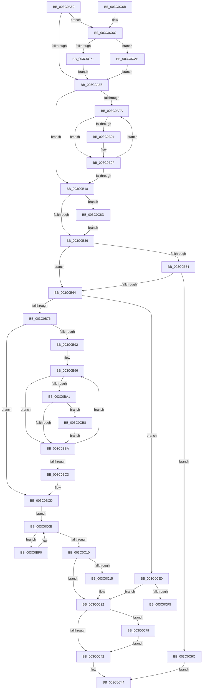

# KeSetAffinityProcess

- RVA: `0x003C0A60`–`0x003C0D0C` (길이 `684` bytes)
- VA: `0x00000001403C0A60`
- 실행 섹션: `.text`
- PDB 이름 있음: `예`; PDB Function 태그: `예`
- unwind 정보 RVA: `0x0008E04C`
- 디코드: `177`개 명령, `684/684` bytes 표시
- 미해석 바이트: `0` (있으면 어셈블리에 `.byte`로 보존)

> 이 문서는 커널 이미지의 기계어와 PDB 기호를 분석해 생성했습니다. 4번과 5번은 함수 원형과 자료형을 바이너리 사용 방식에서 추정한 C 해석이며 원본 소스 복구 결과는 아닙니다.

## 1. Dependencies

- 직접 호출 지점: **14**; 고유 호출 대상: **13**
- 직접 호출자로 확인된 함수: **3**
- RIP 상대 이미지 참조: **2**

### Outgoing calls
- `0x003C0AA7` → [memset](../6C/memset_function_006C6C40.md) (function, `0x006C6C40`)
- `0x003C0AD3` → [memset](../6C/memset_function_006C6C40.md) (function, `0x006C6C40`)
- `0x003C0B48` → [ExAcquireSpinLockExclusiveAtDpcLevel](../24/ExAcquireSpinLockExclusiveAtDpcLevel_function_00248E80.md) (function, `0x00248E80`)
- `0x003C0B80` → [KiCopyAffinityEx](../2C/KiCopyAffinityEx_function_002CE860.md) (function, `0x002CE860`)
- `0x003C0BAA` → [KiSetIdealNodeProcessByGroup](KiSetIdealNodeProcessByGroup_function_003C0888.md) (function, `0x003C0888`)
- `0x003C0BE2` → [KiSelectIdealProcessorSetsForProcess](KiSelectIdealProcessorSetsForProcess_function_003C0D40.md) (function, `0x003C0D40`)
- `0x003C0C03` → [KiSetAffinityThread](../2C/KiSetAffinityThread_function_002CE010.md) (function, `0x002CE010`)
- `0x003C0C26` → [ExReleaseSpinLockExclusiveFromDpcLevel](../24/ExReleaseSpinLockExclusiveFromDpcLevel_function_002497E0.md) (function, `0x002497E0`)
- `0x003C0C38` → [KiProcessDeferredReadyList](../25/KiProcessDeferredReadyList_function_00250800.md) (function, `0x00250800`)
- `0x003C0C4B` → [_security_check_cookie](../6A/_security_check_cookie_function_006AC640.md) (function, `0x006AC640`)
- `0x003C0C7E` → [KiUpdateProcessAvailableCpuState](KiUpdateProcessAvailableCpuState_function_003C00B4.md) (function, `0x003C00B4`)
- `0x003C0C86` → [KiNotifyAvailableCpusChangeProcess](../4F/KiNotifyAvailableCpusChangeProcess_function_004FCE30.md) (function, `0x004FCE30`)
- `0x003C0C92` → [KiRaiseIrqlProcessIrqlFlags](../4F/KiRaiseIrqlProcessIrqlFlags_function_004F56FC.md) (function, `0x004F56FC`)
- `0x003C0CA2` → [KiReleaseProcessLockExclusive](KiReleaseProcessLockExclusive_function_003C2660.md) (function, `0x003C2660`)

### Direct callers
- [PspSetProcessAffinitySafe](../../page/A6/PspSetProcessAffinitySafe_function_00A60904.md) at `0x00A609FD`
- [KiInitializeDynamicProcessorDpc](../../pagelk/B6/KiInitializeDynamicProcessorDpc_function_00B67A30.md) at `0x00B67AF1`
- [Phase1InitializationDiscard](../../init/C1/Phase1InitializationDiscard_function_00C1C728.md) at `0x00C1D078`

### Static image references
- `0x003C0A7C` → RVA `0x00E0A740` (`.data`; read)
- `0x003C0B2A` → RVA `0x00FC6D20` (`ALMOSTRO`; read)

## 2. Other-region calls and transfers

- 다른 실행 섹션으로 향하는 call: **0**
- call이 아닌 외부 분기/꼬리 이동: **1**
  - `0x003C0D07` → [sub_006E7E46](../6E/Unknown_function_006E7E46.md) (`tail-transfer`)

## 3. Assembly (complete function range)

```asm
003C0A60  48 89 5C 24 10                  mov qword ptr [rsp + 0x10], rbx
003C0A65  55                              push rbp
003C0A66  56                              push rsi
003C0A67  57                              push rdi
003C0A68  41 54                           push r12
003C0A6A  41 55                           push r13
003C0A6C  41 56                           push r14
003C0A6E  41 57                           push r15
003C0A70  48 8D 6C 24 80                  lea rbp, [rsp - 0x80]
003C0A75  48 81 EC 80 01 00 00            sub rsp, 0x180
003C0A7C  48 8B 05 BD 9C A4 00            mov rax, qword ptr [rip + 0xa49cbd]
003C0A83  48 33 C4                        xor rax, rsp
003C0A86  48 89 45 70                     mov qword ptr [rbp + 0x70], rax
003C0A8A  49 8B F0                        mov rsi, r8
003C0A8D  48 89 4C 24 38                  mov qword ptr [rsp + 0x38], rcx
003C0A92  8B FA                           mov edi, edx
003C0A94  48 8B D9                        mov rbx, rcx
003C0A97  41 BC 00 01 00 00               mov r12d, 0x100
003C0A9D  48 8D 4C 24 68                  lea rcx, [rsp + 0x68]
003C0AA2  45 8B C4                        mov r8d, r12d
003C0AA5  33 D2                           xor edx, edx
003C0AA7  E8 94 61 30 00                  call 0x1406c6c40
003C0AAC  33 C9                           xor ecx, ecx
003C0AAE  48 C7 44 24 60 01 00 20 00      mov qword ptr [rsp + 0x60], 0x200001
003C0AB7  44 8A E9                        mov r13b, cl
003C0ABA  88 4C 24 20                     mov byte ptr [rsp + 0x20], cl
003C0ABE  44 8A F9                        mov r15b, cl
003C0AC1  48 89 4C 24 30                  mov qword ptr [rsp + 0x30], rcx
003C0AC6  44 8A F1                        mov r14b, cl
003C0AC9  45 8B C4                        mov r8d, r12d
003C0ACC  48 8D 4C 24 68                  lea rcx, [rsp + 0x68]
003C0AD1  33 D2                           xor edx, edx
003C0AD3  E8 68 61 30 00                  call 0x1406c6c40
003C0AD8  41 B8 01 00 00 00               mov r8d, 1
003C0ADE  40 F6 C7 03                     test dil, 3
003C0AE2  0F 85 84 01 00 00               jne 0x1403c0c6c
003C0AE8  33 D2                           xor edx, edx
003C0AEA  0F 57 C0                        xorps xmm0, xmm0
003C0AED  0F B7 C2                        movzx eax, dx
003C0AF0  0F 11 44 24 48                  movups xmmword ptr [rsp + 0x48], xmm0
003C0AF5  66 3B 16                        cmp dx, word ptr [rsi]
003C0AF8  73 1E                           jae 0x1403c0b18
003C0AFA  0F B7 C8                        movzx ecx, ax
003C0AFD  48 39 54 CE 08                  cmp qword ptr [rsi + rcx*8 + 8], rdx
003C0B02  74 0B                           je 0x1403c0b0f
003C0B04  48 8D 54 24 48                  lea rdx, [rsp + 0x48]
003C0B09  48 0F AB 0A                     bts qword ptr [rdx], rcx
003C0B0D  33 D2                           xor edx, edx
003C0B0F  66 41 03 C0                     add ax, r8w
003C0B13  66 3B 06                        cmp ax, word ptr [rsi]
003C0B16  72 E2                           jb 0x1403c0afa
003C0B18  45 0F 20 C4                     mov r12, cr8
003C0B1C  4C 89 64 24 28                  mov qword ptr [rsp + 0x28], r12
003C0B21  B8 02 00 00 00                  mov eax, 2
003C0B26  44 0F 22 C0                     mov cr8, rax
003C0B2A  39 15 F0 61 C0 00               cmp dword ptr [rip + 0xc061f0], edx
003C0B30  0F 85 57 01 00 00               jne 0x1403c0c8d
003C0B36  65 48 8B 04 25 20 00 00 00      mov rax, qword ptr gs:[0x20]
003C0B3F  48 8D 4B 40                     lea rcx, [rbx + 0x40]
003C0B43  48 89 44 24 40                  mov qword ptr [rsp + 0x40], rax
003C0B48  E8 33 83 E8 FF                  call 0x140248e80
003C0B4D  33 C9                           xor ecx, ecx
003C0B4F  45 84 F6                        test r14b, r14b
003C0B52  74 10                           je 0x1403c0b64
003C0B54  F7 83 88 00 00 00 00 10 00 00   test dword ptr [rbx + 0x88], 0x1000
003C0B5E  0F 85 38 01 00 00               jne 0x1403c0c9c
003C0B64  44 8A 74 24 20                  mov r14b, byte ptr [rsp + 0x20]
003C0B69  48 8B 7B 50                     mov rdi, qword ptr [rbx + 0x50]
003C0B6D  45 84 F6                        test r14b, r14b
003C0B70  0F 85 6A 01 00 00               jne 0x1403c0ce0
003C0B76  0F B7 57 02                     movzx edx, word ptr [rdi + 2]
003C0B7A  4C 8B C6                        mov r8, rsi
003C0B7D  48 8B CF                        mov rcx, rdi
003C0B80  E8 DB DC F0 FF                  call 0x1402ce860
003C0B85  33 C0                           xor eax, eax
003C0B87  41 B7 01                        mov r15b, 1
003C0B8A  0F B7 F8                        movzx edi, ax
003C0B8D  66 3B 06                        cmp ax, word ptr [rsi]
003C0B90  73 3B                           jae 0x1403c0bcd
003C0B92  44 8D 60 01                     lea r12d, [rax + 1]
003C0B96  44 0F B7 F7                     movzx r14d, di
003C0B9A  4A 39 44 F6 08                  cmp qword ptr [rsi + r14*8 + 8], rax
003C0B9F  74 19                           je 0x1403c0bba
003C0BA1  44 0F B7 C7                     movzx r8d, di
003C0BA5  33 D2                           xor edx, edx
003C0BA7  48 8B CB                        mov rcx, rbx
003C0BAA  E8 D9 FC FF FF                  call 0x1403c0888
003C0BAF  33 C0                           xor eax, eax
003C0BB1  45 84 ED                        test r13b, r13b
003C0BB4  0F 84 FE 00 00 00               je 0x1403c0cb8
003C0BBA  66 41 03 FC                     add di, r12w
003C0BBE  66 3B 3E                        cmp di, word ptr [rsi]
003C0BC1  72 D3                           jb 0x1403c0b96
003C0BC3  4C 8B 64 24 28                  mov r12, qword ptr [rsp + 0x28]
003C0BC8  44 8A 74 24 20                  mov r14b, byte ptr [rsp + 0x20]
003C0BCD  48 8B 93 B8 00 00 00            mov rdx, qword ptr [rbx + 0xb8]
003C0BD4  48 8B CB                        mov rcx, rbx
003C0BD7  4C 8D 4A 04                     lea r9, [rdx + 4]
003C0BDB  4C 8D 82 D0 00 00 00            lea r8, [rdx + 0xd0]
003C0BE2  E8 59 01 00 00                  call 0x1403c0d40
003C0BE7  48 8D 73 30                     lea rsi, [rbx + 0x30]
003C0BEB  48 8B 3E                        mov rdi, qword ptr [rsi]
003C0BEE  EB 1B                           jmp 0x1403c0c0b
003C0BF0  4C 8B 43 50                     mov r8, qword ptr [rbx + 0x50]
003C0BF4  48 8D 8F 08 FD FF FF            lea rcx, [rdi - 0x2f8]
003C0BFB  45 8A CC                        mov r9b, r12b
003C0BFE  48 8D 54 24 30                  lea rdx, [rsp + 0x30]
003C0C03  E8 08 D4 F0 FF                  call 0x1402ce010
003C0C08  48 8B 3F                        mov rdi, qword ptr [rdi]
003C0C0B  48 3B FE                        cmp rdi, rsi
003C0C0E  75 E0                           jne 0x1403c0bf0
003C0C10  45 84 F6                        test r14b, r14b
003C0C13  75 0D                           jne 0x1403c0c22
003C0C15  0F 10 44 24 48                  movups xmm0, xmmword ptr [rsp + 0x48]
003C0C1A  F3 0F 7F 83 98 00 00 00         movdqu xmmword ptr [rbx + 0x98], xmm0
003C0C22  48 8D 4B 40                     lea rcx, [rbx + 0x40]
003C0C26  E8 B5 8B E8 FF                  call 0x1402497e0
003C0C2B  48 8B 4C 24 40                  mov rcx, qword ptr [rsp + 0x40]
003C0C30  48 8D 54 24 30                  lea rdx, [rsp + 0x30]
003C0C35  45 8A C4                        mov r8b, r12b
003C0C38  E8 C3 FB E8 FF                  call 0x140250800
003C0C3D  45 84 FF                        test r15b, r15b
003C0C40  75 37                           jne 0x1403c0c79
003C0C42  33 C0                           xor eax, eax
003C0C44  48 8B 4D 70                     mov rcx, qword ptr [rbp + 0x70]
003C0C48  48 33 CC                        xor rcx, rsp
003C0C4B  E8 F0 B9 2E 00                  call 0x1406ac640
003C0C50  48 8B 9C 24 C8 01 00 00         mov rbx, qword ptr [rsp + 0x1c8]
003C0C58  48 81 C4 80 01 00 00            add rsp, 0x180
003C0C5F  41 5F                           pop r15
003C0C61  41 5E                           pop r14
003C0C63  41 5D                           pop r13
003C0C65  41 5C                           pop r12
003C0C67  5F                              pop rdi
003C0C68  5E                              pop rsi
003C0C69  5D                              pop rbp
003C0C6A  C3                              ret
003C0C6B  CC                              int3
003C0C6C  41 84 F8                        test r8b, dil
003C0C6F  74 3D                           je 0x1403c0cae
003C0C71  45 8A F0                        mov r14b, r8b
003C0C74  E9 6F FE FF FF                  jmp 0x1403c0ae8
003C0C79  33 D2                           xor edx, edx
003C0C7B  48 8B CB                        mov rcx, rbx
003C0C7E  E8 31 F4 FF FF                  call 0x1403c00b4
003C0C83  48 8B CB                        mov rcx, rbx
003C0C86  E8 A5 C1 13 00                  call 0x1404fce30
003C0C8B  EB B5                           jmp 0x1403c0c42
003C0C8D  8A D0                           mov dl, al
003C0C8F  41 8A CC                        mov cl, r12b
003C0C92  E8 65 4A 13 00                  call 0x1404f56fc
003C0C97  E9 9A FE FF FF                  jmp 0x1403c0b36
003C0C9C  41 8A D4                        mov dl, r12b
003C0C9F  48 8B CB                        mov rcx, rbx
003C0CA2  E8 B9 19 00 00                  call 0x1403c2660
003C0CA7  B8 0D 00 00 C0                  mov eax, 0xc000000d
003C0CAC  EB 96                           jmp 0x1403c0c44
003C0CAE  44 88 44 24 20                  mov byte ptr [rsp + 0x20], r8b
003C0CB3  E9 30 FE FF FF                  jmp 0x1403c0ae8
003C0CB8  48 8B 83 B8 00 00 00            mov rax, qword ptr [rbx + 0xb8]
003C0CBF  45 8A EC                        mov r13b, r12b
003C0CC2  42 0F B7 8C 70 90 00 00 00      movzx ecx, word ptr [rax + r14*2 + 0x90]
003C0CCB  33 C0                           xor eax, eax
003C0CCD  66 89 8B 04 01 00 00            mov word ptr [rbx + 0x104], cx
003C0CD4  66 89 BB A0 01 00 00            mov word ptr [rbx + 0x1a0], di
003C0CDB  E9 DA FE FF FF                  jmp 0x1403c0bba
003C0CE0  0F B7 07                        movzx eax, word ptr [rdi]
003C0CE3  44 0F B7 F1                     movzx r14d, cx
003C0CE7  66 89 44 24 22                  mov word ptr [rsp + 0x22], ax
003C0CEC  66 3B C8                        cmp cx, ax
003C0CEF  0F 83 2D FF FF FF               jae 0x1403c0c22
003C0CF5  4C 8B EE                        mov r13, rsi
003C0CF8  4C 8D 7F 08                     lea r15, [rdi + 8]
003C0CFC  4C 2B EF                        sub r13, rdi
003C0CFF  44 8A E1                        mov r12b, cl
003C0D02  BB 01 00 00 00                  mov ebx, 1
003C0D07  E9 3A 71 32 00                  jmp 0x1406e7e46
```

## 4. C-style interpretation (structured pseudocode)

```c
__int64 __fastcall KeSetAffinityProcess(__int64 a1, int a2, __int64 a3)
{
    __int64 result;
    __int64 v_r13;
    __int64 v_rdi;
    __int64 v_rsp;
    unsigned __int64 v_stack_m150;
    unsigned __int64 v_stack_m158;
    unsigned __int64 v_stack_m170;
    unsigned __int64 v_stack_m178;
    unsigned __int64 v_stack_m180;
    unsigned __int64 v_stack_m188;
    unsigned __int64 v_stack_m190;
    unsigned __int8 v_stack_m198;
    unsigned __int64 v_stack_m48;
    unsigned __int64 v_stack_mB8;
    unsigned __int64 v_stack_p10;
    unsigned __int8 v_stack_p20;
    unsigned __int16 v_stack_p22;

    v_stack_p10 = v_rbx;
    v_rsp = (v_rsp) - (384);
    result = (*(unsigned __int64 *)(v_rip + 10788029)) ^ (v_rsp);
    v_stack_m48 = result;
    v_stack_m180 = a1;
    a2 = 0;
    result = memset(v_stack_m150, a2, 256, a4);
    a1 = 0;
    v_stack_m158 = 0x200001ULL;
    v_stack_m198 = 0;
    v_stack_m188 = 0;
    a2 = 0;
    result = memset(v_stack_m150, a2, 256, a4);
    if ((((unsigned __int8)((unsigned int)(a2))) & (3)) != 0) goto loc_003C0C6C;
loc_003C0AE8:
    a2 = 0;
    v_stack_m170 = v_xmm0;
    if (0 >= (*(unsigned __int16 *)(a3))) goto loc_003C0B18;
loc_003C0AFA:
    if ((*(unsigned __int64 *)(a3 + 0 * 8 + 8)) != 0) {
        a2 = v_stack_m170;
        a2 = 0;
    }
    result = (unsigned __int16)((0) + (1));
    if (((unsigned __int16)(result)) < (*(unsigned __int16 *)(a3))) goto loc_003C0AFA;
loc_003C0B18:
    v_stack_m190 = v_cr8;
    if ((*(unsigned int *)(v_rip + 12607984)) != 0) goto loc_003C0C8D;
loc_003C0B36:
    v_stack_m178 = *(unsigned __int64 *)(gs_base + (0 + 32));
    result = ExAcquireSpinLockExclusiveAtDpcLevel(a1 + 64, a2, 1, a4);
    a1 = 0;
    if (0 == 0) goto loc_003C0B64;
    if (((*(unsigned int *)(a1 + 136)) & (0x1000ULL)) != 0) goto loc_003C0C9C;
loc_003C0B64:
    if ((unsigned __int8)(v_stack_m198) != 0) goto loc_003C0CE0;
    result = KiCopyAffinityEx(*(unsigned __int64 *)(a1 + 80), *(unsigned __int16 *)(*(unsigned __int64 *)(a1 + 80) + 2), a3, a4);
    result = 0;
    if (0 >= (*(unsigned __int16 *)(a3))) goto loc_003C0BCD;
loc_003C0B96:
    if ((*(unsigned __int64 *)(a3 + 0 * 8 + 8)) == 0) goto loc_003C0BBA;
    a2 = 0;
    result = KiSetIdealNodeProcessByGroup(0, a2, 0, a4);
    result = 0;
    if (0 == 0) goto loc_003C0CB8;
loc_003C0BBA:
    v_rdi = (unsigned __int16)((0) + ((unsigned __int16)(result + 1)));
    if (((unsigned __int16)(v_rdi)) < (*(unsigned __int16 *)(a3))) goto loc_003C0B96;
loc_003C0BCD:
    result = KiSelectIdealProcessorSetsForProcess(0, *(unsigned __int64 *)(a1 + 184), *(unsigned __int64 *)(a1 + 184) + 208, *(unsigned __int64 *)(a1 + 184) + 4);
    goto loc_003C0C0B;
loc_003C0BF0:
    result = KiSetAffinityThread(*(unsigned __int64 *)(a1 + 48) - 760, v_stack_m188, *(unsigned __int64 *)(a1 + 80), (unsigned __int8)(v_stack_m190));
loc_003C0C0B:
    if ((*(unsigned __int64 *)(*(unsigned __int64 *)(a1 + 48))) != (a1 + 48)) goto loc_003C0BF0;
    if ((unsigned __int8)(v_stack_m198) == 0) {
        *(unsigned __int64 *)(a1 + 152) = v_xmm0;
    }
    result = ExReleaseSpinLockExclusiveFromDpcLevel(a1 + 64, v_stack_m188, *(unsigned __int64 *)(a1 + 80), (unsigned __int8)(v_stack_m190));
    result = KiProcessDeferredReadyList(v_stack_m178, v_stack_m188, (unsigned __int8)(v_stack_m190), (unsigned __int8)(v_stack_m190));
    if (1 != 0) goto loc_003C0C79;
loc_003C0C42:
    result = 0;
loc_003C0C44:
    a1 = (v_stack_m48) ^ (v_rsp);
    result = _security_check_cookie(a1, v_stack_m188, (unsigned __int8)(v_stack_m190), (unsigned __int8)(v_stack_m190));
    v_rsp = (v_rsp) + (384);
    return result;
loc_003C0C6C:
    if ((((unsigned __int8)((unsigned __int8)(v_stack_m190))) & ((unsigned __int8)(*(unsigned __int64 *)(*(unsigned __int64 *)(a1 + 48))))) == 0) goto loc_003C0CAE;
    goto loc_003C0AE8;
loc_003C0C79:
    a2 = 0;
    result = KiUpdateProcessAvailableCpuState(v_stack_p10, a2, (unsigned __int8)(v_stack_m190), (unsigned __int8)(v_stack_m190));
    result = KiNotifyAvailableCpusChangeProcess(v_stack_p10, a2, (unsigned __int8)(v_stack_m190), (unsigned __int8)(v_stack_m190));
    goto loc_003C0C42;
loc_003C0C8D:
    result = KiRaiseIrqlProcessIrqlFlags((unsigned __int8)(v_stack_m190), (unsigned __int8)(result), (unsigned __int8)(v_stack_m190), (unsigned __int8)(v_stack_m190));
    goto loc_003C0B36;
loc_003C0C9C:
    result = KiReleaseProcessLockExclusive(v_stack_p10, (unsigned __int8)(v_stack_m190), (unsigned __int8)(v_stack_m190), (unsigned __int8)(v_stack_m190));
    goto loc_003C0C44;
loc_003C0CAE:
    v_stack_p20 = (unsigned __int8)((unsigned __int8)(v_stack_m190));
    goto loc_003C0AE8;
loc_003C0CB8:
    result = 0;
    *(unsigned __int16 *)(v_stack_p10 + 260) = (unsigned __int16)(*(unsigned __int16 *)(*(unsigned __int64 *)(v_stack_p10 + 184) + (unsigned __int8)((unsigned __int8)(v_stack_m190)) * 2 + 144));
    *(unsigned __int16 *)(v_stack_p10 + 416) = (unsigned __int16)(*(unsigned __int64 *)(*(unsigned __int64 *)(a1 + 48)));
    goto loc_003C0BBA;
loc_003C0CE0:
    v_stack_p22 = (unsigned __int16)(*(unsigned __int16 *)(*(unsigned __int64 *)(*(unsigned __int64 *)(a1 + 48))));
    if (((unsigned __int16)(*(unsigned __int16 *)(*(unsigned __int64 *)(v_stack_p10 + 184) + (unsigned __int8)((unsigned __int8)(v_stack_m190)) * 2 + 144))) >= ((unsigned __int16)(*(unsigned __int16 *)(*(unsigned __int64 *)(*(unsigned __int64 *)(a1 + 48)))))) goto loc_003C0C22;
    v_r13 = (a1 + 48) - (*(unsigned __int64 *)(*(unsigned __int64 *)(a1 + 48)));
}
```

## 5. (Beta) C Style

```c
int64_t KeSetAffinityProcess(void *Arg1, int32_t Arg2, void *Arg3)
{
    uint8_t *arg1 = (uint8_t *)Arg1;
    uint8_t *arg3 = (uint8_t *)Arg3;

    int64_t result;
    int64_t local_r13;
    int64_t local_rdi;
    int64_t local_rsp;
    uint64_t v_stack_m150;
    uint64_t v_stack_m158;
    uint64_t v_stack_m170;
    uint64_t v_stack_m178;
    uint64_t v_stack_m180;
    uint64_t v_stack_m188;
    uint64_t v_stack_m190;
    uint8_t v_stack_m198;
    uint64_t v_stack_m48;
    uint64_t v_stack_mB8;
    uint64_t v_stack_p10;
    uint8_t v_stack_p20;
    uint16_t v_stack_p22;

    v_stack_p10 = local_rbx;
    local_rsp = (local_rsp) - (384);
    result = (*(uint64_t *)(v_rip + 0xA49CBD)) ^ (local_rsp);
    v_stack_m48 = result;
    v_stack_m180 = Arg1;
    Arg2 = 0;
    result = memset(v_stack_m150, Arg2, 256, a4);
    Arg1 = 0;
    v_stack_m158 = 0x200001ULL;
    v_stack_m198 = 0;
    v_stack_m188 = 0;
    Arg2 = 0;
    result = memset(v_stack_m150, Arg2, 256, a4);
    if ((((uint8_t)((uint32_t)(Arg2))) & (3)) != 0) goto loc_003C0C6C;
loc_003C0AE8:
    Arg2 = 0;
    v_stack_m170 = v_xmm0;
    if (0 >= (*(uint16_t *)(arg3))) goto loc_003C0B18;
loc_003C0AFA:
    if ((*(uint64_t *)(arg3 + 0x0 * 8 + 0x8)) != 0) {
        Arg2 = v_stack_m170;
        Arg2 = 0;
    }
    result = (uint16_t)((0) + (1));
    if (((uint16_t)(result)) < (*(uint16_t *)(arg3))) goto loc_003C0AFA;
loc_003C0B18:
    v_stack_m190 = v_cr8;
    if ((*(uint32_t *)(v_rip + 0xC061F0)) != 0) goto loc_003C0C8D;
loc_003C0B36:
    v_stack_m178 = *(uint64_t *)(gs_base + (0 + 0x20));
    result = ExAcquireSpinLockExclusiveAtDpcLevel(Arg1 + 64, Arg2, 1, a4);
    Arg1 = 0;
    if (0 == 0) goto loc_003C0B64;
    if (((*(uint32_t *)(arg1 + 0x88)) & (0x1000ULL)) != 0) goto loc_003C0C9C;
loc_003C0B64:
    if ((uint8_t)(v_stack_m198) != 0) goto loc_003C0CE0;
    result = KiCopyAffinityEx(*(uint64_t *)(arg1 + 0x50), *(uint16_t *)(*(uint64_t *)(arg1 + 0x50) + 0x2), Arg3, a4);
    result = 0;
    if (0 >= (*(uint16_t *)(arg3))) goto loc_003C0BCD;
loc_003C0B96:
    if ((*(uint64_t *)(arg3 + 0x0 * 8 + 0x8)) == 0) goto loc_003C0BBA;
    Arg2 = 0;
    result = KiSetIdealNodeProcessByGroup(0, Arg2, 0, a4);
    result = 0;
    if (0 == 0) goto loc_003C0CB8;
loc_003C0BBA:
    local_rdi = (uint16_t)((0) + ((uint16_t)(result + 1)));
    if (((uint16_t)(local_rdi)) < (*(uint16_t *)(arg3))) goto loc_003C0B96;
loc_003C0BCD:
    result = KiSelectIdealProcessorSetsForProcess(0, *(uint64_t *)(arg1 + 0xB8), *(uint64_t *)(arg1 + 0xB8) + 208, *(uint64_t *)(arg1 + 0xB8) + 4);
    goto loc_003C0C0B;
loc_003C0BF0:
    result = KiSetAffinityThread(*(uint64_t *)(arg1 + 0x30) - 760, v_stack_m188, *(uint64_t *)(arg1 + 0x50), (uint8_t)(v_stack_m190));
loc_003C0C0B:
    if ((*(uint64_t *)(*(uint64_t *)(arg1 + 0x30))) != (Arg1 + 48)) goto loc_003C0BF0;
    if ((uint8_t)(v_stack_m198) == 0) {
        *(uint64_t *)(arg1 + 0x98) = v_xmm0;
    }
    result = ExReleaseSpinLockExclusiveFromDpcLevel(Arg1 + 64, v_stack_m188, *(uint64_t *)(arg1 + 0x50), (uint8_t)(v_stack_m190));
    result = KiProcessDeferredReadyList(v_stack_m178, v_stack_m188, (uint8_t)(v_stack_m190), (uint8_t)(v_stack_m190));
    if (1 != 0) goto loc_003C0C79;
loc_003C0C42:
    result = 0;
loc_003C0C44:
    Arg1 = (v_stack_m48) ^ (local_rsp);
    result = _security_check_cookie(Arg1, v_stack_m188, (uint8_t)(v_stack_m190), (uint8_t)(v_stack_m190));
    local_rsp = (local_rsp) + (384);
    return result;
loc_003C0C6C:
    if ((((uint8_t)((uint8_t)(v_stack_m190))) & ((uint8_t)(*(uint64_t *)(*(uint64_t *)(arg1 + 0x30))))) == 0) goto loc_003C0CAE;
    goto loc_003C0AE8;
loc_003C0C79:
    Arg2 = 0;
    result = KiUpdateProcessAvailableCpuState(v_stack_p10, Arg2, (uint8_t)(v_stack_m190), (uint8_t)(v_stack_m190));
    result = KiNotifyAvailableCpusChangeProcess(v_stack_p10, Arg2, (uint8_t)(v_stack_m190), (uint8_t)(v_stack_m190));
    goto loc_003C0C42;
loc_003C0C8D:
    result = KiRaiseIrqlProcessIrqlFlags((uint8_t)(v_stack_m190), (uint8_t)(result), (uint8_t)(v_stack_m190), (uint8_t)(v_stack_m190));
    goto loc_003C0B36;
loc_003C0C9C:
    result = KiReleaseProcessLockExclusive(v_stack_p10, (uint8_t)(v_stack_m190), (uint8_t)(v_stack_m190), (uint8_t)(v_stack_m190));
    goto loc_003C0C44;
loc_003C0CAE:
    v_stack_p20 = (uint8_t)((uint8_t)(v_stack_m190));
    goto loc_003C0AE8;
loc_003C0CB8:
    result = 0;
    *(uint16_t *)(v_stack_p10 + 0x104) = (uint16_t)(*(uint16_t *)(*(uint64_t *)(v_stack_p10 + 0xB8) + (uint8_t)((uint8_t)(v_stack_m190)) * 2 + 0x90));
    *(uint16_t *)(v_stack_p10 + 0x1A0) = (uint16_t)(*(uint64_t *)(*(uint64_t *)(arg1 + 0x30)));
    goto loc_003C0BBA;
loc_003C0CE0:
    v_stack_p22 = (uint16_t)(*(uint16_t *)(*(uint64_t *)(*(uint64_t *)(arg1 + 0x30))));
    if (((uint16_t)(*(uint16_t *)(*(uint64_t *)(v_stack_p10 + 0xB8) + (uint8_t)((uint8_t)(v_stack_m190)) * 2 + 0x90))) >= ((uint16_t)(*(uint16_t *)(*(uint64_t *)(*(uint64_t *)(arg1 + 0x30)))))) goto loc_003C0C22;
    local_r13 = (Arg1 + 48) - (*(uint64_t *)(*(uint64_t *)(arg1 + 0x30)));
}
```

### 관측된 메모리 오프셋

구조체 형식이 확인되지 않은 접근은 인자 기준의 오프셋으로만 기록했습니다.

| 기준 인자 | 오프셋 표현 | 폭 (bit) | 접근 |
|---|---:|---:|---|
| `Arg1` | `+ 0x0` | `64` | `R` |
| `Arg1` | `+ 0x30` | `64` | `R` |
| `Arg1` | `+ 0x40` | `64` | `R` |
| `Arg1` | `+ 0x50` | `64` | `R` |
| `Arg1` | `+ 0x88` | `32` | `R` |
| `Arg1` | `+ 0x98` | `128` | `W` |
| `Arg1` | `+ 0xB8` | `64` | `R` |
| `Arg1` | `+ 0x104` | `16` | `W` |
| `Arg1` | `+ 0x1A0` | `16` | `W` |
| `Arg3` | `+ 0x0` | `16` | `R` |
| `Arg3` | `+ 0x8 + r14*8` | `64` | `R` |
| `Arg3` | `+ 0x8 + rcx*8` | `64` | `R` |

## 6. Execution-region graph

[열기: 2D/3D 그래프와 함수 탐색 컨트롤 패널](../../../control-panel.html?section=text&rva=0x003C0A60&view=graph)

- 2D 그래프는 위에서 아래로 흐르고, 3D 그래프는 빈 공간을 드래그해 회전합니다. Shift+드래그는 이동, 휠은 확대·축소, 함수 노드 선택은 대상 보고서 이동입니다.

### Static fallback


