# KeSetBasePriorityThread

- RVA: `0x003C6EB0`–`0x003C7230` (길이 `896` bytes)
- VA: `0x00000001403C6EB0`
- 실행 섹션: `.text`
- PDB 이름 있음: `예`; PDB Function 태그: `아니요`
- unwind 정보 RVA: `0x0008E62C`
- 디코드: `226`개 명령, `896/896` bytes 표시
- 미해석 바이트: `0` (있으면 어셈블리에 `.byte`로 보존)

> 이 문서는 커널 이미지의 기계어와 PDB 기호를 분석해 생성했습니다. 4번과 5번은 함수 원형과 자료형을 바이너리 사용 방식에서 추정한 C 해석이며 원본 소스 복구 결과는 아닙니다.

## 1. Dependencies

- 직접 호출 지점: **15**; 고유 호출 대상: **14**
- 직접 호출자로 확인된 함수: **3**
- RIP 상대 이미지 참조: **6**

### Outgoing calls
- `0x003C6FC5` → [Feature_StackingDecayBoosts__private_IsEnabledNoReportingNoInline](../4E/Feature_StackingDecayBoosts__private_IsEnabledNoReportingNoInline_function_004EF7C0.md) (function, `0x004EF7C0`)
- `0x003C6FF1` → [KiSetBasePriorityAndClearDecrement](KiSetBasePriorityAndClearDecrement_function_003C6B9C.md) (function, `0x003C6B9C`)
- `0x003C6FFB` → [KiAdjustRealtimePriorityFloor](../21/KiAdjustRealtimePriorityFloor_function_0021FBE0.md) (function, `0x0021FBE0`)
- `0x003C7000` → [Feature_StackingDecayBoosts__private_IsEnabledNoReportingNoInline](../4E/Feature_StackingDecayBoosts__private_IsEnabledNoReportingNoInline_function_004EF7C0.md) (function, `0x004EF7C0`)
- `0x003C7014` → [KiComputeThreadPriority](KiComputeThreadPriority_function_003C45F4.md) (function, `0x003C45F4`)
- `0x003C7046` → [KiUpdateTotalCyclesCurrentThread](../37/KiUpdateTotalCyclesCurrentThread_function_0037DE40.md) (function, `0x0037DE40`)
- `0x003C706B` → [KiQueryQuantumReset](../21/KiQueryQuantumReset_function_0021F6B4.md) (function, `0x0021F6B4`)
- `0x003C7098` → [KiSetPriorityThread](../22/KiSetPriorityThread_function_00220E78.md) (function, `0x00220E78`)
- `0x003C70C8` → [KiProcessDeferredReadyList](../25/KiProcessDeferredReadyList_function_00250800.md) (function, `0x00250800`)
- `0x003C7148` → [KiRaiseIrqlProcessIrqlFlags](../4F/KiRaiseIrqlProcessIrqlFlags_function_004F56FC.md) (function, `0x004F56FC`)
- `0x003C7160` → [KiCheckVpBackingLongSpinWaitHypercall](../30/KiCheckVpBackingLongSpinWaitHypercall_function_0030F490.md) (function, `0x0030F490`)
- `0x003C716F` → [HvlNotifyLongSpinWait](../30/HvlNotifyLongSpinWait_function_0030F460.md) (function, `0x0030F460`)
- `0x003C7192` → [EtwTracePriority](EtwTracePriority_function_003C41A4.md) (function, `0x003C41A4`)
- `0x003C71BA` → [KiRemoveSystemWorkPriorityKick](../26/KiRemoveSystemWorkPriorityKick_function_002631D0.md) (function, `0x002631D0`)
- `0x003C7226` → [KiPriQueueThreadPriorityChanged](KiPriQueueThreadPriorityChanged_function_003C4640.md) (function, `0x003C4640`)

### Direct callers
- [EtwpCovSampCaptureContextStart](../../page/7C/EtwpCovSampCaptureContextStart_function_007C14AC.md) at `0x007C1767`
- [NtSetInformationThread](../../page/8C/NtSetInformationThread_function_008C9F60.md) at `0x008CA6E1`
- [PfTLoggingWorker](../../page/97/PfTLoggingWorker_function_0097B140.md) at `0x0097B199`

### Static image references
- `0x003C6ECB` → RVA `0x00FCFF00` (`CACHEALI`; read)
- `0x003C6F01` → RVA `0x00FC6D20` (`ALMOSTRO`; read)
- `0x003C6F35` → RVA `0x00FC52AC` (`ALMOSTRO`; reference)
- `0x003C7070` → RVA `0x00FC5098` (`ALMOSTRO`; read)
- `0x003C70CD` → RVA `0x00FC6B04` (`ALMOSTRO`; read)
- `0x003C7152` → RVA `0x00FC6AB8` (`ALMOSTRO`; read)

## 2. Other-region calls and transfers

- 다른 실행 섹션으로 향하는 call: **0**
- 별도 외부 분기/꼬리 이동을 확인하지 못했습니다.

## 3. Assembly (complete function range)

```asm
003C6EB0  48 89 5C 24 10                  mov qword ptr [rsp + 0x10], rbx
003C6EB5  55                              push rbp
003C6EB6  56                              push rsi
003C6EB7  57                              push rdi
003C6EB8  41 54                           push r12
003C6EBA  41 55                           push r13
003C6EBC  41 56                           push r14
003C6EBE  41 57                           push r15
003C6EC0  48 8B EC                        mov rbp, rsp
003C6EC3  48 83 EC 50                     sub rsp, 0x50
003C6EC7  83 65 40 00                     and dword ptr [rbp + 0x40], 0
003C6ECB  48 8D 05 2E 90 C0 00            lea rax, [rip + 0xc0902e]
003C6ED2  4C 8B B9 20 02 00 00            mov r15, qword ptr [rcx + 0x220]
003C6ED9  44 8B F2                        mov r14d, edx
003C6EDC  48 8B D9                        mov rbx, rcx
003C6EDF  4C 3B F8                        cmp r15, rax
003C6EE2  0F 84 DC 02 00 00               je 0x1403c71c4
003C6EE8  40 32 F6                        xor sil, sil
003C6EEB  48 83 65 E0 00                  and qword ptr [rbp - 0x20], 0
003C6EF0  44 0F 20 C0                     mov rax, cr8
003C6EF4  48 89 45 F8                     mov qword ptr [rbp - 8], rax
003C6EF8  BA 02 00 00 00                  mov edx, 2
003C6EFD  44 0F 22 C2                     mov cr8, rdx
003C6F01  83 3D 18 FE BF 00 00            cmp dword ptr [rip + 0xbffe18], 0
003C6F08  0F 85 38 02 00 00               jne 0x1403c7146
003C6F0E  65 4C 8B 2C 25 20 00 00 00      mov r13, qword ptr gs:[0x20]
003C6F17  33 FF                           xor edi, edi
003C6F19  4C 89 6D E8                     mov qword ptr [rbp - 0x18], r13
003C6F1D  49 8B 45 08                     mov rax, qword ptr [r13 + 8]
003C6F21  44 8D 6F 01                     lea r13d, [rdi + 1]
003C6F25  48 89 45 F0                     mov qword ptr [rbp - 0x10], rax
003C6F29  F0 48 0F BA 6B 40 00            lock bts qword ptr [rbx + 0x40], 0
003C6F30  73 1C                           jae 0x1403c6f4e
003C6F32  41 03 FD                        add edi, r13d
003C6F35  85 3D 71 E3 BF 00               test dword ptr [rip + 0xbfe371], edi
003C6F3B  0F 84 11 02 00 00               je 0x1403c7152
003C6F41  F3 90                           pause
003C6F43  48 8B 43 40                     mov rax, qword ptr [rbx + 0x40]
003C6F47  48 85 C0                        test rax, rax
003C6F4A  74 DD                           je 0x1403c6f29
003C6F4C  EB E4                           jmp 0x1403c6f32
003C6F4E  0F BE 8B 33 02 00 00            movsx ecx, byte ptr [rbx + 0x233]
003C6F55  41 0F BE 87 90 00 00 00         movsx eax, byte ptr [r15 + 0x90]
003C6F5D  44 8B E1                        mov r12d, ecx
003C6F60  4C 8B 6D E8                     mov r13, qword ptr [rbp - 0x18]
003C6F64  44 2B E0                        sub r12d, eax
003C6F67  0F BE 83 85 02 00 00            movsx eax, byte ptr [rbx + 0x285]
003C6F6E  89 4D 58                        mov dword ptr [rbp + 0x58], ecx
003C6F71  84 C0                           test al, al
003C6F73  0F 85 52 02 00 00               jne 0x1403c71cb
003C6F79  BA 10 00 00 00                  mov edx, 0x10
003C6F7E  40 88 B3 85 02 00 00            mov byte ptr [rbx + 0x285], sil
003C6F85  41 8B C6                        mov eax, r14d
003C6F88  F7 D8                           neg eax
003C6F8A  41 0F 48 C6                     cmovs eax, r14d
003C6F8E  44 8D 42 F1                     lea r8d, [rdx - 0xf]
003C6F92  3B C2                           cmp eax, edx
003C6F94  0F 8D 3D 02 00 00               jge 0x1403c71d7
003C6F9A  41 0F BE 8F 90 00 00 00         movsx ecx, byte ptr [r15 + 0x90]
003C6FA2  41 8D 3C 0E                     lea edi, [r14 + rcx]
003C6FA6  3A CA                           cmp cl, dl
003C6FA8  0F 8D 7D 01 00 00               jge 0x1403c712b
003C6FAE  41 BE 0F 00 00 00               mov r14d, 0xf
003C6FB4  3B FA                           cmp edi, edx
003C6FB6  0F 8D 44 02 00 00               jge 0x1403c7200
003C6FBC  85 FF                           test edi, edi
003C6FBE  41 0F 4E F8                     cmovle edi, r8d
003C6FC2  89 7D 50                        mov dword ptr [rbp + 0x50], edi
003C6FC5  E8 F6 87 12 00                  call 0x1404ef7c0
003C6FCA  85 C0                           test eax, eax
003C6FCC  0F 85 27 01 00 00               jne 0x1403c70f9
003C6FD2  0F BE B3 66 03 00 00            movsx esi, byte ptr [rbx + 0x366]
003C6FD9  03 F7                           add esi, edi
003C6FDB  89 75 40                        mov dword ptr [rbp + 0x40], esi
003C6FDE  83 FE 10                        cmp esi, 0x10
003C6FE1  0F 8D 25 02 00 00               jge 0x1403c720c
003C6FE7  40 2A F7                        sub sil, dil
003C6FEA  48 8D 55 50                     lea rdx, [rbp + 0x50]
003C6FEE  48 8B CB                        mov rcx, rbx
003C6FF1  E8 A6 FB FF FF                  call 0x1403c6b9c
003C6FF6  8B D7                           mov edx, edi
003C6FF8  48 8B CB                        mov rcx, rbx
003C6FFB  E8 E0 8B E5 FF                  call 0x14021fbe0
003C7000  E8 BB 87 12 00                  call 0x1404ef7c0
003C7005  45 33 C0                        xor r8d, r8d
003C7008  40 88 B3 66 03 00 00            mov byte ptr [rbx + 0x366], sil
003C700F  33 D2                           xor edx, edx
003C7011  48 8B CB                        mov rcx, rbx
003C7014  E8 DB D5 FF FF                  call 0x1403c45f4
003C7019  0F BE 8B C3 00 00 00            movsx ecx, byte ptr [rbx + 0xc3]
003C7020  89 45 40                        mov dword ptr [rbp + 0x40], eax
003C7023  3B C1                           cmp eax, ecx
003C7025  74 76                           je 0x1403c709d
003C7027  48 3B 5D F0                     cmp rbx, qword ptr [rbp - 0x10]
003C702B  0F 85 0C 01 00 00               jne 0x1403c713d
003C7031  41 80 7D 20 00                  cmp byte ptr [r13 + 0x20], 0
003C7036  0F 85 01 01 00 00               jne 0x1403c713d
003C703C  FA                              cli
003C703D  45 33 C0                        xor r8d, r8d
003C7040  48 8B D3                        mov rdx, rbx
003C7043  49 8B CD                        mov rcx, r13
003C7046  E8 F5 6D FB FF                  call 0x14037de40
003C704B  65 48 8B 0C 25 20 00 00 00      mov rcx, qword ptr gs:[0x20]
003C7054  48 8B F8                        mov rdi, rax
003C7057  4C 8B 81 B8 8E 00 00            mov r8, qword ptr [rcx + 0x8eb8]
003C705E  4D 85 C0                        test r8, r8
003C7061  0F 85 35 01 00 00               jne 0x1403c719c
003C7067  FB                              sti
003C7068  48 8B CB                        mov rcx, rbx
003C706B  E8 44 86 E5 FF                  call 0x14021f6b4
003C7070  0F AF 05 21 E0 BF 00            imul eax, dword ptr [rip + 0xbfe021]
003C7077  8B C8                           mov ecx, eax
003C7079  8B 43 78                        mov eax, dword ptr [rbx + 0x78]
003C707C  48 03 CF                        add rcx, rdi
003C707F  A8 20                           test al, 0x20
003C7081  74 06                           je 0x1403c7089
003C7083  F0 0F BA 73 78 05               lock btr dword ptr [rbx + 0x78], 5
003C7089  44 8B 45 40                     mov r8d, dword ptr [rbp + 0x40]
003C708D  48 8D 55 E0                     lea rdx, [rbp - 0x20]
003C7091  48 89 4B 20                     mov qword ptr [rbx + 0x20], rcx
003C7095  48 8B CB                        mov rcx, rbx
003C7098  E8 DB 9D E5 FF                  call 0x140220e78
003C709D  48 8B 8B E8 00 00 00            mov rcx, qword ptr [rbx + 0xe8]
003C70A4  48 85 C9                        test rcx, rcx
003C70A7  74 0C                           je 0x1403c70b5
003C70A9  8A 01                           mov al, byte ptr [rcx]
003C70AB  24 7F                           and al, 0x7f
003C70AD  3C 15                           cmp al, 0x15
003C70AF  0F 84 6E 01 00 00               je 0x1403c7223
003C70B5  48 C7 43 40 00 00 00 00         mov qword ptr [rbx + 0x40], 0
003C70BD  44 8A 45 F8                     mov r8b, byte ptr [rbp - 8]
003C70C1  48 8D 55 E0                     lea rdx, [rbp - 0x20]
003C70C5  49 8B CD                        mov rcx, r13
003C70C8  E8 33 97 E8 FF                  call 0x140250800
003C70CD  F7 05 2D FA BF 00 00 20 00 00   test dword ptr [rip + 0xbffa2d], 0x2000
003C70D7  0F 85 9C 00 00 00               jne 0x1403c7179
003C70DD  41 8B C4                        mov eax, r12d
003C70E0  48 8B 9C 24 98 00 00 00         mov rbx, qword ptr [rsp + 0x98]
003C70E8  48 83 C4 50                     add rsp, 0x50
003C70EC  41 5F                           pop r15
003C70EE  41 5E                           pop r14
003C70F0  41 5D                           pop r13
003C70F2  41 5C                           pop r12
003C70F4  5F                              pop rdi
003C70F5  5E                              pop rsi
003C70F6  5D                              pop rbp
003C70F7  C3                              ret
003C70F8  CC                              int3
003C70F9  0F B7 93 06 02 00 00            movzx edx, word ptr [rbx + 0x206]
003C7100  0F BE 8B 66 03 00 00            movsx ecx, byte ptr [rbx + 0x366]
003C7107  41 23 D6                        and edx, r14d
003C710A  03 D7                           add edx, edi
003C710C  83 FA 10                        cmp edx, 0x10
003C710F  41 0F 4D D6                     cmovge edx, r14d
003C7113  03 CA                           add ecx, edx
003C7115  89 4D 40                        mov dword ptr [rbp + 0x40], ecx
003C7118  83 F9 10                        cmp ecx, 0x10
003C711B  0F 8D F7 00 00 00               jge 0x1403c7218
003C7121  2A CA                           sub cl, dl
003C7123  40 8A F1                        mov sil, cl
003C7126  E9 BF FE FF FF                  jmp 0x1403c6fea
003C712B  3B FA                           cmp edi, edx
003C712D  0F 8D BB 00 00 00               jge 0x1403c71ee
003C7133  8B FA                           mov edi, edx
003C7135  89 55 50                        mov dword ptr [rbp + 0x50], edx
003C7138  E9 AD FE FF FF                  jmp 0x1403c6fea
003C713D  48 8B 7B 48                     mov rdi, qword ptr [rbx + 0x48]
003C7141  E9 22 FF FF FF                  jmp 0x1403c7068
003C7146  8A C8                           mov cl, al
003C7148  E8 AF E5 12 00                  call 0x1404f56fc
003C714D  E9 BC FD FF FF                  jmp 0x1403c6f0e
003C7152  8B 05 60 F9 BF 00               mov eax, dword ptr [rip + 0xbff960]
003C7158  A8 40                           test al, 0x40
003C715A  0F 84 E1 FD FF FF               je 0x1403c6f41
003C7160  E8 2B 83 F4 FF                  call 0x14030f490
003C7165  84 C0                           test al, al
003C7167  0F 84 D4 FD FF FF               je 0x1403c6f41
003C716D  8B CF                           mov ecx, edi
003C716F  E8 EC 82 F4 FF                  call 0x14030f460
003C7174  E9 CA FD FF FF                  jmp 0x1403c6f43
003C7179  44 8B 4D 50                     mov r9d, dword ptr [rbp + 0x50]
003C717D  48 8D 45 40                     lea rax, [rbp + 0x40]
003C7181  44 8B 45 58                     mov r8d, dword ptr [rbp + 0x58]
003C7185  BA 31 05 00 00                  mov edx, 0x531
003C718A  48 8B CB                        mov rcx, rbx
003C718D  48 89 44 24 20                  mov qword ptr [rsp + 0x20], rax
003C7192  E8 0D D0 FF FF                  call 0x1403c41a4
003C7197  E9 41 FF FF FF                  jmp 0x1403c70dd
003C719C  41 0F 0D 08                     prefetchw byte ptr [r8]
003C71A0  41 8B 00                        mov eax, dword ptr [r8]
003C71A3  8B D0                           mov edx, eax
003C71A5  0F BA F2 15                     btr edx, 0x15
003C71A9  F0 41 0F B1 10                  lock cmpxchg dword ptr [r8], edx
003C71AE  75 F3                           jne 0x1403c71a3
003C71B0  0F BA E0 15                     bt eax, 0x15
003C71B4  0F 83 AD FE FF FF               jae 0x1403c7067
003C71BA  E8 11 C0 E9 FF                  call 0x1402631d0
003C71BF  E9 A3 FE FF FF                  jmp 0x1403c7067
003C71C4  33 C0                           xor eax, eax
003C71C6  E9 15 FF FF FF                  jmp 0x1403c70e0
003C71CB  44 8B E0                        mov r12d, eax
003C71CE  41 C1 E4 04                     shl r12d, 4
003C71D2  E9 A2 FD FF FF                  jmp 0x1403c6f79
003C71D7  83 C9 FF                        or ecx, 0xffffffff
003C71DA  41 8B C0                        mov eax, r8d
003C71DD  45 85 F6                        test r14d, r14d
003C71E0  0F 4E C1                        cmovle eax, ecx
003C71E3  88 83 85 02 00 00               mov byte ptr [rbx + 0x285], al
003C71E9  E9 AC FD FF FF                  jmp 0x1403c6f9a
003C71EE  B8 1F 00 00 00                  mov eax, 0x1f
003C71F3  3B F8                           cmp edi, eax
003C71F5  0F 4F F8                        cmovg edi, eax
003C71F8  89 7D 50                        mov dword ptr [rbp + 0x50], edi
003C71FB  E9 EA FD FF FF                  jmp 0x1403c6fea
003C7200  41 8B FE                        mov edi, r14d
003C7203  44 89 75 50                     mov dword ptr [rbp + 0x50], r14d
003C7207  E9 B9 FD FF FF                  jmp 0x1403c6fc5
003C720C  41 8B F6                        mov esi, r14d
003C720F  44 89 75 40                     mov dword ptr [rbp + 0x40], r14d
003C7213  E9 CF FD FF FF                  jmp 0x1403c6fe7
003C7218  41 8B CE                        mov ecx, r14d
003C721B  89 4D 40                        mov dword ptr [rbp + 0x40], ecx
003C721E  E9 FE FE FF FF                  jmp 0x1403c7121
003C7223  48 8B D3                        mov rdx, rbx
003C7226  E8 15 D4 FF FF                  call 0x1403c4640
003C722B  E9 8D FE FF FF                  jmp 0x1403c70bd
```

## 4. C-style interpretation (structured pseudocode)

```c
__int64 __fastcall KeSetBasePriorityThread(__int64 a1, int a2)
{
    __int64 result;
    __int64 v_r12;
    __int64 v_rdi;
    __int64 v_rsi;
    __int64 v_rsp;
    unsigned __int64 v_stack_m40;
    unsigned __int64 v_stack_m48;
    unsigned __int64 v_stack_m50;
    unsigned __int64 v_stack_m58;
    unsigned __int64 v_stack_p10;
    unsigned int v_stack_p18;
    unsigned int v_stack_p20;
    unsigned int v_stack_p8;

    v_stack_p10 = v_rbx;
    v_rsp = (v_rsp) - (80);
    if ((*(unsigned __int64 *)(a1 + 544)) == (v_rip + 12619822)) goto loc_003C71C4;
    v_rsi = 0;
    v_stack_m40 = v_cr8;
    if ((*(unsigned int *)(v_rip + 12582424)) != 0) goto loc_003C7146;
loc_003C6F0E:
    v_rdi = 0;
    v_stack_m50 = *(unsigned __int64 *)(gs_base + (0 + 32));
    v_stack_m48 = *(unsigned __int64 *)(*(unsigned __int64 *)(gs_base + (0 + 32)) + 8);
loc_003C6F29:
    if (condition_is_above_or_equal) goto loc_003C6F4E;
loc_003C6F32:
    v_rdi = (unsigned int)((v_rdi) + ((unsigned int)(v_rdi + 1)));
    if (((*(unsigned int *)(v_rip + 12575601)) & ((unsigned int)(v_rdi))) == 0) goto loc_003C7152;
loc_003C6F41:
loc_003C6F43:
    if (*(unsigned __int64 *)(a1 + 64) == 0) goto loc_003C6F29;
    goto loc_003C6F32;
loc_003C6F4E:
    v_r12 = (unsigned int)(((unsigned int)((unsigned int)((__int8)(*(unsigned __int8 *)(a1 + 563))))) - ((unsigned int)((__int8)(*(unsigned __int8 *)(*(unsigned __int64 *)(a1 + 544) + 144)))));
    v_stack_p20 = (unsigned int)((__int8)(*(unsigned __int8 *)(a1 + 563)));
    if ((unsigned __int8)((__int8)(*(unsigned __int8 *)(a1 + 645))) != 0) goto loc_003C71CB;
loc_003C6F79:
    *(unsigned __int8 *)(a1 + 645) = 0;
    result = (unsigned int)(-((unsigned int)((unsigned int)((unsigned int)(a2)))));
    if (sign_flag) { result = (unsigned int)((unsigned int)(a2)); }
    if (((unsigned int)(result)) >= 16) goto loc_003C71D7;
loc_003C6F9A:
    if (((unsigned __int8)((__int8)(*(unsigned __int8 *)(*(unsigned __int64 *)(a1 + 544) + 144)))) >= 16) goto loc_003C712B;
    if (((unsigned int)((unsigned int)(a2) + (__int8)(*(unsigned __int8 *)(*(unsigned __int64 *)(a1 + 544) + 144)) * 1)) >= 16) goto loc_003C7200;
    v_rdi = (unsigned int)(a2) + (__int8)(*(unsigned __int8 *)(*(unsigned __int64 *)(a1 + 544) + 144)) * 1;
    if (condition_is_less_or_equal) { v_rdi = (unsigned int)(16 - 15); }
    v_stack_p18 = (unsigned int)(v_rdi);
loc_003C6FC5:
    result = Feature_StackingDecayBoosts__private_IsEnabledNoReportingNoInline((__int8)(*(unsigned __int8 *)(*(unsigned __int64 *)(a1 + 544) + 144)), 16, 16 - 15, a4);
    if ((unsigned int)(result) != 0) goto loc_003C70F9;
    v_rsi = (unsigned int)(((__int8)(*(unsigned __int8 *)(a1 + 870))) + ((unsigned int)(v_rdi)));
    v_stack_p8 = (unsigned int)(v_rsi);
    if (((unsigned int)(v_rsi)) >= 16) goto loc_003C720C;
loc_003C6FE7:
    v_rsi = (unsigned __int8)((v_rsi) - ((unsigned __int8)(v_rdi)));
loc_003C6FEA:
    result = KiSetBasePriorityAndClearDecrement(a1, v_stack_p18, 16 - 15, a4);
    result = KiAdjustRealtimePriorityFloor(a1, (unsigned int)((unsigned int)(v_rdi)), 16 - 15, a4);
    result = Feature_StackingDecayBoosts__private_IsEnabledNoReportingNoInline(a1, (unsigned int)((unsigned int)(v_rdi)), 16 - 15, a4);
    a3 = 0;
    *(unsigned __int8 *)(a1 + 870) = (unsigned __int8)(v_rsi);
    a2 = 0;
    result = KiComputeThreadPriority(a1, a2, a3, a4);
    v_stack_p8 = (unsigned int)(result);
    if (((unsigned int)(result)) == ((unsigned int)((__int8)(*(unsigned __int8 *)(a1 + 195))))) goto loc_003C709D;
    if (a1 != v_stack_m48) goto loc_003C713D;
    if ((*(unsigned __int8 *)(v_stack_m50 + 32)) != 0) goto loc_003C713D;
    a3 = 0;
    result = KiUpdateTotalCyclesCurrentThread(v_stack_m50, a1, a3, a4);
    if (*(unsigned __int64 *)(*(unsigned __int64 *)(gs_base + (0 + 32)) + 36536) != 0) goto loc_003C719C;
loc_003C7067:
loc_003C7068:
    result = KiQueryQuantumReset(a1, a1, *(unsigned __int64 *)(*(unsigned __int64 *)(gs_base + (0 + 32)) + 36536), a4);
    result = (unsigned int)((result) * (*(unsigned int *)(v_rip + 12574753)));
    a1 = ((unsigned int)((unsigned int)(result))) + (result);
    if ((((unsigned __int8)((unsigned int)(*(unsigned int *)(a1 + 120)))) & (32)) != 0) {
    }
    *(unsigned __int64 *)(a1 + 32) = a1;
    result = KiSetPriorityThread(a1, v_stack_m58, (unsigned int)(v_stack_p8), a4);
loc_003C709D:
    if (*(unsigned __int64 *)(a1 + 232) == 0) goto loc_003C70B5;
    result = (unsigned __int8)((*(unsigned __int8 *)(*(unsigned __int64 *)(a1 + 232))) & (127));
    if (((unsigned __int8)(result)) == 21) goto loc_003C7223;
loc_003C70B5:
    *(unsigned __int64 *)(a1 + 64) = 0;
loc_003C70BD:
    result = KiProcessDeferredReadyList(v_stack_m50, v_stack_m58, v_stack_m40, a4);
    if (((*(unsigned int *)(v_rip + 12581421)) & (0x2000ULL)) != 0) goto loc_003C7179;
loc_003C70DD:
loc_003C70E0:
    v_rsp = (v_rsp) + (80);
    return (unsigned int)((unsigned int)(v_r12));
loc_003C70F9:
    a2 = (unsigned int)((*(unsigned __int16 *)(v_stack_p10 + 518)) & (15));
    a2 = (unsigned int)((a2) + ((unsigned int)(result)));
    if (a2 >= 16) { a2 = 15; }
    a1 = (unsigned int)(((__int8)(*(unsigned __int8 *)(v_stack_p10 + 870))) + (a2));
    v_stack_p8 = (unsigned int)(a1);
    if (((unsigned int)(a1)) >= 16) goto loc_003C7218;
loc_003C7121:
    a1 = (unsigned __int8)((a1) - ((unsigned __int8)(a2)));
    goto loc_003C6FEA;
loc_003C712B:
    if (((unsigned int)(result)) >= a2) goto loc_003C71EE;
    v_stack_p18 = a2;
    goto loc_003C6FEA;
loc_003C713D:
    goto loc_003C7068;
loc_003C7146:
    result = KiRaiseIrqlProcessIrqlFlags((unsigned __int8)((unsigned int)((unsigned int)(v_r12))), a2, v_stack_m40, a4);
    goto loc_003C6F0E;
loc_003C7152:
    if ((((unsigned __int8)((unsigned int)(*(unsigned int *)(v_rip + 12581216)))) & (64)) == 0) goto loc_003C6F41;
    result = KiCheckVpBackingLongSpinWaitHypercall((unsigned __int8)((unsigned int)((unsigned int)(v_r12))), a2, v_stack_m40, a4);
    if ((unsigned __int8)(result) == 0) goto loc_003C6F41;
    result = HvlNotifyLongSpinWait((unsigned int)((unsigned int)(*(unsigned __int64 *)(v_stack_p10 + 72))), a2, v_stack_m40, a4);
    goto loc_003C6F43;
loc_003C7179:
    v_stack_p20 = v_stack_p8;
    result = EtwTracePriority(v_stack_p10, (unsigned int)(0x531ULL), (unsigned int)(v_stack_p20), (unsigned int)(v_stack_p18));
    goto loc_003C70DD;
loc_003C719C:
loc_003C71A3:
    if ((unsigned __int8)(result) != 0) goto loc_003C71A3;
    if (condition_is_above_or_equal) goto loc_003C7067;
    result = KiRemoveSystemWorkPriorityKick(v_stack_p10, (unsigned int)((unsigned int)((unsigned int)(*(unsigned int *)((unsigned int)(v_stack_p20))))), (unsigned int)(v_stack_p20), (unsigned int)(v_stack_p18));
    goto loc_003C7067;
loc_003C71C4:
    result = 0;
    goto loc_003C70E0;
loc_003C71CB:
    v_r12 = (unsigned int)((0) << (4));
    goto loc_003C6F79;
loc_003C71D7:
    a1 = (unsigned int)((v_stack_p10) | (0xFFFFFFFFULL));
    result = (unsigned int)((unsigned int)((unsigned int)(v_stack_p20)));
    if (condition_is_less_or_equal) { result = (unsigned int)(a1); }
    *(unsigned __int8 *)(v_stack_p10 + 645) = (unsigned __int8)(result);
    goto loc_003C6F9A;
loc_003C71EE:
    v_rdi = *(unsigned __int64 *)(v_stack_p10 + 72);
    if (((unsigned int)(*(unsigned __int64 *)(v_stack_p10 + 72))) > 31) { v_rdi = 31; }
    v_stack_p18 = (unsigned int)(v_rdi);
    goto loc_003C6FEA;
loc_003C7200:
    v_stack_p18 = 15;
    goto loc_003C6FC5;
loc_003C720C:
    v_stack_p8 = 15;
    goto loc_003C6FE7;
loc_003C7218:
    v_stack_p8 = 15;
    goto loc_003C7121;
loc_003C7223:
    result = KiPriQueueThreadPriorityChanged(15, v_stack_p10, (unsigned int)(v_stack_p20), (unsigned int)(v_stack_p18));
    goto loc_003C70BD;
}
```

## 5. (Beta) C Style

```c
int64_t KeSetBasePriorityThread(void *Arg1, int32_t Arg2)
{
    uint8_t *arg1 = (uint8_t *)Arg1;

    int64_t result;
    int64_t local_r12;
    int64_t local_rdi;
    int64_t local_rsi;
    int64_t local_rsp;
    uint64_t v_stack_m40;
    uint64_t v_stack_m48;
    uint64_t v_stack_m50;
    uint64_t v_stack_m58;
    uint64_t v_stack_p10;
    uint32_t v_stack_p18;
    uint32_t v_stack_p20;
    uint32_t v_stack_p8;

    v_stack_p10 = local_rbx;
    local_rsp = (local_rsp) - (80);
    if ((*(uint64_t *)(arg1 + 0x220)) == (v_rip + 12619822)) goto loc_003C71C4;
    local_rsi = 0;
    v_stack_m40 = v_cr8;
    if ((*(uint32_t *)(v_rip + 0xBFFE18)) != 0) goto loc_003C7146;
loc_003C6F0E:
    local_rdi = 0;
    v_stack_m50 = *(uint64_t *)(gs_base + (0 + 0x20));
    v_stack_m48 = *(uint64_t *)(*(uint64_t *)(gs_base + (0 + 0x20)) + 0x8);
loc_003C6F29:
    if (condition_is_above_or_equal) goto loc_003C6F4E;
loc_003C6F32:
    local_rdi = (uint32_t)((local_rdi) + ((uint32_t)(local_rdi + 1)));
    if (((*(uint32_t *)(v_rip + 0xBFE371)) & ((uint32_t)(local_rdi))) == 0) goto loc_003C7152;
loc_003C6F41:
loc_003C6F43:
    if (*(uint64_t *)(arg1 + 0x40) == 0) goto loc_003C6F29;
    goto loc_003C6F32;
loc_003C6F4E:
    local_r12 = (uint32_t)(((uint32_t)((uint32_t)((int8_t)(*(uint8_t *)(arg1 + 0x233))))) - ((uint32_t)((int8_t)(*(uint8_t *)(*(uint64_t *)(arg1 + 0x220) + 0x90)))));
    v_stack_p20 = (uint32_t)((int8_t)(*(uint8_t *)(arg1 + 0x233)));
    if ((uint8_t)((int8_t)(*(uint8_t *)(arg1 + 0x285))) != 0) goto loc_003C71CB;
loc_003C6F79:
    *(uint8_t *)(arg1 + 0x285) = 0;
    result = (uint32_t)(-((uint32_t)((uint32_t)((uint32_t)(Arg2)))));
    if (sign_flag) { result = (uint32_t)((uint32_t)(Arg2)); }
    if (((uint32_t)(result)) >= 16) goto loc_003C71D7;
loc_003C6F9A:
    if (((uint8_t)((int8_t)(*(uint8_t *)(*(uint64_t *)(arg1 + 0x220) + 0x90)))) >= 16) goto loc_003C712B;
    if (((uint32_t)((uint32_t)(Arg2) + (int8_t)(*(uint8_t *)(*(uint64_t *)(arg1 + 0x220) + 0x90)) * 1)) >= 16) goto loc_003C7200;
    local_rdi = (uint32_t)(Arg2) + (int8_t)(*(uint8_t *)(*(uint64_t *)(arg1 + 0x220) + 0x90)) * 1;
    if (condition_is_less_or_equal) { local_rdi = (uint32_t)(16 - 15); }
    v_stack_p18 = (uint32_t)(local_rdi);
loc_003C6FC5:
    result = Feature_StackingDecayBoosts__private_IsEnabledNoReportingNoInline((int8_t)(*(uint8_t *)(*(uint64_t *)(arg1 + 0x220) + 0x90)), 16, 16 - 15, a4);
    if ((uint32_t)(result) != 0) goto loc_003C70F9;
    local_rsi = (uint32_t)(((int8_t)(*(uint8_t *)(arg1 + 0x366))) + ((uint32_t)(local_rdi)));
    v_stack_p8 = (uint32_t)(local_rsi);
    if (((uint32_t)(local_rsi)) >= 16) goto loc_003C720C;
loc_003C6FE7:
    local_rsi = (uint8_t)((local_rsi) - ((uint8_t)(local_rdi)));
loc_003C6FEA:
    result = KiSetBasePriorityAndClearDecrement(Arg1, v_stack_p18, 16 - 15, a4);
    result = KiAdjustRealtimePriorityFloor(Arg1, (uint32_t)((uint32_t)(local_rdi)), 16 - 15, a4);
    result = Feature_StackingDecayBoosts__private_IsEnabledNoReportingNoInline(Arg1, (uint32_t)((uint32_t)(local_rdi)), 16 - 15, a4);
    a3 = 0;
    *(uint8_t *)(arg1 + 0x366) = (uint8_t)(local_rsi);
    Arg2 = 0;
    result = KiComputeThreadPriority(Arg1, Arg2, a3, a4);
    v_stack_p8 = (uint32_t)(result);
    if (((uint32_t)(result)) == ((uint32_t)((int8_t)(*(uint8_t *)(arg1 + 0xC3))))) goto loc_003C709D;
    if (Arg1 != v_stack_m48) goto loc_003C713D;
    if ((*(uint8_t *)(v_stack_m50 + 0x20)) != 0) goto loc_003C713D;
    a3 = 0;
    result = KiUpdateTotalCyclesCurrentThread(v_stack_m50, Arg1, a3, a4);
    if (*(uint64_t *)(*(uint64_t *)(gs_base + (0 + 0x20)) + 0x8EB8) != 0) goto loc_003C719C;
loc_003C7067:
loc_003C7068:
    result = KiQueryQuantumReset(Arg1, Arg1, *(uint64_t *)(*(uint64_t *)(gs_base + (0 + 0x20)) + 0x8EB8), a4);
    result = (uint32_t)((result) * (*(uint32_t *)(v_rip + 0xBFE021)));
    Arg1 = ((uint32_t)((uint32_t)(result))) + (result);
    if ((((uint8_t)((uint32_t)(*(uint32_t *)(arg1 + 0x78)))) & (32)) != 0) {
    }
    *(void **)(arg1 + 0x20) = Arg1;
    result = KiSetPriorityThread(Arg1, v_stack_m58, (uint32_t)(v_stack_p8), a4);
loc_003C709D:
    if (*(uint64_t *)(arg1 + 0xE8) == 0) goto loc_003C70B5;
    result = (uint8_t)((*(uint8_t *)(*(uint64_t *)(arg1 + 0xE8))) & (127));
    if (((uint8_t)(result)) == 21) goto loc_003C7223;
loc_003C70B5:
    *(uint64_t *)(arg1 + 0x40) = 0;
loc_003C70BD:
    result = KiProcessDeferredReadyList(v_stack_m50, v_stack_m58, v_stack_m40, a4);
    if (((*(uint32_t *)(v_rip + 0xBFFA2D)) & (0x2000ULL)) != 0) goto loc_003C7179;
loc_003C70DD:
loc_003C70E0:
    local_rsp = (local_rsp) + (80);
    return (uint32_t)((uint32_t)(local_r12));
loc_003C70F9:
    Arg2 = (uint32_t)((*(uint16_t *)(v_stack_p10 + 0x206)) & (15));
    Arg2 = (uint32_t)((Arg2) + ((uint32_t)(result)));
    if (Arg2 >= 16) { Arg2 = 15; }
    Arg1 = (uint32_t)(((int8_t)(*(uint8_t *)(v_stack_p10 + 0x366))) + (Arg2));
    v_stack_p8 = (uint32_t)(Arg1);
    if (((uint32_t)(Arg1)) >= 16) goto loc_003C7218;
loc_003C7121:
    Arg1 = (uint8_t)((Arg1) - ((uint8_t)(Arg2)));
    goto loc_003C6FEA;
loc_003C712B:
    if (((uint32_t)(result)) >= Arg2) goto loc_003C71EE;
    v_stack_p18 = Arg2;
    goto loc_003C6FEA;
loc_003C713D:
    goto loc_003C7068;
loc_003C7146:
    result = KiRaiseIrqlProcessIrqlFlags((uint8_t)((uint32_t)((uint32_t)(local_r12))), Arg2, v_stack_m40, a4);
    goto loc_003C6F0E;
loc_003C7152:
    if ((((uint8_t)((uint32_t)(*(uint32_t *)(v_rip + 0xBFF960)))) & (64)) == 0) goto loc_003C6F41;
    result = KiCheckVpBackingLongSpinWaitHypercall((uint8_t)((uint32_t)((uint32_t)(local_r12))), Arg2, v_stack_m40, a4);
    if ((uint8_t)(result) == 0) goto loc_003C6F41;
    result = HvlNotifyLongSpinWait((uint32_t)((uint32_t)(*(uint64_t *)(v_stack_p10 + 0x48))), Arg2, v_stack_m40, a4);
    goto loc_003C6F43;
loc_003C7179:
    v_stack_p20 = v_stack_p8;
    result = EtwTracePriority(v_stack_p10, (uint32_t)(0x531ULL), (uint32_t)(v_stack_p20), (uint32_t)(v_stack_p18));
    goto loc_003C70DD;
loc_003C719C:
loc_003C71A3:
    if ((uint8_t)(result) != 0) goto loc_003C71A3;
    if (condition_is_above_or_equal) goto loc_003C7067;
    result = KiRemoveSystemWorkPriorityKick(v_stack_p10, (uint32_t)((uint32_t)((uint32_t)(*(uint32_t *)((uint32_t)(v_stack_p20))))), (uint32_t)(v_stack_p20), (uint32_t)(v_stack_p18));
    goto loc_003C7067;
loc_003C71C4:
    result = 0;
    goto loc_003C70E0;
loc_003C71CB:
    local_r12 = (uint32_t)((0) << (4));
    goto loc_003C6F79;
loc_003C71D7:
    Arg1 = (uint32_t)((v_stack_p10) | (0xFFFFFFFFULL));
    result = (uint32_t)((uint32_t)((uint32_t)(v_stack_p20)));
    if (condition_is_less_or_equal) { result = (uint32_t)(Arg1); }
    *(uint8_t *)(v_stack_p10 + 0x285) = (uint8_t)(result);
    goto loc_003C6F9A;
loc_003C71EE:
    local_rdi = *(uint64_t *)(v_stack_p10 + 0x48);
    if (((uint32_t)(*(uint64_t *)(v_stack_p10 + 0x48))) > 31) { local_rdi = 31; }
    v_stack_p18 = (uint32_t)(local_rdi);
    goto loc_003C6FEA;
loc_003C7200:
    v_stack_p18 = 15;
    goto loc_003C6FC5;
loc_003C720C:
    v_stack_p8 = 15;
    goto loc_003C6FE7;
loc_003C7218:
    v_stack_p8 = 15;
    goto loc_003C7121;
loc_003C7223:
    result = KiPriQueueThreadPriorityChanged(15, v_stack_p10, (uint32_t)(v_stack_p20), (uint32_t)(v_stack_p18));
    goto loc_003C70BD;
}
```

### 관측된 메모리 오프셋

구조체 형식이 확인되지 않은 접근은 인자 기준의 오프셋으로만 기록했습니다.

| 기준 인자 | 오프셋 표현 | 폭 (bit) | 접근 |
|---|---:|---:|---|
| `Arg1` | `+ 0x40` | `64` | `R` |
| `Arg1` | `+ 0x40` | `64` | `R/W` |
| `Arg1` | `+ 0xC3` | `8` | `R` |
| `Arg1` | `+ 0x206` | `16` | `R` |
| `Arg1` | `+ 0x220` | `64` | `R` |
| `Arg1` | `+ 0x233` | `8` | `R` |
| `Arg1` | `+ 0x285` | `8` | `R` |
| `Arg1` | `+ 0x285` | `8` | `W` |
| `Arg1` | `+ 0x366` | `8` | `R` |
| `Arg1` | `+ 0x366` | `8` | `W` |

## 6. Execution-region graph

[열기: 2D/3D 그래프와 함수 탐색 컨트롤 패널](../../../control-panel.html?section=text&rva=0x003C6EB0&view=graph)

- 2D 그래프는 위에서 아래로 흐르고, 3D 그래프는 빈 공간을 드래그해 회전합니다. Shift+드래그는 이동, 휠은 확대·축소, 함수 노드 선택은 대상 보고서 이동입니다.

### Static fallback

```mermaid
flowchart TD
  bb_003C6EB0[BB_003C6EB0]
  bb_003C6EE8[BB_003C6EE8]
  bb_003C6F0E[BB_003C6F0E]
  bb_003C6F29[BB_003C6F29]
  bb_003C6F32[BB_003C6F32]
  bb_003C6F41[BB_003C6F41]
  bb_003C6F43[BB_003C6F43]
  bb_003C6F4C[BB_003C6F4C]
  bb_003C6F4E[BB_003C6F4E]
  bb_003C6F79[BB_003C6F79]
  bb_003C6F9A[BB_003C6F9A]
  bb_003C6FAE[BB_003C6FAE]
  bb_003C6FBC[BB_003C6FBC]
  bb_003C6FC5[BB_003C6FC5]
  bb_003C6FD2[BB_003C6FD2]
  bb_003C6FE7[BB_003C6FE7]
  bb_003C6FEA[BB_003C6FEA]
  bb_003C7027[BB_003C7027]
  bb_003C7031[BB_003C7031]
  bb_003C703C[BB_003C703C]
  bb_003C7067[BB_003C7067]
  bb_003C7068[BB_003C7068]
  bb_003C7083[BB_003C7083]
  bb_003C7089[BB_003C7089]
  bb_003C709D[BB_003C709D]
  bb_003C70A9[BB_003C70A9]
  bb_003C70B5[BB_003C70B5]
  bb_003C70BD[BB_003C70BD]
  bb_003C70DD[BB_003C70DD]
  bb_003C70E0[BB_003C70E0]
  bb_003C70F8[BB_003C70F8]
  bb_003C70F9[BB_003C70F9]
  bb_003C7121[BB_003C7121]
  bb_003C712B[BB_003C712B]
  bb_003C7133[BB_003C7133]
  bb_003C713D[BB_003C713D]
  bb_003C7146[BB_003C7146]
  bb_003C7152[BB_003C7152]
  bb_003C7160[BB_003C7160]
  bb_003C716D[BB_003C716D]
  bb_003C7179[BB_003C7179]
  bb_003C719C[BB_003C719C]
  bb_003C71A3[BB_003C71A3]
  bb_003C71B0[BB_003C71B0]
  bb_003C71BA[BB_003C71BA]
  bb_003C71C4[BB_003C71C4]
  bb_003C71CB[BB_003C71CB]
  bb_003C71D7[BB_003C71D7]
  bb_003C71EE[BB_003C71EE]
  bb_003C7200[BB_003C7200]
  bb_003C720C[BB_003C720C]
  bb_003C7218[BB_003C7218]
  bb_003C7223[BB_003C7223]
  bb_003C6EB0 -->|branch| bb_003C71C4
  bb_003C6EB0 -->|fallthrough| bb_003C6EE8
  bb_003C6EE8 -->|branch| bb_003C7146
  bb_003C6EE8 -->|fallthrough| bb_003C6F0E
  bb_003C6F0E -->|flow| bb_003C6F29
  bb_003C6F29 -->|branch| bb_003C6F4E
  bb_003C6F29 -->|fallthrough| bb_003C6F32
  bb_003C6F32 -->|branch| bb_003C7152
  bb_003C6F32 -->|fallthrough| bb_003C6F41
  bb_003C6F41 -->|flow| bb_003C6F43
  bb_003C6F43 -->|branch| bb_003C6F29
  bb_003C6F43 -->|fallthrough| bb_003C6F4C
  bb_003C6F4C -->|branch| bb_003C6F32
  bb_003C6F4E -->|branch| bb_003C71CB
  bb_003C6F4E -->|fallthrough| bb_003C6F79
  bb_003C6F79 -->|branch| bb_003C71D7
  bb_003C6F79 -->|fallthrough| bb_003C6F9A
  bb_003C6F9A -->|branch| bb_003C712B
  bb_003C6F9A -->|fallthrough| bb_003C6FAE
  bb_003C6FAE -->|branch| bb_003C7200
  bb_003C6FAE -->|fallthrough| bb_003C6FBC
  bb_003C6FBC -->|flow| bb_003C6FC5
  bb_003C6FC5 -->|branch| bb_003C70F9
  bb_003C6FC5 -->|fallthrough| bb_003C6FD2
  bb_003C6FD2 -->|branch| bb_003C720C
  bb_003C6FD2 -->|fallthrough| bb_003C6FE7
  bb_003C6FE7 -->|flow| bb_003C6FEA
  bb_003C6FEA -->|branch| bb_003C709D
  bb_003C6FEA -->|fallthrough| bb_003C7027
  bb_003C7027 -->|branch| bb_003C713D
  bb_003C7027 -->|fallthrough| bb_003C7031
  bb_003C7031 -->|branch| bb_003C713D
  bb_003C7031 -->|fallthrough| bb_003C703C
  bb_003C703C -->|branch| bb_003C719C
  bb_003C703C -->|fallthrough| bb_003C7067
  bb_003C7067 -->|flow| bb_003C7068
  bb_003C7068 -->|branch| bb_003C7089
  bb_003C7068 -->|fallthrough| bb_003C7083
  bb_003C7083 -->|flow| bb_003C7089
  bb_003C7089 -->|flow| bb_003C709D
  bb_003C709D -->|branch| bb_003C70B5
  bb_003C709D -->|fallthrough| bb_003C70A9
  bb_003C70A9 -->|branch| bb_003C7223
  bb_003C70A9 -->|fallthrough| bb_003C70B5
  bb_003C70B5 -->|flow| bb_003C70BD
  bb_003C70BD -->|branch| bb_003C7179
  bb_003C70BD -->|fallthrough| bb_003C70DD
  bb_003C70DD -->|flow| bb_003C70E0
  bb_003C70F8 -->|flow| bb_003C70F9
  bb_003C70F9 -->|branch| bb_003C7218
  bb_003C70F9 -->|fallthrough| bb_003C7121
  bb_003C7121 -->|branch| bb_003C6FEA
  bb_003C712B -->|branch| bb_003C71EE
  bb_003C712B -->|fallthrough| bb_003C7133
  bb_003C7133 -->|branch| bb_003C6FEA
  bb_003C713D -->|branch| bb_003C7068
  bb_003C7146 -->|branch| bb_003C6F0E
  bb_003C7152 -->|branch| bb_003C6F41
  bb_003C7152 -->|fallthrough| bb_003C7160
  bb_003C7160 -->|branch| bb_003C6F41
  bb_003C7160 -->|fallthrough| bb_003C716D
  bb_003C716D -->|branch| bb_003C6F43
  bb_003C7179 -->|branch| bb_003C70DD
  bb_003C719C -->|flow| bb_003C71A3
  bb_003C71A3 -->|branch| bb_003C71A3
  bb_003C71A3 -->|fallthrough| bb_003C71B0
  bb_003C71B0 -->|branch| bb_003C7067
  bb_003C71B0 -->|fallthrough| bb_003C71BA
  bb_003C71BA -->|branch| bb_003C7067
  bb_003C71C4 -->|branch| bb_003C70E0
  bb_003C71CB -->|branch| bb_003C6F79
  bb_003C71D7 -->|branch| bb_003C6F9A
  bb_003C71EE -->|branch| bb_003C6FEA
  bb_003C7200 -->|branch| bb_003C6FC5
  bb_003C720C -->|branch| bb_003C6FE7
  bb_003C7218 -->|branch| bb_003C7121
  bb_003C7223 -->|branch| bb_003C70BD
```


