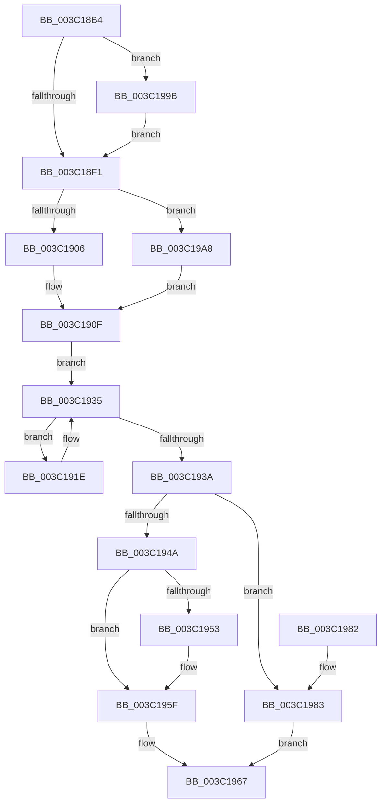

# KeSetDisableBoostProcess

- RVA: `0x003C18B4`–`0x003C19B6` (길이 `258` bytes)
- VA: `0x00000001403C18B4`
- 실행 섹션: `.text`
- PDB 이름 있음: `예`; PDB Function 태그: `아니요`
- unwind 정보 RVA: `0x0008E140`
- 디코드: `65`개 명령, `258/258` bytes 표시
- 미해석 바이트: `0` (있으면 어셈블리에 `.byte`로 보존)

> 이 문서는 커널 이미지의 기계어와 PDB 기호를 분석해 생성했습니다. 4번과 5번은 함수 원형과 자료형을 바이너리 사용 방식에서 추정한 C 해석이며 원본 소스 복구 결과는 아닙니다.

## 1. Dependencies

- 직접 호출 지점: **6**; 고유 호출 대상: **6**
- 직접 호출자로 확인된 함수: **1**
- RIP 상대 이미지 참조: **1**

### Outgoing calls
- `0x003C18F8` → [ExAcquireSpinLockExclusiveAtDpcLevel](../24/ExAcquireSpinLockExclusiveAtDpcLevel_function_00248E80.md) (function, `0x00248E80`)
- `0x003C192D` → [KiSetDisableBoostThread](KiSetDisableBoostThread_function_003C1A5C.md) (function, `0x003C1A5C`)
- `0x003C193D` → [ExReleaseSpinLockExclusiveFromDpcLevel](../24/ExReleaseSpinLockExclusiveFromDpcLevel_function_002497E0.md) (function, `0x002497E0`)
- `0x003C195A` → [KiLowerIrqlProcessIrqlFlags](../4F/KiLowerIrqlProcessIrqlFlags_function_004F5698.md) (function, `0x004F5698`)
- `0x003C1994` → [KiProcessDeferredReadyList](../25/KiProcessDeferredReadyList_function_00250800.md) (function, `0x00250800`)
- `0x003C199E` → [KiRaiseIrqlProcessIrqlFlags](../4F/KiRaiseIrqlProcessIrqlFlags_function_004F56FC.md) (function, `0x004F56FC`)

### Direct callers
- [NtSetInformationProcess](../../page/AE/NtSetInformationProcess_function_00AE5370.md) at `0x00AE6699`

### Static image references
- `0x003C18E4` → RVA `0x00FC6D20` (`ALMOSTRO`; read)

## 2. Other-region calls and transfers

- 다른 실행 섹션으로 향하는 call: **0**
- 별도 외부 분기/꼬리 이동을 확인하지 못했습니다.

## 3. Assembly (complete function range)

```asm
003C18B4  48 8B C4                        mov rax, rsp
003C18B7  48 89 58 10                     mov qword ptr [rax + 0x10], rbx
003C18BB  48 89 68 18                     mov qword ptr [rax + 0x18], rbp
003C18BF  48 89 70 20                     mov qword ptr [rax + 0x20], rsi
003C18C3  57                              push rdi
003C18C4  41 56                           push r14
003C18C6  41 57                           push r15
003C18C8  48 83 EC 20                     sub rsp, 0x20
003C18CC  48 83 60 08 00                  and qword ptr [rax + 8], 0
003C18D1  44 8B FA                        mov r15d, edx
003C18D4  48 8B D9                        mov rbx, rcx
003C18D7  44 0F 20 C7                     mov rdi, cr8
003C18DB  BA 02 00 00 00                  mov edx, 2
003C18E0  44 0F 22 C2                     mov cr8, rdx
003C18E4  83 3D 35 54 C0 00 00            cmp dword ptr [rip + 0xc05435], 0
003C18EB  0F 85 AA 00 00 00               jne 0x1403c199b
003C18F1  4C 8D 73 40                     lea r14, [rbx + 0x40]
003C18F5  49 8B CE                        mov rcx, r14
003C18F8  E8 83 75 E8 FF                  call 0x140248e80
003C18FD  45 85 FF                        test r15d, r15d
003C1900  0F 84 A2 00 00 00               je 0x1403c19a8
003C1906  F0 0F BA AB 88 00 00 00 01      lock bts dword ptr [rbx + 0x88], 1
003C190F  0F 92 C0                        setb al
003C1912  48 8D 73 30                     lea rsi, [rbx + 0x30]
003C1916  48 8B 1E                        mov rbx, qword ptr [rsi]
003C1919  0F B6 E8                        movzx ebp, al
003C191C  EB 17                           jmp 0x1403c1935
003C191E  48 8D 8B 08 FD FF FF            lea rcx, [rbx - 0x2f8]
003C1925  41 8B D7                        mov edx, r15d
003C1928  4C 8D 44 24 40                  lea r8, [rsp + 0x40]
003C192D  E8 2A 01 00 00                  call 0x1403c1a5c
003C1932  48 8B 1B                        mov rbx, qword ptr [rbx]
003C1935  48 3B DE                        cmp rbx, rsi
003C1938  75 E4                           jne 0x1403c191e
003C193A  49 8B CE                        mov rcx, r14
003C193D  E8 9E 7E E8 FF                  call 0x1402497e0
003C1942  48 83 7C 24 40 00               cmp qword ptr [rsp + 0x40], 0
003C1948  75 39                           jne 0x1403c1983
003C194A  83 3D CF 53 C0 00 00            cmp dword ptr [rip + 0xc053cf], 0
003C1951  74 0C                           je 0x1403c195f
003C1953  44 0F 20 C1                     mov rcx, cr8
003C1957  40 8A D7                        mov dl, dil
003C195A  E8 39 3D 13 00                  call 0x1404f5698
003C195F  40 0F B6 C7                     movzx eax, dil
003C1963  44 0F 22 C0                     mov cr8, rax
003C1967  48 8B 5C 24 48                  mov rbx, qword ptr [rsp + 0x48]
003C196C  8B C5                           mov eax, ebp
003C196E  48 8B 6C 24 50                  mov rbp, qword ptr [rsp + 0x50]
003C1973  48 8B 74 24 58                  mov rsi, qword ptr [rsp + 0x58]
003C1978  48 83 C4 20                     add rsp, 0x20
003C197C  41 5F                           pop r15
003C197E  41 5E                           pop r14
003C1980  5F                              pop rdi
003C1981  C3                              ret
003C1982  CC                              int3
003C1983  65 48 8B 0C 25 20 00 00 00      mov rcx, qword ptr gs:[0x20]
003C198C  48 8D 54 24 40                  lea rdx, [rsp + 0x40]
003C1991  44 8A C7                        mov r8b, dil
003C1994  E8 67 EE E8 FF                  call 0x140250800
003C1999  EB CC                           jmp 0x1403c1967
003C199B  40 8A CF                        mov cl, dil
003C199E  E8 59 3D 13 00                  call 0x1404f56fc
003C19A3  E9 49 FF FF FF                  jmp 0x1403c18f1
003C19A8  F0 0F BA B3 88 00 00 00 01      lock btr dword ptr [rbx + 0x88], 1
003C19B1  E9 59 FF FF FF                  jmp 0x1403c190f
```

## 4. C-style interpretation (structured pseudocode)

```c
__int64 __fastcall KeSetDisableBoostProcess(__int64 a1, int a2)
{
    __int64 result;
    __int64 v_rsp;
    unsigned __int64 v_stack_p10;
    unsigned __int64 v_stack_p18;
    unsigned __int64 v_stack_p20;
    unsigned __int64 v_stack_p40;
    unsigned __int64 v_stack_p8;

    *(unsigned __int64 *)(v_rsp + 16) = v_rbx;
    *(unsigned __int64 *)(v_rsp + 24) = v_rbp;
    *(unsigned __int64 *)(v_rsp + 32) = v_rsi;
    v_rsp = (v_rsp) - (32);
    if ((*(unsigned int *)(v_rip + 12604469)) != 0) goto loc_003C199B;
loc_003C18F1:
    result = ExAcquireSpinLockExclusiveAtDpcLevel(a1 + 64, 2, a3, a4);
    if ((unsigned int)((unsigned int)(a2)) == 0) goto loc_003C19A8;
loc_003C190F:
    result = (condition_is_below) ? 1 : 0;
    goto loc_003C1935;
loc_003C191E:
    result = KiSetDisableBoostThread(*(unsigned __int64 *)(a1 + 48) - 760, (unsigned int)((unsigned int)((unsigned int)(a2))), v_stack_p8, a4);
loc_003C1935:
    if ((*(unsigned __int64 *)(*(unsigned __int64 *)(a1 + 48))) != (a1 + 48)) goto loc_003C191E;
    result = ExReleaseSpinLockExclusiveFromDpcLevel(a1 + 64, (unsigned int)((unsigned int)((unsigned int)(a2))), v_stack_p8, a4);
    if (v_stack_p8 != 0) goto loc_003C1983;
    if ((*(unsigned int *)(v_rip + 12604367)) != 0) {
        a1 = 2;
        a2 = (unsigned __int8)(v_cr8);
        result = KiLowerIrqlProcessIrqlFlags(a1, a2, v_stack_p8, a4);
    }
loc_003C1967:
    v_rsp = (v_rsp) + (32);
    return (unsigned int)((unsigned int)((unsigned __int8)(result)));
loc_003C1983:
    result = KiProcessDeferredReadyList(*(unsigned __int64 *)(gs_base + (0 + 32)), v_stack_p40, (unsigned __int8)(v_cr8), a4);
    goto loc_003C1967;
loc_003C199B:
    result = KiRaiseIrqlProcessIrqlFlags((unsigned __int8)(v_cr8), v_stack_p40, (unsigned __int8)(v_cr8), a4);
    goto loc_003C18F1;
loc_003C19A8:
    goto loc_003C190F;
}
```

## 5. (Beta) C Style

```c
int64_t KeSetDisableBoostProcess(void *Arg1, int32_t Arg2)
{
    uint8_t *arg1 = (uint8_t *)Arg1;

    int64_t result;
    int64_t local_rsp;
    uint64_t v_stack_p10;
    uint64_t v_stack_p18;
    uint64_t v_stack_p20;
    uint64_t v_stack_p40;
    uint64_t v_stack_p8;

    *(uint64_t *)(local_rsp + 0x10) = local_rbx;
    *(uint64_t *)(local_rsp + 0x18) = local_rbp;
    *(uint64_t *)(local_rsp + 0x20) = local_rsi;
    local_rsp = (local_rsp) - (32);
    if ((*(uint32_t *)(v_rip + 0xC05435)) != 0) goto loc_003C199B;
loc_003C18F1:
    result = ExAcquireSpinLockExclusiveAtDpcLevel(Arg1 + 64, 2, a3, a4);
    if ((uint32_t)((uint32_t)(Arg2)) == 0) goto loc_003C19A8;
loc_003C190F:
    result = (condition_is_below) ? 1 : 0;
    goto loc_003C1935;
loc_003C191E:
    result = KiSetDisableBoostThread(*(uint64_t *)(arg1 + 0x30) - 760, (uint32_t)((uint32_t)((uint32_t)(Arg2))), v_stack_p8, a4);
loc_003C1935:
    if ((*(uint64_t *)(*(uint64_t *)(arg1 + 0x30))) != (Arg1 + 48)) goto loc_003C191E;
    result = ExReleaseSpinLockExclusiveFromDpcLevel(Arg1 + 64, (uint32_t)((uint32_t)((uint32_t)(Arg2))), v_stack_p8, a4);
    if (v_stack_p8 != 0) goto loc_003C1983;
    if ((*(uint32_t *)(v_rip + 0xC053CF)) != 0) {
        Arg1 = 2;
        Arg2 = (uint8_t)(v_cr8);
        result = KiLowerIrqlProcessIrqlFlags(Arg1, Arg2, v_stack_p8, a4);
    }
loc_003C1967:
    local_rsp = (local_rsp) + (32);
    return (uint32_t)((uint32_t)((uint8_t)(result)));
loc_003C1983:
    result = KiProcessDeferredReadyList(*(uint64_t *)(gs_base + (0 + 0x20)), v_stack_p40, (uint8_t)(v_cr8), a4);
    goto loc_003C1967;
loc_003C199B:
    result = KiRaiseIrqlProcessIrqlFlags((uint8_t)(v_cr8), v_stack_p40, (uint8_t)(v_cr8), a4);
    goto loc_003C18F1;
loc_003C19A8:
    goto loc_003C190F;
}
```

### 관측된 메모리 오프셋

구조체 형식이 확인되지 않은 접근은 인자 기준의 오프셋으로만 기록했습니다.

| 기준 인자 | 오프셋 표현 | 폭 (bit) | 접근 |
|---|---:|---:|---|
| `Arg1` | `+ 0x0` | `64` | `R` |
| `Arg1` | `+ 0x30` | `64` | `R` |
| `Arg1` | `+ 0x40` | `64` | `R` |
| `Arg1` | `+ 0x88` | `32` | `R/W` |

## 6. Execution-region graph

[열기: 2D/3D 그래프와 함수 탐색 컨트롤 패널](../../../control-panel.html?section=text&rva=0x003C18B4&view=graph)

- 2D 그래프는 위에서 아래로 흐르고, 3D 그래프는 빈 공간을 드래그해 회전합니다. Shift+드래그는 이동, 휠은 확대·축소, 함수 노드 선택은 대상 보고서 이동입니다.

### Static fallback


