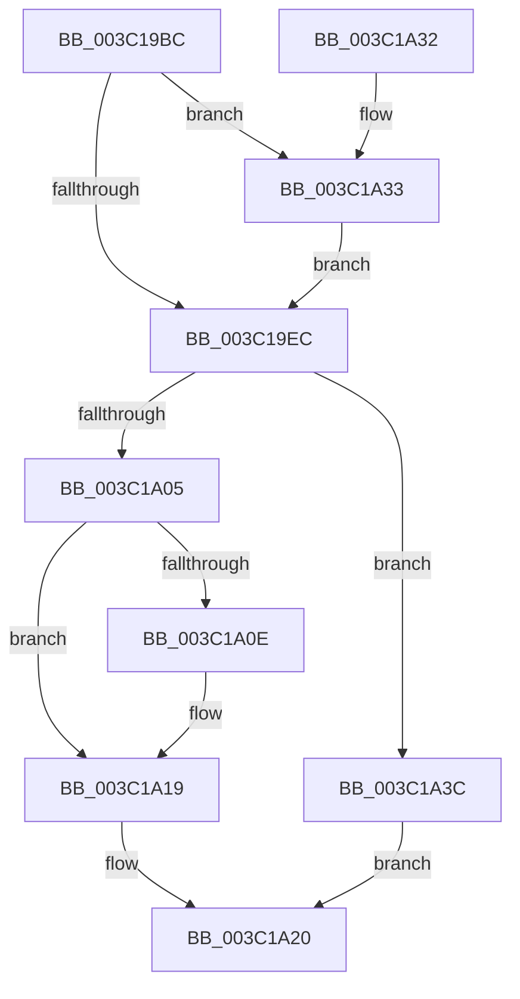

# KeSetDisableBoostThread

- RVA: `0x003C19BC`–`0x003C1A54` (길이 `152` bytes)
- VA: `0x00000001403C19BC`
- 실행 섹션: `.text`
- PDB 이름 있음: `예`; PDB Function 태그: `아니요`
- unwind 정보 RVA: `0x0008E15C`
- 디코드: `41`개 명령, `152/152` bytes 표시
- 미해석 바이트: `0` (있으면 어셈블리에 `.byte`로 보존)

> 이 문서는 커널 이미지의 기계어와 PDB 기호를 분석해 생성했습니다. 4번과 5번은 함수 원형과 자료형을 바이너리 사용 방식에서 추정한 C 해석이며 원본 소스 복구 결과는 아닙니다.

## 1. Dependencies

- 직접 호출 지점: **4**; 고유 호출 대상: **4**
- 직접 호출자로 확인된 함수: **1**
- RIP 상대 이미지 참조: **1**

### Outgoing calls
- `0x003C19F6` → [KiSetDisableBoostThread](KiSetDisableBoostThread_function_003C1A5C.md) (function, `0x003C1A5C`)
- `0x003C1A14` → [KiLowerIrqlProcessIrqlFlags](../4F/KiLowerIrqlProcessIrqlFlags_function_004F5698.md) (function, `0x004F5698`)
- `0x003C1A35` → [KiRaiseIrqlProcessIrqlFlags](../4F/KiRaiseIrqlProcessIrqlFlags_function_004F56FC.md) (function, `0x004F56FC`)
- `0x003C1A4D` → [KiProcessDeferredReadyList](../25/KiProcessDeferredReadyList_function_00250800.md) (function, `0x00250800`)

### Direct callers
- [NtSetInformationThread](../../page/8C/NtSetInformationThread_function_008C9F60.md) at `0x008CADF6`

### Static image references
- `0x003C19E3` → RVA `0x00FC6D20` (`ALMOSTRO`; read)

## 2. Other-region calls and transfers

- 다른 실행 섹션으로 향하는 call: **0**
- 별도 외부 분기/꼬리 이동을 확인하지 못했습니다.

## 3. Assembly (complete function range)

```asm
003C19BC  48 89 5C 24 08                  mov qword ptr [rsp + 8], rbx
003C19C1  48 89 74 24 10                  mov qword ptr [rsp + 0x10], rsi
003C19C6  57                              push rdi
003C19C7  48 83 EC 20                     sub rsp, 0x20
003C19CB  48 83 64 24 40 00               and qword ptr [rsp + 0x40], 0
003C19D1  8B FA                           mov edi, edx
003C19D3  48 8B F1                        mov rsi, rcx
003C19D6  44 0F 20 C3                     mov rbx, cr8
003C19DA  BA 02 00 00 00                  mov edx, 2
003C19DF  44 0F 22 C2                     mov cr8, rdx
003C19E3  83 3D 36 53 C0 00 00            cmp dword ptr [rip + 0xc05336], 0
003C19EA  75 47                           jne 0x1403c1a33
003C19EC  4C 8D 44 24 40                  lea r8, [rsp + 0x40]
003C19F1  8B D7                           mov edx, edi
003C19F3  48 8B CE                        mov rcx, rsi
003C19F6  E8 61 00 00 00                  call 0x1403c1a5c
003C19FB  48 83 7C 24 40 00               cmp qword ptr [rsp + 0x40], 0
003C1A01  8B F8                           mov edi, eax
003C1A03  75 37                           jne 0x1403c1a3c
003C1A05  83 3D 14 53 C0 00 00            cmp dword ptr [rip + 0xc05314], 0
003C1A0C  74 0B                           je 0x1403c1a19
003C1A0E  44 0F 20 C1                     mov rcx, cr8
003C1A12  8A D3                           mov dl, bl
003C1A14  E8 7F 3C 13 00                  call 0x1404f5698
003C1A19  0F B6 CB                        movzx ecx, bl
003C1A1C  44 0F 22 C1                     mov cr8, rcx
003C1A20  48 8B 5C 24 30                  mov rbx, qword ptr [rsp + 0x30]
003C1A25  8B C7                           mov eax, edi
003C1A27  48 8B 74 24 38                  mov rsi, qword ptr [rsp + 0x38]
003C1A2C  48 83 C4 20                     add rsp, 0x20
003C1A30  5F                              pop rdi
003C1A31  C3                              ret
003C1A32  CC                              int3
003C1A33  8A CB                           mov cl, bl
003C1A35  E8 C2 3C 13 00                  call 0x1404f56fc
003C1A3A  EB B0                           jmp 0x1403c19ec
003C1A3C  65 48 8B 0C 25 20 00 00 00      mov rcx, qword ptr gs:[0x20]
003C1A45  48 8D 54 24 40                  lea rdx, [rsp + 0x40]
003C1A4A  44 8A C3                        mov r8b, bl
003C1A4D  E8 AE ED E8 FF                  call 0x140250800
003C1A52  EB CC                           jmp 0x1403c1a20
```

## 4. C-style interpretation (structured pseudocode)

```c
__int64 __fastcall KeSetDisableBoostThread(__int64 a1, int a2)
{
    __int64 result;
    __int64 v_rsp;
    unsigned __int64 v_stack_p10;
    unsigned __int64 v_stack_p18;
    unsigned __int64 v_stack_p40;
    unsigned __int64 v_stack_p8;

    v_stack_p8 = v_rbx;
    v_stack_p10 = v_rsi;
    v_rsp = (v_rsp) - (32);
    if ((*(unsigned int *)(v_rip + 12604214)) != 0) goto loc_003C1A33;
loc_003C19EC:
    result = KiSetDisableBoostThread(a1, (unsigned int)((unsigned int)((unsigned int)(a2))), v_stack_p18, a4);
    if (v_stack_p18 != 0) goto loc_003C1A3C;
    if ((*(unsigned int *)(v_rip + 12604180)) != 0) {
        a1 = 2;
        a2 = (unsigned __int8)(v_cr8);
        result = KiLowerIrqlProcessIrqlFlags(a1, a2, v_stack_p18, a4);
    }
loc_003C1A20:
    v_rsp = (v_rsp) + (32);
    return (unsigned int)((unsigned int)((unsigned int)((unsigned int)(result))));
loc_003C1A33:
    result = KiRaiseIrqlProcessIrqlFlags((unsigned __int8)(v_stack_p8), a2, v_stack_p18, a4);
    goto loc_003C19EC;
loc_003C1A3C:
    result = KiProcessDeferredReadyList(*(unsigned __int64 *)(gs_base + (0 + 32)), v_stack_p40, (unsigned __int8)(v_stack_p8), a4);
    goto loc_003C1A20;
}
```

## 5. (Beta) C Style

```c
int64_t KeSetDisableBoostThread(int64_t Arg1, int32_t Arg2)
{
    int64_t result;
    int64_t local_rsp;
    uint64_t v_stack_p10;
    uint64_t v_stack_p18;
    uint64_t v_stack_p40;
    uint64_t v_stack_p8;

    v_stack_p8 = local_rbx;
    v_stack_p10 = local_rsi;
    local_rsp = (local_rsp) - (32);
    if ((*(uint32_t *)(v_rip + 0xC05336)) != 0) goto loc_003C1A33;
loc_003C19EC:
    result = KiSetDisableBoostThread(Arg1, (uint32_t)((uint32_t)((uint32_t)(Arg2))), v_stack_p18, a4);
    if (v_stack_p18 != 0) goto loc_003C1A3C;
    if ((*(uint32_t *)(v_rip + 0xC05314)) != 0) {
        Arg1 = 2;
        Arg2 = (uint8_t)(v_cr8);
        result = KiLowerIrqlProcessIrqlFlags(Arg1, Arg2, v_stack_p18, a4);
    }
loc_003C1A20:
    local_rsp = (local_rsp) + (32);
    return (uint32_t)((uint32_t)((uint32_t)((uint32_t)(result))));
loc_003C1A33:
    result = KiRaiseIrqlProcessIrqlFlags((uint8_t)(v_stack_p8), Arg2, v_stack_p18, a4);
    goto loc_003C19EC;
loc_003C1A3C:
    result = KiProcessDeferredReadyList(*(uint64_t *)(gs_base + (0 + 0x20)), v_stack_p40, (uint8_t)(v_stack_p8), a4);
    goto loc_003C1A20;
}
```

## 6. Execution-region graph

[열기: 2D/3D 그래프와 함수 탐색 컨트롤 패널](../../../control-panel.html?section=text&rva=0x003C19BC&view=graph)

- 2D 그래프는 위에서 아래로 흐르고, 3D 그래프는 빈 공간을 드래그해 회전합니다. Shift+드래그는 이동, 휠은 확대·축소, 함수 노드 선택은 대상 보고서 이동입니다.

### Static fallback


