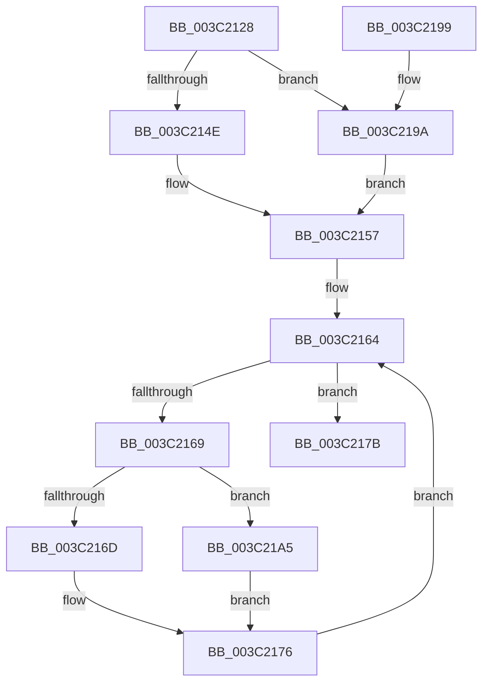

# KeSetDisableQuantumProcess

- RVA: `0x003C2128`–`0x003C21B0` (길이 `136` bytes)
- VA: `0x00000001403C2128`
- 실행 섹션: `.text`
- PDB 이름 있음: `예`; PDB Function 태그: `아니요`
- unwind 정보 RVA: `0x0008E1F0`
- 디코드: `38`개 명령, `136/136` bytes 표시
- 미해석 바이트: `0` (있으면 어셈블리에 `.byte`로 보존)

> 이 문서는 커널 이미지의 기계어와 PDB 기호를 분석해 생성했습니다. 4번과 5번은 함수 원형과 자료형을 바이너리 사용 방식에서 추정한 C 해석이며 원본 소스 복구 결과는 아닙니다.

## 1. Dependencies

- 직접 호출 지점: **2**; 고유 호출 대상: **2**
- 직접 호출자로 확인된 함수: **1**
- RIP 상대 이미지 참조: **0**

### Outgoing calls
- `0x003C2145` → [KiAcquireProcessLockExclusive](KiAcquireProcessLockExclusive_function_003C26B8.md) (function, `0x003C26B8`)
- `0x003C2182` → [KiReleaseProcessLockExclusive](KiReleaseProcessLockExclusive_function_003C2660.md) (function, `0x003C2660`)

### Direct callers
- [PspApplyJobLimitsToProcess](../../page/A5/PspApplyJobLimitsToProcess_function_00A57274.md) at `0x00A5732F`

### Static image references
- 디코드된 RIP-relative 메모리 참조가 없습니다.

## 2. Other-region calls and transfers

- 다른 실행 섹션으로 향하는 call: **0**
- 별도 외부 분기/꼬리 이동을 확인하지 못했습니다.

## 3. Assembly (complete function range)

```asm
003C2128  48 8B C4                        mov rax, rsp
003C212B  48 89 58 08                     mov qword ptr [rax + 8], rbx
003C212F  48 89 70 18                     mov qword ptr [rax + 0x18], rsi
003C2133  57                              push rdi
003C2134  48 83 EC 20                     sub rsp, 0x20
003C2138  8B F2                           mov esi, edx
003C213A  C6 40 10 00                     mov byte ptr [rax + 0x10], 0
003C213E  48 8D 50 10                     lea rdx, [rax + 0x10]
003C2142  48 8B D9                        mov rbx, rcx
003C2145  E8 6E 05 00 00                  call 0x1403c26b8
003C214A  85 F6                           test esi, esi
003C214C  75 4C                           jne 0x1403c219a
003C214E  F0 0F BA B3 88 00 00 00 02      lock btr dword ptr [rbx + 0x88], 2
003C2157  0F 92 C0                        setb al
003C215A  48 8D 4B 30                     lea rcx, [rbx + 0x30]
003C215E  0F B6 F8                        movzx edi, al
003C2161  48 8B 01                        mov rax, qword ptr [rcx]
003C2164  48 3B C1                        cmp rax, rcx
003C2167  74 12                           je 0x1403c217b
003C2169  85 F6                           test esi, esi
003C216B  75 38                           jne 0x1403c21a5
003C216D  F0 0F BA B0 80 FD FF FF 08      lock btr dword ptr [rax - 0x280], 8
003C2176  48 8B 00                        mov rax, qword ptr [rax]
003C2179  EB E9                           jmp 0x1403c2164
003C217B  8A 54 24 38                     mov dl, byte ptr [rsp + 0x38]
003C217F  48 8B CB                        mov rcx, rbx
003C2182  E8 D9 04 00 00                  call 0x1403c2660
003C2187  48 8B 5C 24 30                  mov rbx, qword ptr [rsp + 0x30]
003C218C  8B C7                           mov eax, edi
003C218E  48 8B 74 24 40                  mov rsi, qword ptr [rsp + 0x40]
003C2193  48 83 C4 20                     add rsp, 0x20
003C2197  5F                              pop rdi
003C2198  C3                              ret
003C2199  CC                              int3
003C219A  F0 0F BA AB 88 00 00 00 02      lock bts dword ptr [rbx + 0x88], 2
003C21A3  EB B2                           jmp 0x1403c2157
003C21A5  F0 0F BA A8 80 FD FF FF 08      lock bts dword ptr [rax - 0x280], 8
003C21AE  EB C6                           jmp 0x1403c2176
```

## 4. C-style interpretation (structured pseudocode)

```c
__int64 __fastcall KeSetDisableQuantumProcess(__int64 a1, int a2)
{
    __int64 result;
    __int64 v_rsp;
    unsigned __int8 v_stack_p10;
    unsigned __int64 v_stack_p18;
    unsigned __int64 v_stack_p8;

    *(unsigned __int64 *)(v_rsp + 8) = v_rbx;
    *(unsigned __int64 *)(v_rsp + 24) = v_rsi;
    v_rsp = (v_rsp) - (32);
    *(unsigned __int8 *)(v_rsp + 16) = 0;
    result = KiAcquireProcessLockExclusive(a1, v_rsp + 16, a3, a4);
    if ((unsigned int)((unsigned int)(a2)) != 0) goto loc_003C219A;
loc_003C2157:
    result = (condition_is_below) ? 1 : 0;
loc_003C2164:
    if ((*(unsigned __int64 *)(a1 + 48)) == (a1 + 48)) goto loc_003C217B;
    if ((unsigned int)((unsigned int)(a2)) != 0) goto loc_003C21A5;
loc_003C2176:
    goto loc_003C2164;
loc_003C217B:
    result = KiReleaseProcessLockExclusive(a1, v_stack_p10, a3, a4);
    v_rsp = (v_rsp) + (32);
    return (unsigned int)((unsigned int)((unsigned __int8)(result)));
loc_003C219A:
    goto loc_003C2157;
loc_003C21A5:
    goto loc_003C2176;
}
```

## 5. (Beta) C Style

```c
int64_t KeSetDisableQuantumProcess(void *Arg1, int32_t Arg2)
{
    uint8_t *arg1 = (uint8_t *)Arg1;

    int64_t result;
    int64_t local_rsp;
    uint8_t v_stack_p10;
    uint64_t v_stack_p18;
    uint64_t v_stack_p8;

    *(uint64_t *)(local_rsp + 0x8) = local_rbx;
    *(uint64_t *)(local_rsp + 0x18) = local_rsi;
    local_rsp = (local_rsp) - (32);
    *(uint8_t *)(local_rsp + 0x10) = 0;
    result = KiAcquireProcessLockExclusive(Arg1, local_rsp + 16, a3, a4);
    if ((uint32_t)((uint32_t)(Arg2)) != 0) goto loc_003C219A;
loc_003C2157:
    result = (condition_is_below) ? 1 : 0;
loc_003C2164:
    if ((*(uint64_t *)(arg1 + 0x30)) == (Arg1 + 48)) goto loc_003C217B;
    if ((uint32_t)((uint32_t)(Arg2)) != 0) goto loc_003C21A5;
loc_003C2176:
    goto loc_003C2164;
loc_003C217B:
    result = KiReleaseProcessLockExclusive(Arg1, v_stack_p10, a3, a4);
    local_rsp = (local_rsp) + (32);
    return (uint32_t)((uint32_t)((uint8_t)(result)));
loc_003C219A:
    goto loc_003C2157;
loc_003C21A5:
    goto loc_003C2176;
}
```

### 관측된 메모리 오프셋

구조체 형식이 확인되지 않은 접근은 인자 기준의 오프셋으로만 기록했습니다.

| 기준 인자 | 오프셋 표현 | 폭 (bit) | 접근 |
|---|---:|---:|---|
| `Arg1` | `+ 0x0` | `64` | `R` |
| `Arg1` | `+ 0x30` | `64` | `R` |
| `Arg1` | `+ 0x88` | `32` | `R/W` |

## 6. Execution-region graph

[열기: 2D/3D 그래프와 함수 탐색 컨트롤 패널](../../../control-panel.html?section=text&rva=0x003C2128&view=graph)

- 2D 그래프는 위에서 아래로 흐르고, 3D 그래프는 빈 공간을 드래그해 회전합니다. Shift+드래그는 이동, 휠은 확대·축소, 함수 노드 선택은 대상 보고서 이동입니다.

### Static fallback


