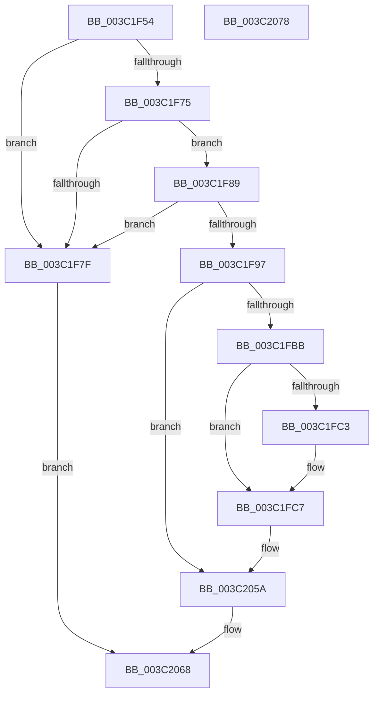

# KeSetExecuteOptions

- RVA: `0x003C1F54`–`0x003C2079` (길이 `293` bytes)
- VA: `0x00000001403C1F54`
- 실행 섹션: `.text`
- PDB 이름 있음: `예`; PDB Function 태그: `아니요`
- unwind 정보 RVA: `0x0008E1D0`
- 디코드: `84`개 명령, `293/293` bytes 표시
- 미해석 바이트: `0` (있으면 어셈블리에 `.byte`로 보존)

> 이 문서는 커널 이미지의 기계어와 PDB 기호를 분석해 생성했습니다. 4번과 5번은 함수 원형과 자료형을 바이너리 사용 방식에서 추정한 C 해석이며 원본 소스 복구 결과는 아닙니다.

## 1. Dependencies

- 직접 호출 지점: **2**; 고유 호출 대상: **2**
- 직접 호출자로 확인된 함수: **1**
- RIP 상대 이미지 참조: **0**

### Outgoing calls
- `0x003C1FA4` → [KiAcquireProcessLockExclusive](KiAcquireProcessLockExclusive_function_003C26B8.md) (function, `0x003C26B8`)
- `0x003C2061` → [KiReleaseProcessLockExclusive](KiReleaseProcessLockExclusive_function_003C2660.md) (function, `0x003C2660`)

### Direct callers
- [NtSetInformationProcess](../../page/AE/NtSetInformationProcess_function_00AE5370.md) at `0x00AE6B66`

### Static image references
- 디코드된 RIP-relative 메모리 참조가 없습니다.

## 2. Other-region calls and transfers

- 다른 실행 섹션으로 향하는 call: **0**
- 별도 외부 분기/꼬리 이동을 확인하지 못했습니다.

## 3. Assembly (complete function range)

```asm
003C1F54  48 89 5C 24 08                  mov qword ptr [rsp + 8], rbx
003C1F59  48 89 74 24 18                  mov qword ptr [rsp + 0x18], rsi
003C1F5E  57                              push rdi
003C1F5F  48 83 EC 20                     sub rsp, 0x20
003C1F63  C6 44 24 38 00                  mov byte ptr [rsp + 0x38], 0
003C1F68  8B FA                           mov edi, edx
003C1F6A  48 8B D9                        mov rbx, rcx
003C1F6D  F7 C2 80 FF FF FF               test edx, 0xffffff80
003C1F73  75 0A                           jne 0x1403c1f7f
003C1F75  48 83 B9 10 03 00 00 00         cmp qword ptr [rcx + 0x310], 0
003C1F7D  75 0A                           jne 0x1403c1f89
003C1F7F  B8 0D 00 00 C0                  mov eax, 0xc000000d
003C1F84  E9 DF 00 00 00                  jmp 0x1403c2068
003C1F89  B9 4C 01 00 00                  mov ecx, 0x14c
003C1F8E  66 39 8B EC 06 00 00            cmp word ptr [rbx + 0x6ec], cx
003C1F95  75 E8                           jne 0x1403c1f7f
003C1F97  48 8D 54 24 38                  lea rdx, [rsp + 0x38]
003C1F9C  48 8B CB                        mov rcx, rbx
003C1F9F  BE 22 00 00 C0                  mov esi, 0xc0000022
003C1FA4  E8 0F 07 00 00                  call 0x1403c26b8
003C1FA9  8A 83 93 00 00 00               mov al, byte ptr [rbx + 0x93]
003C1FAF  41 B2 08                        mov r10b, 8
003C1FB2  41 84 C2                        test r10b, al
003C1FB5  0F 85 9F 00 00 00               jne 0x1403c205a
003C1FBB  24 FE                           and al, 0xfe
003C1FBD  40 F6 C7 01                     test dil, 1
003C1FC1  74 04                           je 0x1403c1fc7
003C1FC3  24 FD                           and al, 0xfd
003C1FC5  0C 01                           or al, 1
003C1FC7  44 0F B6 C0                     movzx r8d, al
003C1FCB  41 B1 02                        mov r9b, 2
003C1FCE  41 8A C0                        mov al, r8b
003C1FD1  0C 04                           or al, 4
003C1FD3  0F B6 C8                        movzx ecx, al
003C1FD6  40 F6 C7 04                     test dil, 4
003C1FDA  41 0F 44 C8                     cmove ecx, r8d
003C1FDE  44 0F B6 C1                     movzx r8d, cl
003C1FE2  41 8A C0                        mov al, r8b
003C1FE5  41 0A C1                        or al, r9b
003C1FE8  0F B6 C8                        movzx ecx, al
003C1FEB  41 84 F9                        test r9b, dil
003C1FEE  41 0F 44 C8                     cmove ecx, r8d
003C1FF2  44 0F B6 C1                     movzx r8d, cl
003C1FF6  41 8A C0                        mov al, r8b
003C1FF9  0C 10                           or al, 0x10
003C1FFB  0F B6 C8                        movzx ecx, al
003C1FFE  40 F6 C7 10                     test dil, 0x10
003C2002  41 0F 44 C8                     cmove ecx, r8d
003C2006  44 0F B6 C1                     movzx r8d, cl
003C200A  41 8A C0                        mov al, r8b
003C200D  0C 20                           or al, 0x20
003C200F  0F B6 C8                        movzx ecx, al
003C2012  40 F6 C7 20                     test dil, 0x20
003C2016  41 0F 44 C8                     cmove ecx, r8d
003C201A  44 0F B6 C1                     movzx r8d, cl
003C201E  41 8A C0                        mov al, r8b
003C2021  0C 40                           or al, 0x40
003C2023  0F B6 C8                        movzx ecx, al
003C2026  40 F6 C7 40                     test dil, 0x40
003C202A  41 0F 44 C8                     cmove ecx, r8d
003C202E  0F B6 D1                        movzx edx, cl
003C2031  8A C2                           mov al, dl
003C2033  41 0A C2                        or al, r10b
003C2036  41 84 FA                        test r10b, dil
003C2039  0F B6 C8                        movzx ecx, al
003C203C  0F 44 CA                        cmove ecx, edx
003C203F  44 0F B6 C1                     movzx r8d, cl
003C2043  41 8A C0                        mov al, r8b
003C2046  0C 30                           or al, 0x30
003C2048  45 84 C1                        test r9b, r8b
003C204B  0F B6 C8                        movzx ecx, al
003C204E  41 0F 44 C8                     cmove ecx, r8d
003C2052  33 F6                           xor esi, esi
003C2054  88 8B 93 00 00 00               mov byte ptr [rbx + 0x93], cl
003C205A  8A 54 24 38                     mov dl, byte ptr [rsp + 0x38]
003C205E  48 8B CB                        mov rcx, rbx
003C2061  E8 FA 05 00 00                  call 0x1403c2660
003C2066  8B C6                           mov eax, esi
003C2068  48 8B 5C 24 30                  mov rbx, qword ptr [rsp + 0x30]
003C206D  48 8B 74 24 40                  mov rsi, qword ptr [rsp + 0x40]
003C2072  48 83 C4 20                     add rsp, 0x20
003C2076  5F                              pop rdi
003C2077  C3                              ret
003C2078  CC                              int3
```

## 4. C-style interpretation (structured pseudocode)

```c
__int64 __fastcall KeSetExecuteOptions(__int64 a1, int a2)
{
    __int64 result;
    __int64 v_rsi;
    __int64 v_rsp;
    unsigned __int8 v_stack_p10;
    unsigned __int64 v_stack_p18;
    unsigned __int64 v_stack_p8;

    v_stack_p8 = v_rbx;
    v_stack_p18 = v_rsi;
    v_rsp = (v_rsp) - (32);
    v_stack_p10 = 0;
    if (((a2) & (0xFFFFFF80ULL)) != 0) goto loc_003C1F7F;
    if ((*(unsigned __int64 *)(a1 + 784)) != 0) goto loc_003C1F89;
loc_003C1F7F:
    goto loc_003C2068;
loc_003C1F89:
    if ((*(unsigned __int16 *)(a1 + 1772)) != 332) goto loc_003C1F7F;
    result = KiAcquireProcessLockExclusive(a1, v_stack_p10, a3, a4);
    if (((8) & ((unsigned __int8)(*(unsigned __int8 *)(a1 + 147)))) != 0) goto loc_003C205A;
    result = (unsigned __int8)((*(unsigned __int8 *)(a1 + 147)) & (254));
    if ((((unsigned __int8)((unsigned int)(a2))) & (1)) != 0) {
        result = (unsigned __int8)((result) & (253));
        result = (unsigned __int8)((result) | (1));
    }
    result = (unsigned __int8)(((unsigned __int8)((unsigned __int8)(result))) | (4));
    a1 = (unsigned __int8)(result);
    if ((((unsigned __int8)((unsigned int)(a2))) & (4)) == 0) { a1 = (unsigned int)((unsigned __int8)(result)); }
    result = (unsigned __int8)(((unsigned __int8)((unsigned __int8)(a1))) | (2));
    a1 = (unsigned __int8)(result);
    if (((2) & ((unsigned __int8)((unsigned int)(a2)))) == 0) { a1 = (unsigned int)((unsigned __int8)(a1)); }
    result = (unsigned __int8)(((unsigned __int8)((unsigned __int8)(a1))) | (16));
    a1 = (unsigned __int8)(result);
    if ((((unsigned __int8)((unsigned int)(a2))) & (16)) == 0) { a1 = (unsigned int)((unsigned __int8)(a1)); }
    result = (unsigned __int8)(((unsigned __int8)((unsigned __int8)(a1))) | (32));
    a1 = (unsigned __int8)(result);
    if ((((unsigned __int8)((unsigned int)(a2))) & (32)) == 0) { a1 = (unsigned int)((unsigned __int8)(a1)); }
    result = (unsigned __int8)(((unsigned __int8)((unsigned __int8)(a1))) | (64));
    a1 = (unsigned __int8)(result);
    if ((((unsigned __int8)((unsigned int)(a2))) & (64)) == 0) { a1 = (unsigned int)((unsigned __int8)(a1)); }
    result = (unsigned __int8)(((unsigned __int8)((unsigned __int8)(a1))) | (8));
    a1 = (unsigned __int8)(result);
    if (((8) & ((unsigned __int8)((unsigned int)(a2)))) == 0) { a1 = (unsigned int)((unsigned __int8)(a1)); }
    result = (unsigned __int8)(((unsigned __int8)((unsigned __int8)(a1))) | (48));
    a1 = (unsigned __int8)(result);
    if (((2) & ((unsigned __int8)((unsigned __int8)(a1)))) == 0) { a1 = (unsigned int)((unsigned __int8)(a1)); }
    v_rsi = 0;
    *(unsigned __int8 *)(a1 + 147) = (unsigned __int8)(a1);
loc_003C205A:
    result = KiReleaseProcessLockExclusive(a1, v_stack_p10, (unsigned __int8)(a1), 2);
loc_003C2068:
    v_rsp = (v_rsp) + (32);
    return 0;
}
```

## 5. (Beta) C Style

```c
int64_t KeSetExecuteOptions(void *Arg1, int32_t Arg2)
{
    uint8_t *arg1 = (uint8_t *)Arg1;

    int64_t result;
    int64_t local_rsi;
    int64_t local_rsp;
    uint8_t v_stack_p10;
    uint64_t v_stack_p18;
    uint64_t v_stack_p8;

    v_stack_p8 = local_rbx;
    v_stack_p18 = local_rsi;
    local_rsp = (local_rsp) - (32);
    v_stack_p10 = 0;
    if (((Arg2) & (0xFFFFFF80ULL)) != 0) goto loc_003C1F7F;
    if ((*(uint64_t *)(arg1 + 0x310)) != 0) goto loc_003C1F89;
loc_003C1F7F:
    goto loc_003C2068;
loc_003C1F89:
    if ((*(uint16_t *)(arg1 + 0x6EC)) != 332) goto loc_003C1F7F;
    result = KiAcquireProcessLockExclusive(Arg1, v_stack_p10, a3, a4);
    if (((8) & ((uint8_t)(*(uint8_t *)(arg1 + 0x93)))) != 0) goto loc_003C205A;
    result = (uint8_t)((*(uint8_t *)(arg1 + 0x93)) & (254));
    if ((((uint8_t)((uint32_t)(Arg2))) & (1)) != 0) {
        result = (uint8_t)((result) & (253));
        result = (uint8_t)((result) | (1));
    }
    result = (uint8_t)(((uint8_t)((uint8_t)(result))) | (4));
    Arg1 = (uint8_t)(result);
    if ((((uint8_t)((uint32_t)(Arg2))) & (4)) == 0) { Arg1 = (uint32_t)((uint8_t)(result)); }
    result = (uint8_t)(((uint8_t)((uint8_t)(Arg1))) | (2));
    Arg1 = (uint8_t)(result);
    if (((2) & ((uint8_t)((uint32_t)(Arg2)))) == 0) { Arg1 = (uint32_t)((uint8_t)(Arg1)); }
    result = (uint8_t)(((uint8_t)((uint8_t)(Arg1))) | (16));
    Arg1 = (uint8_t)(result);
    if ((((uint8_t)((uint32_t)(Arg2))) & (16)) == 0) { Arg1 = (uint32_t)((uint8_t)(Arg1)); }
    result = (uint8_t)(((uint8_t)((uint8_t)(Arg1))) | (32));
    Arg1 = (uint8_t)(result);
    if ((((uint8_t)((uint32_t)(Arg2))) & (32)) == 0) { Arg1 = (uint32_t)((uint8_t)(Arg1)); }
    result = (uint8_t)(((uint8_t)((uint8_t)(Arg1))) | (64));
    Arg1 = (uint8_t)(result);
    if ((((uint8_t)((uint32_t)(Arg2))) & (64)) == 0) { Arg1 = (uint32_t)((uint8_t)(Arg1)); }
    result = (uint8_t)(((uint8_t)((uint8_t)(Arg1))) | (8));
    Arg1 = (uint8_t)(result);
    if (((8) & ((uint8_t)((uint32_t)(Arg2)))) == 0) { Arg1 = (uint32_t)((uint8_t)(Arg1)); }
    result = (uint8_t)(((uint8_t)((uint8_t)(Arg1))) | (48));
    Arg1 = (uint8_t)(result);
    if (((2) & ((uint8_t)((uint8_t)(Arg1)))) == 0) { Arg1 = (uint32_t)((uint8_t)(Arg1)); }
    local_rsi = 0;
    *(uint8_t *)(arg1 + 0x93) = (uint8_t)(Arg1);
loc_003C205A:
    result = KiReleaseProcessLockExclusive(Arg1, v_stack_p10, (uint8_t)(Arg1), 2);
loc_003C2068:
    local_rsp = (local_rsp) + (32);
    return 0;
}
```

### 관측된 메모리 오프셋

구조체 형식이 확인되지 않은 접근은 인자 기준의 오프셋으로만 기록했습니다.

| 기준 인자 | 오프셋 표현 | 폭 (bit) | 접근 |
|---|---:|---:|---|
| `Arg1` | `+ 0x93` | `8` | `R` |
| `Arg1` | `+ 0x93` | `8` | `W` |
| `Arg1` | `+ 0x310` | `64` | `R` |
| `Arg1` | `+ 0x6EC` | `16` | `R` |

## 6. Execution-region graph

[열기: 2D/3D 그래프와 함수 탐색 컨트롤 패널](../../../control-panel.html?section=text&rva=0x003C1F54&view=graph)

- 2D 그래프는 위에서 아래로 흐르고, 3D 그래프는 빈 공간을 드래그해 회전합니다. Shift+드래그는 이동, 휠은 확대·축소, 함수 노드 선택은 대상 보고서 이동입니다.

### Static fallback


