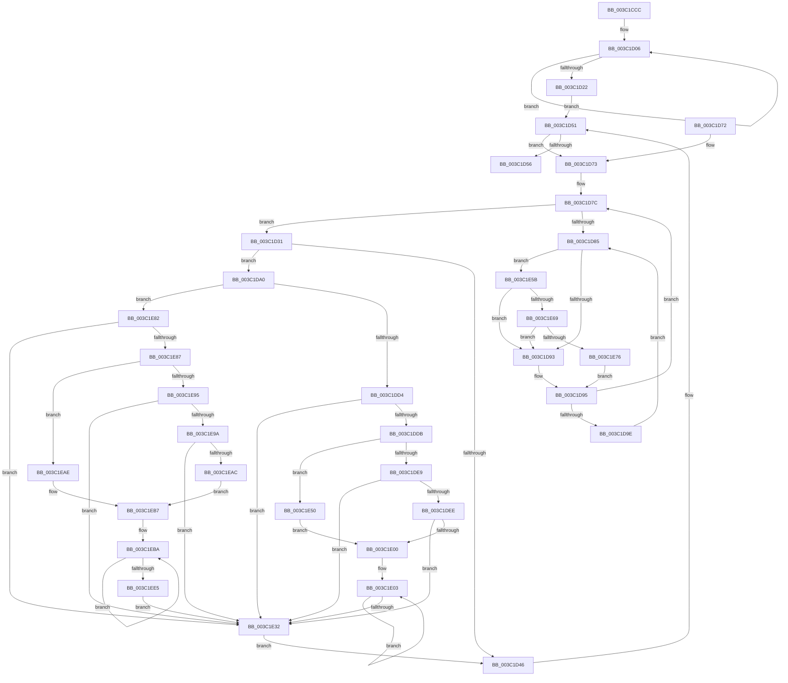

# KeSetProcessPpmPolicy

- RVA: `0x003C1CCC`–`0x003C1EEA` (길이 `542` bytes)
- VA: `0x00000001403C1CCC`
- 실행 섹션: `.text`
- PDB 이름 있음: `예`; PDB Function 태그: `아니요`
- unwind 정보 RVA: `0x0008E1A4`
- 디코드: `155`개 명령, `542/542` bytes 표시
- 미해석 바이트: `0` (있으면 어셈블리에 `.byte`로 보존)

> 이 문서는 커널 이미지의 기계어와 PDB 기호를 분석해 생성했습니다. 4번과 5번은 함수 원형과 자료형을 바이너리 사용 방식에서 추정한 C 해석이며 원본 소스 복구 결과는 아닙니다.

## 1. Dependencies

- 직접 호출 지점: **9**; 고유 호출 대상: **8**
- 직접 호출자로 확인된 함수: **2**
- RIP 상대 이미지 참조: **2**

### Outgoing calls
- `0x003C1CFE` → [KiAcquireProcessLockExclusive](KiAcquireProcessLockExclusive_function_003C26B8.md) (function, `0x003C26B8`)
- `0x003C1D34` → [KiComputeThreadQos](../25/KiComputeThreadQos_function_00258010.md) (function, `0x00258010`)
- `0x003C1D5C` → [KiReleaseProcessLockExclusive](KiReleaseProcessLockExclusive_function_003C2660.md) (function, `0x003C2660`)
- `0x003C1DB8` → [KiAcquireThreadStateLockForWrite](../30/KiAcquireThreadStateLockForWrite_function_0030E8C0.md) (function, `0x0030E8C0`)
- `0x003C1E23` → [KiUpdateThreadQosGroupingSummaries](../25/KiUpdateThreadQosGroupingSummaries_function_00257AEC.md) (function, `0x00257AEC`)
- `0x003C1E46` → [KiReleaseThreadStateLock](../21/KiReleaseThreadStateLock_function_00217910.md) (function, `0x00217910`)
- `0x003C1E69` → [KiCheckVpBackingLongSpinWaitHypercall](../30/KiCheckVpBackingLongSpinWaitHypercall_function_0030F490.md) (function, `0x0030F490`)
- `0x003C1E78` → [HvlNotifyLongSpinWait](../30/HvlNotifyLongSpinWait_function_0030F460.md) (function, `0x0030F460`)
- `0x003C1ED6` → [KiUpdateThreadQosGroupingSummaries](../25/KiUpdateThreadQosGroupingSummaries_function_00257AEC.md) (function, `0x00257AEC`)

### Direct callers
- [PspRefreshProcessUserPresencePpmPolicyCallback](../5E/PspRefreshProcessUserPresencePpmPolicyCallback_function_005E3100.md) at `0x005E319A`
- [PspSetProcessPpmPolicy](../../page/AE/PspSetProcessPpmPolicy_function_00AE34F0.md) at `0x00AE35A3`
- [PspSetProcessPpmPolicy](../../page/AE/PspSetProcessPpmPolicy_function_00AE34F0.md) at `0x00AE35E7`

### Static image references
- `0x003C1D87` → RVA `0x00FC52AC` (`ALMOSTRO`; reference)
- `0x003C1E5B` → RVA `0x00FC6AB8` (`ALMOSTRO`; read)

## 2. Other-region calls and transfers

- 다른 실행 섹션으로 향하는 call: **0**
- 별도 외부 분기/꼬리 이동을 확인하지 못했습니다.

## 3. Assembly (complete function range)

```asm
003C1CCC  40 55                           push rbp
003C1CCE  53                              push rbx
003C1CCF  56                              push rsi
003C1CD0  57                              push rdi
003C1CD1  41 54                           push r12
003C1CD3  41 55                           push r13
003C1CD5  41 56                           push r14
003C1CD7  41 57                           push r15
003C1CD9  48 8B EC                        mov rbp, rsp
003C1CDC  48 83 EC 68                     sub rsp, 0x68
003C1CE0  48 83 65 58 00                  and qword ptr [rbp + 0x58], 0
003C1CE5  8B DA                           mov ebx, edx
003C1CE7  48 83 65 60 00                  and qword ptr [rbp + 0x60], 0
003C1CEC  48 8D 55 50                     lea rdx, [rbp + 0x50]
003C1CF0  0F 57 C0                        xorps xmm0, xmm0
003C1CF3  C6 45 50 00                     mov byte ptr [rbp + 0x50], 0
003C1CF7  0F 11 45 E0                     movups xmmword ptr [rbp - 0x20], xmm0
003C1CFB  4C 8B F1                        mov r14, rcx
003C1CFE  E8 B5 09 00 00                  call 0x1403c26b8
003C1D03  C1 E3 07                        shl ebx, 7
003C1D06  41 8B 86 88 00 00 00            mov eax, dword ptr [r14 + 0x88]
003C1D0D  8B C8                           mov ecx, eax
003C1D0F  81 E1 7F F8 FF FF               and ecx, 0xfffff87f
003C1D15  0B CB                           or ecx, ebx
003C1D17  F0 41 0F B1 8E 88 00 00 00      lock cmpxchg dword ptr [r14 + 0x88], ecx
003C1D20  75 E4                           jne 0x1403c1d06
003C1D22  48 83 65 C8 00                  and qword ptr [rbp - 0x38], 0
003C1D27  4D 8D 66 30                     lea r12, [r14 + 0x30]
003C1D2B  49 8B 34 24                     mov rsi, qword ptr [r12]
003C1D2F  EB 20                           jmp 0x1403c1d51
003C1D31  48 8B CB                        mov rcx, rbx
003C1D34  E8 D7 62 E9 FF                  call 0x140258010
003C1D39  0F B6 8B 04 02 00 00            movzx ecx, byte ptr [rbx + 0x204]
003C1D40  8B F8                           mov edi, eax
003C1D42  3B C1                           cmp eax, ecx
003C1D44  75 5A                           jne 0x1403c1da0
003C1D46  48 C7 43 40 00 00 00 00         mov qword ptr [rbx + 0x40], 0
003C1D4E  48 8B 36                        mov rsi, qword ptr [rsi]
003C1D51  49 3B F4                        cmp rsi, r12
003C1D54  75 1D                           jne 0x1403c1d73
003C1D56  8A 55 50                        mov dl, byte ptr [rbp + 0x50]
003C1D59  49 8B CE                        mov rcx, r14
003C1D5C  E8 FF 08 00 00                  call 0x1403c2660
003C1D61  48 83 C4 68                     add rsp, 0x68
003C1D65  41 5F                           pop r15
003C1D67  41 5E                           pop r14
003C1D69  41 5D                           pop r13
003C1D6B  41 5C                           pop r12
003C1D6D  5F                              pop rdi
003C1D6E  5E                              pop rsi
003C1D6F  5B                              pop rbx
003C1D70  5D                              pop rbp
003C1D71  C3                              ret
003C1D72  CC                              int3
003C1D73  48 8D 9E 08 FD FF FF            lea rbx, [rsi - 0x2f8]
003C1D7A  33 FF                           xor edi, edi
003C1D7C  F0 48 0F BA 6B 40 00            lock bts qword ptr [rbx + 0x40], 0
003C1D83  73 AC                           jae 0x1403c1d31
003C1D85  FF C7                           inc edi
003C1D87  85 3D 1F 35 C0 00               test dword ptr [rip + 0xc0351f], edi
003C1D8D  0F 84 C8 00 00 00               je 0x1403c1e5b
003C1D93  F3 90                           pause
003C1D95  48 8B 43 40                     mov rax, qword ptr [rbx + 0x40]
003C1D99  48 85 C0                        test rax, rax
003C1D9C  74 DE                           je 0x1403c1d7c
003C1D9E  EB E5                           jmp 0x1403c1d85
003C1DA0  48 8D 45 E0                     lea rax, [rbp - 0x20]
003C1DA4  48 8B CB                        mov rcx, rbx
003C1DA7  4C 8D 4D 60                     lea r9, [rbp + 0x60]
003C1DAB  48 89 44 24 20                  mov qword ptr [rsp + 0x20], rax
003C1DB0  4C 8D 45 C8                     lea r8, [rbp - 0x38]
003C1DB4  48 8D 55 58                     lea rdx, [rbp + 0x58]
003C1DB8  E8 03 CB F4 FF                  call 0x14030e8c0
003C1DBD  0F B6 C8                        movzx ecx, al
003C1DC0  40 88 BB 04 02 00 00            mov byte ptr [rbx + 0x204], dil
003C1DC7  48 8B 7D 58                     mov rdi, qword ptr [rbp + 0x58]
003C1DCB  83 E9 02                        sub ecx, 2
003C1DCE  0F 85 AE 00 00 00               jne 0x1403c1e82
003C1DD4  48 83 7F 10 00                  cmp qword ptr [rdi + 0x10], 0
003C1DD9  75 57                           jne 0x1403c1e32
003C1DDB  8B 4B 78                        mov ecx, dword ptr [rbx + 0x78]
003C1DDE  D1 E9                           shr ecx, 1
003C1DE0  48 89 7D D8                     mov qword ptr [rbp - 0x28], rdi
003C1DE4  83 E1 01                        and ecx, 1
003C1DE7  74 67                           je 0x1403c1e50
003C1DE9  83 F9 01                        cmp ecx, 1
003C1DEC  75 44                           jne 0x1403c1e32
003C1DEE  48 8B 87 58 8E 00 00            mov rax, qword ptr [rdi + 0x8e58]
003C1DF5  0F B6 08                        movzx ecx, byte ptr [rax]
003C1DF8  4C 8D 78 08                     lea r15, [rax + 8]
003C1DFC  85 C9                           test ecx, ecx
003C1DFE  74 32                           je 0x1403c1e32
003C1E00  44 8B E9                        mov r13d, ecx
003C1E03  49 8B 0F                        mov rcx, qword ptr [r15]
003C1E06  4C 8B 49 38                     mov r9, qword ptr [rcx + 0x38]
003C1E0A  41 8A 41 40                     mov al, byte ptr [r9 + 0x40]
003C1E0E  44 8A C0                        mov r8b, al
003C1E11  44 32 83 04 02 00 00            xor r8b, byte ptr [rbx + 0x204]
003C1E18  41 80 E0 07                     and r8b, 7
003C1E1C  41 32 C0                        xor al, r8b
003C1E1F  41 88 41 40                     mov byte ptr [r9 + 0x40], al
003C1E23  E8 C4 5C E9 FF                  call 0x140257aec
003C1E28  4D 8D 7F 08                     lea r15, [r15 + 8]
003C1E2C  49 83 ED 01                     sub r13, 1
003C1E30  75 D1                           jne 0x1403c1e03
003C1E32  4C 8B 4D 60                     mov r9, qword ptr [rbp + 0x60]
003C1E36  48 8D 45 E0                     lea rax, [rbp - 0x20]
003C1E3A  4C 8D 45 C8                     lea r8, [rbp - 0x38]
003C1E3E  48 89 44 24 20                  mov qword ptr [rsp + 0x20], rax
003C1E43  48 8B D7                        mov rdx, rdi
003C1E46  E8 C5 5A E5 FF                  call 0x140217910
003C1E4B  E9 F6 FE FF FF                  jmp 0x1403c1d46
003C1E50  4C 8D 7D D8                     lea r15, [rbp - 0x28]
003C1E54  B9 01 00 00 00                  mov ecx, 1
003C1E59  EB A5                           jmp 0x1403c1e00
003C1E5B  8B 05 57 4C C0 00               mov eax, dword ptr [rip + 0xc04c57]
003C1E61  A8 40                           test al, 0x40
003C1E63  0F 84 2A FF FF FF               je 0x1403c1d93
003C1E69  E8 22 D6 F4 FF                  call 0x14030f490
003C1E6E  84 C0                           test al, al
003C1E70  0F 84 1D FF FF FF               je 0x1403c1d93
003C1E76  8B CF                           mov ecx, edi
003C1E78  E8 E3 D5 F4 FF                  call 0x14030f460
003C1E7D  E9 13 FF FF FF                  jmp 0x1403c1d95
003C1E82  83 F9 01                        cmp ecx, 1
003C1E85  75 AB                           jne 0x1403c1e32
003C1E87  8B 4B 78                        mov ecx, dword ptr [rbx + 0x78]
003C1E8A  D1 E9                           shr ecx, 1
003C1E8C  48 89 7D D0                     mov qword ptr [rbp - 0x30], rdi
003C1E90  83 E1 01                        and ecx, 1
003C1E93  74 19                           je 0x1403c1eae
003C1E95  83 F9 01                        cmp ecx, 1
003C1E98  75 98                           jne 0x1403c1e32
003C1E9A  48 8B 87 58 8E 00 00            mov rax, qword ptr [rdi + 0x8e58]
003C1EA1  0F B6 08                        movzx ecx, byte ptr [rax]
003C1EA4  4C 8D 78 08                     lea r15, [rax + 8]
003C1EA8  85 C9                           test ecx, ecx
003C1EAA  74 86                           je 0x1403c1e32
003C1EAC  EB 09                           jmp 0x1403c1eb7
003C1EAE  4C 8D 7D D0                     lea r15, [rbp - 0x30]
003C1EB2  B9 01 00 00 00                  mov ecx, 1
003C1EB7  44 8B E9                        mov r13d, ecx
003C1EBA  49 8B 0F                        mov rcx, qword ptr [r15]
003C1EBD  4C 8B 41 38                     mov r8, qword ptr [rcx + 0x38]
003C1EC1  41 8A 40 40                     mov al, byte ptr [r8 + 0x40]
003C1EC5  8A D0                           mov dl, al
003C1EC7  32 93 04 02 00 00               xor dl, byte ptr [rbx + 0x204]
003C1ECD  80 E2 07                        and dl, 7
003C1ED0  32 C2                           xor al, dl
003C1ED2  41 88 40 40                     mov byte ptr [r8 + 0x40], al
003C1ED6  E8 11 5C E9 FF                  call 0x140257aec
003C1EDB  4D 8D 7F 08                     lea r15, [r15 + 8]
003C1EDF  49 83 ED 01                     sub r13, 1
003C1EE3  75 D5                           jne 0x1403c1eba
003C1EE5  E9 48 FF FF FF                  jmp 0x1403c1e32
```

## 4. C-style interpretation (structured pseudocode)

```c
__int64 __fastcall KeSetProcessPpmPolicy(__int64 a1, int a2)
{
    __int64 result;
    __int64 v_r13;
    __int64 v_rbx;
    __int64 v_rdi;
    __int64 v_rsp;
    unsigned __int64 v_stack_m60;
    unsigned __int64 v_stack_m68;
    unsigned __int64 v_stack_m70;
    unsigned __int64 v_stack_m78;
    unsigned __int64 v_stack_p10;
    unsigned __int64 v_stack_p18;
    unsigned __int64 v_stack_p20;

    v_rsp = (v_rsp) - (104);
    v_stack_p10 = 0;
    v_stack_m60 = v_xmm0;
    result = KiAcquireProcessLockExclusive(a1, v_stack_p10, a3, a4);
    v_rbx = (unsigned int)(((unsigned int)(a2)) << (7));
loc_003C1D06:
    a1 = (unsigned int)(((unsigned int)((unsigned int)((unsigned int)(*(unsigned int *)(a1 + 136))))) & (0xFFFFF87FULL));
    a1 = (unsigned int)((a1) | ((unsigned int)(v_rbx)));
    if (condition_is_not_equal) goto loc_003C1D06;
    goto loc_003C1D51;
loc_003C1D31:
    result = KiComputeThreadQos(v_rbx, v_stack_p10, a3, a4);
    if (((unsigned int)(result)) != ((unsigned int)(*(unsigned __int8 *)(v_rbx + 516)))) goto loc_003C1DA0;
loc_003C1D46:
    *(unsigned __int64 *)(v_rbx + 64) = 0;
loc_003C1D51:
    if ((*(unsigned __int64 *)(*(unsigned __int64 *)(a1 + 48))) != (a1 + 48)) goto loc_003C1D73;
    result = KiReleaseProcessLockExclusive(a1, v_stack_p10, a3, a4);
    v_rsp = (v_rsp) + (104);
    return result;
loc_003C1D73:
    v_rdi = 0;
loc_003C1D7C:
    if (condition_is_above_or_equal) goto loc_003C1D31;
loc_003C1D85:
    v_rdi = (unsigned int)((v_rdi) + 1);
    if (((*(unsigned int *)(v_rip + 12596511)) & ((unsigned int)(v_rdi))) == 0) goto loc_003C1E5B;
loc_003C1D93:
loc_003C1D95:
    if (*(unsigned __int64 *)(*(unsigned __int64 *)(*(unsigned __int64 *)(a1 + 48)) - 760 + 64) == 0) goto loc_003C1D7C;
    goto loc_003C1D85;
loc_003C1DA0:
    v_stack_p20 = v_stack_m60;
    result = KiAcquireThreadStateLockForWrite(*(unsigned __int64 *)(*(unsigned __int64 *)(a1 + 48)) - 760, v_stack_p18, v_stack_m78, v_stack_p20);
    *(unsigned __int8 *)(*(unsigned __int64 *)(*(unsigned __int64 *)(a1 + 48)) - 760 + 516) = (unsigned __int8)(v_rdi);
    a1 = (unsigned int)(((unsigned __int8)(result)) - (2));
    if (condition_is_not_equal) goto loc_003C1E82;
    if ((*(unsigned __int64 *)(v_stack_p18 + 16)) != 0) goto loc_003C1E32;
    a1 = (unsigned int)(((unsigned int)(*(unsigned int *)(*(unsigned __int64 *)(*(unsigned __int64 *)(a1 + 48)) - 760 + 120))) >> (1));
    v_stack_m68 = v_stack_p18;
    a1 = (unsigned int)((a1) & (1));
    if (condition_is_equal) goto loc_003C1E50;
    if (((unsigned int)(a1)) != 1) goto loc_003C1E32;
    if ((unsigned int)(*(unsigned __int8 *)(*(unsigned __int64 *)(v_stack_p18 + 36440))) == 0) goto loc_003C1E32;
loc_003C1E00:
loc_003C1E03:
    a3 = (unsigned __int8)(((unsigned __int8)(*(unsigned __int8 *)(*(unsigned __int64 *)(*(unsigned __int64 *)(*(unsigned __int64 *)(v_stack_p18 + 36440) + 8) + 56) + 64))) ^ (*(unsigned __int8 *)(*(unsigned __int64 *)(*(unsigned __int64 *)(a1 + 48)) - 760 + 516)));
    a3 = (unsigned __int8)((a3) & (7));
    result = (unsigned __int8)((*(unsigned __int8 *)(*(unsigned __int64 *)(*(unsigned __int64 *)(*(unsigned __int64 *)(v_stack_p18 + 36440) + 8) + 56) + 64)) ^ ((unsigned __int8)(a3)));
    *(unsigned __int8 *)(*(unsigned __int64 *)(*(unsigned __int64 *)(*(unsigned __int64 *)(v_stack_p18 + 36440) + 8) + 56) + 64) = (unsigned __int8)(result);
    result = KiUpdateThreadQosGroupingSummaries(*(unsigned __int64 *)(*(unsigned __int64 *)(v_stack_p18 + 36440) + 8), v_stack_p18, a3, *(unsigned __int64 *)(*(unsigned __int64 *)(*(unsigned __int64 *)(v_stack_p18 + 36440) + 8) + 56));
    v_r13 = ((unsigned int)((unsigned int)(*(unsigned __int8 *)(*(unsigned __int64 *)(v_stack_p18 + 36440))))) - (1);
    if (condition_is_not_equal) goto loc_003C1E03;
loc_003C1E32:
    v_stack_p20 = v_stack_m60;
    result = KiReleaseThreadStateLock(*(unsigned __int64 *)(*(unsigned __int64 *)(v_stack_p18 + 36440) + 8), v_stack_p18, v_stack_m78, v_stack_p20);
    goto loc_003C1D46;
loc_003C1E50:
    goto loc_003C1E00;
loc_003C1E5B:
    if ((((unsigned __int8)((unsigned int)(*(unsigned int *)(v_rip + 12602455)))) & (64)) == 0) goto loc_003C1D93;
    result = KiCheckVpBackingLongSpinWaitHypercall(1, v_stack_p18, v_stack_m78, v_stack_p20);
    if ((unsigned __int8)(result) == 0) goto loc_003C1D93;
    result = HvlNotifyLongSpinWait((unsigned int)((unsigned int)(v_stack_p18)), v_stack_p18, v_stack_m78, v_stack_p20);
    goto loc_003C1D95;
loc_003C1E82:
    if (((unsigned int)((unsigned int)((unsigned int)(v_stack_p18)))) != 1) goto loc_003C1E32;
    a1 = (unsigned int)(((unsigned int)(*(unsigned int *)(*(unsigned __int64 *)(*(unsigned __int64 *)(a1 + 48)) - 760 + 120))) >> (1));
    v_stack_m70 = v_stack_p18;
    a1 = (unsigned int)((a1) & (1));
    if (condition_is_equal) goto loc_003C1EAE;
    if (((unsigned int)(a1)) != 1) goto loc_003C1E32;
    if ((unsigned int)(*(unsigned __int8 *)(*(unsigned __int64 *)(v_stack_p18 + 36440))) == 0) goto loc_003C1E32;
    goto loc_003C1EB7;
loc_003C1EAE:
loc_003C1EB7:
loc_003C1EBA:
    a2 = (unsigned __int8)(((unsigned __int8)(*(unsigned __int8 *)(*(unsigned __int64 *)(*(unsigned __int64 *)(v_stack_m70) + 56) + 64))) ^ (*(unsigned __int8 *)(*(unsigned __int64 *)(*(unsigned __int64 *)(a1 + 48)) - 760 + 516)));
    a2 = (unsigned __int8)((a2) & (7));
    result = (unsigned __int8)((*(unsigned __int8 *)(*(unsigned __int64 *)(*(unsigned __int64 *)(v_stack_m70) + 56) + 64)) ^ ((unsigned __int8)(a2)));
    *(unsigned __int8 *)(*(unsigned __int64 *)(*(unsigned __int64 *)(v_stack_m70) + 56) + 64) = (unsigned __int8)(result);
    result = KiUpdateThreadQosGroupingSummaries(*(unsigned __int64 *)(v_stack_m70), a2, *(unsigned __int64 *)(*(unsigned __int64 *)(v_stack_m70) + 56), v_stack_p20);
    v_r13 = (1) - (1);
    if (condition_is_not_equal) goto loc_003C1EBA;
    goto loc_003C1E32;
}
```

## 5. (Beta) C Style

```c
int64_t KeSetProcessPpmPolicy(void *Arg1, int32_t Arg2)
{
    uint8_t *arg1 = (uint8_t *)Arg1;

    int64_t result;
    int64_t local_r13;
    int64_t local_rbx;
    int64_t local_rdi;
    int64_t local_rsp;
    uint64_t v_stack_m60;
    uint64_t v_stack_m68;
    uint64_t v_stack_m70;
    uint64_t v_stack_m78;
    uint64_t v_stack_p10;
    uint64_t v_stack_p18;
    uint64_t v_stack_p20;

    local_rsp = (local_rsp) - (104);
    v_stack_p10 = 0;
    v_stack_m60 = v_xmm0;
    result = KiAcquireProcessLockExclusive(Arg1, v_stack_p10, a3, a4);
    local_rbx = (uint32_t)(((uint32_t)(Arg2)) << (7));
loc_003C1D06:
    Arg1 = (uint32_t)(((uint32_t)((uint32_t)((uint32_t)(*(uint32_t *)(arg1 + 0x88))))) & (0xFFFFF87FULL));
    Arg1 = (uint32_t)((Arg1) | ((uint32_t)(local_rbx)));
    if (condition_is_not_equal) goto loc_003C1D06;
    goto loc_003C1D51;
loc_003C1D31:
    result = KiComputeThreadQos(local_rbx, v_stack_p10, a3, a4);
    if (((uint32_t)(result)) != ((uint32_t)(*(uint8_t *)(local_rbx + 0x204)))) goto loc_003C1DA0;
loc_003C1D46:
    *(uint64_t *)(local_rbx + 0x40) = 0;
loc_003C1D51:
    if ((*(uint64_t *)(*(uint64_t *)(arg1 + 0x30))) != (Arg1 + 48)) goto loc_003C1D73;
    result = KiReleaseProcessLockExclusive(Arg1, v_stack_p10, a3, a4);
    local_rsp = (local_rsp) + (104);
    return result;
loc_003C1D73:
    local_rdi = 0;
loc_003C1D7C:
    if (condition_is_above_or_equal) goto loc_003C1D31;
loc_003C1D85:
    local_rdi = (uint32_t)((local_rdi) + 1);
    if (((*(uint32_t *)(v_rip + 0xC0351F)) & ((uint32_t)(local_rdi))) == 0) goto loc_003C1E5B;
loc_003C1D93:
loc_003C1D95:
    if (*(uint64_t *)(*(uint64_t *)(*(uint64_t *)(arg1 + 0x30)) - 0x2F8 + 0x40) == 0) goto loc_003C1D7C;
    goto loc_003C1D85;
loc_003C1DA0:
    v_stack_p20 = v_stack_m60;
    result = KiAcquireThreadStateLockForWrite(*(uint64_t *)(*(uint64_t *)(arg1 + 0x30)) - 760, v_stack_p18, v_stack_m78, v_stack_p20);
    *(uint8_t *)(*(uint64_t *)(*(uint64_t *)(arg1 + 0x30)) - 0x2F8 + 0x204) = (uint8_t)(local_rdi);
    Arg1 = (uint32_t)(((uint8_t)(result)) - (2));
    if (condition_is_not_equal) goto loc_003C1E82;
    if ((*(uint64_t *)(v_stack_p18 + 0x10)) != 0) goto loc_003C1E32;
    Arg1 = (uint32_t)(((uint32_t)(*(uint32_t *)(*(uint64_t *)(*(uint64_t *)(arg1 + 0x30)) - 0x2F8 + 0x78))) >> (1));
    v_stack_m68 = v_stack_p18;
    Arg1 = (uint32_t)((Arg1) & (1));
    if (condition_is_equal) goto loc_003C1E50;
    if (((uint32_t)(Arg1)) != 1) goto loc_003C1E32;
    if ((uint32_t)(*(uint8_t *)(*(uint64_t *)(v_stack_p18 + 0x8E58))) == 0) goto loc_003C1E32;
loc_003C1E00:
loc_003C1E03:
    a3 = (uint8_t)(((uint8_t)(*(uint8_t *)(*(uint64_t *)(*(uint64_t *)(*(uint64_t *)(v_stack_p18 + 0x8E58) + 0x8) + 0x38) + 0x40))) ^ (*(uint8_t *)(*(uint64_t *)(*(uint64_t *)(arg1 + 0x30)) - 0x2F8 + 0x204)));
    a3 = (uint8_t)((a3) & (7));
    result = (uint8_t)((*(uint8_t *)(*(uint64_t *)(*(uint64_t *)(*(uint64_t *)(v_stack_p18 + 0x8E58) + 0x8) + 0x38) + 0x40)) ^ ((uint8_t)(a3)));
    *(uint8_t *)(*(uint64_t *)(*(uint64_t *)(*(uint64_t *)(v_stack_p18 + 0x8E58) + 0x8) + 0x38) + 0x40) = (uint8_t)(result);
    result = KiUpdateThreadQosGroupingSummaries(*(uint64_t *)(*(uint64_t *)(v_stack_p18 + 0x8E58) + 0x8), v_stack_p18, a3, *(uint64_t *)(*(uint64_t *)(*(uint64_t *)(v_stack_p18 + 0x8E58) + 0x8) + 0x38));
    local_r13 = ((uint32_t)((uint32_t)(*(uint8_t *)(*(uint64_t *)(v_stack_p18 + 0x8E58))))) - (1);
    if (condition_is_not_equal) goto loc_003C1E03;
loc_003C1E32:
    v_stack_p20 = v_stack_m60;
    result = KiReleaseThreadStateLock(*(uint64_t *)(*(uint64_t *)(v_stack_p18 + 0x8E58) + 0x8), v_stack_p18, v_stack_m78, v_stack_p20);
    goto loc_003C1D46;
loc_003C1E50:
    goto loc_003C1E00;
loc_003C1E5B:
    if ((((uint8_t)((uint32_t)(*(uint32_t *)(v_rip + 0xC04C57)))) & (64)) == 0) goto loc_003C1D93;
    result = KiCheckVpBackingLongSpinWaitHypercall(1, v_stack_p18, v_stack_m78, v_stack_p20);
    if ((uint8_t)(result) == 0) goto loc_003C1D93;
    result = HvlNotifyLongSpinWait((uint32_t)((uint32_t)(v_stack_p18)), v_stack_p18, v_stack_m78, v_stack_p20);
    goto loc_003C1D95;
loc_003C1E82:
    if (((uint32_t)((uint32_t)((uint32_t)(v_stack_p18)))) != 1) goto loc_003C1E32;
    Arg1 = (uint32_t)(((uint32_t)(*(uint32_t *)(*(uint64_t *)(*(uint64_t *)(arg1 + 0x30)) - 0x2F8 + 0x78))) >> (1));
    v_stack_m70 = v_stack_p18;
    Arg1 = (uint32_t)((Arg1) & (1));
    if (condition_is_equal) goto loc_003C1EAE;
    if (((uint32_t)(Arg1)) != 1) goto loc_003C1E32;
    if ((uint32_t)(*(uint8_t *)(*(uint64_t *)(v_stack_p18 + 0x8E58))) == 0) goto loc_003C1E32;
    goto loc_003C1EB7;
loc_003C1EAE:
loc_003C1EB7:
loc_003C1EBA:
    Arg2 = (uint8_t)(((uint8_t)(*(uint8_t *)(*(uint64_t *)(*(uint64_t *)(v_stack_m70) + 0x38) + 0x40))) ^ (*(uint8_t *)(*(uint64_t *)(*(uint64_t *)(arg1 + 0x30)) - 0x2F8 + 0x204)));
    Arg2 = (uint8_t)((Arg2) & (7));
    result = (uint8_t)((*(uint8_t *)(*(uint64_t *)(*(uint64_t *)(v_stack_m70) + 0x38) + 0x40)) ^ ((uint8_t)(Arg2)));
    *(uint8_t *)(*(uint64_t *)(*(uint64_t *)(v_stack_m70) + 0x38) + 0x40) = (uint8_t)(result);
    result = KiUpdateThreadQosGroupingSummaries(*(uint64_t *)(v_stack_m70), Arg2, *(uint64_t *)(*(uint64_t *)(v_stack_m70) + 0x38), v_stack_p20);
    local_r13 = (1) - (1);
    if (condition_is_not_equal) goto loc_003C1EBA;
    goto loc_003C1E32;
}
```

### 관측된 메모리 오프셋

구조체 형식이 확인되지 않은 접근은 인자 기준의 오프셋으로만 기록했습니다.

| 기준 인자 | 오프셋 표현 | 폭 (bit) | 접근 |
|---|---:|---:|---|
| `Arg1` | `+ 0x0` | `64` | `R` |
| `Arg1` | `+ 0x30` | `64` | `R` |
| `Arg1` | `+ 0x88` | `32` | `R` |

## 6. Execution-region graph

[열기: 2D/3D 그래프와 함수 탐색 컨트롤 패널](../../../control-panel.html?section=text&rva=0x003C1CCC&view=graph)

- 2D 그래프는 위에서 아래로 흐르고, 3D 그래프는 빈 공간을 드래그해 회전합니다. Shift+드래그는 이동, 휠은 확대·축소, 함수 노드 선택은 대상 보고서 이동입니다.

### Static fallback


