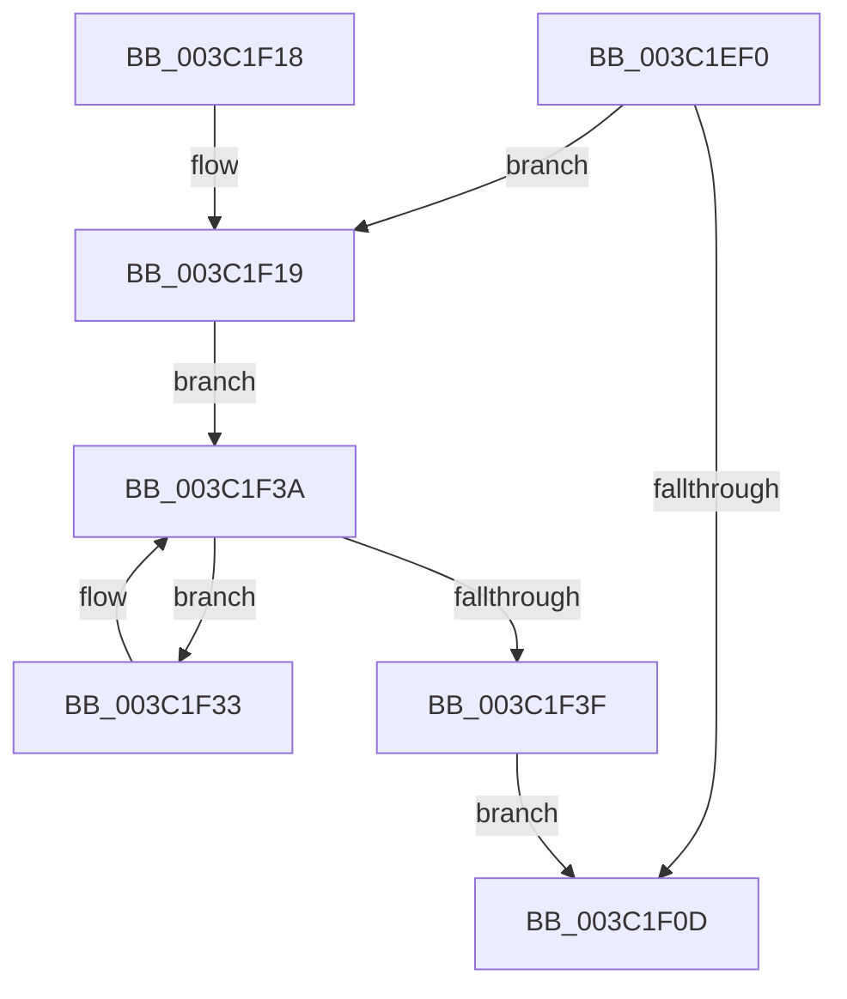

# KeSetQuantumProcess

- RVA: `0x003C1EF0`–`0x003C1F4D` (길이 `93` bytes)
- VA: `0x00000001403C1EF0`
- 실행 섹션: `.text`
- PDB 이름 있음: `예`; PDB Function 태그: `아니요`
- unwind 정보 RVA: `0x0008E1C0`
- 디코드: `27`개 명령, `93/93` bytes 표시
- 미해석 바이트: `0` (있으면 어셈블리에 `.byte`로 보존)

> 이 문서는 커널 이미지의 기계어와 PDB 기호를 분석해 생성했습니다. 4번과 5번은 함수 원형과 자료형을 바이너리 사용 방식에서 추정한 C 해석이며 원본 소스 복구 결과는 아닙니다.

## 1. Dependencies

- 직접 호출 지점: **2**; 고유 호출 대상: **2**
- 직접 호출자로 확인된 함수: **3**
- RIP 상대 이미지 참조: **0**

### Outgoing calls
- `0x003C1F1E` → [KiAcquireProcessLockExclusive](KiAcquireProcessLockExclusive_function_003C26B8.md) (function, `0x003C26B8`)
- `0x003C1F46` → [KiReleaseProcessLockExclusive](KiReleaseProcessLockExclusive_function_003C2660.md) (function, `0x003C2660`)

### Direct callers
- [KeSetPriorityAndQuantumProcess](KeSetPriorityAndQuantumProcess_function_003C2EC0.md) at `0x003C3029`
- [PsChangeQuantumTable](../../page/A3/PsChangeQuantumTable_function_00A3BE70.md) at `0x00A3BF5C`
- [PspApplyJobLimitsToProcess](../../page/A5/PspApplyJobLimitsToProcess_function_00A57274.md) at `0x00A573CF`

### Static image references
- 디코드된 RIP-relative 메모리 참조가 없습니다.

## 2. Other-region calls and transfers

- 다른 실행 섹션으로 향하는 call: **0**
- 별도 외부 분기/꼬리 이동을 확인하지 못했습니다.

## 3. Assembly (complete function range)

```asm
003C1EF0  48 89 5C 24 08                  mov qword ptr [rsp + 8], rbx
003C1EF5  57                              push rdi
003C1EF6  48 83 EC 20                     sub rsp, 0x20
003C1EFA  40 8A FA                        mov dil, dl
003C1EFD  48 8B D9                        mov rbx, rcx
003C1F00  C6 44 24 38 00                  mov byte ptr [rsp + 0x38], 0
003C1F05  38 91 91 00 00 00               cmp byte ptr [rcx + 0x91], dl
003C1F0B  75 0C                           jne 0x1403c1f19
003C1F0D  48 8B 5C 24 30                  mov rbx, qword ptr [rsp + 0x30]
003C1F12  48 83 C4 20                     add rsp, 0x20
003C1F16  5F                              pop rdi
003C1F17  C3                              ret
003C1F18  CC                              int3
003C1F19  48 8D 54 24 38                  lea rdx, [rsp + 0x38]
003C1F1E  E8 95 07 00 00                  call 0x1403c26b8
003C1F23  48 8D 4B 30                     lea rcx, [rbx + 0x30]
003C1F27  40 88 BB 91 00 00 00            mov byte ptr [rbx + 0x91], dil
003C1F2E  48 8B 01                        mov rax, qword ptr [rcx]
003C1F31  EB 07                           jmp 0x1403c1f3a
003C1F33  40 88 78 93                     mov byte ptr [rax - 0x6d], dil
003C1F37  48 8B 00                        mov rax, qword ptr [rax]
003C1F3A  48 3B C1                        cmp rax, rcx
003C1F3D  75 F4                           jne 0x1403c1f33
003C1F3F  8A 54 24 38                     mov dl, byte ptr [rsp + 0x38]
003C1F43  48 8B CB                        mov rcx, rbx
003C1F46  E8 15 07 00 00                  call 0x1403c2660
003C1F4B  EB C0                           jmp 0x1403c1f0d
```

## 4. C-style interpretation (structured pseudocode)

```c
__int64 __fastcall KeSetQuantumProcess(__int64 a1, unsigned __int8 a2)
{
    __int64 result;
    __int64 v_rsp;
    unsigned __int8 v_stack_p10;
    unsigned __int64 v_stack_p38;
    unsigned __int64 v_stack_p8;

    v_stack_p8 = v_rbx;
    v_rsp = (v_rsp) - (32);
    v_stack_p10 = 0;
    if ((*(unsigned __int8 *)(a1 + 145)) != a2) goto loc_003C1F19;
loc_003C1F0D:
    v_rsp = (v_rsp) + (32);
    return result;
loc_003C1F19:
    result = KiAcquireProcessLockExclusive(a1, v_stack_p38, a3, a4);
    *(unsigned __int8 *)(v_stack_p8 + 145) = a2;
    goto loc_003C1F3A;
loc_003C1F33:
    *(unsigned __int8 *)(*(unsigned __int64 *)(v_stack_p8 + 48) - 109) = a2;
loc_003C1F3A:
    if ((*(unsigned __int64 *)(*(unsigned __int64 *)(v_stack_p8 + 48))) != (v_stack_p8 + 48)) goto loc_003C1F33;
    result = KiReleaseProcessLockExclusive(v_stack_p8, v_stack_p38, a3, a4);
    goto loc_003C1F0D;
}
```

## 5. (Beta) C Style

```c
int64_t KeSetQuantumProcess(void *Arg1, uint8_t Arg2)
{
    uint8_t *arg1 = (uint8_t *)Arg1;

    int64_t result;
    int64_t local_rsp;
    uint8_t v_stack_p10;
    uint64_t v_stack_p38;
    uint64_t v_stack_p8;

    v_stack_p8 = local_rbx;
    local_rsp = (local_rsp) - (32);
    v_stack_p10 = 0;
    if ((*(uint8_t *)(arg1 + 0x91)) != Arg2) goto loc_003C1F19;
loc_003C1F0D:
    local_rsp = (local_rsp) + (32);
    return result;
loc_003C1F19:
    result = KiAcquireProcessLockExclusive(Arg1, v_stack_p38, a3, a4);
    *(uint8_t *)(v_stack_p8 + 0x91) = Arg2;
    goto loc_003C1F3A;
loc_003C1F33:
    *(uint8_t *)(*(uint64_t *)(v_stack_p8 + 0x30) - 0x6D) = Arg2;
loc_003C1F3A:
    if ((*(uint64_t *)(*(uint64_t *)(v_stack_p8 + 0x30))) != (v_stack_p8 + 48)) goto loc_003C1F33;
    result = KiReleaseProcessLockExclusive(v_stack_p8, v_stack_p38, a3, a4);
    goto loc_003C1F0D;
}
```

### 관측된 메모리 오프셋

구조체 형식이 확인되지 않은 접근은 인자 기준의 오프셋으로만 기록했습니다.

| 기준 인자 | 오프셋 표현 | 폭 (bit) | 접근 |
|---|---:|---:|---|
| `Arg1` | `+ 0x0` | `64` | `R` |
| `Arg1` | `+ 0x30` | `64` | `R` |
| `Arg1` | `+ 0x91` | `8` | `R` |
| `Arg1` | `+ 0x91` | `8` | `W` |

## 6. Execution-region graph

[열기: 2D/3D 그래프와 함수 탐색 컨트롤 패널](../../../control-panel.html?section=text&rva=0x003C1EF0&view=graph)

- 2D 그래프는 위에서 아래로 흐르고, 3D 그래프는 빈 공간을 드래그해 회전합니다. Shift+드래그는 이동, 휠은 확대·축소, 함수 노드 선택은 대상 보고서 이동입니다.

### Static fallback


