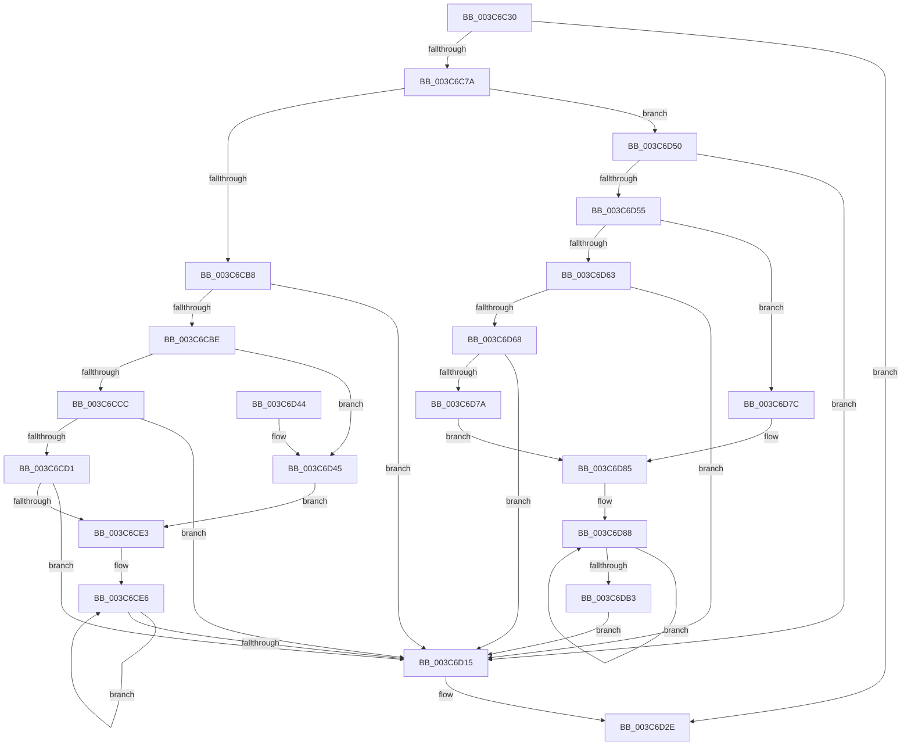

# KeSetThreadPpmPolicy

- RVA: `0x003C6C30`–`0x003C6DB8` (길이 `392` bytes)
- VA: `0x00000001403C6C30`
- 실행 섹션: `.text`
- PDB 이름 있음: `예`; PDB Function 태그: `아니요`
- unwind 정보 RVA: `0x0008E600`
- 디코드: `115`개 명령, `392/392` bytes 표시
- 미해석 바이트: `0` (있으면 어셈블리에 `.byte`로 보존)

> 이 문서는 커널 이미지의 기계어와 PDB 기호를 분석해 생성했습니다. 4번과 5번은 함수 원형과 자료형을 바이너리 사용 방식에서 추정한 C 해석이며 원본 소스 복구 결과는 아닙니다.

## 1. Dependencies

- 직접 호출 지점: **7**; 고유 호출 대상: **6**
- 직접 호출자로 확인된 함수: **1**
- RIP 상대 이미지 참조: **0**

### Outgoing calls
- `0x003C6C56` → [KiAcquireThreadLockRaiseToDpc](../39/KiAcquireThreadLockRaiseToDpc_function_00396280.md) (function, `0x00396280`)
- `0x003C6C64` → [KiComputeThreadQos](../25/KiComputeThreadQos_function_00258010.md) (function, `0x00258010`)
- `0x003C6C9D` → [KiAcquireThreadStateLockForWrite](../30/KiAcquireThreadStateLockForWrite_function_0030E8C0.md) (function, `0x0030E8C0`)
- `0x003C6D06` → [KiUpdateThreadQosGroupingSummaries](../25/KiUpdateThreadQosGroupingSummaries_function_00257AEC.md) (function, `0x00257AEC`)
- `0x003C6D29` → [KiReleaseThreadStateLock](../21/KiReleaseThreadStateLock_function_00217910.md) (function, `0x00217910`)
- `0x003C6D34` → [KiReleaseThreadLockLowerIrql](KiReleaseThreadLockLowerIrql_function_003C65D0.md) (function, `0x003C65D0`)
- `0x003C6DA4` → [KiUpdateThreadQosGroupingSummaries](../25/KiUpdateThreadQosGroupingSummaries_function_00257AEC.md) (function, `0x00257AEC`)

### Direct callers
- [PspSetThreadPpmPolicy](../../page/A5/PspSetThreadPpmPolicy_function_00A56460.md) at `0x00A56483`

### Static image references
- 디코드된 RIP-relative 메모리 참조가 없습니다.

## 2. Other-region calls and transfers

- 다른 실행 섹션으로 향하는 call: **0**
- 별도 외부 분기/꼬리 이동을 확인하지 못했습니다.

## 3. Assembly (complete function range)

```asm
003C6C30  40 55                           push rbp
003C6C32  53                              push rbx
003C6C33  56                              push rsi
003C6C34  57                              push rdi
003C6C35  41 56                           push r14
003C6C37  48 8B EC                        mov rbp, rsp
003C6C3A  48 83 EC 50                     sub rsp, 0x50
003C6C3E  45 33 F6                        xor r14d, r14d
003C6C41  8B DA                           mov ebx, edx
003C6C43  48 8D 55 38                     lea rdx, [rbp + 0x38]
003C6C47  44 88 75 38                     mov byte ptr [rbp + 0x38], r14b
003C6C4B  4C 89 75 30                     mov qword ptr [rbp + 0x30], r14
003C6C4F  48 8B F9                        mov rdi, rcx
003C6C52  4C 89 75 40                     mov qword ptr [rbp + 0x40], r14
003C6C56  E8 25 F6 FC FF                  call 0x140396280
003C6C5B  48 8B CF                        mov rcx, rdi
003C6C5E  88 9F BE 03 00 00               mov byte ptr [rdi + 0x3be], bl
003C6C64  E8 A7 13 E9 FF                  call 0x140258010
003C6C69  0F B6 8F 04 02 00 00            movzx ecx, byte ptr [rdi + 0x204]
003C6C70  8B D8                           mov ebx, eax
003C6C72  3B C1                           cmp eax, ecx
003C6C74  0F 84 B4 00 00 00               je 0x1403c6d2e
003C6C7A  0F 57 C0                        xorps xmm0, xmm0
003C6C7D  4C 89 75 48                     mov qword ptr [rbp + 0x48], r14
003C6C81  48 8D 45 F0                     lea rax, [rbp - 0x10]
003C6C85  48 8B CF                        mov rcx, rdi
003C6C88  4C 8D 4D 40                     lea r9, [rbp + 0x40]
003C6C8C  48 89 44 24 20                  mov qword ptr [rsp + 0x20], rax
003C6C91  4C 8D 45 48                     lea r8, [rbp + 0x48]
003C6C95  48 8D 55 30                     lea rdx, [rbp + 0x30]
003C6C99  0F 11 45 F0                     movups xmmword ptr [rbp - 0x10], xmm0
003C6C9D  E8 1E 7C F4 FF                  call 0x14030e8c0
003C6CA2  0F B6 C8                        movzx ecx, al
003C6CA5  88 9F 04 02 00 00               mov byte ptr [rdi + 0x204], bl
003C6CAB  48 8B 5D 30                     mov rbx, qword ptr [rbp + 0x30]
003C6CAF  83 E9 02                        sub ecx, 2
003C6CB2  0F 85 98 00 00 00               jne 0x1403c6d50
003C6CB8  4C 39 73 10                     cmp qword ptr [rbx + 0x10], r14
003C6CBC  75 57                           jne 0x1403c6d15
003C6CBE  8B 4F 78                        mov ecx, dword ptr [rdi + 0x78]
003C6CC1  D1 E9                           shr ecx, 1
003C6CC3  48 89 5D E8                     mov qword ptr [rbp - 0x18], rbx
003C6CC7  83 E1 01                        and ecx, 1
003C6CCA  74 79                           je 0x1403c6d45
003C6CCC  83 F9 01                        cmp ecx, 1
003C6CCF  75 44                           jne 0x1403c6d15
003C6CD1  48 8B 83 58 8E 00 00            mov rax, qword ptr [rbx + 0x8e58]
003C6CD8  0F B6 08                        movzx ecx, byte ptr [rax]
003C6CDB  48 8D 70 08                     lea rsi, [rax + 8]
003C6CDF  85 C9                           test ecx, ecx
003C6CE1  74 32                           je 0x1403c6d15
003C6CE3  44 8B F1                        mov r14d, ecx
003C6CE6  48 8B 0E                        mov rcx, qword ptr [rsi]
003C6CE9  4C 8B 49 38                     mov r9, qword ptr [rcx + 0x38]
003C6CED  41 8A 41 40                     mov al, byte ptr [r9 + 0x40]
003C6CF1  44 8A C0                        mov r8b, al
003C6CF4  44 32 87 04 02 00 00            xor r8b, byte ptr [rdi + 0x204]
003C6CFB  41 80 E0 07                     and r8b, 7
003C6CFF  41 32 C0                        xor al, r8b
003C6D02  41 88 41 40                     mov byte ptr [r9 + 0x40], al
003C6D06  E8 E1 0D E9 FF                  call 0x140257aec
003C6D0B  48 8D 76 08                     lea rsi, [rsi + 8]
003C6D0F  49 83 EE 01                     sub r14, 1
003C6D13  75 D1                           jne 0x1403c6ce6
003C6D15  4C 8B 4D 40                     mov r9, qword ptr [rbp + 0x40]
003C6D19  48 8D 45 F0                     lea rax, [rbp - 0x10]
003C6D1D  4C 8D 45 48                     lea r8, [rbp + 0x48]
003C6D21  48 89 44 24 20                  mov qword ptr [rsp + 0x20], rax
003C6D26  48 8B D3                        mov rdx, rbx
003C6D29  E8 E2 0B E5 FF                  call 0x140217910
003C6D2E  8A 55 38                        mov dl, byte ptr [rbp + 0x38]
003C6D31  48 8B CF                        mov rcx, rdi
003C6D34  E8 97 F8 FF FF                  call 0x1403c65d0
003C6D39  48 83 C4 50                     add rsp, 0x50
003C6D3D  41 5E                           pop r14
003C6D3F  5F                              pop rdi
003C6D40  5E                              pop rsi
003C6D41  5B                              pop rbx
003C6D42  5D                              pop rbp
003C6D43  C3                              ret
003C6D44  CC                              int3
003C6D45  48 8D 75 E8                     lea rsi, [rbp - 0x18]
003C6D49  B9 01 00 00 00                  mov ecx, 1
003C6D4E  EB 93                           jmp 0x1403c6ce3
003C6D50  83 F9 01                        cmp ecx, 1
003C6D53  75 C0                           jne 0x1403c6d15
003C6D55  8B 4F 78                        mov ecx, dword ptr [rdi + 0x78]
003C6D58  D1 E9                           shr ecx, 1
003C6D5A  48 89 5D E0                     mov qword ptr [rbp - 0x20], rbx
003C6D5E  83 E1 01                        and ecx, 1
003C6D61  74 19                           je 0x1403c6d7c
003C6D63  83 F9 01                        cmp ecx, 1
003C6D66  75 AD                           jne 0x1403c6d15
003C6D68  48 8B 83 58 8E 00 00            mov rax, qword ptr [rbx + 0x8e58]
003C6D6F  0F B6 08                        movzx ecx, byte ptr [rax]
003C6D72  48 8D 70 08                     lea rsi, [rax + 8]
003C6D76  85 C9                           test ecx, ecx
003C6D78  74 9B                           je 0x1403c6d15
003C6D7A  EB 09                           jmp 0x1403c6d85
003C6D7C  48 8D 75 E0                     lea rsi, [rbp - 0x20]
003C6D80  B9 01 00 00 00                  mov ecx, 1
003C6D85  44 8B F1                        mov r14d, ecx
003C6D88  48 8B 0E                        mov rcx, qword ptr [rsi]
003C6D8B  4C 8B 41 38                     mov r8, qword ptr [rcx + 0x38]
003C6D8F  41 8A 40 40                     mov al, byte ptr [r8 + 0x40]
003C6D93  8A D0                           mov dl, al
003C6D95  32 97 04 02 00 00               xor dl, byte ptr [rdi + 0x204]
003C6D9B  80 E2 07                        and dl, 7
003C6D9E  32 C2                           xor al, dl
003C6DA0  41 88 40 40                     mov byte ptr [r8 + 0x40], al
003C6DA4  E8 43 0D E9 FF                  call 0x140257aec
003C6DA9  48 8D 76 08                     lea rsi, [rsi + 8]
003C6DAD  49 83 EE 01                     sub r14, 1
003C6DB1  75 D5                           jne 0x1403c6d88
003C6DB3  E9 5D FF FF FF                  jmp 0x1403c6d15
```

## 4. C-style interpretation (structured pseudocode)

```c
__int64 __fastcall KeSetThreadPpmPolicy(__int64 a1, int a2)
{
    __int64 result;
    __int64 v_r14;
    __int64 v_rsp;
    unsigned __int64 v_stack_m38;
    unsigned __int64 v_stack_m40;
    unsigned __int64 v_stack_m48;
    unsigned __int64 v_stack_m58;
    unsigned __int64 v_stack_p10;
    unsigned __int64 v_stack_p18;
    unsigned __int64 v_stack_p20;
    unsigned __int64 v_stack_p8;

    v_rsp = (v_rsp) - (80);
    v_r14 = 0;
    v_stack_p10 = 0;
    v_stack_p8 = 0;
    v_stack_p18 = 0;
    result = KiAcquireThreadLockRaiseToDpc(a1, v_stack_p10, a3, a4);
    *(unsigned __int8 *)(a1 + 958) = (unsigned __int8)((unsigned int)(a2));
    result = KiComputeThreadQos(a1, v_stack_p10, a3, a4);
    if (((unsigned int)(result)) == ((unsigned int)(*(unsigned __int8 *)(a1 + 516)))) goto loc_003C6D2E;
    v_stack_p20 = 0;
    v_stack_m58 = v_stack_m38;
    v_stack_m38 = v_xmm0;
    result = KiAcquireThreadStateLockForWrite(a1, v_stack_p8, v_stack_p20, v_stack_p18);
    *(unsigned __int8 *)(a1 + 516) = (unsigned __int8)((unsigned int)((unsigned int)(result)));
    a1 = (unsigned int)(((unsigned __int8)(result)) - (2));
    if (condition_is_not_equal) goto loc_003C6D50;
    if ((*(unsigned __int64 *)(v_stack_p8 + 16)) != 0) goto loc_003C6D15;
    a1 = (unsigned int)(((unsigned int)(*(unsigned int *)(a1 + 120))) >> (1));
    v_stack_m40 = v_stack_p8;
    a1 = (unsigned int)((a1) & (1));
    if (condition_is_equal) goto loc_003C6D45;
    if (((unsigned int)(a1)) != 1) goto loc_003C6D15;
    if ((unsigned int)(*(unsigned __int8 *)(*(unsigned __int64 *)(v_stack_p8 + 36440))) == 0) goto loc_003C6D15;
loc_003C6CE3:
loc_003C6CE6:
    a3 = (unsigned __int8)(((unsigned __int8)(*(unsigned __int8 *)(*(unsigned __int64 *)(*(unsigned __int64 *)(*(unsigned __int64 *)(v_stack_p8 + 36440) + 8) + 56) + 64))) ^ (*(unsigned __int8 *)(a1 + 516)));
    a3 = (unsigned __int8)((a3) & (7));
    result = (unsigned __int8)((*(unsigned __int8 *)(*(unsigned __int64 *)(*(unsigned __int64 *)(*(unsigned __int64 *)(v_stack_p8 + 36440) + 8) + 56) + 64)) ^ ((unsigned __int8)(a3)));
    *(unsigned __int8 *)(*(unsigned __int64 *)(*(unsigned __int64 *)(*(unsigned __int64 *)(v_stack_p8 + 36440) + 8) + 56) + 64) = (unsigned __int8)(result);
    result = KiUpdateThreadQosGroupingSummaries(*(unsigned __int64 *)(*(unsigned __int64 *)(v_stack_p8 + 36440) + 8), v_stack_p8, a3, *(unsigned __int64 *)(*(unsigned __int64 *)(*(unsigned __int64 *)(v_stack_p8 + 36440) + 8) + 56));
    v_r14 = ((unsigned int)((unsigned int)(*(unsigned __int8 *)(*(unsigned __int64 *)(v_stack_p8 + 36440))))) - (1);
    if (condition_is_not_equal) goto loc_003C6CE6;
loc_003C6D15:
    v_stack_m58 = v_stack_m38;
    result = KiReleaseThreadStateLock(*(unsigned __int64 *)(*(unsigned __int64 *)(v_stack_p8 + 36440) + 8), v_stack_p8, v_stack_p20, v_stack_p18);
loc_003C6D2E:
    result = KiReleaseThreadLockLowerIrql(a1, v_stack_p10, v_stack_p20, v_stack_p18);
    v_rsp = (v_rsp) + (80);
    return result;
loc_003C6D45:
    goto loc_003C6CE3;
loc_003C6D50:
    if (1 != 1) goto loc_003C6D15;
    a1 = (unsigned int)(((unsigned int)(*(unsigned int *)(a1 + 120))) >> (1));
    v_stack_m48 = v_stack_p8;
    a1 = (unsigned int)((a1) & (1));
    if (condition_is_equal) goto loc_003C6D7C;
    if (((unsigned int)(a1)) != 1) goto loc_003C6D15;
    if ((unsigned int)(*(unsigned __int8 *)(*(unsigned __int64 *)(v_stack_p8 + 36440))) == 0) goto loc_003C6D15;
    goto loc_003C6D85;
loc_003C6D7C:
loc_003C6D85:
loc_003C6D88:
    a2 = (unsigned __int8)(((unsigned __int8)(*(unsigned __int8 *)(*(unsigned __int64 *)(*(unsigned __int64 *)(v_stack_m48) + 56) + 64))) ^ (*(unsigned __int8 *)(a1 + 516)));
    a2 = (unsigned __int8)((a2) & (7));
    result = (unsigned __int8)((*(unsigned __int8 *)(*(unsigned __int64 *)(*(unsigned __int64 *)(v_stack_m48) + 56) + 64)) ^ ((unsigned __int8)(a2)));
    *(unsigned __int8 *)(*(unsigned __int64 *)(*(unsigned __int64 *)(v_stack_m48) + 56) + 64) = (unsigned __int8)(result);
    result = KiUpdateThreadQosGroupingSummaries(*(unsigned __int64 *)(v_stack_m48), a2, *(unsigned __int64 *)(*(unsigned __int64 *)(v_stack_m48) + 56), v_stack_p18);
    v_r14 = (1) - (1);
    if (condition_is_not_equal) goto loc_003C6D88;
    goto loc_003C6D15;
}
```

## 5. (Beta) C Style

```c
int64_t KeSetThreadPpmPolicy(void *Arg1, int32_t Arg2)
{
    uint8_t *arg1 = (uint8_t *)Arg1;

    int64_t result;
    int64_t local_r14;
    int64_t local_rsp;
    uint64_t v_stack_m38;
    uint64_t v_stack_m40;
    uint64_t v_stack_m48;
    uint64_t v_stack_m58;
    uint64_t v_stack_p10;
    uint64_t v_stack_p18;
    uint64_t v_stack_p20;
    uint64_t v_stack_p8;

    local_rsp = (local_rsp) - (80);
    local_r14 = 0;
    v_stack_p10 = 0;
    v_stack_p8 = 0;
    v_stack_p18 = 0;
    result = KiAcquireThreadLockRaiseToDpc(Arg1, v_stack_p10, a3, a4);
    *(uint8_t *)(arg1 + 0x3BE) = (uint8_t)((uint32_t)(Arg2));
    result = KiComputeThreadQos(Arg1, v_stack_p10, a3, a4);
    if (((uint32_t)(result)) == ((uint32_t)(*(uint8_t *)(arg1 + 0x204)))) goto loc_003C6D2E;
    v_stack_p20 = 0;
    v_stack_m58 = v_stack_m38;
    v_stack_m38 = v_xmm0;
    result = KiAcquireThreadStateLockForWrite(Arg1, v_stack_p8, v_stack_p20, v_stack_p18);
    *(uint8_t *)(arg1 + 0x204) = (uint8_t)((uint32_t)((uint32_t)(result)));
    Arg1 = (uint32_t)(((uint8_t)(result)) - (2));
    if (condition_is_not_equal) goto loc_003C6D50;
    if ((*(uint64_t *)(v_stack_p8 + 0x10)) != 0) goto loc_003C6D15;
    Arg1 = (uint32_t)(((uint32_t)(*(uint32_t *)(arg1 + 0x78))) >> (1));
    v_stack_m40 = v_stack_p8;
    Arg1 = (uint32_t)((Arg1) & (1));
    if (condition_is_equal) goto loc_003C6D45;
    if (((uint32_t)(Arg1)) != 1) goto loc_003C6D15;
    if ((uint32_t)(*(uint8_t *)(*(uint64_t *)(v_stack_p8 + 0x8E58))) == 0) goto loc_003C6D15;
loc_003C6CE3:
loc_003C6CE6:
    a3 = (uint8_t)(((uint8_t)(*(uint8_t *)(*(uint64_t *)(*(uint64_t *)(*(uint64_t *)(v_stack_p8 + 0x8E58) + 0x8) + 0x38) + 0x40))) ^ (*(uint8_t *)(arg1 + 0x204)));
    a3 = (uint8_t)((a3) & (7));
    result = (uint8_t)((*(uint8_t *)(*(uint64_t *)(*(uint64_t *)(*(uint64_t *)(v_stack_p8 + 0x8E58) + 0x8) + 0x38) + 0x40)) ^ ((uint8_t)(a3)));
    *(uint8_t *)(*(uint64_t *)(*(uint64_t *)(*(uint64_t *)(v_stack_p8 + 0x8E58) + 0x8) + 0x38) + 0x40) = (uint8_t)(result);
    result = KiUpdateThreadQosGroupingSummaries(*(uint64_t *)(*(uint64_t *)(v_stack_p8 + 0x8E58) + 0x8), v_stack_p8, a3, *(uint64_t *)(*(uint64_t *)(*(uint64_t *)(v_stack_p8 + 0x8E58) + 0x8) + 0x38));
    local_r14 = ((uint32_t)((uint32_t)(*(uint8_t *)(*(uint64_t *)(v_stack_p8 + 0x8E58))))) - (1);
    if (condition_is_not_equal) goto loc_003C6CE6;
loc_003C6D15:
    v_stack_m58 = v_stack_m38;
    result = KiReleaseThreadStateLock(*(uint64_t *)(*(uint64_t *)(v_stack_p8 + 0x8E58) + 0x8), v_stack_p8, v_stack_p20, v_stack_p18);
loc_003C6D2E:
    result = KiReleaseThreadLockLowerIrql(Arg1, v_stack_p10, v_stack_p20, v_stack_p18);
    local_rsp = (local_rsp) + (80);
    return result;
loc_003C6D45:
    goto loc_003C6CE3;
loc_003C6D50:
    if (1 != 1) goto loc_003C6D15;
    Arg1 = (uint32_t)(((uint32_t)(*(uint32_t *)(arg1 + 0x78))) >> (1));
    v_stack_m48 = v_stack_p8;
    Arg1 = (uint32_t)((Arg1) & (1));
    if (condition_is_equal) goto loc_003C6D7C;
    if (((uint32_t)(Arg1)) != 1) goto loc_003C6D15;
    if ((uint32_t)(*(uint8_t *)(*(uint64_t *)(v_stack_p8 + 0x8E58))) == 0) goto loc_003C6D15;
    goto loc_003C6D85;
loc_003C6D7C:
loc_003C6D85:
loc_003C6D88:
    Arg2 = (uint8_t)(((uint8_t)(*(uint8_t *)(*(uint64_t *)(*(uint64_t *)(v_stack_m48) + 0x38) + 0x40))) ^ (*(uint8_t *)(arg1 + 0x204)));
    Arg2 = (uint8_t)((Arg2) & (7));
    result = (uint8_t)((*(uint8_t *)(*(uint64_t *)(*(uint64_t *)(v_stack_m48) + 0x38) + 0x40)) ^ ((uint8_t)(Arg2)));
    *(uint8_t *)(*(uint64_t *)(*(uint64_t *)(v_stack_m48) + 0x38) + 0x40) = (uint8_t)(result);
    result = KiUpdateThreadQosGroupingSummaries(*(uint64_t *)(v_stack_m48), Arg2, *(uint64_t *)(*(uint64_t *)(v_stack_m48) + 0x38), v_stack_p18);
    local_r14 = (1) - (1);
    if (condition_is_not_equal) goto loc_003C6D88;
    goto loc_003C6D15;
}
```

### 관측된 메모리 오프셋

구조체 형식이 확인되지 않은 접근은 인자 기준의 오프셋으로만 기록했습니다.

| 기준 인자 | 오프셋 표현 | 폭 (bit) | 접근 |
|---|---:|---:|---|
| `Arg1` | `+ 0x78` | `32` | `R` |
| `Arg1` | `+ 0x204` | `8` | `R` |
| `Arg1` | `+ 0x204` | `8` | `W` |
| `Arg1` | `+ 0x3BE` | `8` | `W` |

## 6. Execution-region graph

[열기: 2D/3D 그래프와 함수 탐색 컨트롤 패널](../../../control-panel.html?section=text&rva=0x003C6C30&view=graph)

- 2D 그래프는 위에서 아래로 흐르고, 3D 그래프는 빈 공간을 드래그해 회전합니다. Shift+드래그는 이동, 휠은 확대·축소, 함수 노드 선택은 대상 보고서 이동입니다.

### Static fallback


