# KeStartThread

- RVA: `0x003C21B8`–`0x003C2657` (길이 `1,183` bytes)
- VA: `0x00000001403C21B8`
- 실행 섹션: `.text`
- PDB 이름 있음: `예`; PDB Function 태그: `아니요`
- unwind 정보 RVA: `0x0008E204`
- 디코드: `265`개 명령, `1,183/1,183` bytes 표시
- 미해석 바이트: `0` (있으면 어셈블리에 `.byte`로 보존)

> 이 문서는 커널 이미지의 기계어와 PDB 기호를 분석해 생성했습니다. 4번과 5번은 함수 원형과 자료형을 바이너리 사용 방식에서 추정한 C 해석이며 원본 소스 복구 결과는 아닙니다.

## 1. Dependencies

- 직접 호출 지점: **28**; 고유 호출 대상: **23**
- 직접 호출자로 확인된 함수: **2**
- RIP 상대 이미지 참조: **13**

### Outgoing calls
- `0x003C2200` → [memset](../6C/memset_function_006C6C40.md) (function, `0x006C6C40`)
- `0x003C222E` → [memset](../6C/memset_function_006C6C40.md) (function, `0x006C6C40`)
- `0x003C2251` → [KiAcquireProcessLockExclusive](KiAcquireProcessLockExclusive_function_003C26B8.md) (function, `0x003C26B8`)
- `0x003C2259` → [KiAdjustProcessIdealProcessorSetsForThreadCreation](KiAdjustProcessIdealProcessorSetsForThreadCreation_function_003C2710.md) (function, `0x003C2710`)
- `0x003C22A4` → [KiCopyAffinityEx](../2C/KiCopyAffinityEx_function_002CE860.md) (function, `0x002CE860`)
- `0x003C22EC` → [KiCopyAffinityEx](../2C/KiCopyAffinityEx_function_002CE860.md) (function, `0x002CE860`)
- `0x003C22FF` → [KiCopyAffinityEx](../2C/KiCopyAffinityEx_function_002CE860.md) (function, `0x002CE860`)
- `0x003C2315` → [KiUpdateNodeAffinitizedFlag](../39/KiUpdateNodeAffinitizedFlag_function_00399B1C.md) (function, `0x00399B1C`)
- `0x003C232B` → [KeSelectInitialIdealProcessorForThread](KeSelectInitialIdealProcessorForThread_function_003C294C.md) (function, `0x003C294C`)
- `0x003C2398` → [KiAcquireKobjectLockSafe](../25/KiAcquireKobjectLockSafe_function_00251C90.md) (function, `0x00251C90`)
- `0x003C23FA` → [KxAcquireQueuedSpinLock](../27/KxAcquireQueuedSpinLock_function_00273E20.md) (function, `0x00273E20`)
- `0x003C242F` → [KeReleaseInStackQueuedSpinLockFromDpcLevel](../21/KeReleaseInStackQueuedSpinLockFromDpcLevel_function_002171B0.md) (function, `0x002171B0`)
- `0x003C243C` → [KeIsEmptyAffinityEx](../2D/KeIsEmptyAffinityEx_function_002D1580.md) (function, `0x002D1580`)
- `0x003C2450` → [KeIsSubsetAffinityEx](../2C/KeIsSubsetAffinityEx_function_002CDC80.md) (function, `0x002CDC80`)
- `0x003C2486` → [KeComputeGroupMask](../4A/KeComputeGroupMask_function_004A2ECC.md) (function, `0x004A2ECC`)
- `0x003C248E` → [ExGenRandom](../41/ExGenRandom_function_0041B010.md) (function, `0x0041B010`)
- `0x003C249A` → [KeFindBiasedSetBitGroupMask](../41/KeFindBiasedSetBitGroupMask_function_00418AFC.md) (function, `0x00418AFC`)
- `0x003C24FC` → [KiUpdateSharedReadyQueueAffinityThread](../2C/KiUpdateSharedReadyQueueAffinityThread_function_002CE470.md) (function, `0x002CE470`)
- `0x003C2513` → [KiInitializeForegroundBoostThread](KiInitializeForegroundBoostThread_function_003C28D8.md) (function, `0x003C28D8`)
- `0x003C2545` → [KiReleaseProcessLockExclusive](KiReleaseProcessLockExclusive_function_003C2660.md) (function, `0x003C2660`)
- `0x003C258C` → [EtwTraceThreadAffinity](EtwTraceThreadAffinity_function_003C29A0.md) (function, `0x003C29A0`)
- `0x003C25B3` → [_security_check_cookie](../6A/_security_check_cookie_function_006AC640.md) (function, `0x006AC640`)
- `0x003C25D9` → [EtwTraceIdealProcessor](EtwTraceIdealProcessor_function_003C0808.md) (function, `0x003C0808`)
- `0x003C25F9` → [KiFreezeSingleThread](../46/KiFreezeSingleThread_function_0046B890.md) (function, `0x0046B890`)
- `0x003C2609` → [KiExtendProcessAffinity](../5C/KiExtendProcessAffinity_function_005CA600.md) (function, `0x005CA600`)
- `0x003C2622` → [KiFreezeSingleThread](../46/KiFreezeSingleThread_function_0046B890.md) (function, `0x0046B890`)
- `0x003C263A` → [EtwTraceIdealProcessor](EtwTraceIdealProcessor_function_003C0808.md) (function, `0x003C0808`)
- `0x003C264D` → [EtwTraceThreadSchedulingGroup](../65/EtwTraceThreadSchedulingGroup_function_006503AC.md) (function, `0x006503AC`)

### Direct callers
- [KiStartPrcbThread](../5B/KiStartPrcbThread_function_005B941C.md) at `0x005B948F`
- [PspInsertThread](../../page/9F/PspInsertThread_function_009F0314.md) at `0x009F0669`

### Static image references
- `0x003C21D2` → RVA `0x00E0A740` (`.data`; read)
- `0x003C2346` → RVA `0x00FC8C40` (`ALMOSTRO`; read)
- `0x003C237F` → RVA `0x00FC5098` (`ALMOSTRO`; read)
- `0x003C23D2` → RVA `0x00FCFF00` (`CACHEALI`; read)
- `0x003C23E8` → RVA `0x00FCF640` (`CACHEALI`; read)
- `0x003C23FF` → RVA `0x00F22FC8` (`.data`; read)
- `0x003C2406` → RVA `0x00F22FC0` (`.data`; read)
- `0x003C2428` → RVA `0x00F22FC8` (`.data`; write)
- `0x003C252A` → RVA `0x00FC5414` (`ALMOSTRO`; read)
- `0x003C2530` → RVA `0x00FC53E0` (`ALMOSTRO`; read)
- `0x003C254E` → RVA `0x00FC6B10` (`ALMOSTRO`; read)
- `0x003C2566` → RVA `0x00FC6B04` (`ALMOSTRO`; read)
- `0x003C2591` → RVA `0x00FC6B14` (`ALMOSTRO`; read)

## 2. Other-region calls and transfers

- 다른 실행 섹션으로 향하는 call: **0**
- 별도 외부 분기/꼬리 이동을 확인하지 못했습니다.

## 3. Assembly (complete function range)

```asm
003C21B8  40 55                           push rbp
003C21BA  53                              push rbx
003C21BB  56                              push rsi
003C21BC  57                              push rdi
003C21BD  41 54                           push r12
003C21BF  41 56                           push r14
003C21C1  41 57                           push r15
003C21C3  48 8D AC 24 70 FF FF FF         lea rbp, [rsp - 0x90]
003C21CB  48 81 EC 90 01 00 00            sub rsp, 0x190
003C21D2  48 8B 05 67 85 A4 00            mov rax, qword ptr [rip + 0xa48567]
003C21D9  48 33 C4                        xor rax, rsp
003C21DC  48 89 85 80 00 00 00            mov qword ptr [rbp + 0x80], rax
003C21E3  4D 8B F8                        mov r15, r8
003C21E6  C6 44 24 30 00                  mov byte ptr [rsp + 0x30], 0
003C21EB  4C 8B F2                        mov r14, rdx
003C21EE  48 8B D9                        mov rbx, rcx
003C21F1  BF 00 01 00 00                  mov edi, 0x100
003C21F6  48 8D 4C 24 78                  lea rcx, [rsp + 0x78]
003C21FB  44 8B C7                        mov r8d, edi
003C21FE  33 D2                           xor edx, edx
003C2200  E8 3B 4A 30 00                  call 0x1406c6c40
003C2205  33 C0                           xor eax, eax
003C2207  C7 44 24 70 01 00 20 00         mov dword ptr [rsp + 0x70], 0x200001
003C220F  21 44 24 74                     and dword ptr [rsp + 0x74], eax
003C2213  48 8D 4C 24 78                  lea rcx, [rsp + 0x78]
003C2218  0F 57 C0                        xorps xmm0, xmm0
003C221B  48 89 44 24 58                  mov qword ptr [rsp + 0x58], rax
003C2220  44 8B C7                        mov r8d, edi
003C2223  33 D2                           xor edx, edx
003C2225  44 8D 60 01                     lea r12d, [rax + 1]
003C2229  0F 11 44 24 48                  movups xmmword ptr [rsp + 0x48], xmm0
003C222E  E8 0D 4A 30 00                  call 0x1406c6c40
003C2233  65 48 8B 34 25 88 01 00 00      mov rsi, qword ptr gs:[0x188]
003C223C  48 8D 54 24 30                  lea rdx, [rsp + 0x30]
003C2241  48 8B BB B8 00 00 00            mov rdi, qword ptr [rbx + 0xb8]
003C2248  48 83 64 24 40 00               and qword ptr [rsp + 0x40], 0
003C224E  48 8B CF                        mov rcx, rdi
003C2251  E8 62 04 00 00                  call 0x1403c26b8
003C2256  48 8B CF                        mov rcx, rdi
003C2259  E8 B2 04 00 00                  call 0x1403c2710
003C225E  8B 8F 88 00 00 00               mov ecx, dword ptr [rdi + 0x88]
003C2264  8B 43 78                        mov eax, dword ptr [rbx + 0x78]
003C2267  C1 E1 02                        shl ecx, 2
003C226A  33 C8                           xor ecx, eax
003C226C  83 E1 08                        and ecx, 8
003C226F  33 C8                           xor ecx, eax
003C2271  89 4B 78                        mov dword ptr [rbx + 0x78], ecx
003C2274  8A 87 90 00 00 00               mov al, byte ptr [rdi + 0x90]
003C227A  88 83 33 02 00 00               mov byte ptr [rbx + 0x233], al
003C2280  88 83 C3 00 00 00               mov byte ptr [rbx + 0xc3], al
003C2286  C6 83 1B 03 00 00 20            mov byte ptr [rbx + 0x31b], 0x20
003C228D  4D 85 F6                        test r14, r14
003C2290  0F 85 A3 01 00 00               jne 0x1403c2439
003C2296  4C 8B 47 50                     mov r8, qword ptr [rdi + 0x50]
003C229A  48 8D 4C 24 70                  lea rcx, [rsp + 0x70]
003C229F  0F B7 54 24 72                  movzx edx, word ptr [rsp + 0x72]
003C22A4  E8 B7 C5 F0 FF                  call 0x1402ce860
003C22A9  4C 8D 74 24 70                  lea r14, [rsp + 0x70]
003C22AE  48 3B BE 20 02 00 00            cmp rdi, qword ptr [rsi + 0x220]
003C22B5  0F 85 FD 00 00 00               jne 0x1403c23b8
003C22BB  0F B7 B6 48 02 00 00            movzx esi, word ptr [rsi + 0x248]
003C22C2  66 89 74 24 40                  mov word ptr [rsp + 0x40], si
003C22C7  66 41 3B 36                     cmp si, word ptr [r14]
003C22CB  0F 83 12 03 00 00               jae 0x1403c25e3
003C22D1  0F B7 C6                        movzx eax, si
003C22D4  49 8B 4C C6 08                  mov rcx, qword ptr [r14 + rax*8 + 8]
003C22D9  48 89 4C 24 38                  mov qword ptr [rsp + 0x38], rcx
003C22DE  4D 8B C6                        mov r8, r14
003C22E1  48 8B 8B 40 02 00 00            mov rcx, qword ptr [rbx + 0x240]
003C22E8  0F B7 51 02                     movzx edx, word ptr [rcx + 2]
003C22EC  E8 6F C5 F0 FF                  call 0x1402ce860
003C22F1  48 8B 8B 28 02 00 00            mov rcx, qword ptr [rbx + 0x228]
003C22F8  4D 8B C6                        mov r8, r14
003C22FB  0F B7 51 02                     movzx edx, word ptr [rcx + 2]
003C22FF  E8 5C C5 F0 FF                  call 0x1402ce860
003C2304  48 8B CB                        mov rcx, rbx
003C2307  66 89 B3 48 02 00 00            mov word ptr [rbx + 0x248], si
003C230E  66 89 B3 30 02 00 00            mov word ptr [rbx + 0x230], si
003C2315  E8 02 78 FD FF                  call 0x140399b1c
003C231A  4D 85 FF                        test r15, r15
003C231D  0F 85 A1 00 00 00               jne 0x1403c23c4
003C2323  48 8D 54 24 38                  lea rdx, [rsp + 0x38]
003C2328  48 8B CF                        mov rcx, rdi
003C232B  E8 1C 06 00 00                  call 0x1403c294c
003C2330  44 0F B7 F8                     movzx r15d, ax
003C2334  44 89 BB C4 00 00 00            mov dword ptr [rbx + 0xc4], r15d
003C233B  48 8D 77 30                     lea rsi, [rdi + 0x30]
003C233F  44 89 BB 4C 02 00 00            mov dword ptr [rbx + 0x24c], r15d
003C2346  4C 8D 25 F3 68 C0 00            lea r12, [rip + 0xc068f3]
003C234D  41 8B C7                        mov eax, r15d
003C2350  4D 8B 24 C4                     mov r12, qword ptr [r12 + rax*8]
003C2354  48 39 36                        cmp qword ptr [rsi], rsi
003C2357  74 79                           je 0x1403c23d2
003C2359  8B 43 78                        mov eax, dword ptr [rbx + 0x78]
003C235C  8B 97 88 00 00 00               mov edx, dword ptr [rdi + 0x88]
003C2362  C1 E2 06                        shl edx, 6
003C2365  33 D0                           xor edx, eax
003C2367  81 E2 00 01 00 00               and edx, 0x100
003C236D  33 D0                           xor edx, eax
003C236F  89 53 78                        mov dword ptr [rbx + 0x78], edx
003C2372  0F B6 87 91 00 00 00            movzx eax, byte ptr [rdi + 0x91]
003C2379  88 83 8B 02 00 00               mov byte ptr [rbx + 0x28b], al
003C237F  0F AF 05 12 2D C0 00            imul eax, dword ptr [rip + 0xc02d12]
003C2386  F6 C2 20                        test dl, 0x20
003C2389  74 06                           je 0x1403c2391
003C238B  F0 0F BA 73 78 05               lock btr dword ptr [rbx + 0x78], 5
003C2391  48 8B CF                        mov rcx, rdi
003C2394  48 89 43 20                     mov qword ptr [rbx + 0x20], rax
003C2398  E8 F3 F8 E8 FF                  call 0x140251c90
003C239D  48 8B 4E 08                     mov rcx, qword ptr [rsi + 8]
003C23A1  48 8D 83 F8 02 00 00            lea rax, [rbx + 0x2f8]
003C23A8  48 39 31                        cmp qword ptr [rcx], rsi
003C23AB  0F 84 FB 00 00 00               je 0x1403c24ac
003C23B1  B9 03 00 00 00                  mov ecx, 3
003C23B6  CD 29                           int 0x29
003C23B8  0F B7 B7 A0 01 00 00            movzx esi, word ptr [rdi + 0x1a0]
003C23BF  E9 FE FE FF FF                  jmp 0x1403c22c2
003C23C4  45 8B 3F                        mov r15d, dword ptr [r15]
003C23C7  F0 0F BA 6B 78 00               lock bts dword ptr [rbx + 0x78], 0
003C23CD  E9 62 FF FF FF                  jmp 0x1403c2334
003C23D2  48 8D 05 27 DB C0 00            lea rax, [rip + 0xc0db27]
003C23D9  48 3B F8                        cmp rdi, rax
003C23DC  0F 84 77 FF FF FF               je 0x1403c2359
003C23E2  48 83 64 24 48 00               and qword ptr [rsp + 0x48], 0
003C23E8  48 8D 15 51 D2 C0 00            lea rdx, [rip + 0xc0d251]
003C23EF  48 89 54 24 50                  mov qword ptr [rsp + 0x50], rdx
003C23F4  48 8D 4C 24 48                  lea rcx, [rsp + 0x48]
003C23F9  90                              nop
003C23FA  E8 21 1A EB FF                  call 0x140273e20
003C23FF  48 8B 0D C2 0B B6 00            mov rcx, qword ptr [rip + 0xb60bc2]
003C2406  48 8D 15 B3 0B B6 00            lea rdx, [rip + 0xb60bb3]
003C240D  48 8D 87 10 01 00 00            lea rax, [rdi + 0x110]
003C2414  48 39 11                        cmp qword ptr [rcx], rdx
003C2417  75 98                           jne 0x1403c23b1
003C2419  48 89 48 08                     mov qword ptr [rax + 8], rcx
003C241D  48 89 10                        mov qword ptr [rax], rdx
003C2420  48 89 01                        mov qword ptr [rcx], rax
003C2423  48 8D 4C 24 48                  lea rcx, [rsp + 0x48]
003C2428  48 89 05 99 0B B6 00            mov qword ptr [rip + 0xb60b99], rax
003C242F  E8 7C 4D E5 FF                  call 0x1402171b0
003C2434  E9 20 FF FF FF                  jmp 0x1403c2359
003C2439  49 8B CE                        mov rcx, r14
003C243C  E8 3F F1 F0 FF                  call 0x1402d1580
003C2441  85 C0                           test eax, eax
003C2443  0F 85 4D FE FF FF               jne 0x1403c2296
003C2449  48 8B 57 50                     mov rdx, qword ptr [rdi + 0x50]
003C244D  49 8B CE                        mov rcx, r14
003C2450  E8 2B B8 F0 FF                  call 0x1402cdc80
003C2455  85 C0                           test eax, eax
003C2457  0F 84 A6 01 00 00               je 0x1403c2603
003C245D  0F B7 B7 A0 01 00 00            movzx esi, word ptr [rdi + 0x1a0]
003C2464  66 41 3B 36                     cmp si, word ptr [r14]
003C2468  73 0C                           jae 0x1403c2476
003C246A  49 83 7C F6 08 00               cmp qword ptr [r14 + rsi*8 + 8], 0
003C2470  0F 85 4C FE FF FF               jne 0x1403c22c2
003C2476  0F 57 C0                        xorps xmm0, xmm0
003C2479  48 8D 54 24 60                  lea rdx, [rsp + 0x60]
003C247E  49 8B CE                        mov rcx, r14
003C2481  0F 11 44 24 60                  movups xmmword ptr [rsp + 0x60], xmm0
003C2486  E8 41 0A 0E 00                  call 0x1404a2ecc
003C248B  41 8B CC                        mov ecx, r12d
003C248E  E8 7D 8B 05 00                  call 0x14041b010
003C2493  8B D0                           mov edx, eax
003C2495  48 8D 4C 24 60                  lea rcx, [rsp + 0x60]
003C249A  E8 5D 66 05 00                  call 0x140418afc
003C249F  0F B7 F0                        movzx esi, ax
003C24A2  66 89 44 24 40                  mov word ptr [rsp + 0x40], ax
003C24A7  E9 1B FE FF FF                  jmp 0x1403c22c7
003C24AC  48 89 30                        mov qword ptr [rax], rsi
003C24AF  48 89 48 08                     mov qword ptr [rax + 8], rcx
003C24B3  48 89 01                        mov qword ptr [rcx], rax
003C24B6  48 89 46 08                     mov qword ptr [rsi + 8], rax
003C24BA  F0 81 27 7F FF FF FF            lock and dword ptr [rdi], 0xffffff7f
003C24C1  83 BF 50 01 00 00 00            cmp dword ptr [rdi + 0x150], 0
003C24C8  0F 85 45 01 00 00               jne 0x1403c2613
003C24CE  8B 87 88 00 00 00               mov eax, dword ptr [rdi + 0x88]
003C24D4  A8 08                           test al, 8
003C24D6  0F 85 0E 01 00 00               jne 0x1403c25ea
003C24DC  48 8B 87 30 01 00 00            mov rax, qword ptr [rdi + 0x130]
003C24E3  48 89 43 68                     mov qword ptr [rbx + 0x68], rax
003C24E7  48 83 BF 30 01 00 00 00         cmp qword ptr [rdi + 0x130], 0
003C24EF  74 05                           je 0x1403c24f6
003C24F1  F0 0F BA 2B 12                  lock bts dword ptr [rbx], 0x12
003C24F6  48 8B D3                        mov rdx, rbx
003C24F9  49 8B CC                        mov rcx, r12
003C24FC  E8 6F BF F0 FF                  call 0x1402ce470
003C2501  48 83 BF 90 01 00 00 00         cmp qword ptr [rdi + 0x190], 0
003C2509  74 05                           je 0x1403c2510
003C250B  F0 0F BA 2B 17                  lock bts dword ptr [rbx], 0x17
003C2510  48 8B CB                        mov rcx, rbx
003C2513  E8 C0 03 00 00                  call 0x1403c28d8
003C2518  F7 43 74 00 04 00 00            test dword ptr [rbx + 0x74], 0x400
003C251F  75 09                           jne 0x1403c252a
003C2521  8B 47 44                        mov eax, dword ptr [rdi + 0x44]
003C2524  89 83 B8 03 00 00               mov dword ptr [rbx + 0x3b8], eax
003C252A  8B 05 E4 2E C0 00               mov eax, dword ptr [rip + 0xc02ee4]
003C2530  3B 05 AA 2E C0 00               cmp eax, dword ptr [rip + 0xc02eaa]
003C2536  73 06                           jae 0x1403c253e
003C2538  88 83 05 02 00 00               mov byte ptr [rbx + 0x205], al
003C253E  8A 54 24 30                     mov dl, byte ptr [rsp + 0x30]
003C2542  48 8B CF                        mov rcx, rdi
003C2545  E8 16 01 00 00                  call 0x1403c2660
003C254A  41 83 CC FF                     or r12d, 0xffffffff
003C254E  0F BA 25 BA 45 C0 00 1B         bt dword ptr [rip + 0xc045ba], 0x1b
003C2556  72 73                           jb 0x1403c25cb
003C2558  0F BA 25 B0 45 C0 00 1B         bt dword ptr [rip + 0xc045b0], 0x1b
003C2560  0F 82 C6 00 00 00               jb 0x1403c262c
003C2566  F7 05 94 45 C0 00 00 10 00 00   test dword ptr [rip + 0xc04594], 0x1000
003C2570  74 1F                           je 0x1403c2591
003C2572  0F B7 54 24 40                  movzx edx, word ptr [rsp + 0x40]
003C2577  45 33 C9                        xor r9d, r9d
003C257A  66 C7 44 24 28 36 05            mov word ptr [rsp + 0x28], 0x536
003C2581  45 33 C0                        xor r8d, r8d
003C2584  48 8B CB                        mov rcx, rbx
003C2587  4C 89 74 24 20                  mov qword ptr [rsp + 0x20], r14
003C258C  E8 0F 04 00 00                  call 0x1403c29a0
003C2591  F7 05 79 45 C0 00 00 40 00 00   test dword ptr [rip + 0xc04579], 0x4000
003C259B  0F 85 A3 00 00 00               jne 0x1403c2644
003C25A1  F0 83 87 08 01 00 00 08         lock add dword ptr [rdi + 0x108], 8
003C25A9  48 8B 8D 80 00 00 00            mov rcx, qword ptr [rbp + 0x80]
003C25B0  48 33 CC                        xor rcx, rsp
003C25B3  E8 88 A0 2E 00                  call 0x1406ac640
003C25B8  48 81 C4 90 01 00 00            add rsp, 0x190
003C25BF  41 5F                           pop r15
003C25C1  41 5E                           pop r14
003C25C3  41 5C                           pop r12
003C25C5  5F                              pop rdi
003C25C6  5E                              pop rsi
003C25C7  5B                              pop rbx
003C25C8  5D                              pop rbp
003C25C9  C3                              ret
003C25CA  CC                              int3
003C25CB  BA 46 05 00 00                  mov edx, 0x546
003C25D0  45 8B CF                        mov r9d, r15d
003C25D3  45 8B C4                        mov r8d, r12d
003C25D6  48 8B CB                        mov rcx, rbx
003C25D9  E8 2A E2 FF FF                  call 0x1403c0808
003C25DE  E9 75 FF FF FF                  jmp 0x1403c2558
003C25E3  33 C9                           xor ecx, ecx
003C25E5  E9 EF FC FF FF                  jmp 0x1403c22d9
003C25EA  65 48 8B 0C 25 20 00 00 00      mov rcx, qword ptr gs:[0x20]
003C25F3  41 B0 01                        mov r8b, 1
003C25F6  48 8B D3                        mov rdx, rbx
003C25F9  E8 92 92 0A 00                  call 0x14046b890
003C25FE  E9 D9 FE FF FF                  jmp 0x1403c24dc
003C2603  49 8B D6                        mov rdx, r14
003C2606  48 8B CF                        mov rcx, rdi
003C2609  E8 F2 7F 20 00                  call 0x1405ca600
003C260E  E9 4A FE FF FF                  jmp 0x1403c245d
003C2613  65 48 8B 0C 25 20 00 00 00      mov rcx, qword ptr gs:[0x20]
003C261C  45 33 C0                        xor r8d, r8d
003C261F  48 8B D3                        mov rdx, rbx
003C2622  E8 69 92 0A 00                  call 0x14046b890
003C2627  E9 A2 FE FF FF                  jmp 0x1403c24ce
003C262C  BA 47 05 00 00                  mov edx, 0x547
003C2631  45 8B CF                        mov r9d, r15d
003C2634  45 8B C4                        mov r8d, r12d
003C2637  48 8B CB                        mov rcx, rbx
003C263A  E8 C9 E1 FF FF                  call 0x1403c0808
003C263F  E9 22 FF FF FF                  jmp 0x1403c2566
003C2644  4C 8B 43 68                     mov r8, qword ptr [rbx + 0x68]
003C2648  33 D2                           xor edx, edx
003C264A  48 8B CB                        mov rcx, rbx
003C264D  E8 5A DD 28 00                  call 0x1406503ac
003C2652  E9 4A FF FF FF                  jmp 0x1403c25a1
```

## 4. C-style interpretation (structured pseudocode)

```c
__int64 __fastcall KeStartThread(__int64 a1, __int64 a2, __int64 a3, int a4)
{
    __int64 result;
    __int64 v_r12;
    __int64 v_rsp;
    unsigned __int64 v_stack_m150;
    unsigned int v_stack_m154;
    unsigned __int16 v_stack_m156;
    unsigned int v_stack_m158;
    unsigned __int64 v_stack_m168;
    unsigned __int64 v_stack_m170;
    unsigned __int64 v_stack_m178;
    unsigned __int64 v_stack_m180;
    unsigned __int64 v_stack_m188;
    unsigned __int64 v_stack_m190;
    unsigned __int8 v_stack_m198;
    unsigned __int16 v_stack_m1A0;
    unsigned __int64 v_stack_m1A8;
    unsigned __int64 v_stack_m48;
    unsigned __int64 v_stack_mC8;

    v_rsp = (v_rsp) - (400);
    result = (*(unsigned __int64 *)(v_rip + 10782055)) ^ (v_rsp);
    v_stack_m48 = result;
    v_stack_m198 = 0;
    a2 = 0;
    result = memset(v_stack_m150, a2, 256, a4);
    result = 0;
    v_stack_m158 = 0x200001ULL;
    v_stack_m170 = 0;
    a2 = 0;
    v_stack_m180 = v_xmm0;
    result = memset(v_stack_m150, a2, 256, a4);
    result = KiAcquireProcessLockExclusive(*(unsigned __int64 *)(a1 + 184), v_stack_m198, 256, a4);
    result = KiAdjustProcessIdealProcessorSetsForThreadCreation(*(unsigned __int64 *)(a1 + 184), v_stack_m198, 256, a4);
    a1 = (unsigned int)(((unsigned int)(*(unsigned int *)(*(unsigned __int64 *)(a1 + 184) + 136))) << (2));
    a1 = (unsigned int)((a1) ^ ((unsigned int)((unsigned int)(*(unsigned int *)(a1 + 120)))));
    a1 = (unsigned int)((a1) & (8));
    a1 = (unsigned int)((a1) ^ ((unsigned int)((unsigned int)(*(unsigned int *)(a1 + 120)))));
    *(unsigned int *)(a1 + 120) = (unsigned int)(a1);
    *(unsigned __int8 *)(a1 + 563) = (unsigned __int8)(*(unsigned __int8 *)(*(unsigned __int64 *)(a1 + 184) + 144));
    *(unsigned __int8 *)(a1 + 195) = (unsigned __int8)(*(unsigned __int8 *)(*(unsigned __int64 *)(a1 + 184) + 144));
    *(unsigned __int8 *)(a1 + 795) = 32;
    if (0 != 0) goto loc_003C2439;
loc_003C2296:
    result = KiCopyAffinityEx(v_stack_m158, v_stack_m156, *(unsigned __int64 *)(*(unsigned __int64 *)(a1 + 184) + 80), a4);
    if ((*(unsigned __int64 *)(a1 + 184)) != (*(unsigned __int64 *)(*(unsigned __int64 *)(gs_base + (0 + 392)) + 544))) goto loc_003C23B8;
loc_003C22C2:
    v_stack_m188 = (unsigned __int16)(*(unsigned __int16 *)(*(unsigned __int64 *)(gs_base + (0 + 392)) + 584));
loc_003C22C7:
    if (((unsigned __int16)(*(unsigned __int16 *)(*(unsigned __int64 *)(gs_base + (0 + 392)) + 584))) >= (*(unsigned __int16 *)(v_stack_m158))) goto loc_003C25E3;
loc_003C22D9:
    v_stack_m190 = *(unsigned __int64 *)(v_stack_m158 + (unsigned __int16)(*(unsigned __int16 *)(*(unsigned __int64 *)(gs_base + (0 + 392)) + 584)) * 8 + 8);
    result = KiCopyAffinityEx(*(unsigned __int64 *)(a1 + 576), *(unsigned __int16 *)(*(unsigned __int64 *)(a1 + 576) + 2), v_stack_m158, a4);
    result = KiCopyAffinityEx(*(unsigned __int64 *)(a1 + 552), *(unsigned __int16 *)(*(unsigned __int64 *)(a1 + 552) + 2), v_stack_m158, a4);
    *(unsigned __int16 *)(a1 + 584) = (unsigned __int16)(*(unsigned __int16 *)(*(unsigned __int64 *)(gs_base + (0 + 392)) + 584));
    *(unsigned __int16 *)(a1 + 560) = (unsigned __int16)(*(unsigned __int16 *)(*(unsigned __int64 *)(gs_base + (0 + 392)) + 584));
    result = KiUpdateNodeAffinitizedFlag(a1, *(unsigned __int16 *)(*(unsigned __int64 *)(a1 + 552) + 2), v_stack_m158, a4);
    if (a3 != 0) goto loc_003C23C4;
    result = KeSelectInitialIdealProcessorForThread(*(unsigned __int64 *)(a1 + 184), v_stack_m190, v_stack_m158, a4);
loc_003C2334:
    *(unsigned int *)(a1 + 196) = (unsigned int)((unsigned __int16)(result));
    *(unsigned int *)(a1 + 588) = (unsigned int)((unsigned __int16)(result));
    if ((*(unsigned __int64 *)(*(unsigned __int64 *)(a1 + 184) + 48)) == (*(unsigned __int64 *)(a1 + 184) + 48)) goto loc_003C23D2;
loc_003C2359:
    a2 = (unsigned int)(((unsigned int)(*(unsigned int *)(*(unsigned __int64 *)(a1 + 184) + 136))) << (6));
    a2 = (unsigned int)((a2) ^ ((unsigned int)((unsigned int)(*(unsigned int *)(a1 + 120)))));
    a2 = (unsigned int)((a2) & (256));
    a2 = (unsigned int)((a2) ^ ((unsigned int)((unsigned int)(*(unsigned int *)(a1 + 120)))));
    *(unsigned int *)(a1 + 120) = (unsigned int)(a2);
    *(unsigned __int8 *)(a1 + 651) = (unsigned __int8)(*(unsigned __int8 *)(*(unsigned __int64 *)(a1 + 184) + 145));
    result = (unsigned int)((*(unsigned __int8 *)(*(unsigned __int64 *)(a1 + 184) + 145)) * (*(unsigned int *)(v_rip + 12594450)));
    if ((((unsigned __int8)(a2)) & (32)) != 0) {
    }
    *(unsigned __int64 *)(a1 + 32) = result;
    result = KiAcquireKobjectLockSafe(*(unsigned __int64 *)(a1 + 184), a2, v_stack_m158, a4);
    if ((*(unsigned __int64 *)(*(unsigned __int64 *)(*(unsigned __int64 *)(a1 + 184) + 48 + 8))) == (*(unsigned __int64 *)(a1 + 184) + 48)) goto loc_003C24AC;
loc_003C23B1:
loc_003C23B8:
    goto loc_003C22C2;
loc_003C23C4:
    goto loc_003C2334;
loc_003C23D2:
    if ((*(unsigned __int64 *)(a1 + 184)) == (v_rip + 12639015)) goto loc_003C2359;
    v_stack_m178 = v_rip + 12636753;
    result = KxAcquireQueuedSpinLock(v_stack_m180, v_rip + 12636753, v_stack_m158, a4);
    if ((*(unsigned __int64 *)(*(unsigned __int64 *)(v_rip + 11930562))) != (v_rip + 11930547)) goto loc_003C23B1;
    *(unsigned __int64 *)(*(unsigned __int64 *)(a1 + 184) + 272 + 8) = *(unsigned __int64 *)(v_rip + 11930562);
    *(unsigned __int64 *)(*(unsigned __int64 *)(a1 + 184) + 272) = v_rip + 11930547;
    *(unsigned __int64 *)(*(unsigned __int64 *)(v_rip + 11930562)) = *(unsigned __int64 *)(a1 + 184) + 272;
    *(unsigned __int64 *)(v_rip + 11930521) = *(unsigned __int64 *)(a1 + 184) + 272;
    result = KeReleaseInStackQueuedSpinLockFromDpcLevel(v_stack_m180, v_rip + 11930547, v_stack_m158, a4);
    goto loc_003C2359;
loc_003C2439:
    result = KeIsEmptyAffinityEx(v_stack_m158, v_rip + 11930547, v_stack_m158, a4);
    if ((unsigned int)(result) != 0) goto loc_003C2296;
    result = KeIsSubsetAffinityEx(v_stack_m158, *(unsigned __int64 *)(*(unsigned __int64 *)(a1 + 184) + 80), v_stack_m158, a4);
    if ((unsigned int)(result) == 0) goto loc_003C2603;
loc_003C245D:
    if (((unsigned __int16)(*(unsigned __int16 *)(*(unsigned __int64 *)(a1 + 184) + 416))) >= (*(unsigned __int16 *)(v_stack_m158))) goto loc_003C2476;
    if ((*(unsigned __int64 *)(v_stack_m158 + *(unsigned __int16 *)(*(unsigned __int64 *)(a1 + 184) + 416) * 8 + 8)) != 0) goto loc_003C22C2;
loc_003C2476:
    v_stack_m168 = v_xmm0;
    result = KeComputeGroupMask(v_stack_m158, v_stack_m168, v_stack_m158, a4);
    result = ExGenRandom((unsigned int)((unsigned int)(*(unsigned __int64 *)(v_rip + 12609779 + (unsigned int)((unsigned int)((unsigned __int16)(result))) * 8))), v_stack_m168, v_stack_m158, a4);
    result = KeFindBiasedSetBitGroupMask(v_stack_m168, (unsigned int)((unsigned int)(result)), v_stack_m158, a4);
    v_stack_m188 = (unsigned __int16)(result);
    goto loc_003C22C7;
loc_003C24AC:
    *(unsigned __int64 *)(result) = (unsigned __int16)(result);
    *(unsigned __int64 *)(result + 8) = v_stack_m168;
    *(unsigned __int64 *)(v_stack_m168) = result;
    *(unsigned __int64 *)((unsigned __int16)(result) + 8) = result;
    if ((*(unsigned int *)(*(unsigned __int64 *)(a1 + 184) + 336)) != 0) goto loc_003C2613;
loc_003C24CE:
    if ((((unsigned __int8)((unsigned int)(*(unsigned int *)(*(unsigned __int64 *)(a1 + 184) + 136)))) & (8)) != 0) goto loc_003C25EA;
loc_003C24DC:
    *(unsigned __int64 *)(a1 + 104) = *(unsigned __int64 *)(*(unsigned __int64 *)(a1 + 184) + 304);
    if ((*(unsigned __int64 *)(*(unsigned __int64 *)(a1 + 184) + 304)) != 0) {
    }
    result = KiUpdateSharedReadyQueueAffinityThread(*(unsigned __int64 *)(v_rip + 12609779 + (unsigned int)((unsigned int)((unsigned __int16)(result))) * 8), a1, v_stack_m158, a4);
    if ((*(unsigned __int64 *)(*(unsigned __int64 *)(a1 + 184) + 400)) != 0) {
    }
    result = KiInitializeForegroundBoostThread(a1, a1, v_stack_m158, a4);
    if (((*(unsigned int *)(a1 + 116)) & (0x400ULL)) == 0) {
        result = *(unsigned int *)(*(unsigned __int64 *)(a1 + 184) + 68);
        *(unsigned int *)(a1 + 952) = (unsigned int)(result);
    }
    if (((unsigned int)((unsigned int)(*(unsigned int *)(v_rip + 12594916)))) < (*(unsigned int *)(v_rip + 12594858))) {
        *(unsigned __int8 *)(a1 + 517) = (unsigned __int8)((unsigned int)(*(unsigned int *)(v_rip + 12594916)));
    }
    result = KiReleaseProcessLockExclusive(*(unsigned __int64 *)(a1 + 184), v_stack_m198, v_stack_m158, a4);
    v_r12 = (unsigned int)((*(unsigned __int64 *)(v_rip + 12609779 + (unsigned int)((unsigned int)((unsigned __int16)(result))) * 8)) | (0xFFFFFFFFULL));
    if (condition_is_below) goto loc_003C25CB;
loc_003C2558:
    if (condition_is_below) goto loc_003C262C;
loc_003C2566:
    if (((*(unsigned int *)(v_rip + 12600724)) & (0x1000ULL)) != 0) {
        a2 = v_stack_m188;
        a4 = 0;
        v_stack_m1A0 = 0x536ULL;
        a3 = 0;
        a1 = a1;
        v_stack_m1A8 = v_stack_m158;
        result = EtwTraceThreadAffinity(a1, a2, a3, a4);
    }
    if (((*(unsigned int *)(v_rip + 12600697)) & (0x4000ULL)) != 0) goto loc_003C2644;
loc_003C25A1:
    a1 = (v_stack_m48) ^ (v_rsp);
    result = _security_check_cookie(a1, a2, a3, a4);
    v_rsp = (v_rsp) + (400);
    return result;
loc_003C25CB:
    result = EtwTraceIdealProcessor(a1, (unsigned int)(0x546ULL), (unsigned int)((unsigned int)(v_r12)), (unsigned int)((unsigned int)((unsigned int)(*(unsigned int *)((unsigned __int16)(result))))));
    goto loc_003C2558;
loc_003C25E3:
    a1 = 0;
    goto loc_003C22D9;
loc_003C25EA:
    result = KiFreezeSingleThread(*(unsigned __int64 *)(gs_base + (0 + 32)), 0, 1, (unsigned int)((unsigned int)((unsigned int)(*(unsigned int *)((unsigned __int16)(result))))));
    goto loc_003C24DC;
loc_003C2603:
    result = KiExtendProcessAffinity(*(unsigned __int64 *)(a1 + 184), v_stack_m158, 1, (unsigned int)((unsigned int)((unsigned int)(*(unsigned int *)((unsigned __int16)(result))))));
    goto loc_003C245D;
loc_003C2613:
    a3 = 0;
    result = KiFreezeSingleThread(*(unsigned __int64 *)(gs_base + (0 + 32)), 0, a3, (unsigned int)((unsigned int)((unsigned int)(*(unsigned int *)((unsigned __int16)(result))))));
    goto loc_003C24CE;
loc_003C262C:
    result = EtwTraceIdealProcessor(0, (unsigned int)(0x547ULL), (unsigned int)((unsigned int)(v_r12)), (unsigned int)((unsigned int)((unsigned int)(*(unsigned int *)((unsigned __int16)(result))))));
    goto loc_003C2566;
loc_003C2644:
    a2 = 0;
    result = EtwTraceThreadSchedulingGroup(0, a2, *(unsigned __int64 *)(a1 + 104), (unsigned int)((unsigned int)((unsigned int)(*(unsigned int *)((unsigned __int16)(result))))));
    goto loc_003C25A1;
}
```

## 5. (Beta) C Style

```c
int64_t KeStartThread(void *Arg1, int64_t Arg2, int64_t Arg3, int32_t Arg4)
{
    uint8_t *arg1 = (uint8_t *)Arg1;

    int64_t result;
    int64_t local_r12;
    int64_t local_rsp;
    uint64_t v_stack_m150;
    uint32_t v_stack_m154;
    uint16_t v_stack_m156;
    uint32_t v_stack_m158;
    uint64_t v_stack_m168;
    uint64_t v_stack_m170;
    uint64_t v_stack_m178;
    uint64_t v_stack_m180;
    uint64_t v_stack_m188;
    uint64_t v_stack_m190;
    uint8_t v_stack_m198;
    uint16_t v_stack_m1A0;
    uint64_t v_stack_m1A8;
    uint64_t v_stack_m48;
    uint64_t v_stack_mC8;

    local_rsp = (local_rsp) - (400);
    result = (*(uint64_t *)(v_rip + 0xA48567)) ^ (local_rsp);
    v_stack_m48 = result;
    v_stack_m198 = 0;
    Arg2 = 0;
    result = memset(v_stack_m150, Arg2, 256, Arg4);
    result = 0;
    v_stack_m158 = 0x200001ULL;
    v_stack_m170 = 0;
    Arg2 = 0;
    v_stack_m180 = v_xmm0;
    result = memset(v_stack_m150, Arg2, 256, Arg4);
    result = KiAcquireProcessLockExclusive(*(uint64_t *)(arg1 + 0xB8), v_stack_m198, 256, Arg4);
    result = KiAdjustProcessIdealProcessorSetsForThreadCreation(*(uint64_t *)(arg1 + 0xB8), v_stack_m198, 256, Arg4);
    Arg1 = (uint32_t)(((uint32_t)(*(uint32_t *)(*(uint64_t *)(arg1 + 0xB8) + 0x88))) << (2));
    Arg1 = (uint32_t)((Arg1) ^ ((uint32_t)((uint32_t)(*(uint32_t *)(arg1 + 0x78)))));
    Arg1 = (uint32_t)((Arg1) & (8));
    Arg1 = (uint32_t)((Arg1) ^ ((uint32_t)((uint32_t)(*(uint32_t *)(arg1 + 0x78)))));
    *(uint32_t *)(arg1 + 0x78) = (uint32_t)(Arg1);
    *(uint8_t *)(arg1 + 0x233) = (uint8_t)(*(uint8_t *)(*(uint64_t *)(arg1 + 0xB8) + 0x90));
    *(uint8_t *)(arg1 + 0xC3) = (uint8_t)(*(uint8_t *)(*(uint64_t *)(arg1 + 0xB8) + 0x90));
    *(uint8_t *)(arg1 + 0x31B) = 32;
    if (0 != 0) goto loc_003C2439;
loc_003C2296:
    result = KiCopyAffinityEx(v_stack_m158, v_stack_m156, *(uint64_t *)(*(uint64_t *)(arg1 + 0xB8) + 0x50), Arg4);
    if ((*(uint64_t *)(arg1 + 0xB8)) != (*(uint64_t *)(*(uint64_t *)(gs_base + (0 + 0x188)) + 0x220))) goto loc_003C23B8;
loc_003C22C2:
    v_stack_m188 = (uint16_t)(*(uint16_t *)(*(uint64_t *)(gs_base + (0 + 0x188)) + 0x248));
loc_003C22C7:
    if (((uint16_t)(*(uint16_t *)(*(uint64_t *)(gs_base + (0 + 0x188)) + 0x248))) >= (*(uint16_t *)(v_stack_m158))) goto loc_003C25E3;
loc_003C22D9:
    v_stack_m190 = *(uint64_t *)(v_stack_m158 + (uint16_t)(*(uint16_t *)(*(uint64_t *)(gs_base + (0 + 0x188)) + 0x248)) * 8 + 0x8);
    result = KiCopyAffinityEx(*(uint64_t *)(arg1 + 0x240), *(uint16_t *)(*(uint64_t *)(arg1 + 0x240) + 0x2), v_stack_m158, Arg4);
    result = KiCopyAffinityEx(*(uint64_t *)(arg1 + 0x228), *(uint16_t *)(*(uint64_t *)(arg1 + 0x228) + 0x2), v_stack_m158, Arg4);
    *(uint16_t *)(arg1 + 0x248) = (uint16_t)(*(uint16_t *)(*(uint64_t *)(gs_base + (0 + 0x188)) + 0x248));
    *(uint16_t *)(arg1 + 0x230) = (uint16_t)(*(uint16_t *)(*(uint64_t *)(gs_base + (0 + 0x188)) + 0x248));
    result = KiUpdateNodeAffinitizedFlag(Arg1, *(uint16_t *)(*(uint64_t *)(arg1 + 0x228) + 0x2), v_stack_m158, Arg4);
    if (Arg3 != 0) goto loc_003C23C4;
    result = KeSelectInitialIdealProcessorForThread(*(uint64_t *)(arg1 + 0xB8), v_stack_m190, v_stack_m158, Arg4);
loc_003C2334:
    *(uint32_t *)(arg1 + 0xC4) = (uint32_t)((uint16_t)(result));
    *(uint32_t *)(arg1 + 0x24C) = (uint32_t)((uint16_t)(result));
    if ((*(uint64_t *)(*(uint64_t *)(arg1 + 0xB8) + 0x30)) == (*(uint64_t *)(arg1 + 0xB8) + 48)) goto loc_003C23D2;
loc_003C2359:
    Arg2 = (uint32_t)(((uint32_t)(*(uint32_t *)(*(uint64_t *)(arg1 + 0xB8) + 0x88))) << (6));
    Arg2 = (uint32_t)((Arg2) ^ ((uint32_t)((uint32_t)(*(uint32_t *)(arg1 + 0x78)))));
    Arg2 = (uint32_t)((Arg2) & (256));
    Arg2 = (uint32_t)((Arg2) ^ ((uint32_t)((uint32_t)(*(uint32_t *)(arg1 + 0x78)))));
    *(uint32_t *)(arg1 + 0x78) = (uint32_t)(Arg2);
    *(uint8_t *)(arg1 + 0x28B) = (uint8_t)(*(uint8_t *)(*(uint64_t *)(arg1 + 0xB8) + 0x91));
    result = (uint32_t)((*(uint8_t *)(*(uint64_t *)(arg1 + 0xB8) + 0x91)) * (*(uint32_t *)(v_rip + 0xC02D12)));
    if ((((uint8_t)(Arg2)) & (32)) != 0) {
    }
    *(uint64_t *)(arg1 + 0x20) = result;
    result = KiAcquireKobjectLockSafe(*(uint64_t *)(arg1 + 0xB8), Arg2, v_stack_m158, Arg4);
    if ((*(uint64_t *)(*(uint64_t *)(*(uint64_t *)(arg1 + 0xB8) + 0x30 + 0x8))) == (*(uint64_t *)(arg1 + 0xB8) + 48)) goto loc_003C24AC;
loc_003C23B1:
loc_003C23B8:
    goto loc_003C22C2;
loc_003C23C4:
    goto loc_003C2334;
loc_003C23D2:
    if ((*(uint64_t *)(arg1 + 0xB8)) == (v_rip + 12639015)) goto loc_003C2359;
    v_stack_m178 = v_rip + 12636753;
    result = KxAcquireQueuedSpinLock(v_stack_m180, v_rip + 12636753, v_stack_m158, Arg4);
    if ((*(uint64_t *)(*(uint64_t *)(v_rip + 0xB60BC2))) != (v_rip + 11930547)) goto loc_003C23B1;
    *(uint64_t *)(*(uint64_t *)(arg1 + 0xB8) + 0x110 + 0x8) = *(uint64_t *)(v_rip + 0xB60BC2);
    *(uint64_t *)(*(uint64_t *)(arg1 + 0xB8) + 0x110) = v_rip + 11930547;
    *(uint64_t *)(*(uint64_t *)(v_rip + 0xB60BC2)) = *(uint64_t *)(arg1 + 0xB8) + 272;
    *(uint64_t *)(v_rip + 0xB60B99) = *(uint64_t *)(arg1 + 0xB8) + 272;
    result = KeReleaseInStackQueuedSpinLockFromDpcLevel(v_stack_m180, v_rip + 11930547, v_stack_m158, Arg4);
    goto loc_003C2359;
loc_003C2439:
    result = KeIsEmptyAffinityEx(v_stack_m158, v_rip + 11930547, v_stack_m158, Arg4);
    if ((uint32_t)(result) != 0) goto loc_003C2296;
    result = KeIsSubsetAffinityEx(v_stack_m158, *(uint64_t *)(*(uint64_t *)(arg1 + 0xB8) + 0x50), v_stack_m158, Arg4);
    if ((uint32_t)(result) == 0) goto loc_003C2603;
loc_003C245D:
    if (((uint16_t)(*(uint16_t *)(*(uint64_t *)(arg1 + 0xB8) + 0x1A0))) >= (*(uint16_t *)(v_stack_m158))) goto loc_003C2476;
    if ((*(uint64_t *)(v_stack_m158 + *(uint16_t *)(*(uint64_t *)(arg1 + 0xB8) + 0x1A0) * 8 + 0x8)) != 0) goto loc_003C22C2;
loc_003C2476:
    v_stack_m168 = v_xmm0;
    result = KeComputeGroupMask(v_stack_m158, v_stack_m168, v_stack_m158, Arg4);
    result = ExGenRandom((uint32_t)((uint32_t)(*(uint64_t *)(v_rip + 0xC068F3 + (uint32_t)((uint32_t)((uint16_t)(result))) * 8))), v_stack_m168, v_stack_m158, Arg4);
    result = KeFindBiasedSetBitGroupMask(v_stack_m168, (uint32_t)((uint32_t)(result)), v_stack_m158, Arg4);
    v_stack_m188 = (uint16_t)(result);
    goto loc_003C22C7;
loc_003C24AC:
    *(uint64_t *)(result) = (uint16_t)(result);
    *(uint64_t *)(result + 0x8) = v_stack_m168;
    *(uint64_t *)(v_stack_m168) = result;
    *(uint64_t *)((uint16_t)(result) + 0x8) = result;
    if ((*(uint32_t *)(*(uint64_t *)(arg1 + 0xB8) + 0x150)) != 0) goto loc_003C2613;
loc_003C24CE:
    if ((((uint8_t)((uint32_t)(*(uint32_t *)(*(uint64_t *)(arg1 + 0xB8) + 0x88)))) & (8)) != 0) goto loc_003C25EA;
loc_003C24DC:
    *(uint64_t *)(arg1 + 0x68) = *(uint64_t *)(*(uint64_t *)(arg1 + 0xB8) + 0x130);
    if ((*(uint64_t *)(*(uint64_t *)(arg1 + 0xB8) + 0x130)) != 0) {
    }
    result = KiUpdateSharedReadyQueueAffinityThread(*(uint64_t *)(v_rip + 0xC068F3 + (uint32_t)((uint32_t)((uint16_t)(result))) * 8), Arg1, v_stack_m158, Arg4);
    if ((*(uint64_t *)(*(uint64_t *)(arg1 + 0xB8) + 0x190)) != 0) {
    }
    result = KiInitializeForegroundBoostThread(Arg1, Arg1, v_stack_m158, Arg4);
    if (((*(uint32_t *)(arg1 + 0x74)) & (0x400ULL)) == 0) {
        result = *(uint32_t *)(*(uint64_t *)(arg1 + 0xB8) + 0x44);
        *(uint32_t *)(arg1 + 0x3B8) = (uint32_t)(result);
    }
    if (((uint32_t)((uint32_t)(*(uint32_t *)(v_rip + 0xC02EE4)))) < (*(uint32_t *)(v_rip + 0xC02EAA))) {
        *(uint8_t *)(arg1 + 0x205) = (uint8_t)((uint32_t)(*(uint32_t *)(v_rip + 0xC02EE4)));
    }
    result = KiReleaseProcessLockExclusive(*(uint64_t *)(arg1 + 0xB8), v_stack_m198, v_stack_m158, Arg4);
    local_r12 = (uint32_t)((*(uint64_t *)(v_rip + 0xC068F3 + (uint32_t)((uint32_t)((uint16_t)(result))) * 8)) | (0xFFFFFFFFULL));
    if (condition_is_below) goto loc_003C25CB;
loc_003C2558:
    if (condition_is_below) goto loc_003C262C;
loc_003C2566:
    if (((*(uint32_t *)(v_rip + 0xC04594)) & (0x1000ULL)) != 0) {
        Arg2 = v_stack_m188;
        Arg4 = 0;
        v_stack_m1A0 = 0x536ULL;
        Arg3 = 0;
        Arg1 = Arg1;
        v_stack_m1A8 = v_stack_m158;
        result = EtwTraceThreadAffinity(Arg1, Arg2, Arg3, Arg4);
    }
    if (((*(uint32_t *)(v_rip + 0xC04579)) & (0x4000ULL)) != 0) goto loc_003C2644;
loc_003C25A1:
    Arg1 = (v_stack_m48) ^ (local_rsp);
    result = _security_check_cookie(Arg1, Arg2, Arg3, Arg4);
    local_rsp = (local_rsp) + (400);
    return result;
loc_003C25CB:
    result = EtwTraceIdealProcessor(Arg1, (uint32_t)(0x546ULL), (uint32_t)((uint32_t)(local_r12)), (uint32_t)((uint32_t)((uint32_t)(*(uint32_t *)((uint16_t)(result))))));
    goto loc_003C2558;
loc_003C25E3:
    Arg1 = 0;
    goto loc_003C22D9;
loc_003C25EA:
    result = KiFreezeSingleThread(*(uint64_t *)(gs_base + (0 + 0x20)), 0, 1, (uint32_t)((uint32_t)((uint32_t)(*(uint32_t *)((uint16_t)(result))))));
    goto loc_003C24DC;
loc_003C2603:
    result = KiExtendProcessAffinity(*(uint64_t *)(arg1 + 0xB8), v_stack_m158, 1, (uint32_t)((uint32_t)((uint32_t)(*(uint32_t *)((uint16_t)(result))))));
    goto loc_003C245D;
loc_003C2613:
    Arg3 = 0;
    result = KiFreezeSingleThread(*(uint64_t *)(gs_base + (0 + 0x20)), 0, Arg3, (uint32_t)((uint32_t)((uint32_t)(*(uint32_t *)((uint16_t)(result))))));
    goto loc_003C24CE;
loc_003C262C:
    result = EtwTraceIdealProcessor(0, (uint32_t)(0x547ULL), (uint32_t)((uint32_t)(local_r12)), (uint32_t)((uint32_t)((uint32_t)(*(uint32_t *)((uint16_t)(result))))));
    goto loc_003C2566;
loc_003C2644:
    Arg2 = 0;
    result = EtwTraceThreadSchedulingGroup(0, Arg2, *(uint64_t *)(arg1 + 0x68), (uint32_t)((uint32_t)((uint32_t)(*(uint32_t *)((uint16_t)(result))))));
    goto loc_003C25A1;
}
```

### 관측된 메모리 오프셋

구조체 형식이 확인되지 않은 접근은 인자 기준의 오프셋으로만 기록했습니다.

| 기준 인자 | 오프셋 표현 | 폭 (bit) | 접근 |
|---|---:|---:|---|
| `Arg1` | `+ 0x0` | `32` | `R/W` |
| `Arg1` | `+ 0x0` | `64` | `W` |
| `Arg1` | `+ 0x8` | `64` | `W` |
| `Arg1` | `+ 0x20` | `64` | `W` |
| `Arg1` | `+ 0x68` | `64` | `R` |
| `Arg1` | `+ 0x68` | `64` | `W` |
| `Arg1` | `+ 0x74` | `32` | `R` |
| `Arg1` | `+ 0x78` | `32` | `R` |
| `Arg1` | `+ 0x78` | `32` | `R/W` |
| `Arg1` | `+ 0x78` | `32` | `W` |
| `Arg1` | `+ 0xB8` | `64` | `R` |
| `Arg1` | `+ 0xC3` | `8` | `W` |
| `Arg1` | `+ 0xC4` | `32` | `W` |
| `Arg1` | `+ 0x205` | `8` | `W` |
| `Arg1` | `+ 0x228` | `64` | `R` |
| `Arg1` | `+ 0x230` | `16` | `W` |
| `Arg1` | `+ 0x233` | `8` | `W` |
| `Arg1` | `+ 0x240` | `64` | `R` |
| `Arg1` | `+ 0x248` | `16` | `W` |
| `Arg1` | `+ 0x24C` | `32` | `W` |
| `Arg1` | `+ 0x28B` | `8` | `W` |
| `Arg1` | `+ 0x2F8` | `64` | `R` |
| `Arg1` | `+ 0x31B` | `8` | `W` |
| `Arg1` | `+ 0x3B8` | `32` | `W` |

## 6. Execution-region graph

[열기: 2D/3D 그래프와 함수 탐색 컨트롤 패널](../../../control-panel.html?section=text&rva=0x003C21B8&view=graph)

- 2D 그래프는 위에서 아래로 흐르고, 3D 그래프는 빈 공간을 드래그해 회전합니다. Shift+드래그는 이동, 휠은 확대·축소, 함수 노드 선택은 대상 보고서 이동입니다.

### Static fallback

```mermaid
flowchart TD
  bb_003C21B8[BB_003C21B8]
  bb_003C2296[BB_003C2296]
  bb_003C22BB[BB_003C22BB]
  bb_003C22C2[BB_003C22C2]
  bb_003C22C7[BB_003C22C7]
  bb_003C22D1[BB_003C22D1]
  bb_003C22D9[BB_003C22D9]
  bb_003C2323[BB_003C2323]
  bb_003C2334[BB_003C2334]
  bb_003C2359[BB_003C2359]
  bb_003C238B[BB_003C238B]
  bb_003C2391[BB_003C2391]
  bb_003C23B1[BB_003C23B1]
  bb_003C23B8[BB_003C23B8]
  bb_003C23C4[BB_003C23C4]
  bb_003C23D2[BB_003C23D2]
  bb_003C23E2[BB_003C23E2]
  bb_003C2419[BB_003C2419]
  bb_003C2439[BB_003C2439]
  bb_003C2449[BB_003C2449]
  bb_003C245D[BB_003C245D]
  bb_003C246A[BB_003C246A]
  bb_003C2476[BB_003C2476]
  bb_003C24AC[BB_003C24AC]
  bb_003C24CE[BB_003C24CE]
  bb_003C24DC[BB_003C24DC]
  bb_003C24F1[BB_003C24F1]
  bb_003C24F6[BB_003C24F6]
  bb_003C250B[BB_003C250B]
  bb_003C2510[BB_003C2510]
  bb_003C2521[BB_003C2521]
  bb_003C252A[BB_003C252A]
  bb_003C2538[BB_003C2538]
  bb_003C253E[BB_003C253E]
  bb_003C2558[BB_003C2558]
  bb_003C2566[BB_003C2566]
  bb_003C2572[BB_003C2572]
  bb_003C2591[BB_003C2591]
  bb_003C25A1[BB_003C25A1]
  bb_003C25CA[BB_003C25CA]
  bb_003C25CB[BB_003C25CB]
  bb_003C25E3[BB_003C25E3]
  bb_003C25EA[BB_003C25EA]
  bb_003C2603[BB_003C2603]
  bb_003C2613[BB_003C2613]
  bb_003C262C[BB_003C262C]
  bb_003C2644[BB_003C2644]
  bb_003C21B8 -->|branch| bb_003C2439
  bb_003C21B8 -->|fallthrough| bb_003C2296
  bb_003C2296 -->|branch| bb_003C23B8
  bb_003C2296 -->|fallthrough| bb_003C22BB
  bb_003C22BB -->|flow| bb_003C22C2
  bb_003C22C2 -->|flow| bb_003C22C7
  bb_003C22C7 -->|branch| bb_003C25E3
  bb_003C22C7 -->|fallthrough| bb_003C22D1
  bb_003C22D1 -->|flow| bb_003C22D9
  bb_003C22D9 -->|branch| bb_003C23C4
  bb_003C22D9 -->|fallthrough| bb_003C2323
  bb_003C2323 -->|flow| bb_003C2334
  bb_003C2334 -->|branch| bb_003C23D2
  bb_003C2334 -->|fallthrough| bb_003C2359
  bb_003C2359 -->|branch| bb_003C2391
  bb_003C2359 -->|fallthrough| bb_003C238B
  bb_003C238B -->|flow| bb_003C2391
  bb_003C2391 -->|branch| bb_003C24AC
  bb_003C2391 -->|fallthrough| bb_003C23B1
  bb_003C23B1 -->|flow| bb_003C23B8
  bb_003C23B8 -->|branch| bb_003C22C2
  bb_003C23C4 -->|branch| bb_003C2334
  bb_003C23D2 -->|branch| bb_003C2359
  bb_003C23D2 -->|fallthrough| bb_003C23E2
  bb_003C23E2 -->|branch| bb_003C23B1
  bb_003C23E2 -->|fallthrough| bb_003C2419
  bb_003C2419 -->|branch| bb_003C2359
  bb_003C2439 -->|branch| bb_003C2296
  bb_003C2439 -->|fallthrough| bb_003C2449
  bb_003C2449 -->|branch| bb_003C2603
  bb_003C2449 -->|fallthrough| bb_003C245D
  bb_003C245D -->|branch| bb_003C2476
  bb_003C245D -->|fallthrough| bb_003C246A
  bb_003C246A -->|branch| bb_003C22C2
  bb_003C246A -->|fallthrough| bb_003C2476
  bb_003C2476 -->|branch| bb_003C22C7
  bb_003C24AC -->|branch| bb_003C2613
  bb_003C24AC -->|fallthrough| bb_003C24CE
  bb_003C24CE -->|branch| bb_003C25EA
  bb_003C24CE -->|fallthrough| bb_003C24DC
  bb_003C24DC -->|branch| bb_003C24F6
  bb_003C24DC -->|fallthrough| bb_003C24F1
  bb_003C24F1 -->|flow| bb_003C24F6
  bb_003C24F6 -->|branch| bb_003C2510
  bb_003C24F6 -->|fallthrough| bb_003C250B
  bb_003C250B -->|flow| bb_003C2510
  bb_003C2510 -->|branch| bb_003C252A
  bb_003C2510 -->|fallthrough| bb_003C2521
  bb_003C2521 -->|flow| bb_003C252A
  bb_003C252A -->|branch| bb_003C253E
  bb_003C252A -->|fallthrough| bb_003C2538
  bb_003C2538 -->|flow| bb_003C253E
  bb_003C253E -->|branch| bb_003C25CB
  bb_003C253E -->|fallthrough| bb_003C2558
  bb_003C2558 -->|branch| bb_003C262C
  bb_003C2558 -->|fallthrough| bb_003C2566
  bb_003C2566 -->|branch| bb_003C2591
  bb_003C2566 -->|fallthrough| bb_003C2572
  bb_003C2572 -->|flow| bb_003C2591
  bb_003C2591 -->|branch| bb_003C2644
  bb_003C2591 -->|fallthrough| bb_003C25A1
  bb_003C25CA -->|flow| bb_003C25CB
  bb_003C25CB -->|branch| bb_003C2558
  bb_003C25E3 -->|branch| bb_003C22D9
  bb_003C25EA -->|branch| bb_003C24DC
  bb_003C2603 -->|branch| bb_003C245D
  bb_003C2613 -->|branch| bb_003C24CE
  bb_003C262C -->|branch| bb_003C2566
  bb_003C2644 -->|branch| bb_003C25A1
```


