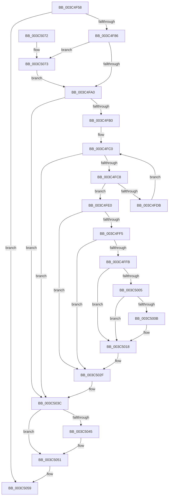

# KiAbUmPostWait

- RVA: `0x003C4F58`–`0x003C5080` (길이 `296` bytes)
- VA: `0x00000001403C4F58`
- 실행 섹션: `.text`
- PDB 이름 있음: `예`; PDB Function 태그: `아니요`
- unwind 정보 RVA: `0x0008E444`
- 디코드: `77`개 명령, `296/296` bytes 표시
- 미해석 바이트: `0` (있으면 어셈블리에 `.byte`로 보존)

> 이 문서는 커널 이미지의 기계어와 PDB 기호를 분석해 생성했습니다. 4번과 5번은 함수 원형과 자료형을 바이너리 사용 방식에서 추정한 C 해석이며 원본 소스 복구 결과는 아닙니다.

## 1. Dependencies

- 직접 호출 지점: **3**; 고유 호출 대상: **3**
- 직접 호출자로 확인된 함수: **1**
- RIP 상대 이미지 참조: **1**

### Outgoing calls
- `0x003C5025` → [KiAbEntryFreeAndEnableInterrupts](../26/KiAbEntryFreeAndEnableInterrupts_function_002622D0.md) (function, `0x002622D0`)
- `0x003C504C` → [KiLowerIrqlProcessIrqlFlags](../4F/KiLowerIrqlProcessIrqlFlags_function_004F5698.md) (function, `0x004F5698`)
- `0x003C5076` → [KiRaiseIrqlProcessIrqlFlags](../4F/KiRaiseIrqlProcessIrqlFlags_function_004F56FC.md) (function, `0x004F56FC`)

### Direct callers
- [KeWaitForAlertByThreadId](KeWaitForAlertByThreadId_function_003C4B14.md) at `0x003C4CF2`

### Static image references
- `0x003C4F93` → RVA `0x00FC6D20` (`ALMOSTRO`; read)

## 2. Other-region calls and transfers

- 다른 실행 섹션으로 향하는 call: **0**
- 별도 외부 분기/꼬리 이동을 확인하지 못했습니다.

## 3. Assembly (complete function range)

```asm
003C4F58  48 89 5C 24 10                  mov qword ptr [rsp + 0x10], rbx
003C4F5D  48 89 6C 24 18                  mov qword ptr [rsp + 0x18], rbp
003C4F62  48 89 74 24 20                  mov qword ptr [rsp + 0x20], rsi
003C4F67  57                              push rdi
003C4F68  41 56                           push r14
003C4F6A  41 57                           push r15
003C4F6C  48 83 EC 30                     sub rsp, 0x30
003C4F70  48 8B 99 78 04 00 00            mov rbx, qword ptr [rcx + 0x478]
003C4F77  4C 8B FA                        mov r15, rdx
003C4F7A  48 8B F1                        mov rsi, rcx
003C4F7D  48 85 DB                        test rbx, rbx
003C4F80  0F 84 D3 00 00 00               je 0x1403c5059
003C4F86  44 0F 20 C7                     mov rdi, cr8
003C4F8A  BA 02 00 00 00                  mov edx, 2
003C4F8F  44 0F 22 C2                     mov cr8, rdx
003C4F93  83 3D 86 1D C0 00 00            cmp dword ptr [rip + 0xc01d86], 0
003C4F9A  0F 85 D3 00 00 00               jne 0x1403c5073
003C4FA0  4C 8B B6 20 03 00 00            mov r14, qword ptr [rsi + 0x320]
003C4FA7  4D 85 F6                        test r14, r14
003C4FAA  0F 84 8C 00 00 00               je 0x1403c503c
003C4FB0  33 C9                           xor ecx, ecx
003C4FB2  48 BA FC FF FF FF FF FF FF 7F   movabs rdx, 0x7ffffffffffffffc
003C4FBC  44 8D 49 01                     lea r9d, [rcx + 1]
003C4FC0  0F B6 43 0C                     movzx eax, byte ptr [rbx + 0xc]
003C4FC4  3B C8                           cmp ecx, eax
003C4FC6  73 74                           jae 0x1403c503c
003C4FC8  49 8B 04 CE                     mov rax, qword ptr [r14 + rcx*8]
003C4FCC  48 89 44 24 50                  mov qword ptr [rsp + 0x50], rax
003C4FD1  48 23 C2                        and rax, rdx
003C4FD4  8B E9                           mov ebp, ecx
003C4FD6  49 3B C7                        cmp rax, r15
003C4FD9  74 05                           je 0x1403c4fe0
003C4FDB  41 03 C9                        add ecx, r9d
003C4FDE  EB E0                           jmp 0x1403c4fc0
003C4FE0  80 64 24 50 FE                  and byte ptr [rsp + 0x50], 0xfe
003C4FE5  48 6B C5 58                     imul rax, rbp, 0x58
003C4FE9  48 03 D8                        add rbx, rax
003C4FEC  48 8B 43 10                     mov rax, qword ptr [rbx + 0x10]
003C4FF0  48 85 C0                        test rax, rax
003C4FF3  74 3A                           je 0x1403c502f
003C4FF5  80 7B 19 00                     cmp byte ptr [rbx + 0x19], 0
003C4FF9  74 34                           je 0x1403c502f
003C4FFB  FA                              cli
003C4FFC  4C 8B 43 10                     mov r8, qword ptr [rbx + 0x10]
003C5000  4C 23 C2                        and r8, rdx
003C5003  74 13                           je 0x1403c5018
003C5005  80 7B 18 00                     cmp byte ptr [rbx + 0x18], 0
003C5009  7C 0D                           jl 0x1403c5018
003C500B  48 B8 00 00 00 00 00 00 00 80   movabs rax, 0x8000000000000000
003C5015  4C 0B C0                        or r8, rax
003C5018  48 83 64 24 20 00               and qword ptr [rsp + 0x20], 0
003C501E  48 8D 4B 10                     lea rcx, [rbx + 0x10]
003C5022  48 8B D6                        mov rdx, rsi
003C5025  E8 A6 D2 E9 FF                  call 0x1402622d0
003C502A  80 64 24 57 7F                  and byte ptr [rsp + 0x57], 0x7f
003C502F  48 8B 44 24 50                  mov rax, qword ptr [rsp + 0x50]
003C5034  49 89 04 EE                     mov qword ptr [r14 + rbp*8], rax
003C5038  80 63 18 BF                     and byte ptr [rbx + 0x18], 0xbf
003C503C  83 3D DD 1C C0 00 00            cmp dword ptr [rip + 0xc01cdd], 0
003C5043  74 0C                           je 0x1403c5051
003C5045  44 0F 20 C1                     mov rcx, cr8
003C5049  40 8A D7                        mov dl, dil
003C504C  E8 47 06 13 00                  call 0x1404f5698
003C5051  40 0F B6 C7                     movzx eax, dil
003C5055  44 0F 22 C0                     mov cr8, rax
003C5059  48 8B 5C 24 58                  mov rbx, qword ptr [rsp + 0x58]
003C505E  48 8B 6C 24 60                  mov rbp, qword ptr [rsp + 0x60]
003C5063  48 8B 74 24 68                  mov rsi, qword ptr [rsp + 0x68]
003C5068  48 83 C4 30                     add rsp, 0x30
003C506C  41 5F                           pop r15
003C506E  41 5E                           pop r14
003C5070  5F                              pop rdi
003C5071  C3                              ret
003C5072  CC                              int3
003C5073  40 8A CF                        mov cl, dil
003C5076  E8 81 06 13 00                  call 0x1404f56fc
003C507B  E9 20 FF FF FF                  jmp 0x1403c4fa0
```

## 4. C-style interpretation (structured pseudocode)

```c
__int64 __fastcall KiAbUmPostWait(__int64 a1, __int64 a2)
{
    __int64 result;
    __int64 v_rbx;
    __int64 v_rsp;
    unsigned __int64 v_stack_m28;
    unsigned __int64 v_stack_p10;
    unsigned __int64 v_stack_p18;
    unsigned __int64 v_stack_p20;
    unsigned __int64 v_stack_p8;
    unsigned __int8 v_stack_pF;

    v_stack_p10 = v_rbx;
    v_stack_p18 = v_rbp;
    v_stack_p20 = v_rsi;
    v_rsp = (v_rsp) - (48);
    if (*(unsigned __int64 *)(a1 + 1144) == 0) goto loc_003C5059;
    if ((*(unsigned int *)(v_rip + 12590470)) != 0) goto loc_003C5073;
loc_003C4FA0:
    if (*(unsigned __int64 *)(a1 + 800) == 0) goto loc_003C503C;
    a1 = 0;
loc_003C4FC0:
    if (0 >= ((unsigned int)(*(unsigned __int8 *)(*(unsigned __int64 *)(a1 + 1144) + 12)))) goto loc_003C503C;
    v_stack_p8 = *(unsigned __int64 *)(*(unsigned __int64 *)(a1 + 800) + a1 * 8);
    result = (*(unsigned __int64 *)(*(unsigned __int64 *)(a1 + 800) + a1 * 8)) & (2);
    if (result == a2) goto loc_003C4FE0;
    a1 = (unsigned int)((a1) + ((unsigned int)(a1 + 1)));
    goto loc_003C4FC0;
loc_003C4FE0:
    result = (result) * (0);
    v_rbx = (*(unsigned __int64 *)(a1 + 1144)) + (result);
    if (*(unsigned __int64 *)(v_rbx + 16) == 0) goto loc_003C502F;
    if ((*(unsigned __int8 *)(v_rbx + 25)) == 0) goto loc_003C502F;
    a3 = (*(unsigned __int64 *)(v_rbx + 16)) & (2);
    if (condition_is_equal) goto loc_003C5018;
    if ((*(unsigned __int8 *)(v_rbx + 24)) >= 0) {
        a3 = (a3) | (*(unsigned __int64 *)(v_rbx + 16));
    }
    result = KiAbEntryFreeAndEnableInterrupts(v_rbx + 16, a1, a3, a1 + 1);
loc_003C502F:
    *(unsigned __int64 *)(*(unsigned __int64 *)(a1 + 800) + 0 * 8) = v_stack_p8;
loc_003C503C:
    result = v_stack_p8;
    if ((*(unsigned int *)(v_rip + 12590301)) != 0) {
        a1 = 2;
        a2 = (unsigned __int8)(v_cr8);
        result = KiLowerIrqlProcessIrqlFlags(a1, a2, a3, a1 + 1);
    }
loc_003C5059:
    v_rsp = (v_rsp) + (48);
    return (unsigned __int8)(v_cr8);
loc_003C5073:
    result = KiRaiseIrqlProcessIrqlFlags((unsigned __int8)(v_cr8), a2, a3, a1 + 1);
    goto loc_003C4FA0;
}
```

## 5. (Beta) C Style

```c
int64_t KiAbUmPostWait(void *Arg1, int64_t Arg2)
{
    uint8_t *arg1 = (uint8_t *)Arg1;

    int64_t result;
    int64_t local_rbx;
    int64_t local_rsp;
    uint64_t v_stack_m28;
    uint64_t v_stack_p10;
    uint64_t v_stack_p18;
    uint64_t v_stack_p20;
    uint64_t v_stack_p8;
    uint8_t v_stack_pF;

    v_stack_p10 = local_rbx;
    v_stack_p18 = local_rbp;
    v_stack_p20 = local_rsi;
    local_rsp = (local_rsp) - (48);
    if (*(uint64_t *)(arg1 + 0x478) == 0) goto loc_003C5059;
    if ((*(uint32_t *)(v_rip + 0xC01D86)) != 0) goto loc_003C5073;
loc_003C4FA0:
    if (*(uint64_t *)(arg1 + 0x320) == 0) goto loc_003C503C;
    Arg1 = 0;
loc_003C4FC0:
    if (0 >= ((uint32_t)(*(uint8_t *)(*(uint64_t *)(arg1 + 0x478) + 0xC)))) goto loc_003C503C;
    v_stack_p8 = *(uint64_t *)(*(uint64_t *)(arg1 + 0x320) + arg1 * 8);
    result = (*(uint64_t *)(*(uint64_t *)(arg1 + 0x320) + arg1 * 8)) & (2);
    if (result == Arg2) goto loc_003C4FE0;
    Arg1 = (uint32_t)((Arg1) + ((uint32_t)(Arg1 + 1)));
    goto loc_003C4FC0;
loc_003C4FE0:
    result = (result) * (0);
    local_rbx = (*(uint64_t *)(arg1 + 0x478)) + (result);
    if (*(uint64_t *)(local_rbx + 0x10) == 0) goto loc_003C502F;
    if ((*(uint8_t *)(local_rbx + 0x19)) == 0) goto loc_003C502F;
    a3 = (*(uint64_t *)(local_rbx + 0x10)) & (2);
    if (condition_is_equal) goto loc_003C5018;
    if ((*(uint8_t *)(local_rbx + 0x18)) >= 0) {
        a3 = (a3) | (*(uint64_t *)(local_rbx + 0x10));
    }
    result = KiAbEntryFreeAndEnableInterrupts(local_rbx + 16, Arg1, a3, Arg1 + 1);
loc_003C502F:
    *(uint64_t *)(*(uint64_t *)(arg1 + 0x320) + 0x0 * 8) = v_stack_p8;
loc_003C503C:
    result = v_stack_p8;
    if ((*(uint32_t *)(v_rip + 0xC01CDD)) != 0) {
        Arg1 = 2;
        Arg2 = (uint8_t)(v_cr8);
        result = KiLowerIrqlProcessIrqlFlags(Arg1, Arg2, a3, Arg1 + 1);
    }
loc_003C5059:
    local_rsp = (local_rsp) + (48);
    return (uint8_t)(v_cr8);
loc_003C5073:
    result = KiRaiseIrqlProcessIrqlFlags((uint8_t)(v_cr8), Arg2, a3, Arg1 + 1);
    goto loc_003C4FA0;
}
```

### 관측된 메모리 오프셋

구조체 형식이 확인되지 않은 접근은 인자 기준의 오프셋으로만 기록했습니다.

| 기준 인자 | 오프셋 표현 | 폭 (bit) | 접근 |
|---|---:|---:|---|
| `Arg1` | `+ 0x320` | `64` | `R` |
| `Arg1` | `+ 0x478` | `64` | `R` |

## 6. Execution-region graph

[열기: 2D/3D 그래프와 함수 탐색 컨트롤 패널](../../../control-panel.html?section=text&rva=0x003C4F58&view=graph)

- 2D 그래프는 위에서 아래로 흐르고, 3D 그래프는 빈 공간을 드래그해 회전합니다. Shift+드래그는 이동, 휠은 확대·축소, 함수 노드 선택은 대상 보고서 이동입니다.

### Static fallback


