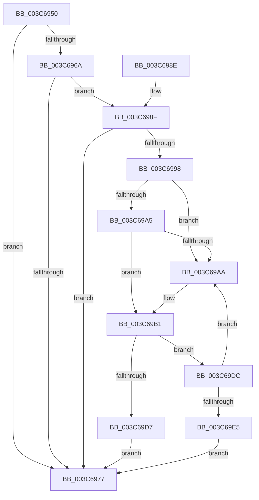

# KiActivateWaiterKQueue

- RVA: `0x003C6950`–`0x003C69F5` (길이 `165` bytes)
- VA: `0x00000001403C6950`
- 실행 섹션: `.text`
- PDB 이름 있음: `예`; PDB Function 태그: `아니요`
- unwind 정보 RVA: `0x00060CCC`
- 디코드: `49`개 명령, `165/165` bytes 표시
- 미해석 바이트: `0` (있으면 어셈블리에 `.byte`로 보존)

> 이 문서는 커널 이미지의 기계어와 PDB 기호를 분석해 생성했습니다. 4번과 5번은 함수 원형과 자료형을 바이너리 사용 방식에서 추정한 C 해석이며 원본 소스 복구 결과는 아닙니다.

## 1. Dependencies

- 직접 호출 지점: **1**; 고유 호출 대상: **1**
- 직접 호출자로 확인된 함수: **2**
- RIP 상대 이미지 참조: **0**

### Outgoing calls
- `0x003C69CE` → [KiWakeQueueWaiter](../34/KiWakeQueueWaiter_function_00344C10.md) (function, `0x00344C10`)

### Direct callers
- [KiActivateWaiterQueueWithNoLocks](../20/KiActivateWaiterQueueWithNoLocks_function_0020CEB0.md) at `0x0020CFAA`
- [sub_003C67DC](Unknown_function_003C67DC.md) at `0x003C6873`

### Static image references
- 디코드된 RIP-relative 메모리 참조가 없습니다.

## 2. Other-region calls and transfers

- 다른 실행 섹션으로 향하는 call: **0**
- 별도 외부 분기/꼬리 이동을 확인하지 못했습니다.

## 3. Assembly (complete function range)

```asm
003C6950  48 89 5C 24 08                  mov qword ptr [rsp + 8], rbx
003C6955  48 89 74 24 10                  mov qword ptr [rsp + 0x10], rsi
003C695A  57                              push rdi
003C695B  48 83 EC 20                     sub rsp, 0x20
003C695F  8B 41 28                        mov eax, dword ptr [rcx + 0x28]
003C6962  48 8B D9                        mov rbx, rcx
003C6965  3B 41 2C                        cmp eax, dword ptr [rcx + 0x2c]
003C6968  73 0D                           jae 0x1403c6977
003C696A  48 8B 71 18                     mov rsi, qword ptr [rcx + 0x18]
003C696E  48 8D 79 18                     lea rdi, [rcx + 0x18]
003C6972  48 3B F7                        cmp rsi, rdi
003C6975  75 18                           jne 0x1403c698f
003C6977  F0 81 23 7F FF FF FF            lock and dword ptr [rbx], 0xffffff7f
003C697E  48 8B 5C 24 30                  mov rbx, qword ptr [rsp + 0x30]
003C6983  48 8B 74 24 38                  mov rsi, qword ptr [rsp + 0x38]
003C6988  48 83 C4 20                     add rsp, 0x20
003C698C  5F                              pop rdi
003C698D  C3                              ret
003C698E  CC                              int3
003C698F  48 8D 41 08                     lea rax, [rcx + 8]
003C6993  48 39 00                        cmp qword ptr [rax], rax
003C6996  74 DF                           je 0x1403c6977
003C6998  48 8B 0E                        mov rcx, qword ptr [rsi]
003C699B  48 8B 46 08                     mov rax, qword ptr [rsi + 8]
003C699F  48 39 71 08                     cmp qword ptr [rcx + 8], rsi
003C69A3  75 05                           jne 0x1403c69aa
003C69A5  48 39 30                        cmp qword ptr [rax], rsi
003C69A8  74 07                           je 0x1403c69b1
003C69AA  B9 03 00 00 00                  mov ecx, 3
003C69AF  CD 29                           int 0x29
003C69B1  48 89 08                        mov qword ptr [rax], rcx
003C69B4  4C 8B C6                        mov r8, rsi
003C69B7  48 89 41 08                     mov qword ptr [rcx + 8], rax
003C69BB  48 8B D3                        mov rdx, rbx
003C69BE  48 C7 06 00 00 00 00            mov qword ptr [rsi], 0
003C69C5  65 48 8B 0C 25 20 00 00 00      mov rcx, qword ptr gs:[0x20]
003C69CE  E8 3D E2 F7 FF                  call 0x140344c10
003C69D3  84 C0                           test al, al
003C69D5  74 05                           je 0x1403c69dc
003C69D7  FF 4B 04                        dec dword ptr [rbx + 4]
003C69DA  EB 9B                           jmp 0x1403c6977
003C69DC  48 8B 07                        mov rax, qword ptr [rdi]
003C69DF  48 39 78 08                     cmp qword ptr [rax + 8], rdi
003C69E3  75 C5                           jne 0x1403c69aa
003C69E5  48 89 06                        mov qword ptr [rsi], rax
003C69E8  48 89 7E 08                     mov qword ptr [rsi + 8], rdi
003C69EC  48 89 70 08                     mov qword ptr [rax + 8], rsi
003C69F0  48 89 37                        mov qword ptr [rdi], rsi
003C69F3  EB 82                           jmp 0x1403c6977
```

## 4. C-style interpretation (structured pseudocode)

```c
__int64 __fastcall KiActivateWaiterKQueue(__int64 a1)
{
    __int64 result;
    __int64 v_rsp;
    unsigned __int64 v_stack_p10;
    unsigned __int64 v_stack_p8;

    v_stack_p8 = v_rbx;
    v_stack_p10 = v_rsi;
    v_rsp = (v_rsp) - (32);
    if (((unsigned int)((unsigned int)(*(unsigned int *)(a1 + 40)))) >= (*(unsigned int *)(a1 + 44))) goto loc_003C6977;
    if ((*(unsigned __int64 *)(a1 + 24)) != (a1 + 24)) goto loc_003C698F;
loc_003C6977:
    v_rsp = (v_rsp) + (32);
    return (unsigned int)(*(unsigned int *)(a1 + 40));
loc_003C698F:
    if ((*(unsigned __int64 *)(a1 + 8)) == (a1 + 8)) goto loc_003C6977;
    if ((*(unsigned __int64 *)(*(unsigned __int64 *)(v_stack_p10) + 8)) != v_stack_p10) goto loc_003C69AA;
    if ((*(unsigned __int64 *)(*(unsigned __int64 *)(v_stack_p10 + 8))) != v_stack_p10) {
        a1 = 3;
    }
    *(unsigned __int64 *)(*(unsigned __int64 *)(v_stack_p10 + 8)) = a1;
    *(unsigned __int64 *)(a1 + 8) = *(unsigned __int64 *)(v_stack_p10 + 8);
    *(unsigned __int64 *)(v_stack_p10) = 0;
    result = KiWakeQueueWaiter(*(unsigned __int64 *)(gs_base + (0 + 32)), v_stack_p8, v_stack_p10, a4);
    if ((unsigned __int8)(result) == 0) goto loc_003C69DC;
    goto loc_003C6977;
loc_003C69DC:
    if ((*(unsigned __int64 *)(*(unsigned __int64 *)(a1 + 24) + 8)) != (a1 + 24)) goto loc_003C69AA;
    *(unsigned __int64 *)(v_stack_p10) = *(unsigned __int64 *)(a1 + 24);
    *(unsigned __int64 *)(v_stack_p10 + 8) = a1 + 24;
    *(unsigned __int64 *)(*(unsigned __int64 *)(a1 + 24) + 8) = v_stack_p10;
    *(unsigned __int64 *)(a1 + 24) = v_stack_p10;
    goto loc_003C6977;
}
```

## 5. (Beta) C Style

```c
int64_t KiActivateWaiterKQueue(void *Arg1)
{
    uint8_t *arg1 = (uint8_t *)Arg1;

    int64_t result;
    int64_t local_rsp;
    uint64_t v_stack_p10;
    uint64_t v_stack_p8;

    v_stack_p8 = local_rbx;
    v_stack_p10 = local_rsi;
    local_rsp = (local_rsp) - (32);
    if (((uint32_t)((uint32_t)(*(uint32_t *)(arg1 + 0x28)))) >= (*(uint32_t *)(arg1 + 0x2C))) goto loc_003C6977;
    if ((*(uint64_t *)(arg1 + 0x18)) != (Arg1 + 24)) goto loc_003C698F;
loc_003C6977:
    local_rsp = (local_rsp) + (32);
    return (uint32_t)(*(uint32_t *)(arg1 + 0x28));
loc_003C698F:
    if ((*(uint64_t *)(arg1 + 0x8)) == (Arg1 + 8)) goto loc_003C6977;
    if ((*(uint64_t *)(*(uint64_t *)(v_stack_p10) + 0x8)) != v_stack_p10) goto loc_003C69AA;
    if ((*(uint64_t *)(*(uint64_t *)(v_stack_p10 + 0x8))) != v_stack_p10) {
        Arg1 = 3;
    }
    *(void **)(*(uint64_t *)(v_stack_p10 + 0x8)) = Arg1;
    *(uint64_t *)(arg1 + 0x8) = *(uint64_t *)(v_stack_p10 + 0x8);
    *(uint64_t *)(v_stack_p10) = 0;
    result = KiWakeQueueWaiter(*(uint64_t *)(gs_base + (0 + 0x20)), v_stack_p8, v_stack_p10, a4);
    if ((uint8_t)(result) == 0) goto loc_003C69DC;
    goto loc_003C6977;
loc_003C69DC:
    if ((*(uint64_t *)(*(uint64_t *)(arg1 + 0x18) + 0x8)) != (Arg1 + 24)) goto loc_003C69AA;
    *(uint64_t *)(v_stack_p10) = *(uint64_t *)(arg1 + 0x18);
    *(void **)(v_stack_p10 + 0x8) = Arg1 + 24;
    *(uint64_t *)(*(uint64_t *)(arg1 + 0x18) + 0x8) = v_stack_p10;
    *(uint64_t *)(arg1 + 0x18) = v_stack_p10;
    goto loc_003C6977;
}
```

### 관측된 메모리 오프셋

구조체 형식이 확인되지 않은 접근은 인자 기준의 오프셋으로만 기록했습니다.

| 기준 인자 | 오프셋 표현 | 폭 (bit) | 접근 |
|---|---:|---:|---|
| `Arg1` | `+ 0x0` | `32` | `R/W` |
| `Arg1` | `+ 0x0` | `64` | `R` |
| `Arg1` | `+ 0x0` | `64` | `W` |
| `Arg1` | `+ 0x4` | `32` | `R/W` |
| `Arg1` | `+ 0x8` | `64` | `R` |
| `Arg1` | `+ 0x18` | `64` | `R` |
| `Arg1` | `+ 0x28` | `32` | `R` |
| `Arg1` | `+ 0x2C` | `32` | `R` |

## 6. Execution-region graph

[열기: 2D/3D 그래프와 함수 탐색 컨트롤 패널](../../../control-panel.html?section=text&rva=0x003C6950&view=graph)

- 2D 그래프는 위에서 아래로 흐르고, 3D 그래프는 빈 공간을 드래그해 회전합니다. Shift+드래그는 이동, 휠은 확대·축소, 함수 노드 선택은 대상 보고서 이동입니다.

### Static fallback


