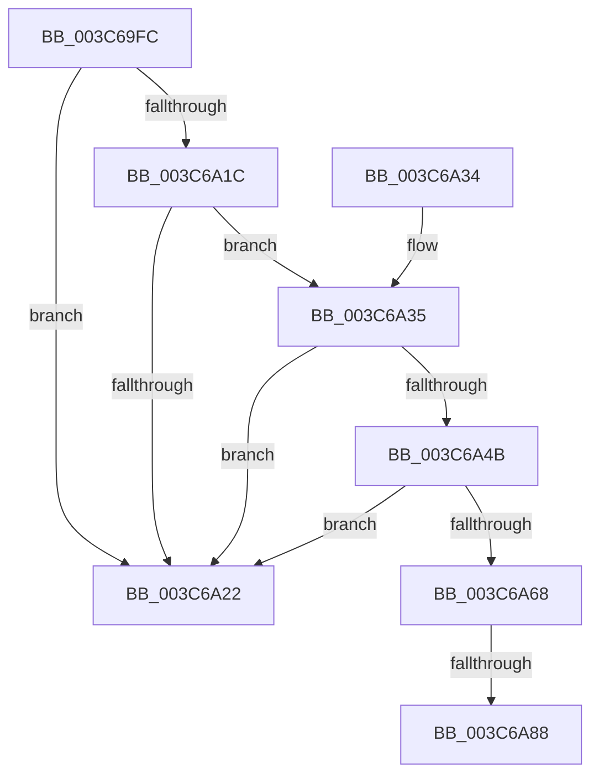

# KiActivateWaiterPriQueue

- RVA: `0x003C69FC`–`0x003C6A8F` (길이 `147` bytes)
- VA: `0x00000001403C69FC`
- 실행 섹션: `.text`
- PDB 이름 있음: `예`; PDB Function 태그: `예`
- unwind 정보 RVA: `0x0008E5C4`
- 디코드: `40`개 명령, `147/147` bytes 표시
- 미해석 바이트: `0` (있으면 어셈블리에 `.byte`로 보존)

> 이 문서는 커널 이미지의 기계어와 PDB 기호를 분석해 생성했습니다. 4번과 5번은 함수 원형과 자료형을 바이너리 사용 방식에서 추정한 C 해석이며 원본 소스 복구 결과는 아닙니다.

## 1. Dependencies

- 직접 호출 지점: **2**; 고유 호출 대상: **2**
- 직접 호출자로 확인된 함수: **1**
- RIP 상대 이미지 참조: **0**

### Outgoing calls
- `0x003C6A3E` → [KiAttemptFastRemovePriQueue](KiAttemptFastRemovePriQueue_function_003C6AA0.md) (function, `0x003C6AA0`)
- `0x003C6A5F` → [KiWakePriQueueWaiter](../21/KiWakePriQueueWaiter_function_0021F720.md) (function, `0x0021F720`)

### Direct callers
- [KiPriQueueThreadPriorityChanged](KiPriQueueThreadPriorityChanged_function_003C4640.md) at `0x003C46B4`

### Static image references
- 디코드된 RIP-relative 메모리 참조가 없습니다.

## 2. Other-region calls and transfers

- 다른 실행 섹션으로 향하는 call: **0**
- call이 아닌 외부 분기/꼬리 이동: **1**
  - `0x003C6A82` → [sub_006E824A](../6E/Unknown_function_006E824A.md) (`tail-transfer`)

## 3. Assembly (complete function range)

```asm
003C69FC  48 89 5C 24 08                  mov qword ptr [rsp + 8], rbx
003C6A01  48 89 54 24 10                  mov qword ptr [rsp + 0x10], rdx
003C6A06  57                              push rdi
003C6A07  48 83 EC 20                     sub rsp, 0x20
003C6A0B  83 64 24 38 00                  and dword ptr [rsp + 0x38], 0
003C6A10  48 8D 41 08                     lea rax, [rcx + 8]
003C6A14  48 8B D9                        mov rbx, rcx
003C6A17  48 39 00                        cmp qword ptr [rax], rax
003C6A1A  74 06                           je 0x1403c6a22
003C6A1C  83 79 04 00                     cmp dword ptr [rcx + 4], 0
003C6A20  75 13                           jne 0x1403c6a35
003C6A22  F0 81 23 7F FF FF FF            lock and dword ptr [rbx], 0xffffff7f
003C6A29  48 8B 5C 24 30                  mov rbx, qword ptr [rsp + 0x30]
003C6A2E  48 83 C4 20                     add rsp, 0x20
003C6A32  5F                              pop rdi
003C6A33  C3                              ret
003C6A34  CC                              int3
003C6A35  41 83 C8 FF                     or r8d, 0xffffffff
003C6A39  48 8D 54 24 38                  lea rdx, [rsp + 0x38]
003C6A3E  E8 5D 00 00 00                  call 0x1403c6aa0
003C6A43  48 8B F8                        mov rdi, rax
003C6A46  48 85 C0                        test rax, rax
003C6A49  74 D7                           je 0x1403c6a22
003C6A4B  65 48 8B 0C 25 20 00 00 00      mov rcx, qword ptr gs:[0x20]
003C6A54  4C 8B C0                        mov r8, rax
003C6A57  44 8B 4C 24 38                  mov r9d, dword ptr [rsp + 0x38]
003C6A5C  48 8B D3                        mov rdx, rbx
003C6A5F  E8 BC 8C E5 FF                  call 0x14021f720
003C6A64  84 C0                           test al, al
003C6A66  75 BA                           jne 0x1403c6a22
003C6A68  FF 43 04                        inc dword ptr [rbx + 4]
003C6A6B  48 63 4C 24 38                  movsxd rcx, dword ptr [rsp + 0x38]
003C6A70  48 C1 E1 04                     shl rcx, 4
003C6A74  48 83 C1 18                     add rcx, 0x18
003C6A78  48 03 CB                        add rcx, rbx
003C6A7B  48 8B 01                        mov rax, qword ptr [rcx]
003C6A7E  48 39 48 08                     cmp qword ptr [rax + 8], rcx
003C6A82  0F 84 C2 17 32 00               je 0x1406e824a
003C6A88  B9 03 00 00 00                  mov ecx, 3
003C6A8D  CD 29                           int 0x29
```

## 4. C-style interpretation (structured pseudocode)

```c
__int64 __fastcall KiActivateWaiterPriQueue(__int64 a1, __int64 a2, int a3)
{
    __int64 result;
    __int64 v_rsp;
    unsigned __int64 v_stack_p10;
    unsigned __int64 v_stack_p38;
    unsigned __int64 v_stack_p8;

    v_stack_p8 = v_rbx;
    v_stack_p10 = a2;
    v_rsp = (v_rsp) - (32);
    if ((*(unsigned __int64 *)(a1 + 8)) == (a1 + 8)) goto loc_003C6A22;
    if ((*(unsigned int *)(a1 + 4)) != 0) goto loc_003C6A35;
loc_003C6A22:
    v_rsp = (v_rsp) + (32);
    return a1 + 8;
loc_003C6A35:
    a3 = (unsigned int)((a3) | (0xFFFFFFFFULL));
    result = KiAttemptFastRemovePriQueue(a1, v_stack_p38, a3, a4);
    if (result == 0) goto loc_003C6A22;
    result = KiWakePriQueueWaiter(*(unsigned __int64 *)(gs_base + (0 + 32)), v_stack_p8, result, (unsigned int)(v_stack_p38));
    if ((unsigned __int8)(result) != 0) goto loc_003C6A22;
    a1 = ((int)(v_stack_p38)) << (4);
    a1 = (a1) + (24);
    a1 = (a1) + (v_stack_p8);
    return *(unsigned __int64 *)(a1);
}
```

## 5. (Beta) C Style

```c
void *KiActivateWaiterPriQueue(void *Arg1, int64_t Arg2, int32_t Arg3)
{
    uint8_t *arg1 = (uint8_t *)Arg1;

    int64_t result;
    int64_t local_rsp;
    uint64_t v_stack_p10;
    uint64_t v_stack_p38;
    uint64_t v_stack_p8;

    v_stack_p8 = local_rbx;
    v_stack_p10 = Arg2;
    local_rsp = (local_rsp) - (32);
    if ((*(uint64_t *)(arg1 + 0x8)) == (Arg1 + 8)) goto loc_003C6A22;
    if ((*(uint32_t *)(arg1 + 0x4)) != 0) goto loc_003C6A35;
loc_003C6A22:
    local_rsp = (local_rsp) + (32);
    return Arg1 + 8;
loc_003C6A35:
    Arg3 = (uint32_t)((Arg3) | (0xFFFFFFFFULL));
    result = KiAttemptFastRemovePriQueue(Arg1, v_stack_p38, Arg3, a4);
    if (result == 0) goto loc_003C6A22;
    result = KiWakePriQueueWaiter(*(uint64_t *)(gs_base + (0 + 0x20)), v_stack_p8, result, (uint32_t)(v_stack_p38));
    if ((uint8_t)(result) != 0) goto loc_003C6A22;
    Arg1 = ((int32_t)(v_stack_p38)) << (4);
    Arg1 = (Arg1) + (24);
    Arg1 = (Arg1) + (v_stack_p8);
    return *(uint64_t *)(arg1);
}
```

### 관측된 메모리 오프셋

구조체 형식이 확인되지 않은 접근은 인자 기준의 오프셋으로만 기록했습니다.

| 기준 인자 | 오프셋 표현 | 폭 (bit) | 접근 |
|---|---:|---:|---|
| `Arg1` | `+ 0x0` | `32` | `R/W` |
| `Arg1` | `+ 0x0` | `64` | `R` |
| `Arg1` | `+ 0x4` | `32` | `R` |
| `Arg1` | `+ 0x4` | `32` | `R/W` |
| `Arg1` | `+ 0x8` | `64` | `R` |

## 6. Execution-region graph

[열기: 2D/3D 그래프와 함수 탐색 컨트롤 패널](../../../control-panel.html?section=text&rva=0x003C69FC&view=graph)

- 2D 그래프는 위에서 아래로 흐르고, 3D 그래프는 빈 공간을 드래그해 회전합니다. Shift+드래그는 이동, 휠은 확대·축소, 함수 노드 선택은 대상 보고서 이동입니다.

### Static fallback


