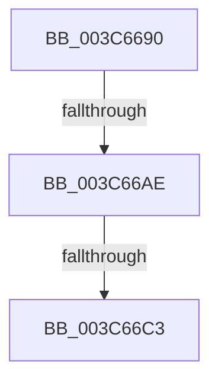

# KiActivateWaiterQueueWithThreadLock

- RVA: `0x003C6690`–`0x003C66C7` (길이 `55` bytes)
- VA: `0x00000001403C6690`
- 실행 섹션: `.text`
- PDB 이름 있음: `예`; PDB Function 태그: `아니요`
- unwind 정보 RVA: `0x0008E554`
- 디코드: `18`개 명령, `55/55` bytes 표시
- 미해석 바이트: `0` (있으면 어셈블리에 `.byte`로 보존)

> 이 문서는 커널 이미지의 기계어와 PDB 기호를 분석해 생성했습니다. 4번과 5번은 함수 원형과 자료형을 바이너리 사용 방식에서 추정한 C 해석이며 원본 소스 복구 결과는 아닙니다.

## 1. Dependencies

- 직접 호출 지점: **0**; 고유 호출 대상: **0**
- 직접 호출자로 확인된 함수: **1**
- RIP 상대 이미지 참조: **0**

### Outgoing calls
- 직접 디코드된 call 명령이 없습니다.

### Direct callers
- [KiCommitThreadWait](../20/KiCommitThreadWait_function_0020DFE0.md) at `0x0020E36B`

### Static image references
- 디코드된 RIP-relative 메모리 참조가 없습니다.

## 2. Other-region calls and transfers

- 다른 실행 섹션으로 향하는 call: **0**
- call이 아닌 외부 분기/꼬리 이동: **2**
  - `0x003C66A8` → [sub_003C67B3](Unknown_function_003C67B3.md) (`tail-transfer`)
  - `0x003C66BD` → [sub_003C687D](Unknown_function_003C687D.md) (`tail-transfer`)

## 3. Assembly (complete function range)

```asm
003C6690  40 53                           push rbx
003C6692  55                              push rbp
003C6693  57                              push rdi
003C6694  48 83 EC 20                     sub rsp, 0x20
003C6698  48 8B DA                        mov rbx, rdx
003C669B  48 8B F9                        mov rdi, rcx
003C669E  0F 0D 0A                        prefetchw byte ptr [rdx]
003C66A1  0F B6 02                        movzx eax, byte ptr [rdx]
003C66A4  24 7F                           and al, 0x7f
003C66A6  3C 15                           cmp al, 0x15
003C66A8  0F 84 05 01 00 00               je 0x1403c67b3
003C66AE  48 8D 42 28                     lea rax, [rdx + 0x28]
003C66B2  48 8B C8                        mov rcx, rax
003C66B5  F0 FF 08                        lock dec dword ptr [rax]
003C66B8  F0 0F BA 2B 07                  lock bts dword ptr [rbx], 7
003C66BD  0F 82 BA 01 00 00               jb 0x1403c687d
003C66C3  B0 01                           mov al, 1
003C66C5  33 ED                           xor ebp, ebp
```

## 4. C-style interpretation (structured pseudocode)

```c
__int64 __fastcall KiActivateWaiterQueueWithThreadLock(__int64 a1, __int64 a2)
{
    __int64 result;
    __int64 v_rbp;
    __int64 v_rsp;

    v_rsp = (v_rsp) - (32);
    result = (unsigned __int8)((*(unsigned __int8 *)(a2)) & (127));
    v_rbp = 0;
    return 1;
}
```

## 5. (Beta) C Style

```c
int64_t KiActivateWaiterQueueWithThreadLock(int64_t Arg1, void *Arg2)
{
    uint8_t *arg2 = (uint8_t *)Arg2;

    int64_t result;
    int64_t local_rbp;
    int64_t local_rsp;

    local_rsp = (local_rsp) - (32);
    result = (uint8_t)((*(uint8_t *)(arg2)) & (127));
    local_rbp = 0;
    return 1;
}
```

### 관측된 메모리 오프셋

구조체 형식이 확인되지 않은 접근은 인자 기준의 오프셋으로만 기록했습니다.

| 기준 인자 | 오프셋 표현 | 폭 (bit) | 접근 |
|---|---:|---:|---|
| `Arg2` | `+ 0x0` | `8` | `R` |
| `Arg2` | `+ 0x0` | `32` | `R/W` |
| `Arg2` | `+ 0x28` | `64` | `R` |

## 6. Execution-region graph

[열기: 2D/3D 그래프와 함수 탐색 컨트롤 패널](../../../control-panel.html?section=text&rva=0x003C6690&view=graph)

- 2D 그래프는 위에서 아래로 흐르고, 3D 그래프는 빈 공간을 드래그해 회전합니다. Shift+드래그는 이동, 휠은 확대·축소, 함수 노드 선택은 대상 보고서 이동입니다.

### Static fallback


