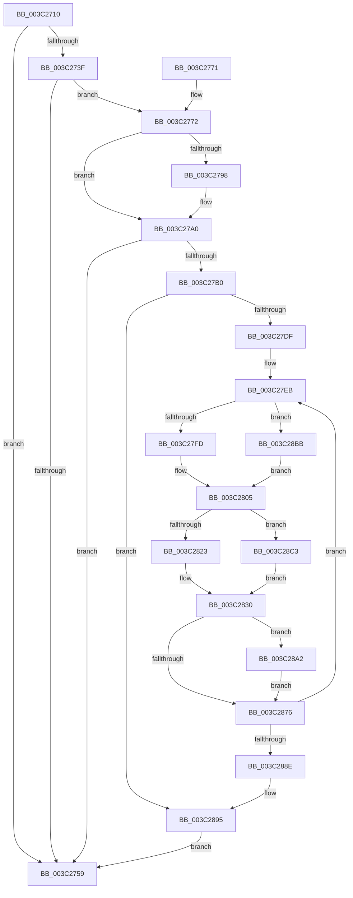

# KiAdjustProcessIdealProcessorSetsForThreadCreation

- RVA: `0x003C2710`–`0x003C28D0` (길이 `448` bytes)
- VA: `0x00000001403C2710`
- 실행 섹션: `.text`
- PDB 이름 있음: `예`; PDB Function 태그: `아니요`
- unwind 정보 RVA: `0x0008E228`
- 디코드: `122`개 명령, `448/448` bytes 표시
- 미해석 바이트: `0` (있으면 어셈블리에 `.byte`로 보존)

> 이 문서는 커널 이미지의 기계어와 PDB 기호를 분석해 생성했습니다. 4번과 5번은 함수 원형과 자료형을 바이너리 사용 방식에서 추정한 C 해석이며 원본 소스 복구 결과는 아닙니다.

## 1. Dependencies

- 직접 호출 지점: **2**; 고유 호출 대상: **2**
- 직접 호출자로 확인된 함수: **1**
- RIP 상대 이미지 참조: **3**

### Outgoing calls
- `0x003C27A7` → [KiIsConcurrencyCountWithinIdealProcessorSetBreakpoints](KiIsConcurrencyCountWithinIdealProcessorSetBreakpoints_function_003C210C.md) (function, `0x003C210C`)
- `0x003C2855` → [KiSelectIdealProcessorSetForGroup](KiSelectIdealProcessorSetForGroup_function_003C0E68.md) (function, `0x003C0E68`)

### Direct callers
- [KeStartThread](KeStartThread_function_003C21B8.md) at `0x003C2259`

### Static image references
- `0x003C2727` → RVA `0x00FC5084` (`ALMOSTRO`; read)
- `0x003C278B` → RVA `0x00FC6AE8` (`ALMOSTRO`; read)
- `0x003C27CE` → RVA `0x00FC5018` (`ALMOSTRO`; read)

## 2. Other-region calls and transfers

- 다른 실행 섹션으로 향하는 call: **0**
- 별도 외부 분기/꼬리 이동을 확인하지 못했습니다.

## 3. Assembly (complete function range)

```asm
003C2710  48 89 5C 24 08                  mov qword ptr [rsp + 8], rbx
003C2715  55                              push rbp
003C2716  56                              push rsi
003C2717  57                              push rdi
003C2718  41 54                           push r12
003C271A  41 55                           push r13
003C271C  41 56                           push r14
003C271E  41 57                           push r15
003C2720  48 8B EC                        mov rbp, rsp
003C2723  48 83 EC 60                     sub rsp, 0x60
003C2727  8B 05 57 29 C0 00               mov eax, dword ptr [rip + 0xc02957]
003C272D  45 33 C9                        xor r9d, r9d
003C2730  4C 89 4D D0                     mov qword ptr [rbp - 0x30], r9
003C2734  4C 8B F1                        mov r14, rcx
003C2737  4C 89 4D 58                     mov qword ptr [rbp + 0x58], r9
003C273B  A8 20                           test al, 0x20
003C273D  74 1A                           je 0x1403c2759
003C273F  4C 8D 91 B8 00 00 00            lea r10, [rcx + 0xb8]
003C2746  49 8B 1A                        mov rbx, qword ptr [r10]
003C2749  45 8D 59 01                     lea r11d, [r9 + 1]
003C274D  4C 89 55 D8                     mov qword ptr [rbp - 0x28], r10
003C2751  8B 43 0C                        mov eax, dword ptr [rbx + 0xc]
003C2754  41 84 C3                        test r11b, al
003C2757  74 19                           je 0x1403c2772
003C2759  48 8B 9C 24 A0 00 00 00         mov rbx, qword ptr [rsp + 0xa0]
003C2761  48 83 C4 60                     add rsp, 0x60
003C2765  41 5F                           pop r15
003C2767  41 5E                           pop r14
003C2769  41 5D                           pop r13
003C276B  41 5C                           pop r12
003C276D  5F                              pop rdi
003C276E  5E                              pop rsi
003C276F  5D                              pop rbp
003C2770  C3                              ret
003C2771  CC                              int3
003C2772  8B 03                           mov eax, dword ptr [rbx]
003C2774  41 B8 FF FF 03 00               mov r8d, 0x3ffff
003C277A  8D 88 00 00 04 00               lea ecx, [rax + 0x40000]
003C2780  8B D1                           mov edx, ecx
003C2782  33 D0                           xor edx, eax
003C2784  41 23 D0                        and edx, r8d
003C2787  33 D1                           xor edx, ecx
003C2789  89 13                           mov dword ptr [rbx], edx
003C278B  8B 05 57 43 C0 00               mov eax, dword ptr [rip + 0xc04357]
003C2791  C1 EA 12                        shr edx, 0x12
003C2794  3B D0                           cmp edx, eax
003C2796  76 08                           jbe 0x1403c27a0
003C2798  C1 E0 12                        shl eax, 0x12
003C279B  41 03 C0                        add eax, r8d
003C279E  89 03                           mov dword ptr [rbx], eax
003C27A0  48 8D 4B 04                     lea rcx, [rbx + 4]
003C27A4  48 8B D3                        mov rdx, rbx
003C27A7  E8 60 F9 FF FF                  call 0x1403c210c
003C27AC  84 C0                           test al, al
003C27AE  75 A9                           jne 0x1403c2759
003C27B0  4C 89 4D 50                     mov qword ptr [rbp + 0x50], r9
003C27B4  45 8B E9                        mov r13d, r9d
003C27B7  8B 75 54                        mov esi, dword ptr [rbp + 0x54]
003C27BA  41 0F B7 F9                     movzx edi, r9w
003C27BE  41 23 F0                        and esi, r8d
003C27C1  44 89 4D 50                     mov dword ptr [rbp + 0x50], r9d
003C27C5  81 CE 00 00 04 20               or esi, 0x20040000
003C27CB  41 2B F3                        sub esi, r11d
003C27CE  66 44 3B 0D 42 28 C0 00         cmp r9w, word ptr [rip + 0xc02842]
003C27D6  89 75 54                        mov dword ptr [rbp + 0x54], esi
003C27D9  0F 83 B6 00 00 00               jae 0x1403c2895
003C27DF  49 8D 56 50                     lea rdx, [r14 + 0x50]
003C27E3  49 C1 EE 0C                     shr r14, 0xc
003C27E7  48 89 55 E0                     mov qword ptr [rbp - 0x20], rdx
003C27EB  0F B7 C7                        movzx eax, di
003C27EE  8B C8                           mov ecx, eax
003C27F0  66 3B BB D0 00 00 00            cmp di, word ptr [rbx + 0xd0]
003C27F7  0F 83 BE 00 00 00               jae 0x1403c28bb
003C27FD  4C 8B A4 C3 D8 00 00 00         mov r12, qword ptr [rbx + rax*8 + 0xd8]
003C2805  48 8B 12                        mov rdx, qword ptr [rdx]
003C2808  0F 57 C0                        xorps xmm0, xmm0
003C280B  44 8B 03                        mov r8d, dword ptr [rbx]
003C280E  41 C1 E8 12                     shr r8d, 0x12
003C2812  0F 11 45 E8                     movups xmmword ptr [rbp - 0x18], xmm0
003C2816  66 89 7D F0                     mov word ptr [rbp - 0x10], di
003C281A  66 3B 3A                        cmp di, word ptr [rdx]
003C281D  0F 83 A0 00 00 00               jae 0x1403c28c3
003C2823  4C 8D 3C CD 00 00 00 00         lea r15, [rcx*8]
003C282B  4D 8B 4C 17 08                  mov r9, qword ptr [r15 + rdx + 8]
003C2830  49 8B 12                        mov rdx, qword ptr [r10]
003C2833  48 8D 45 58                     lea rax, [rbp + 0x58]
003C2837  48 89 44 24 28                  mov qword ptr [rsp + 0x28], rax
003C283C  48 8D 45 D0                     lea rax, [rbp - 0x30]
003C2840  4C 89 4D E8                     mov qword ptr [rbp - 0x18], r9
003C2844  4D 8B CE                        mov r9, r14
003C2847  48 89 44 24 20                  mov qword ptr [rsp + 0x20], rax
003C284C  0F B7 54 4A 50                  movzx edx, word ptr [rdx + rcx*2 + 0x50]
003C2851  48 8D 4D E8                     lea rcx, [rbp - 0x18]
003C2855  E8 0E E6 FF FF                  call 0x1403c0e68
003C285A  44 3B 6D 58                     cmp r13d, dword ptr [rbp + 0x58]
003C285E  48 8B 45 D0                     mov rax, qword ptr [rbp - 0x30]
003C2862  44 0F 42 6D 58                  cmovb r13d, dword ptr [rbp + 0x58]
003C2867  3B 75 5C                        cmp esi, dword ptr [rbp + 0x5c]
003C286A  0F 47 75 5C                     cmova esi, dword ptr [rbp + 0x5c]
003C286E  45 33 C9                        xor r9d, r9d
003C2871  4C 3B E0                        cmp r12, rax
003C2874  75 2C                           jne 0x1403c28a2
003C2876  4C 8B 55 D8                     mov r10, qword ptr [rbp - 0x28]
003C287A  66 FF C7                        inc di
003C287D  66 3B 3D 94 27 C0 00            cmp di, word ptr [rip + 0xc02794]
003C2884  48 8B 55 E0                     mov rdx, qword ptr [rbp - 0x20]
003C2888  0F 82 5D FF FF FF               jb 0x1403c27eb
003C288E  89 75 54                        mov dword ptr [rbp + 0x54], esi
003C2891  44 89 6D 50                     mov dword ptr [rbp + 0x50], r13d
003C2895  48 8B 45 50                     mov rax, qword ptr [rbp + 0x50]
003C2899  48 89 43 04                     mov qword ptr [rbx + 4], rax
003C289D  E9 B7 FE FF FF                  jmp 0x1403c2759
003C28A2  49 89 84 1F D8 00 00 00         mov qword ptr [r15 + rbx + 0xd8], rax
003C28AA  49 33 C4                        xor rax, r12
003C28AD  48 0F BC C8                     bsf rcx, rax
003C28B1  0F B7 C7                        movzx eax, di
003C28B4  66 89 4C 43 10                  mov word ptr [rbx + rax*2 + 0x10], cx
003C28B9  EB BB                           jmp 0x1403c2876
003C28BB  4D 8B E1                        mov r12, r9
003C28BE  E9 42 FF FF FF                  jmp 0x1403c2805
003C28C3  4C 8D 3C C5 00 00 00 00         lea r15, [rax*8]
003C28CB  E9 60 FF FF FF                  jmp 0x1403c2830
```

## 4. C-style interpretation (structured pseudocode)

```c
__int64 __fastcall KiAdjustProcessIdealProcessorSetsForThreadCreation(__int64 a1, __int64 a2, __int64 a3, int a4)
{
    __int64 result;
    __int64 v_r13;
    __int64 v_r14;
    __int64 v_rdi;
    __int64 v_rsi;
    __int64 v_rsp;
    unsigned __int16 v_stack_m48;
    unsigned __int64 v_stack_m50;
    unsigned __int64 v_stack_m58;
    unsigned __int64 v_stack_m60;
    unsigned __int64 v_stack_m68;
    unsigned __int64 v_stack_p18;
    unsigned int v_stack_p1C;
    unsigned __int64 v_stack_p20;
    unsigned int v_stack_p24;
    unsigned __int64 v_stack_p28;
    unsigned __int64 v_stack_p8;

    v_stack_p8 = v_rbx;
    v_rsp = (v_rsp) - (96);
    a4 = 0;
    v_stack_m68 = 0;
    v_stack_p20 = 0;
    if ((((unsigned __int8)((unsigned int)(*(unsigned int *)(v_rip + 12593495)))) & (32)) == 0) goto loc_003C2759;
    v_stack_m60 = a1 + 184;
    if ((((unsigned __int8)(a4 + 1)) & ((unsigned __int8)((unsigned int)(*(unsigned int *)(*(unsigned __int64 *)(a1 + 184) + 12))))) == 0) goto loc_003C2772;
loc_003C2759:
    v_rsp = (v_rsp) + (96);
    return (unsigned int)(*(unsigned int *)(*(unsigned __int64 *)(a1 + 184) + 12));
loc_003C2772:
    a2 = (unsigned int)(((unsigned int)((unsigned int)((unsigned int)(*(unsigned int *)(v_stack_p8)) + 262144))) ^ ((unsigned int)((unsigned int)(*(unsigned int *)(v_stack_p8)))));
    a2 = (unsigned int)((a2) & ((unsigned int)((unsigned int)(0x3FFFFULL))));
    a2 = (unsigned int)((a2) ^ ((unsigned int)((unsigned int)(*(unsigned int *)(v_stack_p8)) + 262144)));
    *(unsigned int *)(v_stack_p8) = (unsigned int)(a2);
    a2 = (unsigned int)((a2) >> (18));
    result = (unsigned int)(*(unsigned int *)(v_rip + 12600151));
    if (((unsigned int)(a2)) >= = ((unsigned int)((unsigned int)(*(unsigned int *)(v_rip + 12600151))))) {
        result = (unsigned int)(((unsigned int)(*(unsigned int *)(v_rip + 12600151))) << (18));
        result = (unsigned int)((result) + ((unsigned int)((unsigned int)(0x3FFFFULL))));
        *(unsigned int *)(v_stack_p8) = (unsigned int)(result);
    }
    result = KiIsConcurrencyCountWithinIdealProcessorSetBreakpoints(v_stack_p8 + 4, v_stack_p8, (unsigned int)(0x3FFFFULL), a4);
    if ((unsigned __int8)(result) != 0) goto loc_003C2759;
    v_stack_p18 = 0;
    v_rsi = (unsigned int)(((unsigned int)(v_stack_p1C)) & ((unsigned int)((unsigned int)(0x3FFFFULL))));
    v_stack_p18 = 0;
    v_rsi = (unsigned int)((v_rsi) | (0x20040000ULL));
    v_rsi = (unsigned int)((v_rsi) - ((unsigned int)(a4 + 1)));
    v_stack_p1C = (unsigned int)(v_rsi);
    if (0 >= (*(unsigned __int16 *)(v_rip + 12593218))) goto loc_003C2895;
    v_r14 = (a1) >> (12);
    v_stack_m58 = a1 + 80;
loc_003C27EB:
    if (0 >= (*(unsigned __int16 *)(v_stack_p8 + 208))) goto loc_003C28BB;
loc_003C2805:
    a3 = (unsigned int)(((unsigned int)(*(unsigned int *)(v_stack_p8))) >> (18));
    v_stack_m50 = v_xmm0;
    v_stack_m48 = 0;
    if (0 >= (*(unsigned __int16 *)(*(unsigned __int64 *)(a1 + 80)))) goto loc_003C28C3;
loc_003C2830:
    v_stack_p28 = v_stack_p20;
    v_stack_m50 = *(unsigned __int64 *)(0 * 8 + *(unsigned __int64 *)(a1 + 80) * 1 + 8);
    v_stack_p20 = v_stack_m68;
    result = KiSelectIdealProcessorSetForGroup(v_stack_m50, *(unsigned __int16 *)(*(unsigned __int64 *)(a1 + 184) + 0 * 2 + 80), a3, v_r14);
    v_r13 = 0;
    if (0 < v_stack_p20) { v_r13 = v_stack_p20; }
    if (((unsigned int)(v_rsi)) > v_stack_p24) { v_rsi = v_stack_p24; }
    a4 = 0;
    if ((*(unsigned __int64 *)(v_stack_p8 + 0 * 8 + 216)) != v_stack_m68) goto loc_003C28A2;
loc_003C2876:
    v_rdi = (unsigned __int16)((0) + 1);
    if (((unsigned __int16)(v_rdi)) < (*(unsigned __int16 *)(v_rip + 12593044))) goto loc_003C27EB;
    v_stack_p1C = (unsigned int)(v_rsi);
    v_stack_p18 = (unsigned int)(v_r13);
loc_003C2895:
    *(unsigned __int64 *)(v_stack_p8 + 4) = v_stack_p18;
    goto loc_003C2759;
loc_003C28A2:
    *(unsigned __int64 *)(0 * 8 + v_stack_p8 * 1 + 216) = v_stack_p18;
    result = (v_stack_p18) ^ (*(unsigned __int64 *)(v_stack_p8 + 0 * 8 + 216));
    *(unsigned __int16 *)(v_stack_p8 + (unsigned __int16)(v_rdi) * 2 + 16) = (unsigned __int16)(v_stack_m50);
    goto loc_003C2876;
loc_003C28BB:
    goto loc_003C2805;
loc_003C28C3:
    goto loc_003C2830;
}
```

## 5. (Beta) C Style

```c
int64_t KiAdjustProcessIdealProcessorSetsForThreadCreation(void *Arg1, int64_t Arg2, int64_t Arg3, int32_t Arg4)
{
    uint8_t *arg1 = (uint8_t *)Arg1;

    int64_t result;
    int64_t local_r13;
    int64_t local_r14;
    int64_t local_rdi;
    int64_t local_rsi;
    int64_t local_rsp;
    uint16_t v_stack_m48;
    uint64_t v_stack_m50;
    uint64_t v_stack_m58;
    uint64_t v_stack_m60;
    uint64_t v_stack_m68;
    uint64_t v_stack_p18;
    uint32_t v_stack_p1C;
    uint64_t v_stack_p20;
    uint32_t v_stack_p24;
    uint64_t v_stack_p28;
    uint64_t v_stack_p8;

    v_stack_p8 = local_rbx;
    local_rsp = (local_rsp) - (96);
    Arg4 = 0;
    v_stack_m68 = 0;
    v_stack_p20 = 0;
    if ((((uint8_t)((uint32_t)(*(uint32_t *)(v_rip + 0xC02957)))) & (32)) == 0) goto loc_003C2759;
    v_stack_m60 = Arg1 + 184;
    if ((((uint8_t)(Arg4 + 1)) & ((uint8_t)((uint32_t)(*(uint32_t *)(*(uint64_t *)(arg1 + 0xB8) + 0xC))))) == 0) goto loc_003C2772;
loc_003C2759:
    local_rsp = (local_rsp) + (96);
    return (uint32_t)(*(uint32_t *)(*(uint64_t *)(arg1 + 0xB8) + 0xC));
loc_003C2772:
    Arg2 = (uint32_t)(((uint32_t)((uint32_t)((uint32_t)(*(uint32_t *)(v_stack_p8)) + 262144))) ^ ((uint32_t)((uint32_t)(*(uint32_t *)(v_stack_p8)))));
    Arg2 = (uint32_t)((Arg2) & ((uint32_t)((uint32_t)(0x3FFFFULL))));
    Arg2 = (uint32_t)((Arg2) ^ ((uint32_t)((uint32_t)(*(uint32_t *)(v_stack_p8)) + 262144)));
    *(uint32_t *)(v_stack_p8) = (uint32_t)(Arg2);
    Arg2 = (uint32_t)((Arg2) >> (18));
    result = (uint32_t)(*(uint32_t *)(v_rip + 0xC04357));
    if (((uint32_t)(Arg2)) >= = ((uint32_t)((uint32_t)(*(uint32_t *)(v_rip + 0xC04357))))) {
        result = (uint32_t)(((uint32_t)(*(uint32_t *)(v_rip + 0xC04357))) << (18));
        result = (uint32_t)((result) + ((uint32_t)((uint32_t)(0x3FFFFULL))));
        *(uint32_t *)(v_stack_p8) = (uint32_t)(result);
    }
    result = KiIsConcurrencyCountWithinIdealProcessorSetBreakpoints(v_stack_p8 + 4, v_stack_p8, (uint32_t)(0x3FFFFULL), Arg4);
    if ((uint8_t)(result) != 0) goto loc_003C2759;
    v_stack_p18 = 0;
    local_rsi = (uint32_t)(((uint32_t)(v_stack_p1C)) & ((uint32_t)((uint32_t)(0x3FFFFULL))));
    v_stack_p18 = 0;
    local_rsi = (uint32_t)((local_rsi) | (0x20040000ULL));
    local_rsi = (uint32_t)((local_rsi) - ((uint32_t)(Arg4 + 1)));
    v_stack_p1C = (uint32_t)(local_rsi);
    if (0 >= (*(uint16_t *)(v_rip + 0xC02842))) goto loc_003C2895;
    local_r14 = (Arg1) >> (12);
    v_stack_m58 = Arg1 + 80;
loc_003C27EB:
    if (0 >= (*(uint16_t *)(v_stack_p8 + 0xD0))) goto loc_003C28BB;
loc_003C2805:
    Arg3 = (uint32_t)(((uint32_t)(*(uint32_t *)(v_stack_p8))) >> (18));
    v_stack_m50 = v_xmm0;
    v_stack_m48 = 0;
    if (0 >= (*(uint16_t *)(*(uint64_t *)(arg1 + 0x50)))) goto loc_003C28C3;
loc_003C2830:
    v_stack_p28 = v_stack_p20;
    v_stack_m50 = *(uint64_t *)(0 * 8 + *(uint64_t *)(arg1 + 0x50) * 1 + 0x8);
    v_stack_p20 = v_stack_m68;
    result = KiSelectIdealProcessorSetForGroup(v_stack_m50, *(uint16_t *)(*(uint64_t *)(arg1 + 0xB8) + 0x0 * 2 + 0x50), Arg3, local_r14);
    local_r13 = 0;
    if (0 < v_stack_p20) { local_r13 = v_stack_p20; }
    if (((uint32_t)(local_rsi)) > v_stack_p24) { local_rsi = v_stack_p24; }
    Arg4 = 0;
    if ((*(uint64_t *)(v_stack_p8 + 0x0 * 8 + 0xD8)) != v_stack_m68) goto loc_003C28A2;
loc_003C2876:
    local_rdi = (uint16_t)((0) + 1);
    if (((uint16_t)(local_rdi)) < (*(uint16_t *)(v_rip + 0xC02794))) goto loc_003C27EB;
    v_stack_p1C = (uint32_t)(local_rsi);
    v_stack_p18 = (uint32_t)(local_r13);
loc_003C2895:
    *(uint64_t *)(v_stack_p8 + 0x4) = v_stack_p18;
    goto loc_003C2759;
loc_003C28A2:
    *(uint64_t *)(0 * 8 + v_stack_p8 * 1 + 0xD8) = v_stack_p18;
    result = (v_stack_p18) ^ (*(uint64_t *)(v_stack_p8 + 0x0 * 8 + 0xD8));
    *(uint16_t *)(v_stack_p8 + (uint16_t)(local_rdi) * 2 + 0x10) = (uint16_t)(v_stack_m50);
    goto loc_003C2876;
loc_003C28BB:
    goto loc_003C2805;
loc_003C28C3:
    goto loc_003C2830;
}
```

### 관측된 메모리 오프셋

구조체 형식이 확인되지 않은 접근은 인자 기준의 오프셋으로만 기록했습니다.

| 기준 인자 | 오프셋 표현 | 폭 (bit) | 접근 |
|---|---:|---:|---|
| `Arg1` | `+ 0x0` | `64` | `R` |
| `Arg1` | `+ 0x50` | `64` | `R` |
| `Arg1` | `+ 0xB8` | `64` | `R` |

## 6. Execution-region graph

[열기: 2D/3D 그래프와 함수 탐색 컨트롤 패널](../../../control-panel.html?section=text&rva=0x003C2710&view=graph)

- 2D 그래프는 위에서 아래로 흐르고, 3D 그래프는 빈 공간을 드래그해 회전합니다. Shift+드래그는 이동, 휠은 확대·축소, 함수 노드 선택은 대상 보고서 이동입니다.

### Static fallback


