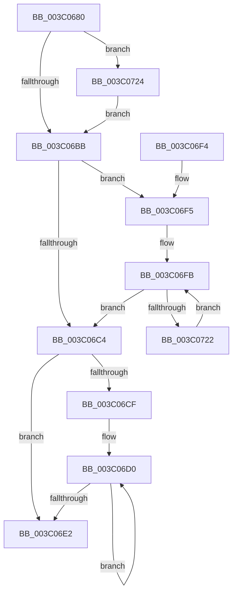

# KiAndAffinityEx

- RVA: `0x003C0680`–`0x003C072E` (길이 `174` bytes)
- VA: `0x00000001403C0680`
- 실행 섹션: `.text`
- PDB 이름 있음: `예`; PDB Function 태그: `아니요`
- unwind 정보 RVA: `0x0008DFD4`
- 디코드: `48`개 명령, `174/174` bytes 표시
- 미해석 바이트: `0` (있으면 어셈블리에 `.byte`로 보존)

> 이 문서는 커널 이미지의 기계어와 PDB 기호를 분석해 생성했습니다. 4번과 5번은 함수 원형과 자료형을 바이너리 사용 방식에서 추정한 C 해석이며 원본 소스 복구 결과는 아닙니다.

## 1. Dependencies

- 직접 호출 지점: **0**; 고유 호출 대상: **0**
- 직접 호출자로 확인된 함수: **4**
- RIP 상대 이미지 참조: **0**

### Outgoing calls
- 직접 디코드된 call 명령이 없습니다.

### Direct callers
- [KiComputeCpuSetAffinity](../39/KiComputeCpuSetAffinity_function_0039A1C0.md) at `0x0039A654`
- [PpmHeteroUpdateHgsConfiguration](../3B/PpmHeteroUpdateHgsConfiguration_function_003BF344.md) at `0x003BF8AB`
- [PpmHeteroUpdateHgsConfiguration](../3B/PpmHeteroUpdateHgsConfiguration_function_003BF344.md) at `0x003BF8C7`
- [KeFlushQueuedDpcs](KeFlushQueuedDpcs_function_003C0300.md) at `0x003C03FD`
- [KeAndAffinityEx](../4F/KeAndAffinityEx_function_004FC0E0.md) at `0x004FC0F6`

### Static image references
- 디코드된 RIP-relative 메모리 참조가 없습니다.

## 2. Other-region calls and transfers

- 다른 실행 섹션으로 향하는 call: **0**
- 별도 외부 분기/꼬리 이동을 확인하지 못했습니다.

## 3. Assembly (complete function range)

```asm
003C0680  48 89 5C 24 08                  mov qword ptr [rsp + 8], rbx
003C0685  48 89 74 24 10                  mov qword ptr [rsp + 0x10], rsi
003C068A  48 89 7C 24 18                  mov qword ptr [rsp + 0x18], rdi
003C068F  4D 8B D0                        mov r10, r8
003C0692  66 45 89 48 02                  mov word ptr [r8 + 2], r9w
003C0697  44 0F B7 01                     movzx r8d, word ptr [rcx]
003C069B  33 F6                           xor esi, esi
003C069D  0F B7 02                        movzx eax, word ptr [rdx]
003C06A0  4C 8B DA                        mov r11, rdx
003C06A3  66 44 3B C0                     cmp r8w, ax
003C06A7  48 8B D9                        mov rbx, rcx
003C06AA  8B FE                           mov edi, esi
003C06AC  66 44 0F 43 C0                  cmovae r8w, ax
003C06B1  66 45 89 02                     mov word ptr [r10], r8w
003C06B5  66 45 3B C1                     cmp r8w, r9w
003C06B9  77 69                           ja 0x1403c0724
003C06BB  0F B7 CE                        movzx ecx, si
003C06BE  66 41 3B F0                     cmp si, r8w
003C06C2  72 31                           jb 0x1403c06f5
003C06C4  41 89 72 04                     mov dword ptr [r10 + 4], esi
003C06C8  66 41 3B 4A 02                  cmp cx, word ptr [r10 + 2]
003C06CD  73 13                           jae 0x1403c06e2
003C06CF  90                              nop
003C06D0  0F B7 D1                        movzx edx, cx
003C06D3  66 FF C1                        inc cx
003C06D6  49 89 74 D2 08                  mov qword ptr [r10 + rdx*8 + 8], rsi
003C06DB  66 41 3B 4A 02                  cmp cx, word ptr [r10 + 2]
003C06E0  72 EE                           jb 0x1403c06d0
003C06E2  48 8B 5C 24 08                  mov rbx, qword ptr [rsp + 8]
003C06E7  8B C7                           mov eax, edi
003C06E9  48 8B 7C 24 18                  mov rdi, qword ptr [rsp + 0x18]
003C06EE  48 8B 74 24 10                  mov rsi, qword ptr [rsp + 0x10]
003C06F3  C3                              ret
003C06F4  CC                              int3
003C06F5  41 B9 01 00 00 00               mov r9d, 1
003C06FB  0F B7 C1                        movzx eax, cx
003C06FE  4C 8D 04 C5 00 00 00 00         lea r8, [rax*8]
003C0706  49 8B 54 18 08                  mov rdx, qword ptr [r8 + rbx + 8]
003C070B  4B 23 54 18 08                  and rdx, qword ptr [r8 + r11 + 8]
003C0710  4B 89 54 10 08                  mov qword ptr [r8 + r10 + 8], rdx
003C0715  41 0F 45 F9                     cmovne edi, r9d
003C0719  66 FF C1                        inc cx
003C071C  66 41 3B 0A                     cmp cx, word ptr [r10]
003C0720  73 A2                           jae 0x1403c06c4
003C0722  EB D7                           jmp 0x1403c06fb
003C0724  66 45 89 0A                     mov word ptr [r10], r9w
003C0728  45 0F B7 C1                     movzx r8d, r9w
003C072C  EB 8D                           jmp 0x1403c06bb
```

## 4. C-style interpretation (structured pseudocode)

```c
__int64 __fastcall KiAndAffinityEx(__int64 a1, __int64 a2, __int64 a3, unsigned __int16 a4)
{
    __int64 v_rdi;
    __int64 v_rsi;
    unsigned __int64 v_stack_p10;
    unsigned __int64 v_stack_p18;
    unsigned __int64 v_stack_p8;

    v_stack_p8 = v_rbx;
    v_stack_p10 = v_rsi;
    v_stack_p18 = v_rdi;
    *(unsigned __int16 *)(a3 + 2) = a4;
    v_rsi = 0;
    a3 = *(unsigned __int16 *)(a1);
    if (((unsigned __int16)(*(unsigned __int16 *)(a1))) >= ((unsigned __int16)(*(unsigned __int16 *)(a2)))) { a3 = (unsigned __int16)(*(unsigned __int16 *)(a2)); }
    *(unsigned __int16 *)(a3) = (unsigned __int16)(a3);
    if (((unsigned __int16)(a3)) > a4) goto loc_003C0724;
loc_003C06BB:
    if (0 < ((unsigned __int16)(a3))) goto loc_003C06F5;
loc_003C06C4:
    *(unsigned int *)(a3 + 4) = 0;
    if (0 >= (*(unsigned __int16 *)(a3 + 2))) goto loc_003C06E2;
loc_003C06D0:
    a1 = (unsigned __int16)((0) + 1);
    *(unsigned __int64 *)(a3 + 0 * 8 + 8) = 0;
    if (((unsigned __int16)(a1)) < (*(unsigned __int16 *)(a3 + 2))) goto loc_003C06D0;
loc_003C06E2:
    return 0;
loc_003C06F5:
loc_003C06FB:
    a2 = (*(unsigned __int64 *)((unsigned __int16)(a1) * 8 + v_stack_p8 * 1 + 8)) & (*(unsigned __int64 *)((unsigned __int16)(a1) * 8 + a2 * 1 + 8));
    *(unsigned __int64 *)((unsigned __int16)(a1) * 8 + a3 * 1 + 8) = a2;
    v_rdi = v_stack_p18;
    if (condition_is_not_equal) { v_rdi = 1; }
    a1 = (unsigned __int16)((a1) + 1);
    if (((unsigned __int16)(a1)) >= (*(unsigned __int16 *)(a3))) goto loc_003C06C4;
    goto loc_003C06FB;
loc_003C0724:
    *(unsigned __int16 *)(a3) = 1;
    goto loc_003C06BB;
}
```

## 5. (Beta) C Style

```c
int64_t KiAndAffinityEx(void *Arg1, void *Arg2, void *Arg3, uint16_t Arg4)
{
    uint8_t *arg1 = (uint8_t *)Arg1;
    uint8_t *arg2 = (uint8_t *)Arg2;
    uint8_t *arg3 = (uint8_t *)Arg3;

    int64_t local_rdi;
    int64_t local_rsi;
    uint64_t v_stack_p10;
    uint64_t v_stack_p18;
    uint64_t v_stack_p8;

    v_stack_p8 = local_rbx;
    v_stack_p10 = local_rsi;
    v_stack_p18 = local_rdi;
    *(uint16_t *)(arg3 + 0x2) = Arg4;
    local_rsi = 0;
    Arg3 = *(uint16_t *)(arg1);
    if (((uint16_t)(*(uint16_t *)(arg1))) >= ((uint16_t)(*(uint16_t *)(arg2)))) { Arg3 = (uint16_t)(*(uint16_t *)(arg2)); }
    *(uint16_t *)(arg3) = (uint16_t)(Arg3);
    if (((uint16_t)(Arg3)) > Arg4) goto loc_003C0724;
loc_003C06BB:
    if (0 < ((uint16_t)(Arg3))) goto loc_003C06F5;
loc_003C06C4:
    *(uint32_t *)(arg3 + 0x4) = 0;
    if (0 >= (*(uint16_t *)(arg3 + 0x2))) goto loc_003C06E2;
loc_003C06D0:
    Arg1 = (uint16_t)((0) + 1);
    *(uint64_t *)(arg3 + 0x0 * 8 + 0x8) = 0;
    if (((uint16_t)(Arg1)) < (*(uint16_t *)(arg3 + 0x2))) goto loc_003C06D0;
loc_003C06E2:
    return 0;
loc_003C06F5:
loc_003C06FB:
    Arg2 = (*(uint64_t *)((uint16_t)(arg1) * 8 + v_stack_p8 * 1 + 0x8)) & (*(uint64_t *)((uint16_t)(arg1) * 8 + arg2 * 1 + 0x8));
    *(void **)((uint16_t)(arg1) * 8 + arg3 * 1 + 0x8) = Arg2;
    local_rdi = v_stack_p18;
    if (condition_is_not_equal) { local_rdi = 1; }
    Arg1 = (uint16_t)((Arg1) + 1);
    if (((uint16_t)(Arg1)) >= (*(uint16_t *)(arg3))) goto loc_003C06C4;
    goto loc_003C06FB;
loc_003C0724:
    *(uint16_t *)(arg3) = 1;
    goto loc_003C06BB;
}
```

### 관측된 메모리 오프셋

구조체 형식이 확인되지 않은 접근은 인자 기준의 오프셋으로만 기록했습니다.

| 기준 인자 | 오프셋 표현 | 폭 (bit) | 접근 |
|---|---:|---:|---|
| `Arg1` | `+ 0x0` | `16` | `R` |
| `Arg2` | `+ 0x0` | `16` | `R` |
| `Arg3` | `+ 0x0` | `16` | `R` |
| `Arg3` | `+ 0x0` | `16` | `W` |
| `Arg3` | `+ 0x2` | `16` | `R` |
| `Arg3` | `+ 0x2` | `16` | `W` |
| `Arg3` | `+ 0x4` | `32` | `W` |
| `Arg3` | `+ 0x8 + rdx*8` | `64` | `W` |

## 6. Execution-region graph

[열기: 2D/3D 그래프와 함수 탐색 컨트롤 패널](../../../control-panel.html?section=text&rva=0x003C0680&view=graph)

- 2D 그래프는 위에서 아래로 흐르고, 3D 그래프는 빈 공간을 드래그해 회전합니다. Shift+드래그는 이동, 휠은 확대·축소, 함수 노드 선택은 대상 보고서 이동입니다.

### Static fallback


