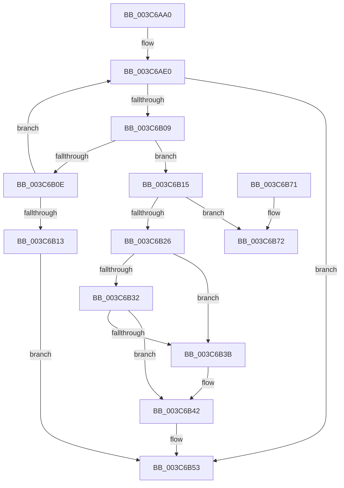

# KiAttemptFastRemovePriQueue

- RVA: `0x003C6AA0`–`0x003C6B93` (길이 `243` bytes)
- VA: `0x00000001403C6AA0`
- 실행 섹션: `.text`
- PDB 이름 있음: `예`; PDB Function 태그: `아니요`
- unwind 정보 RVA: `0x0008E5E4`
- 디코드: `66`개 명령, `243/243` bytes 표시
- 미해석 바이트: `0` (있으면 어셈블리에 `.byte`로 보존)

> 이 문서는 커널 이미지의 기계어와 PDB 기호를 분석해 생성했습니다. 4번과 5번은 함수 원형과 자료형을 바이너리 사용 방식에서 추정한 C 해석이며 원본 소스 복구 결과는 아닙니다.

## 1. Dependencies

- 직접 호출 지점: **1**; 고유 호출 대상: **1**
- 직접 호출자로 확인된 함수: **5**
- RIP 상대 이미지 참조: **1**

### Outgoing calls
- `0x003C6B8D` → [KeBugCheckEx](../4F/KeBugCheckEx_function_004FD660.md) (function, `0x004FD660`)

### Direct callers
- [KiActivateWaiterQueueWithNoLocks](../20/KiActivateWaiterQueueWithNoLocks_function_0020CEB0.md) at `0x0020D017`
- [KeRemovePriQueue](KeRemovePriQueue_function_003C5090.md) at `0x003C5516`
- [sub_003C66C7](Unknown_function_003C66C7.md) at `0x003C672F`
- [sub_003C6884](Unknown_function_003C6884.md) at `0x003C68BC`
- [KiActivateWaiterPriQueue](KiActivateWaiterPriQueue_function_003C69FC.md) at `0x003C6A3E`

### Static image references
- `0x003C6B79` → RVA `0x00EFAAB8` (`.data`; read)

## 2. Other-region calls and transfers

- 다른 실행 섹션으로 향하는 call: **0**
- 별도 외부 분기/꼬리 이동을 확인하지 못했습니다.

## 3. Assembly (complete function range)

```asm
003C6AA0  48 89 5C 24 08                  mov qword ptr [rsp + 8], rbx
003C6AA5  48 89 6C 24 10                  mov qword ptr [rsp + 0x10], rbp
003C6AAA  48 89 74 24 18                  mov qword ptr [rsp + 0x18], rsi
003C6AAF  48 89 7C 24 20                  mov qword ptr [rsp + 0x20], rdi
003C6AB4  41 56                           push r14
003C6AB6  48 83 EC 30                     sub rsp, 0x30
003C6ABA  45 33 C9                        xor r9d, r9d
003C6ABD  49 63 F8                        movsxd rdi, r8d
003C6AC0  41 BB 20 00 00 00               mov r11d, 0x20
003C6AC6  48 8D 81 18 02 00 00            lea rax, [rcx + 0x218]
003C6ACD  33 F6                           xor esi, esi
003C6ACF  4C 8D 91 98 02 00 00            lea r10, [rcx + 0x298]
003C6AD6  45 8B C3                        mov r8d, r11d
003C6AD9  4C 8B F2                        mov r14, rdx
003C6ADC  0F 1F 40 00                     nop dword ptr [rax]
003C6AE0  41 8B 52 FC                     mov edx, dword ptr [r10 - 4]
003C6AE4  4D 8D 52 FC                     lea r10, [r10 - 4]
003C6AE8  41 03 D1                        add edx, r9d
003C6AEB  41 FF CB                        dec r11d
003C6AEE  49 FF C8                        dec r8
003C6AF1  48 83 E8 10                     sub rax, 0x10
003C6AF5  4C 3B C7                        cmp r8, rdi
003C6AF8  44 8D 4A FF                     lea r9d, [rdx - 1]
003C6AFC  44 0F 45 CA                     cmovne r9d, edx
003C6B00  44 3B 89 98 02 00 00            cmp r9d, dword ptr [rcx + 0x298]
003C6B07  73 4A                           jae 0x1403c6b53
003C6B09  48 39 00                        cmp qword ptr [rax], rax
003C6B0C  75 07                           jne 0x1403c6b15
003C6B0E  4D 85 C0                        test r8, r8
003C6B11  7F CD                           jg 0x1403c6ae0
003C6B13  EB 3E                           jmp 0x1403c6b53
003C6B15  49 63 C3                        movsxd rax, r11d
003C6B18  48 03 C0                        add rax, rax
003C6B1B  48 8B 74 C1 18                  mov rsi, qword ptr [rcx + rax*8 + 0x18]
003C6B20  48 83 3E 00                     cmp qword ptr [rsi], 0
003C6B24  74 4C                           je 0x1403c6b72
003C6B26  FF 49 04                        dec dword ptr [rcx + 4]
003C6B29  48 8B 0E                        mov rcx, qword ptr [rsi]
003C6B2C  48 39 71 08                     cmp qword ptr [rcx + 8], rsi
003C6B30  75 09                           jne 0x1403c6b3b
003C6B32  48 8B 46 08                     mov rax, qword ptr [rsi + 8]
003C6B36  48 39 30                        cmp qword ptr [rax], rsi
003C6B39  74 07                           je 0x1403c6b42
003C6B3B  B9 03 00 00 00                  mov ecx, 3
003C6B40  CD 29                           int 0x29
003C6B42  48 89 08                        mov qword ptr [rax], rcx
003C6B45  48 89 41 08                     mov qword ptr [rcx + 8], rax
003C6B49  48 C7 06 00 00 00 00            mov qword ptr [rsi], 0
003C6B50  45 89 1E                        mov dword ptr [r14], r11d
003C6B53  48 8B 5C 24 40                  mov rbx, qword ptr [rsp + 0x40]
003C6B58  48 8B C6                        mov rax, rsi
003C6B5B  48 8B 74 24 50                  mov rsi, qword ptr [rsp + 0x50]
003C6B60  48 8B 6C 24 48                  mov rbp, qword ptr [rsp + 0x48]
003C6B65  48 8B 7C 24 58                  mov rdi, qword ptr [rsp + 0x58]
003C6B6A  48 83 C4 30                     add rsp, 0x30
003C6B6E  41 5E                           pop r14
003C6B70  C3                              ret
003C6B71  CC                              int3
003C6B72  48 8B 46 10                     mov rax, qword ptr [rsi + 0x10]
003C6B76  4C 8B C1                        mov r8, rcx
003C6B79  4C 8B 0D 38 3F B3 00            mov r9, qword ptr [rip + 0xb33f38]
003C6B80  B9 96 00 00 00                  mov ecx, 0x96
003C6B85  48 8B D6                        mov rdx, rsi
003C6B88  48 89 44 24 20                  mov qword ptr [rsp + 0x20], rax
003C6B8D  E8 CE 6A 13 00                  call 0x1404fd660
003C6B92  CC                              int3
```

## 4. C-style interpretation (structured pseudocode)

```c
__int64 __fastcall KiAttemptFastRemovePriQueue(__int64 a1, __int64 a2, int a3, int a4)
{
    __int64 result;
    __int64 v_r11;
    __int64 v_rsi;
    __int64 v_rsp;
    unsigned __int64 v_stack_p10;
    unsigned __int64 v_stack_p18;
    unsigned __int64 v_stack_p20;
    unsigned __int64 v_stack_p8;

    v_stack_p8 = v_rbx;
    v_stack_p10 = v_rbp;
    v_stack_p18 = v_rsi;
    v_stack_p20 = v_rdi;
    v_rsp = (v_rsp) - (48);
    a4 = 0;
    v_rsi = 0;
loc_003C6AE0:
    a2 = (unsigned int)(((unsigned int)(*(unsigned int *)(a1 + 664 - 4))) + (0));
    v_r11 = (unsigned int)((32) - 1);
    a3 = (32) - 1;
    result = (a1 + 536) - (16);
    a4 = a2 - 1;
    if (a3 != ((int)(a3))) { a4 = (unsigned int)(a2); }
    if (a4 >= (*(unsigned int *)(a1 + 664))) goto loc_003C6B53;
    if ((*(unsigned __int64 *)(result)) != result) goto loc_003C6B15;
    if (condition_is_greater) goto loc_003C6AE0;
    goto loc_003C6B53;
loc_003C6B15:
    result = ((int)((unsigned int)(v_r11))) + ((int)((unsigned int)(v_r11)));
    if ((*(unsigned __int64 *)(*(unsigned __int64 *)(a1 + result * 8 + 24))) == 0) goto loc_003C6B72;
    if ((*(unsigned __int64 *)(*(unsigned __int64 *)(*(unsigned __int64 *)(a1 + result * 8 + 24)) + 8)) != (*(unsigned __int64 *)(a1 + result * 8 + 24))) goto loc_003C6B3B;
    if ((*(unsigned __int64 *)(*(unsigned __int64 *)(*(unsigned __int64 *)(a1 + result * 8 + 24) + 8))) != (*(unsigned __int64 *)(a1 + result * 8 + 24))) {
        a1 = 3;
    }
    *(unsigned __int64 *)(*(unsigned __int64 *)(*(unsigned __int64 *)(a1 + result * 8 + 24) + 8)) = a1;
    *(unsigned __int64 *)(a1 + 8) = *(unsigned __int64 *)(*(unsigned __int64 *)(a1 + result * 8 + 24) + 8);
    *(unsigned __int64 *)(*(unsigned __int64 *)(a1 + result * 8 + 24)) = 0;
    *(unsigned int *)(a2) = (unsigned int)(v_r11);
loc_003C6B53:
    v_rsp = (v_rsp) + (48);
    return *(unsigned __int64 *)(a1 + result * 8 + 24);
loc_003C6B72:
    v_stack_p20 = *(unsigned __int64 *)(v_stack_p18 + 16);
    result = KeBugCheckEx(150, v_stack_p18, a1, *(unsigned __int64 *)(v_rip + 11747128));
    return result;
}
```

## 5. (Beta) C Style

```c
int64_t KiAttemptFastRemovePriQueue(void *Arg1, void *Arg2, int32_t Arg3, int32_t Arg4)
{
    uint8_t *arg1 = (uint8_t *)Arg1;
    uint8_t *arg2 = (uint8_t *)Arg2;

    int64_t result;
    int64_t local_r11;
    int64_t local_rsi;
    int64_t local_rsp;
    uint64_t v_stack_p10;
    uint64_t v_stack_p18;
    uint64_t v_stack_p20;
    uint64_t v_stack_p8;

    v_stack_p8 = local_rbx;
    v_stack_p10 = local_rbp;
    v_stack_p18 = local_rsi;
    v_stack_p20 = local_rdi;
    local_rsp = (local_rsp) - (48);
    Arg4 = 0;
    local_rsi = 0;
loc_003C6AE0:
    Arg2 = (uint32_t)(((uint32_t)(*(uint32_t *)(arg1 + 0x298 - 0x4))) + (0));
    local_r11 = (uint32_t)((32) - 1);
    Arg3 = (32) - 1;
    result = (Arg1 + 536) - (16);
    Arg4 = Arg2 - 1;
    if (Arg3 != ((int32_t)(Arg3))) { Arg4 = (uint32_t)(Arg2); }
    if (Arg4 >= (*(uint32_t *)(arg1 + 0x298))) goto loc_003C6B53;
    if ((*(uint64_t *)(result)) != result) goto loc_003C6B15;
    if (condition_is_greater) goto loc_003C6AE0;
    goto loc_003C6B53;
loc_003C6B15:
    result = ((int32_t)((uint32_t)(local_r11))) + ((int32_t)((uint32_t)(local_r11)));
    if ((*(uint64_t *)(*(uint64_t *)(arg1 + result * 8 + 0x18))) == 0) goto loc_003C6B72;
    if ((*(uint64_t *)(*(uint64_t *)(*(uint64_t *)(arg1 + result * 8 + 0x18)) + 0x8)) != (*(uint64_t *)(arg1 + result * 8 + 0x18))) goto loc_003C6B3B;
    if ((*(uint64_t *)(*(uint64_t *)(*(uint64_t *)(arg1 + result * 8 + 0x18) + 0x8))) != (*(uint64_t *)(arg1 + result * 8 + 0x18))) {
        Arg1 = 3;
    }
    *(void **)(*(uint64_t *)(*(uint64_t *)(arg1 + result * 8 + 0x18) + 0x8)) = Arg1;
    *(uint64_t *)(arg1 + 0x8) = *(uint64_t *)(*(uint64_t *)(arg1 + result * 8 + 0x18) + 0x8);
    *(uint64_t *)(*(uint64_t *)(arg1 + result * 8 + 0x18)) = 0;
    *(uint32_t *)(arg2) = (uint32_t)(local_r11);
loc_003C6B53:
    local_rsp = (local_rsp) + (48);
    return *(uint64_t *)(arg1 + result * 8 + 0x18);
loc_003C6B72:
    v_stack_p20 = *(uint64_t *)(v_stack_p18 + 0x10);
    result = KeBugCheckEx(150, v_stack_p18, Arg1, *(uint64_t *)(v_rip + 0xB33F38));
    return result;
}
```

### 관측된 메모리 오프셋

구조체 형식이 확인되지 않은 접근은 인자 기준의 오프셋으로만 기록했습니다.

| 기준 인자 | 오프셋 표현 | 폭 (bit) | 접근 |
|---|---:|---:|---|
| `Arg1` | `- 0x4` | `32` | `R` |
| `Arg1` | `- 0x4` | `64` | `R` |
| `Arg1` | `+ 0x0` | `32` | `R` |
| `Arg1` | `+ 0x0` | `64` | `R` |
| `Arg1` | `+ 0x4` | `32` | `R/W` |
| `Arg1` | `+ 0x18 + rax*8` | `64` | `R` |
| `Arg1` | `+ 0x218` | `64` | `R` |
| `Arg1` | `+ 0x298` | `32` | `R` |
| `Arg1` | `+ 0x298` | `64` | `R` |
| `Arg2` | `+ 0x0` | `32` | `W` |

## 6. Execution-region graph

[열기: 2D/3D 그래프와 함수 탐색 컨트롤 패널](../../../control-panel.html?section=text&rva=0x003C6AA0&view=graph)

- 2D 그래프는 위에서 아래로 흐르고, 3D 그래프는 빈 공간을 드래그해 회전합니다. Shift+드래그는 이동, 휠은 확대·축소, 함수 노드 선택은 대상 보고서 이동입니다.

### Static fallback


