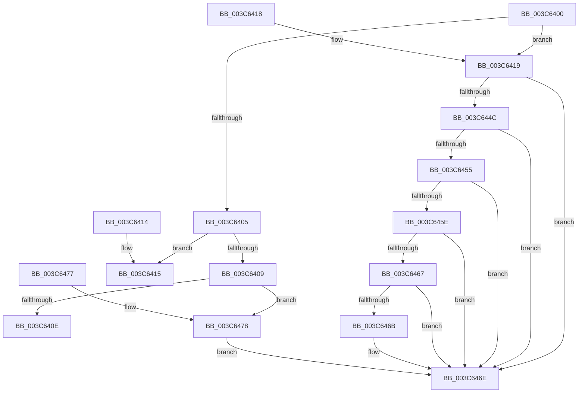

# KiCheckDueTimeExpired

- RVA: `0x003C6400`–`0x003C6487` (길이 `135` bytes)
- VA: `0x00000001403C6400`
- 실행 섹션: `.text`
- PDB 이름 있음: `예`; PDB Function 태그: `아니요`
- unwind 정보 RVA: `0x000DB714`
- 디코드: `38`개 명령, `135/135` bytes 표시
- 미해석 바이트: `0` (있으면 어셈블리에 `.byte`로 보존)

> 이 문서는 커널 이미지의 기계어와 PDB 기호를 분석해 생성했습니다. 4번과 5번은 함수 원형과 자료형을 바이너리 사용 방식에서 추정한 C 해석이며 원본 소스 복구 결과는 아닙니다.

## 1. Dependencies

- 직접 호출 지점: **0**; 고유 호출 대상: **0**
- 직접 호출자로 확인된 함수: **1**
- RIP 상대 이미지 참조: **0**

### Outgoing calls
- 직접 디코드된 call 명령이 없습니다.

### Direct callers
- [KiWaitForAllObjects](KiWaitForAllObjects_function_003C5800.md) at `0x003C5BEE`

### Static image references
- 디코드된 RIP-relative 메모리 참조가 없습니다.

## 2. Other-region calls and transfers

- 다른 실행 섹션으로 향하는 call: **0**
- 별도 외부 분기/꼬리 이동을 확인하지 못했습니다.

## 3. Assembly (complete function range)

```asm
003C6400  83 FA 02                        cmp edx, 2
003C6403  74 14                           je 0x1403c6419
003C6405  85 D2                           test edx, edx
003C6407  74 0C                           je 0x1403c6415
003C6409  4D 85 C0                        test r8, r8
003C640C  75 6A                           jne 0x1403c6478
003C640E  B8 01 00 00 00                  mov eax, 1
003C6413  C3                              ret
003C6414  CC                              int3
003C6415  33 C0                           xor eax, eax
003C6417  C3                              ret
003C6418  CC                              int3
003C6419  48 B8 B0 03 00 00 80 F7 FF FF   movabs rax, 0xfffff780000003b0
003C6423  48 BA 08 00 00 00 80 F7 FF FF   movabs rdx, 0xfffff78000000008
003C642D  48 8B 00                        mov rax, qword ptr [rax]
003C6430  48 8B 12                        mov rdx, qword ptr [rdx]
003C6433  48 2B 91 F8 00 00 00            sub rdx, qword ptr [rcx + 0xf8]
003C643A  48 2B D0                        sub rdx, rax
003C643D  8B 81 B8 03 00 00               mov eax, dword ptr [rcx + 0x3b8]
003C6443  80 B9 87 01 00 00 00            cmp byte ptr [rcx + 0x187], 0
003C644A  74 22                           je 0x1403c646e
003C644C  83 B9 E4 01 00 00 00            cmp dword ptr [rcx + 0x1e4], 0
003C6453  75 19                           jne 0x1403c646e
003C6455  80 B9 86 01 00 00 00            cmp byte ptr [rcx + 0x186], 0
003C645C  75 10                           jne 0x1403c646e
003C645E  80 B9 C0 00 00 00 00            cmp byte ptr [rcx + 0xc0], 0
003C6465  75 07                           jne 0x1403c646e
003C6467  85 C0                           test eax, eax
003C6469  74 03                           je 0x1403c646e
003C646B  4C 03 C0                        add r8, rax
003C646E  33 C0                           xor eax, eax
003C6470  49 3B D0                        cmp rdx, r8
003C6473  0F 97 C0                        seta al
003C6476  C3                              ret
003C6477  CC                              int3
003C6478  48 BA 14 00 00 00 80 F7 FF FF   movabs rdx, 0xfffff78000000014
003C6482  48 8B 12                        mov rdx, qword ptr [rdx]
003C6485  EB E7                           jmp 0x1403c646e
```

## 4. C-style interpretation (structured pseudocode)

```c
__int64 __fastcall KiCheckDueTimeExpired(__int64 a1, int a2, __int64 a3)
{
    __int64 result;

    if (a2 == 2) goto loc_003C6419;
    if (a2 == 0) goto loc_003C6415;
    if (a3 != 0) goto loc_003C6478;
    return 1;
loc_003C6415:
    result = 0;
    return result;
loc_003C6419:
    a2 = (*(unsigned __int64 *)(a2)) - (*(unsigned __int64 *)(a1 + 248));
    a2 = (a2) - (*(unsigned __int64 *)(result));
    if ((*(unsigned __int8 *)(a1 + 391)) == 0) goto loc_003C646E;
    if ((*(unsigned int *)(a1 + 484)) != 0) goto loc_003C646E;
    if ((*(unsigned __int8 *)(a1 + 390)) != 0) goto loc_003C646E;
    if ((*(unsigned __int8 *)(a1 + 192)) != 0) goto loc_003C646E;
    if ((unsigned int)((unsigned int)(*(unsigned int *)(a1 + 952))) != 0) {
        a3 = (a3) + ((unsigned int)(*(unsigned int *)(a1 + 952)));
    }
    result = 0;
    result = (a2 > a3) ? 1 : 0;
    return result;
loc_003C6478:
    goto loc_003C646E;
}
```

## 5. (Beta) C Style

```c
int64_t KiCheckDueTimeExpired(void *Arg1, int32_t Arg2, int64_t Arg3)
{
    uint8_t *arg1 = (uint8_t *)Arg1;

    int64_t result;

    if (Arg2 == 2) goto loc_003C6419;
    if (Arg2 == 0) goto loc_003C6415;
    if (Arg3 != 0) goto loc_003C6478;
    return 1;
loc_003C6415:
    result = 0;
    return result;
loc_003C6419:
    Arg2 = (*(uint64_t *)(Arg2)) - (*(uint64_t *)(arg1 + 0xF8));
    Arg2 = (Arg2) - (*(uint64_t *)(result));
    if ((*(uint8_t *)(arg1 + 0x187)) == 0) goto loc_003C646E;
    if ((*(uint32_t *)(arg1 + 0x1E4)) != 0) goto loc_003C646E;
    if ((*(uint8_t *)(arg1 + 0x186)) != 0) goto loc_003C646E;
    if ((*(uint8_t *)(arg1 + 0xC0)) != 0) goto loc_003C646E;
    if ((uint32_t)((uint32_t)(*(uint32_t *)(arg1 + 0x3B8))) != 0) {
        Arg3 = (Arg3) + ((uint32_t)(*(uint32_t *)(arg1 + 0x3B8)));
    }
    result = 0;
    result = (Arg2 > Arg3) ? 1 : 0;
    return result;
loc_003C6478:
    goto loc_003C646E;
}
```

### 관측된 메모리 오프셋

구조체 형식이 확인되지 않은 접근은 인자 기준의 오프셋으로만 기록했습니다.

| 기준 인자 | 오프셋 표현 | 폭 (bit) | 접근 |
|---|---:|---:|---|
| `Arg1` | `+ 0xC0` | `8` | `R` |
| `Arg1` | `+ 0xF8` | `64` | `R` |
| `Arg1` | `+ 0x186` | `8` | `R` |
| `Arg1` | `+ 0x187` | `8` | `R` |
| `Arg1` | `+ 0x1E4` | `32` | `R` |
| `Arg1` | `+ 0x3B8` | `32` | `R` |

## 6. Execution-region graph

[열기: 2D/3D 그래프와 함수 탐색 컨트롤 패널](../../../control-panel.html?section=text&rva=0x003C6400&view=graph)

- 2D 그래프는 위에서 아래로 흐르고, 3D 그래프는 빈 공간을 드래그해 회전합니다. Shift+드래그는 이동, 휠은 확대·축소, 함수 노드 선택은 대상 보고서 이동입니다.

### Static fallback


