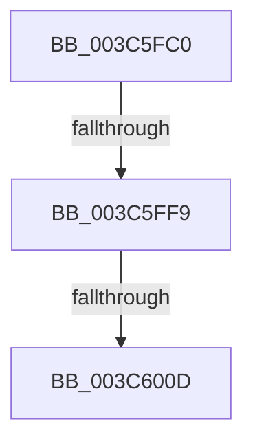

# KiCheckWaitNext

- RVA: `0x003C5FC0`–`0x003C601D` (길이 `93` bytes)
- VA: `0x00000001403C5FC0`
- 실행 섹션: `.text`
- PDB 이름 있음: `예`; PDB Function 태그: `예`
- unwind 정보 RVA: `0x0008E4B4`
- 디코드: `24`개 명령, `93/93` bytes 표시
- 미해석 바이트: `0` (있으면 어셈블리에 `.byte`로 보존)

> 이 문서는 커널 이미지의 기계어와 PDB 기호를 분석해 생성했습니다. 4번과 5번은 함수 원형과 자료형을 바이너리 사용 방식에서 추정한 C 해석이며 원본 소스 복구 결과는 아닙니다.

## 1. Dependencies

- 직접 호출 지점: **0**; 고유 호출 대상: **0**
- 직접 호출자로 확인된 함수: **3**
- RIP 상대 이미지 참조: **1**

### Outgoing calls
- 직접 디코드된 call 명령이 없습니다.

### Direct callers
- [KeWaitForAlertByThreadId](KeWaitForAlertByThreadId_function_003C4B14.md) at `0x003C4BB9`
- [KeRemovePriQueue](KeRemovePriQueue_function_003C5090.md) at `0x003C50E1`
- [KiWaitForAllObjects](KiWaitForAllObjects_function_003C5800.md) at `0x003C58E2`

### Static image references
- `0x003C6001` → RVA `0x00FC6D20` (`ALMOSTRO`; read)

## 2. Other-region calls and transfers

- 다른 실행 섹션으로 향하는 call: **0**
- call이 아닌 외부 분기/꼬리 이동: **2**
  - `0x003C5FF3` → [sub_003C611D + 0x12](Unknown_function_003C611D.md) (`tail-transfer`)
  - `0x003C6007` → [sub_003C611D](Unknown_function_003C611D.md) (`tail-transfer`)

## 3. Assembly (complete function range)

```asm
003C5FC0  48 89 5C 24 18                  mov qword ptr [rsp + 0x18], rbx
003C5FC5  48 89 6C 24 20                  mov qword ptr [rsp + 0x20], rbp
003C5FCA  56                              push rsi
003C5FCB  57                              push rdi
003C5FCC  41 54                           push r12
003C5FCE  41 56                           push r14
003C5FD0  41 57                           push r15
003C5FD2  48 83 EC 20                     sub rsp, 0x20
003C5FD6  33 DB                           xor ebx, ebx
003C5FD8  4D 8B F9                        mov r15, r9
003C5FDB  0F BA 71 74 02                  btr dword ptr [rcx + 0x74], 2
003C5FE0  41 0F B6 E8                     movzx ebp, r8b
003C5FE4  4C 8B F2                        mov r14, rdx
003C5FE7  0F 92 C0                        setb al
003C5FEA  44 8D 63 02                     lea r12d, [rbx + 2]
003C5FEE  48 8B F1                        mov rsi, rcx
003C5FF1  84 C0                           test al, al
003C5FF3  0F 85 36 01 00 00               jne 0x1403c612f
003C5FF9  44 0F 20 C7                     mov rdi, cr8
003C5FFD  45 0F 22 C4                     mov cr8, r12
003C6001  39 1D 19 0D C0 00               cmp dword ptr [rip + 0xc00d19], ebx
003C6007  0F 85 10 01 00 00               jne 0x1403c611d
003C600D  40 88 BE 86 01 00 00            mov byte ptr [rsi + 0x186], dil
003C6014  65 48 8B 3C 25 20 00 00 00      mov rdi, qword ptr gs:[0x20]
```

## 4. C-style interpretation (structured pseudocode)

```c
__int64 __fastcall KiCheckWaitNext(__int64 a1, __int64 a2, unsigned __int8 a3, __int64 a4)
{
    __int64 result;
    __int64 v_rbx;
    __int64 v_rsp;
    unsigned __int64 v_stack_p18;
    unsigned __int64 v_stack_p20;

    v_stack_p18 = v_rbx;
    v_stack_p20 = v_rbp;
    v_rsp = (v_rsp) - (32);
    v_rbx = 0;
    result = (condition_is_below) ? 1 : 0;
    *(unsigned __int8 *)(a1 + 390) = (unsigned __int8)(v_cr8);
    return result;
}
```

## 5. (Beta) C Style

```c
int64_t KiCheckWaitNext(void *Arg1, int64_t Arg2, uint8_t Arg3, int64_t Arg4)
{
    uint8_t *arg1 = (uint8_t *)Arg1;

    int64_t result;
    int64_t local_rbx;
    int64_t local_rsp;
    uint64_t v_stack_p18;
    uint64_t v_stack_p20;

    v_stack_p18 = local_rbx;
    v_stack_p20 = local_rbp;
    local_rsp = (local_rsp) - (32);
    local_rbx = 0;
    result = (condition_is_below) ? 1 : 0;
    *(uint8_t *)(arg1 + 0x186) = (uint8_t)(v_cr8);
    return result;
}
```

### 관측된 메모리 오프셋

구조체 형식이 확인되지 않은 접근은 인자 기준의 오프셋으로만 기록했습니다.

| 기준 인자 | 오프셋 표현 | 폭 (bit) | 접근 |
|---|---:|---:|---|
| `Arg1` | `+ 0x74` | `32` | `R/W` |
| `Arg1` | `+ 0x186` | `8` | `W` |

## 6. Execution-region graph

[열기: 2D/3D 그래프와 함수 탐색 컨트롤 패널](../../../control-panel.html?section=text&rva=0x003C5FC0&view=graph)

- 2D 그래프는 위에서 아래로 흐르고, 3D 그래프는 빈 공간을 드래그해 회전합니다. Shift+드래그는 이동, 휠은 확대·축소, 함수 노드 선택은 대상 보고서 이동입니다.

### Static fallback


