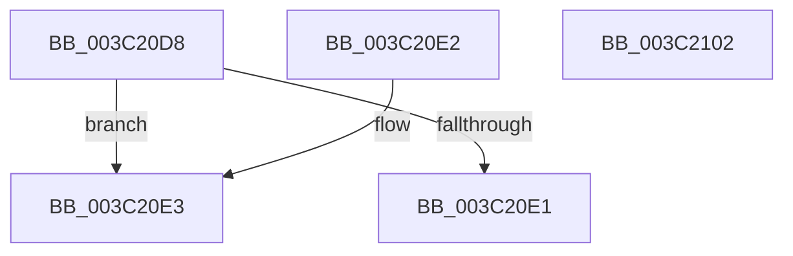

# KiClearForegroundBoost

- RVA: `0x003C20D8`–`0x003C2103` (길이 `43` bytes)
- VA: `0x00000001403C20D8`
- 실행 섹션: `.text`
- PDB 이름 있음: `예`; PDB Function 태그: `아니요`
- unwind 정보 RVA: `0x000DB714`
- 디코드: `11`개 명령, `43/43` bytes 표시
- 미해석 바이트: `0` (있으면 어셈블리에 `.byte`로 보존)

> 이 문서는 커널 이미지의 기계어와 PDB 기호를 분석해 생성했습니다. 4번과 5번은 함수 원형과 자료형을 바이너리 사용 방식에서 추정한 C 해석이며 원본 소스 복구 결과는 아닙니다.

## 1. Dependencies

- 직접 호출 지점: **0**; 고유 호출 대상: **0**
- 직접 호출자로 확인된 함수: **5**
- RIP 상대 이미지 참조: **0**

### Outgoing calls
- 직접 디코드된 call 명령이 없습니다.

### Direct callers
- [sub_0021C0DA](../21/Unknown_function_0021C0DA.md) at `0x0021C10C`
- [KiSetDisableBoostThread](KiSetDisableBoostThread_function_003C1A5C.md) at `0x003C1AF4`
- [KiComputeNewPriority](KiComputeNewPriority_function_003C2D8C.md) at `0x003C2E32`
- [KeSetPriorityAndQuantumProcess](KeSetPriorityAndQuantumProcess_function_003C2EC0.md) at `0x003C31CF`
- [KeSetPriorityAndQuantumProcess](KeSetPriorityAndQuantumProcess_function_003C2EC0.md) at `0x003C33D7`
- [KiComputeNewPriorityNonStacking](../5C/KiComputeNewPriorityNonStacking_function_005CA75C.md) at `0x005CA7AC`

### Static image references
- 디코드된 RIP-relative 메모리 참조가 없습니다.

## 2. Other-region calls and transfers

- 다른 실행 섹션으로 향하는 call: **0**
- 별도 외부 분기/꼬리 이동을 확인하지 못했습니다.

## 3. Assembly (complete function range)

```asm
003C20D8  F6 81 06 02 00 00 0F            test byte ptr [rcx + 0x206], 0xf
003C20DF  75 02                           jne 0x1403c20e3
003C20E1  C3                              ret
003C20E2  CC                              int3
003C20E3  48 B8 20 03 00 00 80 F7 FF FF   movabs rax, 0xfffff78000000320
003C20ED  8B 00                           mov eax, dword ptr [rax]
003C20EF  89 81 68 03 00 00               mov dword ptr [rcx + 0x368], eax
003C20F5  B8 F0 FF 00 00                  mov eax, 0xfff0
003C20FA  66 21 81 06 02 00 00            and word ptr [rcx + 0x206], ax
003C2101  C3                              ret
003C2102  CC                              int3
```

## 4. C-style interpretation (structured pseudocode)

```c
__int64 __fastcall KiClearForegroundBoost(__int64 a1)
{
    if (((*(unsigned __int8 *)(a1 + 518)) & (15)) != 0) goto loc_003C20E3;
    return result;
loc_003C20E3:
    *(unsigned int *)(a1 + 872) = (unsigned int)((unsigned int)(*(unsigned int *)(result)));
    return (unsigned int)(0xFFF0ULL);
}
```

## 5. (Beta) C Style

```c
int64_t KiClearForegroundBoost(void *Arg1)
{
    uint8_t *arg1 = (uint8_t *)Arg1;

    if (((*(uint8_t *)(arg1 + 0x206)) & (15)) != 0) goto loc_003C20E3;
    return result;
loc_003C20E3:
    *(uint32_t *)(arg1 + 0x368) = (uint32_t)((uint32_t)(*(uint32_t *)(result)));
    return (uint32_t)(0xFFF0ULL);
}
```

### 관측된 메모리 오프셋

구조체 형식이 확인되지 않은 접근은 인자 기준의 오프셋으로만 기록했습니다.

| 기준 인자 | 오프셋 표현 | 폭 (bit) | 접근 |
|---|---:|---:|---|
| `Arg1` | `+ 0x206` | `8` | `R` |
| `Arg1` | `+ 0x206` | `16` | `R/W` |
| `Arg1` | `+ 0x368` | `32` | `W` |

## 6. Execution-region graph

[열기: 2D/3D 그래프와 함수 탐색 컨트롤 패널](../../../control-panel.html?section=text&rva=0x003C20D8&view=graph)

- 2D 그래프는 위에서 아래로 흐르고, 3D 그래프는 빈 공간을 드래그해 회전합니다. Shift+드래그는 이동, 휠은 확대·축소, 함수 노드 선택은 대상 보고서 이동입니다.

### Static fallback


