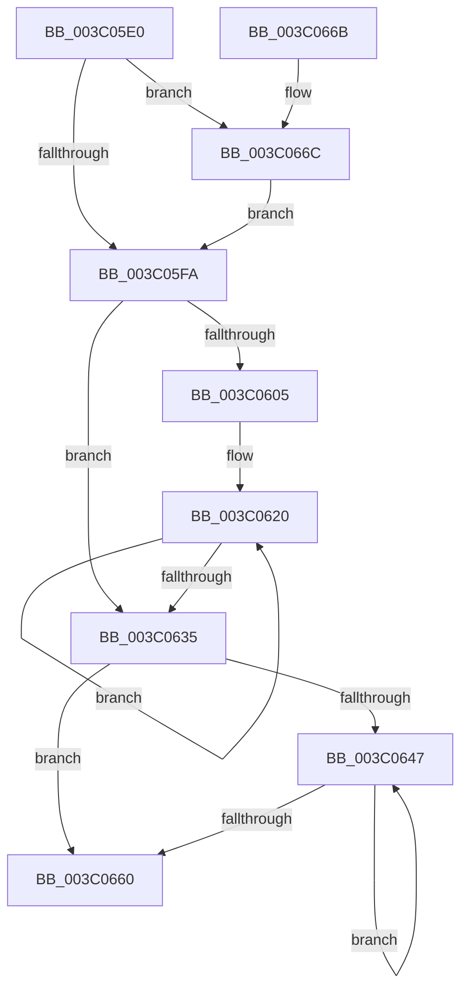

# KiComplementAffinityEx

- RVA: `0x003C05E0`–`0x003C0672` (길이 `146` bytes)
- VA: `0x00000001403C05E0`
- 실행 섹션: `.text`
- PDB 이름 있음: `예`; PDB Function 태그: `아니요`
- unwind 정보 RVA: `0x0008DFC4`
- 디코드: `40`개 명령, `146/146` bytes 표시
- 미해석 바이트: `0` (있으면 어셈블리에 `.byte`로 보존)

> 이 문서는 커널 이미지의 기계어와 PDB 기호를 분석해 생성했습니다. 4번과 5번은 함수 원형과 자료형을 바이너리 사용 방식에서 추정한 C 해석이며 원본 소스 복구 결과는 아닙니다.

## 1. Dependencies

- 직접 호출 지점: **0**; 고유 호출 대상: **0**
- 직접 호출자로 확인된 함수: **6**
- RIP 상대 이미지 참조: **0**

### Outgoing calls
- 직접 디코드된 call 명령이 없습니다.

### Direct callers
- [KiForwardTick](../39/KiForwardTick_function_0039D40C.md) at `0x0039D4F8`
- [KiGetDeepIdleProcessors](KiGetDeepIdleProcessors_function_003C0268.md) at `0x003C02C5`
- [KeFlushQueuedDpcs](KeFlushQueuedDpcs_function_003C0300.md) at `0x003C03E1`
- [KeComplementAffinityEx2](KeComplementAffinityEx2_function_003C05C0.md) at `0x003C05CB`
- [KeComplementAffinityEx](../5B/KeComplementAffinityEx_function_005B95C0.md) at `0x005B95CC`
- [PpmParkComputeUnparkMaskEx](../5E/PpmParkComputeUnparkMaskEx_function_005E05E0.md) at `0x005E11BD`
- [PpmParkComputeUnparkMaskEx](../5E/PpmParkComputeUnparkMaskEx_function_005E05E0.md) at `0x005E1253`

### Static image references
- 디코드된 RIP-relative 메모리 참조가 없습니다.

## 2. Other-region calls and transfers

- 다른 실행 섹션으로 향하는 call: **0**
- 별도 외부 분기/꼬리 이동을 확인하지 못했습니다.

## 3. Assembly (complete function range)

```asm
003C05E0  48 89 5C 24 08                  mov qword ptr [rsp + 8], rbx
003C05E5  48 89 7C 24 10                  mov qword ptr [rsp + 0x10], rdi
003C05EA  45 0F B7 08                     movzx r9d, word ptr [r8]
003C05EE  4C 8B D9                        mov r11, rcx
003C05F1  0F B7 DA                        movzx ebx, dx
003C05F4  66 44 3B CB                     cmp r9w, bx
003C05F8  77 72                           ja 0x1403c066c
003C05FA  33 FF                           xor edi, edi
003C05FC  44 8B D7                        mov r10d, edi
003C05FF  66 41 3B F9                     cmp di, r9w
003C0603  73 30                           jae 0x1403c0635
003C0605  45 0F B7 D1                     movzx r10d, r9w
003C0609  48 8D 41 08                     lea rax, [rcx + 8]
003C060D  41 8B D2                        mov edx, r10d
003C0610  4D 2B C3                        sub r8, r11
003C0613  0F 1F 40 00                     nop dword ptr [rax]
003C0617  66 0F 1F 84 00 00 00 00 00      nop word ptr [rax + rax]
003C0620  49 8B 0C 00                     mov rcx, qword ptr [r8 + rax]
003C0624  48 8D 40 08                     lea rax, [rax + 8]
003C0628  48 F7 D1                        not rcx
003C062B  48 89 48 F8                     mov qword ptr [rax - 8], rcx
003C062F  48 83 EA 01                     sub rdx, 1
003C0633  75 EB                           jne 0x1403c0620
003C0635  41 89 7B 04                     mov dword ptr [r11 + 4], edi
003C0639  66 41 89 1B                     mov word ptr [r11], bx
003C063D  66 41 89 5B 02                  mov word ptr [r11 + 2], bx
003C0642  44 3B D3                        cmp r10d, ebx
003C0645  73 19                           jae 0x1403c0660
003C0647  41 8B C2                        mov eax, r10d
003C064A  41 FF C2                        inc r10d
003C064D  49 C7 44 C3 08 FF FF FF FF      mov qword ptr [r11 + rax*8 + 8], 0xffffffffffffffff
003C0656  41 0F B7 43 02                  movzx eax, word ptr [r11 + 2]
003C065B  44 3B D0                        cmp r10d, eax
003C065E  72 E7                           jb 0x1403c0647
003C0660  48 8B 5C 24 08                  mov rbx, qword ptr [rsp + 8]
003C0665  48 8B 7C 24 10                  mov rdi, qword ptr [rsp + 0x10]
003C066A  C3                              ret
003C066B  CC                              int3
003C066C  44 0F B7 CB                     movzx r9d, bx
003C0670  EB 88                           jmp 0x1403c05fa
```

## 4. C-style interpretation (structured pseudocode)

```c
__int64 __fastcall KiComplementAffinityEx(__int64 a1, unsigned __int16 a2, __int64 a3)
{
    __int64 v_r10;
    __int64 v_rdi;
    unsigned __int64 v_stack_p10;
    unsigned __int64 v_stack_p8;

    v_stack_p8 = v_rbx;
    v_stack_p10 = v_rdi;
    if (((unsigned __int16)(*(unsigned __int16 *)(a3))) > a2) goto loc_003C066C;
loc_003C05FA:
    v_rdi = 0;
    if (0 >= ((unsigned __int16)(*(unsigned __int16 *)(a3)))) goto loc_003C0635;
    a3 = (a3) - (a1);
loc_003C0620:
    a1 = ~(*(unsigned __int64 *)(a3 + a1 + 8 * 1));
    *(unsigned __int64 *)(a1 + 8 + 8 - 8) = a1;
    a2 = ((unsigned int)((unsigned int)((unsigned __int16)(*(unsigned __int16 *)(a3))))) - (1);
    if (condition_is_not_equal) goto loc_003C0620;
loc_003C0635:
    *(unsigned int *)(a1 + 4) = 0;
    *(unsigned __int16 *)(a1) = a2;
    *(unsigned __int16 *)(a1 + 2) = a2;
    if (((unsigned int)((unsigned __int16)(*(unsigned __int16 *)(a3)))) >= a2) goto loc_003C0660;
loc_003C0647:
    v_r10 = (unsigned int)(((unsigned __int16)(*(unsigned __int16 *)(a3))) + 1);
    *(unsigned __int64 *)(a1 + (unsigned int)((unsigned int)((unsigned __int16)(*(unsigned __int16 *)(a3)))) * 8 + 8) = -1;
    if (((unsigned int)(v_r10)) < ((unsigned int)(*(unsigned __int16 *)(a1 + 2)))) goto loc_003C0647;
loc_003C0660:
    return *(unsigned __int16 *)(a1 + 2);
loc_003C066C:
    goto loc_003C05FA;
}
```

## 5. (Beta) C Style

```c
int64_t KiComplementAffinityEx(void *Arg1, uint16_t Arg2, void *Arg3)
{
    uint8_t *arg1 = (uint8_t *)Arg1;
    uint8_t *arg3 = (uint8_t *)Arg3;

    int64_t local_r10;
    int64_t local_rdi;
    uint64_t v_stack_p10;
    uint64_t v_stack_p8;

    v_stack_p8 = local_rbx;
    v_stack_p10 = local_rdi;
    if (((uint16_t)(*(uint16_t *)(arg3))) > Arg2) goto loc_003C066C;
loc_003C05FA:
    local_rdi = 0;
    if (0 >= ((uint16_t)(*(uint16_t *)(arg3)))) goto loc_003C0635;
    Arg3 = (Arg3) - (Arg1);
loc_003C0620:
    Arg1 = ~(*(uint64_t *)(arg3 + arg1 + 0x8 * 1));
    *(void **)(arg1 + 0x8 + 0x8 - 0x8) = Arg1;
    Arg2 = ((uint32_t)((uint32_t)((uint16_t)(*(uint16_t *)(arg3))))) - (1);
    if (condition_is_not_equal) goto loc_003C0620;
loc_003C0635:
    *(uint32_t *)(arg1 + 0x4) = 0;
    *(uint16_t *)(arg1) = Arg2;
    *(uint16_t *)(arg1 + 0x2) = Arg2;
    if (((uint32_t)((uint16_t)(*(uint16_t *)(arg3)))) >= Arg2) goto loc_003C0660;
loc_003C0647:
    local_r10 = (uint32_t)(((uint16_t)(*(uint16_t *)(arg3))) + 1);
    *(uint64_t *)(arg1 + (uint32_t)((uint32_t)((uint16_t)(*(uint16_t *)(arg3)))) * 8 + 0x8) = -1;
    if (((uint32_t)(local_r10)) < ((uint32_t)(*(uint16_t *)(arg1 + 0x2)))) goto loc_003C0647;
loc_003C0660:
    return *(uint16_t *)(arg1 + 0x2);
loc_003C066C:
    goto loc_003C05FA;
}
```

### 관측된 메모리 오프셋

구조체 형식이 확인되지 않은 접근은 인자 기준의 오프셋으로만 기록했습니다.

| 기준 인자 | 오프셋 표현 | 폭 (bit) | 접근 |
|---|---:|---:|---|
| `Arg1` | `- 0x8` | `64` | `W` |
| `Arg1` | `+ 0x0` | `16` | `W` |
| `Arg1` | `+ 0x0` | `32` | `R` |
| `Arg1` | `+ 0x0 + rax*1` | `16` | `R` |
| `Arg1` | `+ 0x2` | `16` | `R` |
| `Arg1` | `+ 0x2` | `16` | `W` |
| `Arg1` | `+ 0x4` | `32` | `W` |
| `Arg1` | `+ 0x8` | `64` | `R` |
| `Arg1` | `+ 0x8 + rax*8` | `64` | `W` |
| `Arg3` | `+ 0x0` | `16` | `R` |
| `Arg3` | `+ 0x0 + rax*1` | `64` | `R` |

## 6. Execution-region graph

[열기: 2D/3D 그래프와 함수 탐색 컨트롤 패널](../../../control-panel.html?section=text&rva=0x003C05E0&view=graph)

- 2D 그래프는 위에서 아래로 흐르고, 3D 그래프는 빈 공간을 드래그해 회전합니다. Shift+드래그는 이동, 휠은 확대·축소, 함수 노드 선택은 대상 보고서 이동입니다.

### Static fallback


