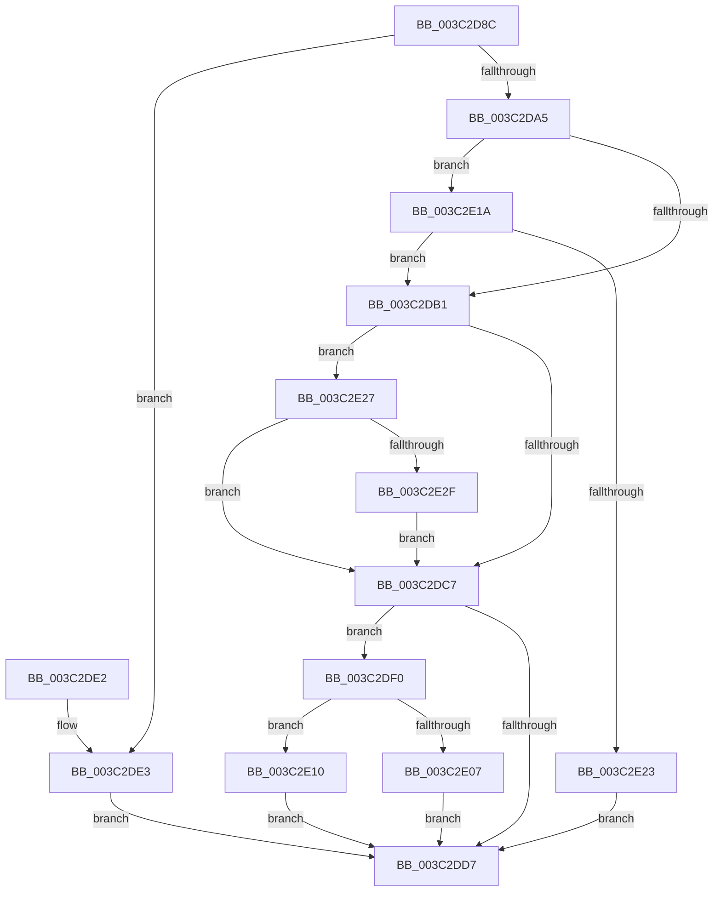

# KiComputeNewPriority

- RVA: `0x003C2D8C`–`0x003C2E39` (길이 `173` bytes)
- VA: `0x00000001403C2D8C`
- 실행 섹션: `.text`
- PDB 이름 있음: `예`; PDB Function 태그: `아니요`
- unwind 정보 RVA: `0x0008E288`
- 디코드: `52`개 명령, `173/173` bytes 표시
- 미해석 바이트: `0` (있으면 어셈블리에 `.byte`로 보존)

> 이 문서는 커널 이미지의 기계어와 PDB 기호를 분석해 생성했습니다. 4번과 5번은 함수 원형과 자료형을 바이너리 사용 방식에서 추정한 C 해석이며 원본 소스 복구 결과는 아닙니다.

## 1. Dependencies

- 직접 호출 지점: **4**; 고유 호출 대상: **4**
- 직접 호출자로 확인된 함수: **5**
- RIP 상대 이미지 참조: **1**

### Outgoing calls
- `0x003C2D9C` → [Feature_StackingDecayBoosts__private_IsEnabledNoReportingNoInline](../4E/Feature_StackingDecayBoosts__private_IsEnabledNoReportingNoInline_function_004EF7C0.md) (function, `0x004EF7C0`)
- `0x003C2DCD` → [KiComputeThreadPriority](KiComputeThreadPriority_function_003C45F4.md) (function, `0x003C45F4`)
- `0x003C2DE9` → [KiComputeNewPriorityNonStacking](../5C/KiComputeNewPriorityNonStacking_function_005CA75C.md) (function, `0x005CA75C`)
- `0x003C2E32` → [KiClearForegroundBoost](KiClearForegroundBoost_function_003C20D8.md) (function, `0x003C20D8`)

### Direct callers
- [KeYieldExecution](../20/KeYieldExecution_function_00209FA0.md) at `0x0020A15E`
- [KiQueueReadyThread](../21/KiQueueReadyThread_function_0021C7B0.md) at `0x0021CECC`
- [sub_0021D7F8](../21/Unknown_function_0021D7F8.md) at `0x0021D977`
- [sub_0021D7F8](../21/Unknown_function_0021D7F8.md) at `0x0021E8E5`
- [sub_0025308F](../25/Unknown_function_0025308F.md) at `0x00253116`
- [sub_002546EC](../25/Unknown_function_002546EC.md) at `0x00254BEB`
- [sub_002546EC](../25/Unknown_function_002546EC.md) at `0x00254DC6`

### Static image references
- `0x003C2DBE` → RVA `0x00FC50A0` (`ALMOSTRO`; read)

## 2. Other-region calls and transfers

- 다른 실행 섹션으로 향하는 call: **0**
- 별도 외부 분기/꼬리 이동을 확인하지 못했습니다.

## 3. Assembly (complete function range)

```asm
003C2D8C  48 89 5C 24 08                  mov qword ptr [rsp + 8], rbx
003C2D91  57                              push rdi
003C2D92  48 83 EC 20                     sub rsp, 0x20
003C2D96  41 8A F8                        mov dil, r8b
003C2D99  48 8B D9                        mov rbx, rcx
003C2D9C  E8 1F CA 12 00                  call 0x1404ef7c0
003C2DA1  85 C0                           test eax, eax
003C2DA3  74 3E                           je 0x1403c2de3
003C2DA5  0F BE 8B C3 00 00 00            movsx ecx, byte ptr [rbx + 0xc3]
003C2DAC  80 F9 10                        cmp cl, 0x10
003C2DAF  7D 69                           jge 0x1403c2e1a
003C2DB1  40 8A C7                        mov al, dil
003C2DB4  F6 D8                           neg al
003C2DB6  1B D2                           sbb edx, edx
003C2DB8  83 E2 F8                        and edx, 0xfffffff8
003C2DBB  83 C2 0A                        add edx, 0xa
003C2DBE  83 3D DB 22 C0 00 00            cmp dword ptr [rip + 0xc022db], 0
003C2DC5  75 60                           jne 0x1403c2e27
003C2DC7  41 B0 01                        mov r8b, 1
003C2DCA  48 8B CB                        mov rcx, rbx
003C2DCD  E8 22 18 00 00                  call 0x1403c45f4
003C2DD2  40 84 FF                        test dil, dil
003C2DD5  75 19                           jne 0x1403c2df0
003C2DD7  48 8B 5C 24 30                  mov rbx, qword ptr [rsp + 0x30]
003C2DDC  48 83 C4 20                     add rsp, 0x20
003C2DE0  5F                              pop rdi
003C2DE1  C3                              ret
003C2DE2  CC                              int3
003C2DE3  44 8A C7                        mov r8b, dil
003C2DE6  48 8B CB                        mov rcx, rbx
003C2DE9  E8 6E 79 20 00                  call 0x1405ca75c
003C2DEE  EB E7                           jmp 0x1403c2dd7
003C2DF0  B9 0F F0 00 00                  mov ecx, 0xf00f
003C2DF5  66 21 8B 06 02 00 00            and word ptr [rbx + 0x206], cx
003C2DFC  8A 8B 66 03 00 00               mov cl, byte ptr [rbx + 0x366]
003C2E02  80 F9 01                        cmp cl, 1
003C2E05  7D 09                           jge 0x1403c2e10
003C2E07  C6 83 66 03 00 00 00            mov byte ptr [rbx + 0x366], 0
003C2E0E  EB C7                           jmp 0x1403c2dd7
003C2E10  FE C9                           dec cl
003C2E12  88 8B 66 03 00 00               mov byte ptr [rbx + 0x366], cl
003C2E18  EB BD                           jmp 0x1403c2dd7
003C2E1A  F7 43 78 00 00 40 00            test dword ptr [rbx + 0x78], 0x400000
003C2E21  75 8E                           jne 0x1403c2db1
003C2E23  8B C1                           mov eax, ecx
003C2E25  EB B0                           jmp 0x1403c2dd7
003C2E27  83 CA 01                        or edx, 1
003C2E2A  40 84 FF                        test dil, dil
003C2E2D  74 98                           je 0x1403c2dc7
003C2E2F  48 8B CB                        mov rcx, rbx
003C2E32  E8 A1 F2 FF FF                  call 0x1403c20d8
003C2E37  EB 8E                           jmp 0x1403c2dc7
```

## 4. C-style interpretation (structured pseudocode)

```c
__int64 __fastcall KiComputeNewPriority(__int64 a1, int a2, unsigned __int8 a3)
{
    __int64 result;
    __int64 v_rsp;
    unsigned __int64 v_stack_p8;

    v_stack_p8 = v_rbx;
    v_rsp = (v_rsp) - (32);
    result = Feature_StackingDecayBoosts__private_IsEnabledNoReportingNoInline(a1, a2, a3, a4);
    if ((unsigned int)(result) == 0) goto loc_003C2DE3;
    if (((unsigned __int8)((__int8)(*(unsigned __int8 *)(a1 + 195)))) >= 16) goto loc_003C2E1A;
loc_003C2DB1:
    result = (unsigned __int8)(-(a3));
    a2 = (unsigned int)((a2) & (0xFFFFFFF8ULL));
    a2 = (unsigned int)((a2) + (10));
    if ((*(unsigned int *)(v_rip + 12591835)) != 0) goto loc_003C2E27;
loc_003C2DC7:
    result = KiComputeThreadPriority(a1, a2, 1, a4);
    if (a3 != 0) goto loc_003C2DF0;
loc_003C2DD7:
    v_rsp = (v_rsp) + (32);
    return result;
loc_003C2DE3:
    result = KiComputeNewPriorityNonStacking(v_stack_p8, a2, a3, a4);
    goto loc_003C2DD7;
loc_003C2DF0:
    if (((unsigned __int8)(*(unsigned __int8 *)(v_stack_p8 + 870))) >= 1) goto loc_003C2E10;
    *(unsigned __int8 *)(v_stack_p8 + 870) = 0;
    goto loc_003C2DD7;
loc_003C2E10:
    a1 = (unsigned __int8)((*(unsigned __int8 *)(v_stack_p8 + 870)) - 1);
    *(unsigned __int8 *)(v_stack_p8 + 870) = (unsigned __int8)(a1);
    goto loc_003C2DD7;
loc_003C2E1A:
    if (((*(unsigned int *)(v_stack_p8 + 120)) & (0x400000ULL)) != 0) goto loc_003C2DB1;
    goto loc_003C2DD7;
loc_003C2E27:
    a2 = (unsigned int)((a2) | (1));
    if (a3 == 0) goto loc_003C2DC7;
    result = KiClearForegroundBoost(v_stack_p8, a2, a3, a4);
    goto loc_003C2DC7;
}
```

## 5. (Beta) C Style

```c
int64_t KiComputeNewPriority(void *Arg1, int32_t Arg2, uint8_t Arg3)
{
    uint8_t *arg1 = (uint8_t *)Arg1;

    int64_t result;
    int64_t local_rsp;
    uint64_t v_stack_p8;

    v_stack_p8 = local_rbx;
    local_rsp = (local_rsp) - (32);
    result = Feature_StackingDecayBoosts__private_IsEnabledNoReportingNoInline(Arg1, Arg2, Arg3, a4);
    if ((uint32_t)(result) == 0) goto loc_003C2DE3;
    if (((uint8_t)((int8_t)(*(uint8_t *)(arg1 + 0xC3)))) >= 16) goto loc_003C2E1A;
loc_003C2DB1:
    result = (uint8_t)(-(Arg3));
    Arg2 = (uint32_t)((Arg2) & (0xFFFFFFF8ULL));
    Arg2 = (uint32_t)((Arg2) + (10));
    if ((*(uint32_t *)(v_rip + 0xC022DB)) != 0) goto loc_003C2E27;
loc_003C2DC7:
    result = KiComputeThreadPriority(Arg1, Arg2, 1, a4);
    if (Arg3 != 0) goto loc_003C2DF0;
loc_003C2DD7:
    local_rsp = (local_rsp) + (32);
    return result;
loc_003C2DE3:
    result = KiComputeNewPriorityNonStacking(v_stack_p8, Arg2, Arg3, a4);
    goto loc_003C2DD7;
loc_003C2DF0:
    if (((uint8_t)(*(uint8_t *)(v_stack_p8 + 0x366))) >= 1) goto loc_003C2E10;
    *(uint8_t *)(v_stack_p8 + 0x366) = 0;
    goto loc_003C2DD7;
loc_003C2E10:
    Arg1 = (uint8_t)((*(uint8_t *)(v_stack_p8 + 0x366)) - 1);
    *(uint8_t *)(v_stack_p8 + 0x366) = (uint8_t)(Arg1);
    goto loc_003C2DD7;
loc_003C2E1A:
    if (((*(uint32_t *)(v_stack_p8 + 0x78)) & (0x400000ULL)) != 0) goto loc_003C2DB1;
    goto loc_003C2DD7;
loc_003C2E27:
    Arg2 = (uint32_t)((Arg2) | (1));
    if (Arg3 == 0) goto loc_003C2DC7;
    result = KiClearForegroundBoost(v_stack_p8, Arg2, Arg3, a4);
    goto loc_003C2DC7;
}
```

### 관측된 메모리 오프셋

구조체 형식이 확인되지 않은 접근은 인자 기준의 오프셋으로만 기록했습니다.

| 기준 인자 | 오프셋 표현 | 폭 (bit) | 접근 |
|---|---:|---:|---|
| `Arg1` | `+ 0x78` | `32` | `R` |
| `Arg1` | `+ 0xC3` | `8` | `R` |
| `Arg1` | `+ 0x206` | `16` | `R/W` |
| `Arg1` | `+ 0x366` | `8` | `R` |
| `Arg1` | `+ 0x366` | `8` | `W` |

## 6. Execution-region graph

[열기: 2D/3D 그래프와 함수 탐색 컨트롤 패널](../../../control-panel.html?section=text&rva=0x003C2D8C&view=graph)

- 2D 그래프는 위에서 아래로 흐르고, 3D 그래프는 빈 공간을 드래그해 회전합니다. Shift+드래그는 이동, 휠은 확대·축소, 함수 노드 선택은 대상 보고서 이동입니다.

### Static fallback


