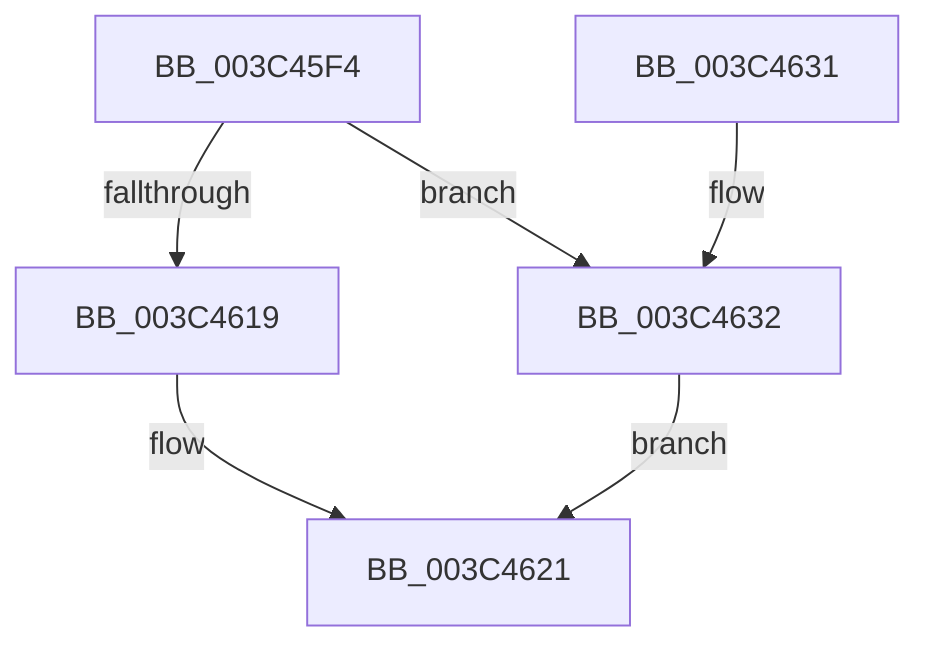

# KiComputeThreadPriority

- RVA: `0x003C45F4`–`0x003C4639` (길이 `69` bytes)
- VA: `0x00000001403C45F4`
- 실행 섹션: `.text`
- PDB 이름 있음: `예`; PDB Function 태그: `아니요`
- unwind 정보 RVA: `0x0006383C`
- 디코드: `22`개 명령, `69/69` bytes 표시
- 미해석 바이트: `0` (있으면 어셈블리에 `.byte`로 보존)

> 이 문서는 커널 이미지의 기계어와 PDB 기호를 분석해 생성했습니다. 4번과 5번은 함수 원형과 자료형을 바이너리 사용 방식에서 추정한 C 해석이며 원본 소스 복구 결과는 아닙니다.

## 1. Dependencies

- 직접 호출 지점: **3**; 고유 호출 대상: **3**
- 직접 호출자로 확인된 함수: **19**
- RIP 상대 이미지 참조: **0**

### Outgoing calls
- `0x003C460B` → [Feature_StackingDecayBoosts__private_IsEnabledNoReportingNoInline](../4E/Feature_StackingDecayBoosts__private_IsEnabledNoReportingNoInline_function_004EF7C0.md) (function, `0x004EF7C0`)
- `0x003C461C` → [KiComputeThreadPriorityStacking](../4E/KiComputeThreadPriorityStacking_function_004EF7F8.md) (function, `0x004EF7F8`)
- `0x003C4632` → [KiComputeThreadPriorityNonStacking](../5C/KiComputeThreadPriorityNonStacking_function_005CA81C.md) (function, `0x005CA81C`)

### Direct callers
- [KiRemoveBoostThread](../21/KiRemoveBoostThread_function_00219128.md) at `0x0021931C`
- [KiRemoveBoostThread](../21/KiRemoveBoostThread_function_00219128.md) at `0x0021934D`
- [sub_0021D7F8](../21/Unknown_function_0021D7F8.md) at `0x0021DA0C`
- [sub_0021D7F8](../21/Unknown_function_0021D7F8.md) at `0x0021DBB3`
- [sub_0021D7F8](../21/Unknown_function_0021D7F8.md) at `0x0021E5BF`
- [sub_0025308F](../25/Unknown_function_0025308F.md) at `0x002543B8`
- [sub_002546EC](../25/Unknown_function_002546EC.md) at `0x0025496B`
- [KeSetPriorityThread](../2C/KeSetPriorityThread_function_002C76E0.md) at `0x002C7808`
- [KiUpdateVpBackingThreadPriorityFromTopLevel](../30/KiUpdateVpBackingThreadPriorityFromTopLevel_function_00303BA0.md) at `0x00303CC9`
- [KiUpdateVPBackingThreadPriority](../30/KiUpdateVPBackingThreadPriority_function_00306040.md) at `0x003060C6`
- [KiSetDisableBoostThread](KiSetDisableBoostThread_function_003C1A5C.md) at `0x003C1B01`
- [KiInitializeForegroundBoostThread](KiInitializeForegroundBoostThread_function_003C28D8.md) at `0x003C2911`
- [KiComputeNewPriority](KiComputeNewPriority_function_003C2D8C.md) at `0x003C2DCD`
- [KeSetPriorityAndQuantumProcess](KeSetPriorityAndQuantumProcess_function_003C2EC0.md) at `0x003C3139`
- [KeAdjustPriorityFloor](KeAdjustPriorityFloor_function_003C3574.md) at `0x003C3690`
- [KeSetActualBasePriorityThread](KeSetActualBasePriorityThread_function_003C4370.md) at `0x003C447E`
- [KeRemovePriQueue](KeRemovePriQueue_function_003C5090.md) at `0x003C5562`
- [KeSetBasePriorityThread](KeSetBasePriorityThread_function_003C6EB0.md) at `0x003C7014`
- [KeBoostPriorityThread](../4D/KeBoostPriorityThread_function_004D37F8.md) at `0x004D3911`
- [KiApplyForegroundBoostThread](../4F/KiApplyForegroundBoostThread_function_004F7DC0.md) at `0x004F7E4C`
- [KiComputeNewPriorityNonStacking](../5C/KiComputeNewPriorityNonStacking_function_005CA75C.md) at `0x005CA7B7`
- [sub_006E7EC2](../6E/Unknown_function_006E7EC2.md) at `0x006E7F67`

### Static image references
- 디코드된 RIP-relative 메모리 참조가 없습니다.

## 2. Other-region calls and transfers

- 다른 실행 섹션으로 향하는 call: **0**
- 별도 외부 분기/꼬리 이동을 확인하지 못했습니다.

## 3. Assembly (complete function range)

```asm
003C45F4  48 89 5C 24 08                  mov qword ptr [rsp + 8], rbx
003C45F9  48 89 74 24 10                  mov qword ptr [rsp + 0x10], rsi
003C45FE  57                              push rdi
003C45FF  48 83 EC 20                     sub rsp, 0x20
003C4603  41 8A F0                        mov sil, r8b
003C4606  8B DA                           mov ebx, edx
003C4608  48 8B F9                        mov rdi, rcx
003C460B  E8 B0 B1 12 00                  call 0x1404ef7c0
003C4610  8B D3                           mov edx, ebx
003C4612  48 8B CF                        mov rcx, rdi
003C4615  85 C0                           test eax, eax
003C4617  74 19                           je 0x1403c4632
003C4619  44 8A C6                        mov r8b, sil
003C461C  E8 D7 B1 12 00                  call 0x1404ef7f8
003C4621  48 8B 5C 24 30                  mov rbx, qword ptr [rsp + 0x30]
003C4626  48 8B 74 24 38                  mov rsi, qword ptr [rsp + 0x38]
003C462B  48 83 C4 20                     add rsp, 0x20
003C462F  5F                              pop rdi
003C4630  C3                              ret
003C4631  CC                              int3
003C4632  E8 E5 61 20 00                  call 0x1405ca81c
003C4637  EB E8                           jmp 0x1403c4621
```

## 4. C-style interpretation (structured pseudocode)

```c
__int64 __fastcall KiComputeThreadPriority(__int64 a1, int a2, unsigned __int8 a3)
{
    __int64 result;
    __int64 v_rsp;
    unsigned __int64 v_stack_p10;
    unsigned __int64 v_stack_p8;

    v_stack_p8 = v_rbx;
    v_stack_p10 = v_rsi;
    v_rsp = (v_rsp) - (32);
    result = Feature_StackingDecayBoosts__private_IsEnabledNoReportingNoInline(a1, a2, a3, a4);
    if ((unsigned int)(result) == 0) goto loc_003C4632;
    result = KiComputeThreadPriorityStacking(a1, (unsigned int)((unsigned int)((unsigned int)(a2))), a3, a4);
loc_003C4621:
    v_rsp = (v_rsp) + (32);
    return result;
loc_003C4632:
    result = KiComputeThreadPriorityNonStacking(a1, (unsigned int)((unsigned int)((unsigned int)(a2))), a3, a4);
    goto loc_003C4621;
}
```

## 5. (Beta) C Style

```c
int64_t KiComputeThreadPriority(int64_t Arg1, int32_t Arg2, uint8_t Arg3)
{
    int64_t result;
    int64_t local_rsp;
    uint64_t v_stack_p10;
    uint64_t v_stack_p8;

    v_stack_p8 = local_rbx;
    v_stack_p10 = local_rsi;
    local_rsp = (local_rsp) - (32);
    result = Feature_StackingDecayBoosts__private_IsEnabledNoReportingNoInline(Arg1, Arg2, Arg3, a4);
    if ((uint32_t)(result) == 0) goto loc_003C4632;
    result = KiComputeThreadPriorityStacking(Arg1, (uint32_t)((uint32_t)((uint32_t)(Arg2))), Arg3, a4);
loc_003C4621:
    local_rsp = (local_rsp) + (32);
    return result;
loc_003C4632:
    result = KiComputeThreadPriorityNonStacking(Arg1, (uint32_t)((uint32_t)((uint32_t)(Arg2))), Arg3, a4);
    goto loc_003C4621;
}
```

## 6. Execution-region graph

[열기: 2D/3D 그래프와 함수 탐색 컨트롤 패널](../../../control-panel.html?section=text&rva=0x003C45F4&view=graph)

- 2D 그래프는 위에서 아래로 흐르고, 3D 그래프는 빈 공간을 드래그해 회전합니다. Shift+드래그는 이동, 휠은 확대·축소, 함수 노드 선택은 대상 보고서 이동입니다.

### Static fallback


